<!-- repo-map:no-verification -->
<!-- GENERATED FILE -- do not edit by hand.
     Regenerate with `npm run tools:deps:full`. -->

# @danielsimonjr/memoryjs - Dependency Graph

This document provides a comprehensive dependency graph of all files, components, imports, functions, and variables in the codebase.

---

## Table of Contents

1. [Overview](#overview)
2. [Entry Points & Reachability](#entry-points--reachability)
3. [Adapters Dependencies](#adapters-dependencies)
4. [Agent Dependencies](#agent-dependencies)
5. [Cli Dependencies](#cli-dependencies)
6. [Core Dependencies](#core-dependencies)
7. [Features Dependencies](#features-dependencies)
8. [Entry Dependencies](#entry-dependencies)
9. [Search Dependencies](#search-dependencies)
10. [Security Dependencies](#security-dependencies)
11. [Root Dependencies](#root-dependencies)
12. [Types Dependencies](#types-dependencies)
13. [Utils Dependencies](#utils-dependencies)
14. [Workers Dependencies](#workers-dependencies)
15. [Dependency Matrix](#dependency-matrix)
16. [Circular Dependency Analysis](#circular-dependency-analysis)
17. [Visual Dependency Graph](#visual-dependency-graph)
18. [Summary Statistics](#summary-statistics)

---

## Overview

The codebase is organized into the following modules:

- **adapters**: 11 files
- **agent**: 177 files
- **cli**: 34 files
- **core**: 36 files
- **features**: 18 files
- **entry**: 1 file
- **search**: 63 files
- **security**: 5 files
- **root**: 1 file
- **types**: 14 files
- **utils**: 52 files
- **workers**: 1 file

---

## Entry Points & Reachability

Seeded build/entry roots (package `exports`, `bin` targets, tsup entries, script entries):

- `src/cli/index.ts`
- `src/index.ts`
- `src/sqlite.ts`
- `src/workers/levenshteinWorker.ts`

Reachable from a root: **413** of 413 files. Dormant: **0** (0 orphaned, 0 test-only) — see `unused-analysis.md` for the file lists.

---

## Adapters Dependencies

### `src/adapters/ApiKeyAuthMiddleware.ts` - API-Key Auth Middleware (Sec9)

**Internal Dependencies:**
| File | Imports | Type |
|------|---------|------|
| `../security/APIKeyStore.js` | `APIKeyStore, KeyValidationResult` | Import (type-only) |
| `./RestRouter.js` | `RestMethod, RestRequest, RestResponse` | Import (type-only) |

**Exports:**
- Classes: `ApiKeyAuthMiddleware`
- Interfaces: `AuthContext`, `ApiKeyAuthOptions`
- Types: `AuthOutcome`
- Constants: `DEFAULT_WRITE_SCOPE`, `DEFAULT_READ_SCOPE`

---

### `src/adapters/LangChainMemoryAdapter.ts` - LangChain Memory Adapter

**Internal Dependencies:**
| File | Imports | Type |
|------|---------|------|
| `../core/ManagerContext.js` | `ManagerContext` | Import (type-only) |
| `../agent/MemoryEngine.js` | `MemoryEngine` | Import (type-only) |
| `../utils/fillDefaults.js` | `fillDefaults` | Import |
| `../types/agent-memory.js` | `AgentEntity` | Import (type-only) |

**Exports:**
- Classes: `LangChainMemoryAdapter`
- Interfaces: `ChatMessage`, `MemoryInputs`, `MemoryVariables`, `LangChainMemoryAdapterOptions`

---

### `src/adapters/MCPToolObserverAdapter.ts` - MCPToolObserverAdapter — Phase Tool C protocol shim.

**Internal Dependencies:**
| File | Imports | Type |
|------|---------|------|
| `../agent/ToolCallObserver.js` | `ToolCallObserver` | Import (type-only) |

**Exports:**
- Classes: `MCPToolObserverAdapter`
- Functions: `extractToolName`

---

### `src/adapters/RateLimiter.ts` - RateLimiter — in-memory token-bucket rate limiter for REST handlers.

**Exports:**
- Classes: `RateLimiter`
- Interfaces: `RateLimiterConfig`, `RateLimitVerdict`
- Constants: `DEFAULT_MAX_BUCKETS`

---

### `src/adapters/RecursaToolAdapter.ts` - RecursaToolAdapter: the reference implementation of the Recursa harness tool surface (spec

**External Dependencies:**
| Package | Import |
|---------|--------|
| `zod` | `z` |

**Node.js Built-in Dependencies:**
| Module | Import |
|--------|--------|
| `path` | `dirname` |

**Internal Dependencies:**
| File | Imports | Type |
|------|---------|------|
| `../core/ManagerContext.js` | `ManagerContext` | Import (type-only) |
| `../core/context/LearningFacade.js` | `LearningLoop, LearningLoopDeps` | Import (type-only) |
| `../agent/harness/InteractionLog.js` | `InteractionLog` | Import (type-only) |
| `../agent/evaluation/Evaluator.js` | `Evaluator, Solver` | Import |
| `../agent/evaluation/DeterministicJudge.js` | `DeterministicJudge, RubricJudge` | Import |
| `../agent/learning/types.js` | `LearningSolver` | Import (type-only) |
| `../agent/learning/RecursiveLearner.js` | `RecursiveStartOptions` | Import (type-only) |
| `../agent/procedural/graph/CompletionProvider.js` | `PGCompletionProvider` | Import (type-only) |
| `../agent/knowledge/KnowledgeRepository.js` | `LoadForContextOptions` | Import (type-only) |
| `../types/skills.js` | `SkillId` | Import (type-only) |
| `../types/learning.js` | `CriterionResult, SolveResult, TaskRecord` | Import (type-only) |
| `../agent/skills/SkillPublisher.js` | `SkillPublisher` | Import |
| `./recursaToolBounds.js` | `boundResult` | Import |
| `./recursaToolSupport.js` | `ToolFailure, definedOnly, fail, failureOf, issuesOf, jsonSchemaOf, publishTargetOf, reservedKeyPath, RecursaToolResult` | Import |
| `./recursaToolSchemas.js` | `evalRunSchema, knowledgeLoadSchema, learnStartSchema, learnSubmitSchema, logAppendSchema, logSelectSchema, skillsImportSchema, skillsPublishSchema, submitChildSchema, traceIdSchema` | Import |

**Exports:**
- Interfaces: `RecursaToolDescriptor`, `RecursaToolSet`, `RecursaToolDeps`
- Functions: `createRecursaTools`

---

### `src/adapters/RestRouter.ts` - REST Router

**Node.js Built-in Dependencies:**
| Module | Import |
|--------|--------|
| `http` | `IncomingMessage, ServerResponse` |
| `net` | `isIP` |

**Internal Dependencies:**
| File | Imports | Type |
|------|---------|------|
| `../core/ManagerContext.js` | `ManagerContext` | Import (type-only) |
| `../utils/logger.js` | `logger` | Import |
| `./pagination.js` | `paginate, parsePaginationParams` | Import |
| `./ApiKeyAuthMiddleware.js` | `ApiKeyAuthMiddleware, AuthContext` | Import (type-only) |
| `./RateLimiter.js` | `RateLimiter` | Import |
| `../utils/errors.js` | `ValidationError` | Import |
| `../types/types.js` | `Entity` | Import (type-only) |

**Exports:**
- Classes: `RestRouter`
- Interfaces: `RestRequest`, `RestResponse`, `RouteDefinition`, `RestRouterOptions`, `RestLimits`
- Types: `RestMethod`, `RestHandler`

---

### `src/adapters/index.ts` - Adapters Module — Barrel Export

**Internal Dependencies:**
| File | Imports | Type |
|------|---------|------|
| `./RestRouter.js` | `RestRouter, RestMethod, RestRequest, RestResponse, RestHandler, RouteDefinition, RestRouterOptions` | Re-export |
| `./ApiKeyAuthMiddleware.js` | `ApiKeyAuthMiddleware, DEFAULT_WRITE_SCOPE, ApiKeyAuthOptions, AuthContext, AuthOutcome` | Re-export |
| `./RateLimiter.js` | `RateLimiter, RateLimiterConfig, RateLimitVerdict` | Re-export |
| `./pagination.js` | `paginate, parsePaginationParams, PaginationParams, ParsePaginationOptions, PaginatedResult` | Re-export |
| `./MCPToolObserverAdapter.js` | `MCPToolObserverAdapter, extractToolName` | Re-export |
| `./RecursaToolAdapter.js` | `createRecursaTools, RecursaToolSet, RecursaToolDeps, RecursaToolDescriptor, RecursaToolResult` | Re-export |
| `./LangChainMemoryAdapter.js` | `LangChainMemoryAdapter` | Re-export |

**Exports:**
- Re-exports: `RestRouter`, `RestMethod`, `RestRequest`, `RestResponse`, `RestHandler`, `RouteDefinition`, `RestRouterOptions`, `ApiKeyAuthMiddleware`, `DEFAULT_WRITE_SCOPE`, `ApiKeyAuthOptions`, `AuthContext`, `AuthOutcome`, `RateLimiter`, `RateLimiterConfig`, `RateLimitVerdict`, `paginate`, `parsePaginationParams`, `PaginationParams`, `ParsePaginationOptions`, `PaginatedResult`, `MCPToolObserverAdapter`, `extractToolName`, `createRecursaTools`, `RecursaToolSet`, `RecursaToolDeps`, `RecursaToolDescriptor`, `RecursaToolResult`, `LangChainMemoryAdapter`

---

### `src/adapters/pagination.ts` - pagination — offset/limit + next-cursor helpers for REST handlers.

**Exports:**
- Interfaces: `PaginationParams`, `ParsePaginationOptions`, `PaginatedResult`
- Functions: `parsePaginationParams`, `paginate`

---

### `src/adapters/recursaToolBounds.ts` - Byte-budget helpers of the Recursa tool adapter: every successful result passes through

**Exports:**
- Functions: `byteSize`, `boundResult`

---

### `src/adapters/recursaToolSchemas.ts` - Argument schemas of the Recursa tool adapter (spec section 3.8). Each schema validates the

**External Dependencies:**
| Package | Import |
|---------|--------|
| `zod` | `z` |

**Internal Dependencies:**
| File | Imports | Type |
|------|---------|------|
| `../agent/harness/InteractionLogFormat.js` | `INTERACTION_KINDS` | Import |

**Exports:**
- Constants: `knowledgeLoadSchema`, `skillsPublishSchema`, `skillsImportSchema`, `learnStartSchema`, `traceIdSchema`, `learnSubmitSchema`, `submitChildSchema`, `logAppendSchema`, `logSelectSchema`, `evalRunSchema`

---

### `src/adapters/recursaToolSupport.ts` - Shared plumbing of the Recursa tool adapter: the stable failure codes, the mapping of thrown

**External Dependencies:**
| Package | Import |
|---------|--------|
| `zod` | `z` |

**Node.js Built-in Dependencies:**
| Module | Import |
|--------|--------|
| `path` | `isAbsolute, resolve` |

**Internal Dependencies:**
| File | Imports | Type |
|------|---------|------|
| `../utils/errors.js` | `ValidationError, KnowledgeGraphError` | Import |
| `../agent/skills/skillTreeFs.js` | `resolveConfinedTreeDir` | Import |

**Exports:**
- Classes: `ToolFailure`
- Types: `RecursaToolResult`
- Functions: `messageOf`, `fail`, `failureOf`, `issuesOf`, `jsonSchemaOf`, `reservedKeyPath`, `definedOnly`, `publishTargetOf`

---

## Agent Dependencies

### `src/agent/AccessTracker.ts` - Access Tracker

**Internal Dependencies:**
| File | Imports | Type |
|------|---------|------|
| `../types/types.js` | `IGraphStorage, Entity` | Import (type-only) |
| `../types/agent-memory.js` | `AgentEntity, AccessContext, AccessPattern` | Import (type-only) |
| `../utils/halfLife.js` | `clampedHalfLifeScore, halfLifeFactor` | Import |
| `../utils/fillDefaults.js` | `fillDefaults` | Import |
| `../core/storageCapabilities.js` | `hasDeltaPrimitives` | Import |
| `../types/agent-memory.js` | `AccessContext` | Re-export (type-only) |

**Exports:**
- Classes: `AccessTracker`
- Interfaces: `AccessStats`, `AccessTrackerConfig`
- Re-exports: `AccessContext`

---

### `src/agent/AgentEnvDefaults.ts` - Environment-derived defaults for agent-memory components.

**Internal Dependencies:**
| File | Imports | Type |
|------|---------|------|
| `../utils/envConfig.js` | `readEnvLooseFlag, readEnvNumber, EnvNumberBounds` | Import |
| `../utils/logger.js` | `logger` | Import |
| `./EntropyFilter.js` | `EntropyFilterConfig` | Import (type-only) |
| `./WorkingMemoryManager.js` | `WorkingMemoryConfig` | Import (type-only) |
| `./MultiAgentMemoryManager.js` | `MultiAgentConfig` | Import (type-only) |
| `../types/agent-memory.js` | `MemoryVisibility` | Import (type-only) |

**Exports:**
- Functions: `readEntropyFilterFromEnv`, `readDefaultVisibilityFromEnv`, `readCognitiveLoadMaxFromEnv`, `readConsolidationSchedulerEnabled`, `withEnvWorkingMemory`, `withEnvMultiAgent`
- Constants: `DEFAULT_ENTROPY_THRESHOLD_BITS`, `DEFAULT_COGNITIVE_LOAD_MAX`

---

### `src/agent/AgentMemoryConfig.ts` - Agent Memory Configuration - env var and programmatic config for all agent memory components.

**Internal Dependencies:**
| File | Imports | Type |
|------|---------|------|
| `./WorkingMemoryManager.js` | `WorkingMemoryConfig` | Import (type-only) |
| `./SessionManager.js` | `SessionConfig` | Import (type-only) |
| `./EpisodicMemoryManager.js` | `EpisodicMemoryConfig` | Import (type-only) |
| `./ConsolidationPipeline.js` | `ConsolidationPipelineConfig` | Import (type-only) |
| `./SummarizationService.js` | `SummarizationConfig` | Import (type-only) |
| `./DecayEngine.js` | `DecayEngineConfig` | Import (type-only) |
| `./DecayScheduler.js` | `DecaySchedulerConfig` | Import (type-only) |
| `./SalienceEngine.js` | `SalienceEngineConfig` | Import (type-only) |
| `./ContextWindowManager.js` | `ContextWindowManagerConfig` | Import (type-only) |
| `./MemoryFormatter.js` | `MemoryFormatterConfig` | Import (type-only) |
| `./MultiAgentMemoryManager.js` | `MultiAgentConfig` | Import (type-only) |
| `./ConflictResolver.js` | `ConflictResolverConfig` | Import (type-only) |
| `./CollaborativeSynthesis.js` | `CollaborativeSynthesisConfig` | Import (type-only) |
| `../core/GraphTraversal.js` | `GraphTraversal` | Import (type-only) |
| `./ProfileManager.js` | `ProfileManagerConfig` | Import (type-only) |

**Exports:**
- Interfaces: `AgentMemoryConfig`
- Functions: `loadConfigFromEnv`, `mergeConfig`, `validateConfig`

---

### `src/agent/AgentMemoryManager.ts` - Agent Memory Manager - Unified Facade

**Node.js Built-in Dependencies:**
| Module | Import |
|--------|--------|
| `events` | `EventEmitter` |

**Internal Dependencies:**
| File | Imports | Type |
|------|---------|------|
| `./CollaborativeSynthesis.js` | `CollaborativeSynthesis` | Import |
| `../core/GraphTraversal.js` | `GraphTraversal` | Import |
| `./AgentEnvDefaults.js` | `withEnvWorkingMemory, withEnvMultiAgent` | Import |
| `../utils/logger.js` | `logger` | Import |
| `../types/types.js` | `IGraphStorage, Entity` | Import (type-only) |
| `../core/GraphStorage.js` | `GraphStorage` | Import (type-only) |
| `../core/EntityManager.js` | `EntityManager` | Import |
| `../core/ObservationManager.js` | `ObservationManager` | Import |
| `../core/RelationManager.js` | `RelationManager` | Import |
| `../types/agent-memory.js` | `AgentEntity, AgentMetadata, MemoryVisibility, ConflictStrategy, ConflictInfo, SessionEntity, ForgetResult, ConsolidationResult, ContextRetrievalOptions, ContextPackage` | Import (type-only) |
| `./AccessTracker.js` | `AccessTracker, AccessContext` | Import |
| `./ContextWindowManager.js` | `WakeUpOptions, WakeUpResult` | Import (type-only) |
| `./knowledgeContext.js` | `KnowledgeRepositoryLike` | Import (type-only) |
| `./DecayEngine.js` | `DecayEngine, ForgetOptions` | Import |
| `./DecayScheduler.js` | `DecayScheduler, DecayCycleResult` | Import |
| `./WorkingMemoryManager.js` | `WorkingMemoryManager, PromotionResult, ConfirmationResult` | Import |
| `./SessionManager.js` | `SessionManager, StartSessionOptions, EndSessionResult` | Import |
| `./EpisodicMemoryManager.js` | `EpisodicMemoryManager, CreateEpisodeOptions, TimelineOptions` | Import |
| `./ConsolidationPipeline.js` | `ConsolidationPipeline` | Import |
| `./SummarizationService.js` | `SummarizationService, ISummarizationProvider` | Import |
| `./PatternDetector.js` | `PatternDetector` | Import |
| `./RuleEvaluator.js` | `RuleEvaluator` | Import |
| `./SalienceEngine.js` | `SalienceEngine` | Import |
| `./ContextWindowManager.js` | `ContextWindowManager` | Import |
| `./MemoryFormatter.js` | `MemoryFormatter` | Import |
| `./MultiAgentMemoryManager.js` | `MultiAgentMemoryManager` | Import |
| `./ConflictResolver.js` | `ConflictResolver, ResolutionResult` | Import |
| `./SessionCheckpoint.js` | `SessionCheckpointManager, SessionCheckpointData` | Import |
| `./WorkThreadManager.js` | `WorkThreadManager` | Import |
| `./AgentMemoryConfig.js` | `AgentMemoryConfig, loadConfigFromEnv, mergeConfig, validateConfig` | Import |
| `./DistillationPolicy.js` | `IDistillationPolicy` | Import (type-only) |
| `./RoleProfiles.js` | `resolveRoleProfile` | Import |
| `./DreamEngine.js` | `DreamEngine, DreamEngineConfig, DreamCycleResult` | Import |
| `./ProfileManager.js` | `ProfileManager` | Import |

**Exports:**
- Classes: `AgentMemoryManager`
- Interfaces: `CreateMemoryOptions`, `RetrieveContextOptions`

---

### `src/agent/AgentReflectionManager.ts` - Reflection Memory Manager (Phase 2 Sprint 8)

**Node.js Built-in Dependencies:**
| Module | Import |
|--------|--------|
| `crypto` | `createHash, randomUUID` |

**Internal Dependencies:**
| File | Imports | Type |
|------|---------|------|
| `../types/types.js` | `Entity, IGraphStorage` | Import (type-only) |
| `../types/agent-memory.js` | `ReflectionEntity, ReflectionId, ReflectionRecord, ReflectionScope` | Import (type-only) |
| `../types/agent-memory.js` | `isReflectionMemory, toIsoDateTime` | Import |
| `../core/EntityManager.js` | `EntityManager` | Import (type-only) |
| `./versionedWriteFailure.js` | `versionedWriteFailure` | Import |
| `./recordQuery.js` | `matchesDefined` | Import |
| `../utils/index.js` | `validateNonEmpty, validateNonEmptyArray` | Import |

**Exports:**
- Classes: `AgentReflectionManager`
- Interfaces: `ReflectionManagerConfig`, `ReflectionInput`, `ReflectionEntityOptions`, `ListReflectionsOptions`, `RelevanceOptions`
- Types: `ArchiveReflectionResult`

---

### `src/agent/ArtifactManager.ts` - Artifact Manager

**Node.js Built-in Dependencies:**
| Module | Import |
|--------|--------|
| `crypto` | `randomBytes` |

**Internal Dependencies:**
| File | Imports | Type |
|------|---------|------|
| `../types/types.js` | `IGraphStorage, Entity` | Import (type-only) |
| `../core/EntityManager.js` | `EntityManager` | Import (type-only) |
| `../core/RefIndex.js` | `RefIndex` | Import (type-only) |
| `../utils/errors.js` | `RefConflictError` | Import |
| `../types/artifact.js` | `ArtifactType, CreateArtifactOptions, ArtifactEntity, ArtifactFilter` | Import (type-only) |
| `../types/artifact.js` | `isArtifactEntity` | Import |

**Exports:**
- Classes: `ArtifactManager`

---

### `src/agent/CognitiveLoadAnalyzer.ts` - Cognitive Load Analyzer

**Internal Dependencies:**
| File | Imports | Type |
|------|---------|------|
| `./AgentEnvDefaults.js` | `readCognitiveLoadMaxFromEnv` | Import |
| `../utils/textSimilarity.js` | `jaccard` | Import |
| `../types/agent-memory.js` | `AgentEntity, CognitiveLoadMetrics, AdaptiveReductionResult` | Import (type-only) |

**Exports:**
- Classes: `CognitiveLoadAnalyzer`
- Interfaces: `CognitiveLoadConfig`

---

### `src/agent/CollaborativeSynthesis.ts` - Collaborative Memory Synthesis

**Internal Dependencies:**
| File | Imports | Type |
|------|---------|------|
| `../types/types.js` | `IGraphStorage` | Import (type-only) |
| `../types/agent-memory.js` | `AgentEntity, SalienceContext, ScoredEntity` | Import (type-only) |
| `../types/agent-memory.js` | `compareTrustLevel, inferTrustLevel` | Import |
| `../core/GraphTraversal.js` | `GraphTraversal` | Import (type-only) |
| `./SalienceEngine.js` | `SalienceEngine` | Import (type-only) |

**Exports:**
- Classes: `CollaborativeSynthesis`
- Interfaces: `CollaborativeSynthesisConfig`, `ConflictView`, `SynthesisResult`
- Types: `ConflictResolutionPolicy`

---

### `src/agent/ConflictResolver.ts` - Conflict Resolver

**Node.js Built-in Dependencies:**
| Module | Import |
|--------|--------|
| `events` | `EventEmitter` |

**Internal Dependencies:**
| File | Imports | Type |
|------|---------|------|
| `../utils/textSimilarity.js` | `jaccard` | Import |
| `../types/agent-memory.js` | `AgentEntity, AgentMetadata, ConflictInfo, ConflictStrategy` | Import (type-only) |
| `../types/agent-memory.js` | `compareTrustLevel, inferTrustLevel` | Import |

**Exports:**
- Classes: `ConflictResolver`
- Interfaces: `ConflictResolverConfig`, `ResolutionResult`

---

### `src/agent/ConsolidationPipeline.ts` - Consolidation Pipeline

**Node.js Built-in Dependencies:**
| Module | Import |
|--------|--------|
| `crypto` | `createHash` |

**Internal Dependencies:**
| File | Imports | Type |
|------|---------|------|
| `../types/types.js` | `IGraphStorage, Entity, Relation` | Import (type-only) |
| `../types/agent-memory.js` | `AgentEntity, ConsolidateOptions, ConsolidationResult, SummarizationResult, PatternResult, MemoryType, MemoryMergeStrategy, MergeResult, DuplicatePair, ConsolidationTrigger, ConsolidationRule` | Import (type-only) |
| `../types/agent-memory.js` | `isAgentEntity, isFailureMemory, isProspectiveMemory, isReflectionMemory` | Import |
| `../utils/textSimilarity.js` | `tokenizeStripped` | Import |
| `../utils/entityUtils.js` | `hash31` | Import |
| `../utils/ids.js` | `uniqueTimeSuffix` | Import |
| `./WorkingMemoryManager.js` | `WorkingMemoryManager` | Import (type-only) |
| `./workingMemoryGuard.js` | `requireWorkingMemoryEntity` | Import |
| `./DecayEngine.js` | `DecayEngine` | Import (type-only) |
| `./DecayEngine.js` | `buildReinforcementUpdates` | Import |
| `../core/storageCapabilities.js` | `hasDeltaPrimitives, withStorageWriteLock, DeltaCapableStorage` | Import |
| `./SummarizationService.js` | `SummarizationService` | Import |
| `./PatternDetector.js` | `PatternDetector` | Import |
| `./RuleEvaluator.js` | `RuleEvaluator` | Import |
| `./AgentReflectionManager.js` | `AgentReflectionManager` | Import (type-only) |
| `./TrajectoryCompressor.js` | `TrajectoryCompressor` | Import (type-only) |
| `./ExperienceExtractor.js` | `ExperienceExtractor, Trajectory, TrajectoryCluster` | Import (type-only) |
| `./HeuristicManager.js` | `HeuristicManager` | Import (type-only) |
| `../types/agent-memory.js` | `HeuristicId` | Import (type-only) |
| `./ObservationDedupManager.js` | `ObservationDedupManager, ObservationDedupFilter` | Import (type-only) |
| `../types/agent-memory.js` | `ReflectionScope` | Import (type-only) |
| `../utils/fillDefaults.js` | `fillDefaults` | Import |
| `../utils/validation.js` | `assertNonEmptyString` | Import |

**Exports:**
- Classes: `ConsolidationPipeline`, `ProspectivePromotionStage`, `ReflectionStage`, `HeuristicExtractionStage`, `ObservationDedupReportStage`
- Interfaces: `ConsolidationPipelineConfig`, `PipelineStage`, `StageResult`, `ReflectionStageConfig`, `HeuristicExtractionStageConfig`, `ObservationDedupReportStageConfig`

---

### `src/agent/ConsolidationScheduler.ts` - Consolidation Scheduler

**Node.js Built-in Dependencies:**
| Module | Import |
|--------|--------|
| `events` | `EventEmitter` |

**Internal Dependencies:**
| File | Imports | Type |
|------|---------|------|
| `../utils/logger.js` | `logger` | Import |
| `../utils/unrefInterval.js` | `beginUnrefInterval, stopUnrefInterval, IntervalRunState` | Import |
| `./ConsolidationPipeline.js` | `ConsolidationPipeline` | Import (type-only) |
| `../features/CompressionManager.js` | `CompressionManager` | Import (type-only) |
| `../types/agent-memory.js` | `ConsolidationResult` | Import (type-only) |
| `../utils/fillDefaults.js` | `fillDefaults` | Import |

**Exports:**
- Classes: `ConsolidationScheduler`
- Interfaces: `ConsolidationSchedulerConfig`, `ConsolidationCycleResult`

---

### `src/agent/ContextProfileManager.ts` - Context Profile Manager

**Internal Dependencies:**
| File | Imports | Type |
|------|---------|------|
| `../types/agent-memory.js` | `SalienceContext, TemporalFocus, ContextProfile` | Import (type-only) |

**Exports:**
- Classes: `ContextProfileManager`
- Interfaces: `ProfileConfig`

---

### `src/agent/ContextWindowManager.ts` - Context Window Manager

**Internal Dependencies:**
| File | Imports | Type |
|------|---------|------|
| `../utils/logger.js` | `logger` | Import |
| `../types/types.js` | `IGraphStorage, Entity, ReadonlyKnowledgeGraph` | Import (type-only) |
| `../core/GraphStorage.js` | `GraphStorage` | Import (type-only) |
| `../types/agent-memory.js` | `AgentEntity, SalienceContext, ContextRetrievalOptions, ContextPackage, TokenBreakdown, ExcludedEntity, ScoredEntity, ProspectiveTrigger, TriggerCondition` | Import (type-only) |
| `../types/agent-memory.js` | `isAgentEntity` | Import |
| `./SalienceEngine.js` | `SalienceEngine` | Import |
| `./DistillationPolicy.js` | `IDistillationPolicy` | Import (type-only) |
| `./ContextProfileManager.js` | `ContextProfileManager, ProfileConfig` | Import |
| `../search/HybridSearchManager.js` | `HybridSearchManager` | Import (type-only) |
| `./SummarizationService.js` | `SummarizationService` | Import (type-only) |
| `../types/agent-memory.js` | `ContextWindowManagerConfig` | Import (type-only) |
| `../utils/fillDefaults.js` | `fillDefaults` | Import |
| `../utils/tokenEstimate.js` | `estimateTokensFromText` | Import |
| `./harness/EvictionIndex.js` | `formatEvictionLine, EvictionIndex` | Import |
| `./knowledgeContext.js` | `knowledgeLayersForWakeUp, KnowledgeRepositoryLike` | Import |
| `./ProjectContextManager.js` | `ProjectContextManager` | Dynamic import |
| `../core/EntityManager.js` | `EntityManager` | Dynamic import |
| `./ProfileManager.js` | `ProfileManager` | Dynamic import |
| `../core/ObservationManager.js` | `ObservationManager` | Dynamic import |
| `./ProspectiveMemoryManager.js` | `ProspectiveMemoryManager` | Dynamic import |

**Exports:**
- Classes: `ContextWindowManager`
- Interfaces: `ContextCompressionResult`, `WakeUpOptions`, `WakeUpResult`, `SpilloverResult`, `PrioritizeOptions`
- Types: `CompressionLevel`

---

### `src/agent/DecayEngine.ts` - Decay Engine

**Internal Dependencies:**
| File | Imports | Type |
|------|---------|------|
| `../types/types.js` | `IGraphStorage, ReadonlyKnowledgeGraph, Entity` | Import (type-only) |
| `../types/agent-memory.js` | `AgentEntity, DecayResult, ForgetOptions, ForgetResult` | Import (type-only) |
| `../types/agent-memory.js` | `isAgentEntity` | Import |
| `./AccessTracker.js` | `AccessTracker` | Import |
| `../features/FreshnessManager.js` | `FreshnessManager` | Import |
| `../utils/textSimilarity.js` | `tokenizeToSet` | Import |
| `../utils/halfLife.js` | `clampedHalfLifeScore, halfLifeFactor` | Import |
| `./connectivity.js` | `computeDegreeMap, normalizedDegree, DegreeMap` | Import |
| `../core/storageCapabilities.js` | `hasDeltaPrimitives` | Import |
| `../types/agent-memory.js` | `DecayResult, ForgetOptions, ForgetResult` | Re-export (type-only) |

**Exports:**
- Classes: `DecayEngine`
- Interfaces: `DecayEngineConfig`, `DecayOperationOptions`, `ReinforcementOptions`, `BatchReinforcementOptions`
- Functions: `buildReinforcementUpdates`
- Re-exports: `DecayResult`, `ForgetOptions`, `ForgetResult`

---

### `src/agent/DecayScheduler.ts` - Decay Scheduler

**Internal Dependencies:**
| File | Imports | Type |
|------|---------|------|
| `../types/agent-memory.js` | `DecayResult, ForgetResult, ForgetOptions` | Import (type-only) |
| `./DecayEngine.js` | `DecayEngine` | Import (type-only) |
| `../utils/logger.js` | `logger` | Import |
| `../utils/fillDefaults.js` | `fillDefaults` | Import |
| `../utils/unrefInterval.js` | `beginUnrefInterval, stopUnrefInterval, IntervalRunState` | Import |
| `../types/agent-memory.js` | `DecayResult, ForgetResult` | Re-export (type-only) |

**Exports:**
- Classes: `DecayScheduler`
- Interfaces: `DecaySchedulerConfig`, `DecayCycleResult`
- Re-exports: `DecayResult`, `ForgetResult`

---

### `src/agent/DecisionManager.ts` - DecisionManager — Phase 3 Decision Rationale (Type 1).

**Node.js Built-in Dependencies:**
| Module | Import |
|--------|--------|
| `crypto` | `randomUUID` |

**Internal Dependencies:**
| File | Imports | Type |
|------|---------|------|
| `../types/types.js` | `Entity, IGraphStorage` | Import (type-only) |
| `../types/agent-memory.js` | `DecisionEntity, DecisionId, DecisionLifecycle, DecisionRecord, DecisionStatus` | Import (type-only) |
| `../types/agent-memory.js` | `isDecisionMemory, toIsoDateTime, IsoDateTime` | Import |
| `../core/EntityManager.js` | `EntityManager` | Import (type-only) |
| `../utils/errors.js` | `VersionConflictError, EntityNotFoundError` | Import |
| `../utils/index.js` | `validateNonEmpty` | Import |
| `./recordQuery.js` | `loadProjectedRecords, matchesDefined` | Import |

**Exports:**
- Classes: `DecisionManager`
- Interfaces: `DecisionInput`, `DecisionEntityOptions`, `ListDecisionsOptions`
- Types: `AcceptDecisionResult`, `RejectDecisionResult`, `SupersedeDecisionResult`

---

### `src/agent/DistillationPipeline.ts` - Distillation Pipeline

**Internal Dependencies:**
| File | Imports | Type |
|------|---------|------|
| `../types/types.js` | `HybridSearchResult` | Import (type-only) |
| `./DistillationPolicy.js` | `IDistillationPolicy, DistilledMemory, DistillationConfig` | Import (type-only) |

**Exports:**
- Classes: `DistillationPipeline`
- Interfaces: `DistillationStats`, `DistillationResult`

---

### `src/agent/DistillationPolicy.ts` - Memory Distillation Policy

**Internal Dependencies:**
| File | Imports | Type |
|------|---------|------|
| `../utils/textSimilarity.js` | `jaccard` | Import |
| `../types/types.js` | `Entity` | Import (type-only) |
| `../types/types.js` | `HybridSearchResult` | Import (type-only) |
| `../features/FreshnessManager.js` | `FreshnessManager` | Import |
| `../utils/halfLife.js` | `halfLifeFactor` | Import |

**Exports:**
- Classes: `NoOpDistillationPolicy`, `DefaultDistillationPolicy`, `CompositeDistillationPolicy`
- Interfaces: `DistilledMemory`, `DistillationConfig`, `IDistillationPolicy`

---

### `src/agent/DreamEngine.ts` - DreamEngine — Background Memory Maintenance System

**Node.js Built-in Dependencies:**
| Module | Import |
|--------|--------|
| `events` | `EventEmitter` |
| `crypto` | `randomUUID` |

**Internal Dependencies:**
| File | Imports | Type |
|------|---------|------|
| `../utils/ids.js` | `uniqueTimeSuffix` | Import |
| `../types/types.js` | `Entity, IGraphStorage, ReadonlyKnowledgeGraph, Relation` | Import (type-only) |
| `../core/GraphStorage.js` | `GraphStorage` | Import (type-only) |
| `../features/FreshnessManager.js` | `FreshnessManager` | Import |
| `../features/CompressionManager.js` | `CompressionManager` | Import |
| `../features/ObservationNormalizer.js` | `ObservationNormalizer` | Import |
| `./PatternDetector.js` | `PatternDetector` | Import |
| `./ConsolidationPipeline.js` | `ConsolidationPipeline` | Import |
| `./EntropyFilter.js` | `passesEntropyFilter` | Import |

**Exports:**
- Classes: `DreamEngine`
- Interfaces: `DreamPhaseConfig`, `DreamEngineCallbacks`, `DreamEngineConfig`, `DreamPhaseResult`, `DreamCycleResult`

---

### `src/agent/EntropyFilter.ts` - Entropy-Aware Content Filter

**Internal Dependencies:**
| File | Imports | Type |
|------|---------|------|
| `../types/agent-memory.js` | `AgentEntity, ConsolidateOptions` | Import (type-only) |
| `./ConsolidationPipeline.js` | `PipelineStage, StageResult` | Import (type-only) |
| `../utils/errors.js` | `LowEntropyContentError` | Re-export |

**Exports:**
- Classes: `EntropyFilterStage`
- Interfaces: `EntropyFilterConfig`
- Functions: `computeEntropy`, `passesEntropyFilter`
- Re-exports: `LowEntropyContentError`

---

### `src/agent/EpisodicMemoryManager.ts` - Episodic Memory Manager

**Node.js Built-in Dependencies:**
| Module | Import |
|--------|--------|
| `crypto` | `randomBytes` |

**Internal Dependencies:**
| File | Imports | Type |
|------|---------|------|
| `../types/types.js` | `IGraphStorage, Entity, Relation` | Import (type-only) |
| `../types/agent-memory.js` | `AgentEntity` | Import (type-only) |
| `../types/agent-memory.js` | `isAgentEntity` | Import |

**Exports:**
- Classes: `EpisodicMemoryManager`
- Interfaces: `EpisodicMemoryConfig`, `CreateEpisodeOptions`, `TimelineOptions`
- Constants: `EpisodicRelations`

---

### `src/agent/ExclusionManager.ts` - ExclusionManager — `do_not_remember` content-pattern exclusions

**Node.js Built-in Dependencies:**
| Module | Import |
|--------|--------|
| `crypto` | `randomUUID` |

**Internal Dependencies:**
| File | Imports | Type |
|------|---------|------|
| `../types/types.js` | `Entity, IGraphStorage` | Import (type-only) |
| `../types/agent-memory.js` | `ExclusionEntity, ExclusionMode, ExclusionRule, ExclusionScope` | Import (type-only) |
| `../types/agent-memory.js` | `isExclusionMemory, toIsoDateTime` | Import |
| `../core/EntityManager.js` | `EntityManager` | Import (type-only) |

**Exports:**
- Classes: `ExclusionManager`
- Interfaces: `AddExclusionRuleInput`, `ExclusionCheckResult`

---

### `src/agent/ExperienceExtractor.ts` - ExperienceExtractor — Phase δ.3 (ROADMAP §3B.3).

**Node.js Built-in Dependencies:**
| Module | Import |
|--------|--------|
| `crypto` | `randomUUID` |

**Internal Dependencies:**
| File | Imports | Type |
|------|---------|------|
| `./PatternDetector.js` | `PatternDetector` | Import (type-only) |
| `../types/agent-memory.js` | `PatternResult` | Import (type-only) |
| `../utils/textSimilarity.js` | `tokenizeToSet, jaccard` | Import |

**Exports:**
- Classes: `ExperienceExtractor`
- Interfaces: `Action`, `Trajectory`, `Rule`, `HeuristicGuideline`, `DecisionRule`, `TrajectoryCluster`, `Experience`, `ExperienceExtractorConfig`
- Types: `Outcome`, `ClusterMethod`, `ExperienceType`

---

### `src/agent/FailureDistillation.ts` - Failure-Driven Memory Distillation

**Node.js Built-in Dependencies:**
| Module | Import |
|--------|--------|
| `crypto` | `randomUUID` |

**Internal Dependencies:**
| File | Imports | Type |
|------|---------|------|
| `../types/types.js` | `IGraphStorage, Entity` | Import (type-only) |
| `../types/agent-memory.js` | `AgentEntity, DistilledLesson` | Import (type-only) |
| `../types/agent-memory.js` | `isAgentEntity, isSessionEntity` | Import |
| `./EpisodicMemoryManager.js` | `EpisodicRelations` | Import |

**Exports:**
- Classes: `FailureDistillation`
- Interfaces: `FailureDistillationConfig`, `FailureDistillationResult`

---

### `src/agent/FailureManager.ts` - Failure Memory Manager (Phase 2 Sprint 4)

**Node.js Built-in Dependencies:**
| Module | Import |
|--------|--------|
| `crypto` | `randomUUID` |

**Internal Dependencies:**
| File | Imports | Type |
|------|---------|------|
| `../utils/logger.js` | `logger` | Import |
| `../types/types.js` | `Entity, IGraphStorage` | Import (type-only) |
| `../types/agent-memory.js` | `FailureEntity, FailureLifecycle, FailureRecord, MarkResolvedResult` | Import (type-only) |
| `../types/agent-memory.js` | `BLAMED_COMPONENT_KINDS, isFailureMemory, isHeuristicMemory, toIsoDateTime` | Import |
| `../types/agent-memory.js` | `BlamedComponent, BlamedComponentKind` | Import (type-only) |
| `../core/EntityManager.js` | `EntityManager` | Import (type-only) |
| `./versionedWriteFailure.js` | `versionedWriteFailure` | Import |
| `./recordQuery.js` | `loadProjectedRecords, matchesDefined` | Import |
| `../utils/index.js` | `validateNonEmpty` | Import |
| `./procedural/ProcedureStore.js` | `PROCEDURE_ENTITY_TYPE, PROCEDURE_STEP_ENTITY_TYPE` | Import |
| `../types/proceduralGraph.js` | `PGSnapshot` | Import (type-only) |

**Exports:**
- Classes: `FailureManager`
- Interfaces: `FailureManagerConfig`, `FailureEntityOptions`, `LookupOptions`, `GetAllOptions`
- Types: `FailureInput`

---

### `src/agent/GuardedComponentEdit.ts` - Applies one bounded, failure-linked edit to the component named on a failure record.

**Node.js Built-in Dependencies:**
| Module | Import |
|--------|--------|
| `crypto` | `randomUUID` |

**Internal Dependencies:**
| File | Imports | Type |
|------|---------|------|
| `../types/types.js` | `Entity, IGraphStorage` | Import (type-only) |
| `../types/agent-memory.js` | `FailureEntity, GoalNode, MemorySource, PlanEntity, PlanRecord` | Import (type-only) |
| `../types/agent-memory.js` | `isFailureMemory, isHeuristicMemory, isPlanMemory, AgentEntity` | Import |
| `../core/EntityManager.js` | `EntityManager` | Import (type-only) |
| `../core/RelationManager.js` | `RelationManager` | Import (type-only) |
| `../features/ContradictionDetector.js` | `ContradictionDetector` | Import (type-only) |
| `../features/AuditLog.js` | `AuditLog` | Import (type-only) |
| `./HeuristicManager.js` | `HeuristicManager` | Import (type-only) |
| `./procedural/graph/backing/IProceduralGraphBacking.js` | `IProceduralGraphBacking` | Import (type-only) |
| `../types/proceduralGraph.js` | `PGEdge, PGEvaluationReport, PGSnapshot, PGRoundRecord` | Import (type-only) |
| `./procedural/graph/canonical.js` | `graphDigest` | Import |
| `../utils/schemas.js` | `validateNonEmpty` | Import |
| `./procedural/ProcedureStore.js` | `PROCEDURE_ENTITY_TYPE, PROCEDURE_STEP_ENTITY_TYPE` | Import |

**Exports:**
- Classes: `GuardedEditError`
- Interfaces: `GuardedChange`, `GuardedEditContext`
- Types: `GuardedEditErrorCode`, `GuardedScalarField`, `GuardedEditResult`
- Functions: `applyGuardedEdit`, `noteHelped`, `retire`

---

### `src/agent/HeuristicManager.ts` - Heuristic Guidelines Manager — Phase 3B.8 (storage-backed, v2.0.x).

**Node.js Built-in Dependencies:**
| Module | Import |
|--------|--------|
| `crypto` | `randomUUID` |

**Internal Dependencies:**
| File | Imports | Type |
|------|---------|------|
| `../utils/textSimilarity.js` | `ENGLISH_STOPWORDS_SMALL, jaccard, tokenSetWithoutStopwords` | Import |
| `../types/types.js` | `Entity, IGraphStorage` | Import (type-only) |
| `../types/agent-memory.js` | `Heuristic, HeuristicEntity, HeuristicId` | Import (type-only) |
| `../types/agent-memory.js` | `isHeuristicMemory, toIsoDateTime` | Import |
| `../core/EntityManager.js` | `EntityManager` | Import (type-only) |
| `../utils/errors.js` | `VersionConflictError, EntityNotFoundError` | Import |

**Exports:**
- Classes: `HeuristicManager`
- Interfaces: `AddHeuristicOptions`, `HeuristicMatch`, `HeuristicConflict`
- Types: `HeuristicUpdateResult`

---

### `src/agent/ImportanceScorer.ts` - Configuration for `ImportanceScorer`. The three weights combine the length, keyword and overlap signals. The defaults ar

**Internal Dependencies:**
| File | Imports | Type |
|------|---------|------|
| `../utils/textSimilarity.js` | `tokenizeUnicodeToSet` | Import |

**Exports:**
- Classes: `ImportanceScorer`
- Interfaces: `ImportanceScorerConfig`, `ScoreOptions`

---

### `src/agent/InMemoryBackend.ts` - `InMemoryBackend` — ephemeral, process-lifetime `IMemoryBackend` adapter.

**Internal Dependencies:**
| File | Imports | Type |
|------|---------|------|
| `./DecayEngine.js` | `DecayEngine` | Import (type-only) |
| `./MemoryBackend.js` | `IMemoryBackend, MemoryTurn, WeightedTurn, GetWeightedOptions` | Import (type-only) |
| `../types/agent-memory.js` | `AgentEntity` | Import (type-only) |
| `./selectWeightedTurns.js` | `selectWeightedTurns` | Import |

**Exports:**
- Classes: `InMemoryBackend`

---

### `src/agent/MemoryBackend.ts` - Memory Backend Interface (`IMemoryBackend`)

**Exports:**
- Interfaces: `MemoryTurn`, `WeightedTurn`, `GetWeightedOptions`, `IMemoryBackend`

---

### `src/agent/MemoryEngine.ts` - Configuration for `MemoryEngine`: dedup thresholds, the dedup scan window, the per-session turn limit and optional seman

**Node.js Built-in Dependencies:**
| Module | Import |
|--------|--------|
| `events` | `EventEmitter` |
| `crypto` | `createHash` |

**Internal Dependencies:**
| File | Imports | Type |
|------|---------|------|
| `../utils/textSimilarity.js` | `jaccard, tokenizeUnicodeToSet` | Import |
| `../types/types.js` | `IGraphStorage, ReadonlyKnowledgeGraph` | Import (type-only) |
| `../types/agent-memory.js` | `AgentEntity` | Import (type-only) |
| `../core/EntityManager.js` | `EntityManager` | Import (type-only) |
| `./EpisodicMemoryManager.js` | `EpisodicMemoryManager` | Import (type-only) |
| `./WorkingMemoryManager.js` | `WorkingMemoryManager` | Import (type-only) |
| `../search/SemanticSearch.js` | `SemanticSearch` | Import (type-only) |
| `../types/index.js` | `EmbeddingService` | Import (type-only) |
| `./ImportanceScorer.js` | `ImportanceScorer` | Import (type-only) |
| `./ExclusionManager.js` | `ExclusionManager` | Import (type-only) |

**Exports:**
- Classes: `MemoryEngine`
- Interfaces: `MemoryEngineConfig`, `AddTurnOptions`, `AddTurnResult`, `DuplicateCheckResult`
- Types: `DedupTier`, `MemoryEngineEventName`

---

### `src/agent/MemoryFormatter.ts` - Memory Formatter

**Internal Dependencies:**
| File | Imports | Type |
|------|---------|------|
| `../types/agent-memory.js` | `AgentEntity, ContextPackage` | Import (type-only) |
| `../utils/fillDefaults.js` | `fillDefaults` | Import |
| `../utils/tokenEstimate.js` | `estimateTokensFromText` | Import |

**Exports:**
- Classes: `MemoryFormatter`
- Interfaces: `MemoryFormatterConfig`

---

### `src/agent/MemoryValidator.ts` - MemoryValidator — Phase δ.1 (ROADMAP §3B.1).

**Internal Dependencies:**
| File | Imports | Type |
|------|---------|------|
| `../types/types.js` | `Entity` | Import (type-only) |
| `../types/agent-memory.js` | `AgentEntity, AgentMetadata, ConflictStrategy` | Import (type-only) |
| `../features/ContradictionDetector.js` | `ContradictionDetector, Contradiction` | Import (type-only) |
| `./ConflictResolver.js` | `ConflictResolver` | Import (type-only) |

**Exports:**
- Classes: `MemoryValidator`
- Interfaces: `MemoryValidationIssue`, `MemoryValidationResult`, `MemoryContradiction`, `MemoryValidatorConfig`

---

### `src/agent/MultiAgentMemoryManager.ts` - Multi-Agent Memory Manager

**Node.js Built-in Dependencies:**
| Module | Import |
|--------|--------|
| `events` | `EventEmitter` |

**Internal Dependencies:**
| File | Imports | Type |
|------|---------|------|
| `../types/types.js` | `IGraphStorage, Entity` | Import (type-only) |
| `../types/agent-memory.js` | `AgentEntity, AgentMetadata, AgentType, MemoryVisibility, ConflictStrategy, ConflictInfo` | Import (type-only) |
| `../types/agent-memory.js` | `isAgentEntity` | Import |
| `./ConflictResolver.js` | `ConflictResolver, ResolutionResult` | Import |
| `./VisibilityResolver.js` | `VisibilityResolver` | Import |
| `../utils/ids.js` | `uniqueTimeSuffix` | Import |

**Exports:**
- Classes: `MultiAgentMemoryManager`
- Interfaces: `MultiAgentConfig`

---

### `src/agent/ObservationDedupManager.ts` - ObservationDedupManager — entity-level cross-observation dedup.

**Node.js Built-in Dependencies:**
| Module | Import |
|--------|--------|
| `crypto` | `createHash` |

**Internal Dependencies:**
| File | Imports | Type |
|------|---------|------|
| `../utils/textSimilarity.js` | `ENGLISH_STOPWORDS_SMALL, jaccard, tokenSetWithoutStopwords` | Import |
| `../types/types.js` | `Entity, IGraphStorage` | Import (type-only) |

**Exports:**
- Classes: `ObservationDedupManager`
- Interfaces: `DuplicateObservationOccurrence`, `DuplicateObservationGroup`, `ObservationDedupFilter`, `ObservationDedupManagerConfig`
- Constants: `DEFAULT_DEDUP_JACCARD`

---

### `src/agent/ObserverPipeline.ts` - Observer Pipeline

**Internal Dependencies:**
| File | Imports | Type |
|------|---------|------|
| `../core/EntityManager.js` | `EntityManager` | Import (type-only) |
| `../core/GraphEventEmitter.js` | `GraphEventEmitter` | Import (type-only) |
| `../types/types.js` | `ObservationAddedEvent` | Import (type-only) |

**Exports:**
- Classes: `ObserverPipeline`
- Interfaces: `ObservationScore`, `ObserverPipelineOptions`, `ObserverPipelineStats`

---

### `src/agent/PatternDetector.ts` - Pattern Detector

**Internal Dependencies:**
| File | Imports | Type |
|------|---------|------|
| `../types/agent-memory.js` | `PatternResult` | Import (type-only) |

**Exports:**
- Classes: `PatternDetector`
- Interfaces: `PatternDetectorOptions`

---

### `src/agent/PlanManager.ts` - Plan / Goal-Stack Manager (Phase 2 Sprint 5)

**Node.js Built-in Dependencies:**
| Module | Import |
|--------|--------|
| `crypto` | `randomUUID` |

**Internal Dependencies:**
| File | Imports | Type |
|------|---------|------|
| `../types/types.js` | `Entity, IGraphStorage` | Import (type-only) |
| `../types/agent-memory.js` | `GoalNode, GoalNodeId, GoalNodeLifecycle, GoalNodeTransition, MarkResolvedResult, PlanEntity, PlanId, PlanLifecycle, PlanRecord` | Import (type-only) |
| `../types/agent-memory.js` | `isPlanMemory, toIsoDateTime` | Import |
| `./recordQuery.js` | `loadProjectedRecords, matchesDefined` | Import |
| `../utils/index.js` | `validateNonEmpty` | Import |

**Exports:**
- Classes: `PlanManager`
- Interfaces: `PlanManagerConfig`, `CreatePlanOptions`, `PushSubGoalOptions`, `ListPlansOptions`

---

### `src/agent/ProfileManager.ts` - Profile Manager

**Internal Dependencies:**
| File | Imports | Type |
|------|---------|------|
| `../types/types.js` | `IGraphStorage` | Import (type-only) |
| `../core/EntityManager.js` | `EntityManager` | Import (type-only) |
| `../core/ObservationManager.js` | `ObservationManager` | Import (type-only) |
| `./SessionManager.js` | `SessionManager` | Import (type-only) |
| `../types/agent-memory.js` | `isSessionEntity` | Import |
| `../types/agent-memory.js` | `AgentEntity` | Import (type-only) |
| `./SalienceEngine.js` | `SalienceEngine` | Import (type-only) |

**Exports:**
- Classes: `ProfileManager`
- Interfaces: `ProfileResponse`, `ProfileManagerConfig`, `ProfileOptions`

---

### `src/agent/ProjectContextManager.ts` - ProjectContextManager — Phase 3 Project Context (Type 2).

**Internal Dependencies:**
| File | Imports | Type |
|------|---------|------|
| `../types/types.js` | `Entity, IGraphStorage` | Import (type-only) |
| `../types/agent-memory.js` | `ProjectContextCommand, ProjectContextEntity, ProjectContextGlossaryTerm, ProjectContextRecord` | Import (type-only) |
| `../types/agent-memory.js` | `isProjectContextMemory, toIsoDateTime` | Import |
| `../core/EntityManager.js` | `EntityManager` | Import (type-only) |
| `../utils/index.js` | `validateNonEmpty` | Import |

**Exports:**
- Classes: `ProjectContextManager`
- Interfaces: `ProjectContextUpsertInput`, `ProjectContextManagerConfig`, `ForContextOptions`
- Functions: `dedupByKey`

---

### `src/agent/ProspectiveMemoryManager.ts` - Prospective Memory Manager

**Node.js Built-in Dependencies:**
| Module | Import |
|--------|--------|
| `crypto` | `randomBytes` |

**Internal Dependencies:**
| File | Imports | Type |
|------|---------|------|
| `../types/types.js` | `Entity, IGraphStorage` | Import (type-only) |
| `../types/agent-memory.js` | `CancelResult, FiredEvent, IsoDateTime, ObservationContext, ProspectiveAction, ProspectiveEntity, ProspectiveEvaluationContext, ProspectiveLifecycle, ProspectiveTrigger, TriggerCondition` | Import (type-only) |
| `../types/agent-memory.js` | `isProspectiveMemory, toIsoDateTime, toPositiveInt` | Import |
| `../utils/logger.js` | `logger` | Import |

**Exports:**
- Classes: `ProspectiveMemoryManager`
- Interfaces: `ProspectiveMemoryConfig`, `ScheduleOptions`
- Types: `ProcedureInvoker`, `PredicateEvaluator`

---

### `src/agent/RelationConsolidator.ts` - Relation Consolidator — R3 (brainapi2 "Janitor" pattern for relations)

**Internal Dependencies:**
| File | Imports | Type |
|------|---------|------|
| `../types/types.js` | `Entity, Relation, RelationProperties` | Import (type-only) |
| `../search/LLMQueryPlanner.js` | `LLMProvider` | Import (type-only) |
| `./reconstruction/MemoryDistiller.js` | `extractJson` | Import |
| `../utils/textSimilarity.js` | `cosineParts` | Import |
| `./ConsolidationPipeline.js` | `PipelineStage, StageResult` | Import (type-only) |
| `../types/agent-memory.js` | `AgentEntity, ConsolidateOptions` | Import (type-only) |
| `../utils/fillDefaults.js` | `fillDefaults` | Import |

**Exports:**
- Classes: `RelationConsolidator`, `RelationConsolidationStage`
- Interfaces: `RelationConsolidatorRelationOps`, `RelationConsolidatorEntityOps`, `RelationEmbeddingProvider`, `RelationConsolidatorThresholds`, `RelationConsolidatorOptions`, `RelationAnalyzeOptions`, `RelationConsolidateOptions`, `ExactDuplicateGroup`, `InverseDuplicatePair`, `SemanticDuplicateGroup`, `RelationVerdict`, `ConsolidationFeedback`, `RelationConsolidationReport`, `RelationConsolidationResult`, `RelationConsolidationStageConfig`
- Functions: `normalizeRelationType`, `relationKey`

---

### `src/agent/RoleProfiles.ts` - Role Profiles

**Internal Dependencies:**
| File | Imports | Type |
|------|---------|------|
| `../types/agent-memory.js` | `AgentType, AgentRole, RoleProfile, SalienceEngineConfig, ContextWindowManagerConfig` | Import (type-only) |

**Exports:**
- Functions: `getRoleProfile`, `listRoleProfiles`, `resolveRoleProfile`, `createCustomProfile`

---

### `src/agent/RuleEvaluator.ts` - Rule Evaluator

**Internal Dependencies:**
| File | Imports | Type |
|------|---------|------|
| `../types/agent-memory.js` | `AgentEntity, RuleConditions, RuleEvaluationResult` | Import (type-only) |
| `../utils/logger.js` | `logger` | Import |

**Exports:**
- Classes: `RuleEvaluator`
- Interfaces: `EvaluatorRule`

---

### `src/agent/SQLiteBackend.ts` - `SQLiteBackend` — durable `IMemoryBackend` adapter wrapping the

**Internal Dependencies:**
| File | Imports | Type |
|------|---------|------|
| `./DecayEngine.js` | `DecayEngine` | Import (type-only) |
| `./MemoryEngine.js` | `MemoryEngine` | Import (type-only) |
| `./MemoryBackend.js` | `IMemoryBackend, MemoryTurn, WeightedTurn, GetWeightedOptions` | Import (type-only) |
| `../types/agent-memory.js` | `AgentEntity` | Import (type-only) |
| `./selectWeightedTurns.js` | `selectWeightedTurns` | Import |

**Exports:**
- Classes: `SQLiteBackend`
- Interfaces: `SQLiteBackendOptions`

---

### `src/agent/SalienceEngine.ts` - Salience Engine

**Internal Dependencies:**
| File | Imports | Type |
|------|---------|------|
| `../types/types.js` | `IGraphStorage` | Import (type-only) |
| `../types/agent-memory.js` | `AgentEntity, SalienceContext, ScoredEntity, SalienceComponents` | Import (type-only) |
| `../types/agent-memory.js` | `isAgentEntity` | Import |
| `./AccessTracker.js` | `AccessTracker` | Import |
| `./DecayEngine.js` | `DecayEngine` | Import |
| `./SummarizationService.js` | `SummarizationService` | Import |
| `../features/FreshnessManager.js` | `FreshnessManager` | Import |
| `./connectivity.js` | `computeDegreeMap, normalizedDegree, DegreeMap` | Import |
| `../utils/fillDefaults.js` | `fillDefaults` | Import |
| `../types/agent-memory.js` | `SalienceEngineConfig` | Import (type-only) |

**Exports:**
- Classes: `SalienceEngine`

---

### `src/agent/SessionCheckpoint.ts` - Session Checkpoint Manager

**Internal Dependencies:**
| File | Imports | Type |
|------|---------|------|
| `../types/types.js` | `Entity, IGraphStorage, Relation` | Import (type-only) |
| `../types/agent-memory.js` | `SessionEntity` | Import (type-only) |
| `../types/agent-memory.js` | `isSessionEntity` | Import |
| `../utils/errors.js` | `EntityNotFoundError` | Import |
| `../core/EntityManager.js` | `EntityManager` | Import (type-only) |
| `../core/RelationManager.js` | `RelationManager` | Import (type-only) |
| `./WorkingMemoryManager.js` | `WorkingMemoryManager` | Import (type-only) |
| `./DecayEngine.js` | `DecayEngine` | Import (type-only) |
| `./keyValueLine.js` | `decodeKeyValueBody, encodeKeyValueBody` | Import |

**Exports:**
- Classes: `SessionCheckpointManager`
- Interfaces: `SessionCheckpointData`
- Functions: `migrateLegacySessionCheckpoints`, `decodeLegacyCheckpoint`
- Constants: `SESSION_CHECKPOINT_ENTITY_TYPE`, `HAS_CHECKPOINT_RELATION`, `SNAPSHOTS_RELATION`

---

### `src/agent/SessionManager.ts` - Session Manager

**Node.js Built-in Dependencies:**
| Module | Import |
|--------|--------|
| `crypto` | `randomBytes` |

**Internal Dependencies:**
| File | Imports | Type |
|------|---------|------|
| `../types/types.js` | `IGraphStorage, Entity, Relation` | Import (type-only) |
| `../types/agent-memory.js` | `AgentEntity, SessionEntity, SessionStatus, SessionOutcome` | Import (type-only) |
| `../types/agent-memory.js` | `isSessionEntity` | Import |
| `./WorkingMemoryManager.js` | `WorkingMemoryManager` | Import |
| `./EpisodicMemoryManager.js` | `EpisodicMemoryManager` | Import (type-only) |
| `../utils/fillDefaults.js` | `fillDefaults` | Import |

**Exports:**
- Classes: `SessionManager`
- Interfaces: `SessionConfig`, `StartSessionOptions`, `SessionHistoryOptions`, `EndSessionResult`

---

### `src/agent/SessionQueryBuilder.ts` - Session Query Builder

**Internal Dependencies:**
| File | Imports | Type |
|------|---------|------|
| `../types/types.js` | `Entity, SearchResult` | Import (type-only) |
| `../types/agent-memory.js` | `AgentEntity, SessionEntity, MemoryType` | Import (type-only) |
| `../types/agent-memory.js` | `isAgentEntity, isSessionEntity` | Import |
| `../types/types.js` | `IGraphStorage` | Import (type-only) |
| `./SessionManager.js` | `SessionManager` | Import (type-only) |

**Exports:**
- Classes: `SessionQueryBuilder`
- Interfaces: `SessionSearchOptions`, `EntityWithContext`
- Types: `SearchFunction`

---

### `src/agent/SummarizationService.ts` - Summarization Service

**Internal Dependencies:**
| File | Imports | Type |
|------|---------|------|
| `../utils/textSimilarity.js` | `calculateTextSimilarity` | Import |
| `../search/LLMQueryPlanner.js` | `LLMProvider` | Import (type-only) |

**Exports:**
- Classes: `LLMSummarizationProvider`, `SummarizationService`
- Interfaces: `ISummarizationProvider`, `SummarizationServiceOptions`, `SummarizationConfig`, `GroupingResult`

---

### `src/agent/ToolAffordanceManager.ts` - ToolAffordanceManager — Phase Tool A (catalog Type 8).

**Internal Dependencies:**
| File | Imports | Type |
|------|---------|------|
| `../types/types.js` | `Entity, IGraphStorage` | Import (type-only) |
| `../types/agent-memory.js` | `ToolAffordanceEntity, ToolAffordanceId, ToolAffordanceRecord, ToolCallOutcome` | Import (type-only) |
| `../types/agent-memory.js` | `isToolAffordanceMemory, toIsoDateTime` | Import |
| `../core/EntityManager.js` | `EntityManager` | Import (type-only) |
| `../utils/errors.js` | `VersionConflictError` | Import |

**Exports:**
- Classes: `ToolAffordanceManager`
- Interfaces: `ToolAffordanceManagerConfig`, `RecordOutcomeInput`, `ToolAffordanceStats`, `SuggestToolOptions`, `ToolSuggestion`

---

### `src/agent/ToolCallObserver.ts` - ToolCallObserver — Phase Tool B producer pipeline.

**Node.js Built-in Dependencies:**
| Module | Import |
|--------|--------|
| `events` | `EventEmitter` |
| `crypto` | `randomUUID` |

**Internal Dependencies:**
| File | Imports | Type |
|------|---------|------|
| `./ToolAffordanceManager.js` | `RecordOutcomeInput, ToolAffordanceManager` | Import (type-only) |
| `./harness/InteractionLog.js` | `InteractionLog` | Import (type-only) |

**Exports:**
- Classes: `ToolCallObserver`
- Types: `ToolCallEvent`

---

### `src/agent/TrajectoryCompressor.ts` - TrajectoryCompressor — Phase δ.2 (ROADMAP §3B.2).

**Internal Dependencies:**
| File | Imports | Type |
|------|---------|------|
| `../types/types.js` | `Entity` | Import (type-only) |
| `../utils/textSimilarity.js` | `jaccard, tokenizeToSet` | Import |
| `./ContextWindowManager.js` | `ContextWindowManager` | Import (type-only) |

**Exports:**
- Classes: `TrajectoryCompressor`
- Interfaces: `DistillOptions`, `CompressedMemory`, `RedundancyGroup`, `TrajectoryCompressorConfig`
- Types: `Granularity`, `TrajectoryMergeStrategy`

---

### `src/agent/VisibilityResolver.ts` - Visibility Resolver

**Internal Dependencies:**
| File | Imports | Type |
|------|---------|------|
| `../types/agent-memory.js` | `AgentEntity, AgentMetadata` | Import (type-only) |

**Exports:**
- Classes: `VisibilityResolver`

---

### `src/agent/WorkThreadManager.ts` - Work Thread Manager

**Node.js Built-in Dependencies:**
| Module | Import |
|--------|--------|
| `crypto` | `randomBytes` |

**Internal Dependencies:**
| File | Imports | Type |
|------|---------|------|
| `../types/types.js` | `IGraphStorage, Entity, Relation` | Import (type-only) |
| `./keyValueLine.js` | `decodeKeyValueBody, encodeKeyValueBody` | Import |

**Exports:**
- Classes: `WorkThreadManager`
- Interfaces: `WorkThread`, `WorkThreadFilter`, `CreateWorkThreadOptions`
- Types: `WorkThreadStatus`
- Functions: `migrateLegacyWorkThreads`, `decodeLegacyWorkThread`
- Constants: `CHILD_OF_RELATION`, `BLOCKED_BY_RELATION`, `WORK_THREAD_ENTITY_TYPE`

---

### `src/agent/WorkingMemoryManager.ts` - Working Memory Manager

**Internal Dependencies:**
| File | Imports | Type |
|------|---------|------|
| `../types/types.js` | `IGraphStorage, Entity` | Import (type-only) |
| `../types/agent-memory.js` | `AgentEntity, WorkingMemoryOptions` | Import (type-only) |
| `../types/agent-memory.js` | `isAgentEntity` | Import |
| `./EntropyFilter.js` | `passesEntropyFilter, EntropyFilterConfig` | Import |
| `../utils/errors.js` | `LowEntropyContentError, MemoryWriteBlockedError` | Import |
| `../utils/fillDefaults.js` | `fillDefaults` | Import |
| `../utils/entityUtils.js` | `hash31` | Import |
| `./ExclusionManager.js` | `ExclusionManager` | Import (type-only) |
| `./workingMemoryGuard.js` | `requireWorkingMemoryEntity` | Import |

**Exports:**
- Classes: `WorkingMemoryManager`
- Interfaces: `WorkingMemoryConfig`, `SessionMemoryFilter`, `PromotionMarkOptions`, `PromotionCriteria`, `PromotionResult`, `ConfirmationResult`

---

### `src/agent/bootstrap/Bootstrapper.ts` - Bootstrapper (Recursa RS-13): one pass from raw corpus to a learned knowledge snapshot.

**Internal Dependencies:**
| File | Imports | Type |
|------|---------|------|
| `../../types/types.js` | `IGraphStorage` | Import (type-only) |
| `../../types/skills.js` | `NavigationNodeRecord, SkillId` | Import (type-only) |
| `../../types/learning.js` | `LearnResult, LearningBudget, TaskRecord` | Import (type-only) |
| `../../types/agent-memory.js` | `isNavigationNodeEntity` | Import |
| `../../core/EntityManager.js` | `EntityManager` | Import |
| `../../core/RelationManager.js` | `RelationManager` | Import |
| `../../core/GraphStorage.js` | `GraphStorage` | Import (type-only) |
| `../skills/SkillManager.js` | `SkillManager` | Import (type-only) |
| `../knowledge/KnowledgeRepository.js` | `KnowledgeRepository` | Import (type-only) |
| `../SummarizationService.js` | `SummarizationService` | Import (type-only) |
| `../../features/KeywordExtractor.js` | `KeywordExtractor` | Import (type-only) |
| `../procedural/graph/CompletionProvider.js` | `PGCompletionProvider` | Import (type-only) |
| `../evaluation/DeterministicJudge.js` | `DeterministicJudge, RubricJudge` | Import |
| `../evaluation/RubricAudit.js` | `RubricIssue` | Import (type-only) |
| `../learning/LeafLearner.js` | `LeafLearner, LeafStartOptions` | Import |
| `../learning/LearningTrace.js` | `LearningTrace` | Import |
| `../learning/Diagnoser.js` | `Diagnoser` | Import |
| `../learning/KnowledgeEditor.js` | `KnowledgeEditor` | Import |
| `../learning/LeafLearnerDeps.js` | `createLeafLearnerDeps` | Import |
| `../learning/types.js` | `LearningDeps, LearningSolver` | Import (type-only) |
| `./CorpusMapper.js` | `CorpusMapper, CorpusMapOptions, CorpusSource, NavigationMap, navigationLeafName` | Import |
| `./BoundaryRecorder.js` | `BoundaryRecorder` | Import |
| `./ExplorationNotes.js` | `ExplorationNotes` | Import |
| `./PracticeTaskGenerator.js` | `PracticeTaskGenerator` | Import |
| `./bootstrapShared.js` | `throwIfAbortedSignal` | Import |

**Exports:**
- Classes: `Bootstrapper`
- Interfaces: `BootstrapLearner`, `BootstrapperDeps`, `BootstrapRunInput`, `BootstrapResult`

---

### `src/agent/bootstrap/BoundaryRecorder.ts` - Coverage boundaries of a corpus (Recursa RS-11): which regions of the material are present,

**Internal Dependencies:**
| File | Imports | Type |
|------|---------|------|
| `../../types/types.js` | `Entity, IGraphStorage` | Import (type-only) |
| `../../types/skills.js` | `CoverageRecord, SkillSource` | Import (type-only) |
| `../../types/agent-memory.js` | `isCoverageEntity, toIsoDateTime` | Import |
| `../../core/EntityManager.js` | `EntityManager` | Import |
| `../../core/GraphStorage.js` | `GraphStorage` | Import (type-only) |
| `../knowledge/knowledgeDigest.js` | `slugify` | Import |
| `../../utils/errors.js` | `ValidationError` | Import |
| `../../utils/tokenEstimate.js` | `estimateTokensFromText` | Import |
| `./bootstrapShared.js` | `buildMemoryEntity, scalarText` | Import |

**Exports:**
- Classes: `BoundaryRecorder`
- Interfaces: `RecordCoverageInput`, `BoundaryRecorderDeps`
- Types: `ExpectedRegion`
- Functions: `coverageEntityName`, `summarizeCoverage`
- Constants: `DEFAULT_COVERAGE_BUDGET_TOKENS`

---

### `src/agent/bootstrap/CorpusMapper.ts` - Corpus navigation mapper (Recursa RS-10).

**Internal Dependencies:**
| File | Imports | Type |
|------|---------|------|
| `../../types/types.js` | `Entity, IGraphStorage, Relation` | Import (type-only) |
| `../../types/skills.js` | `NavigationNodeRecord` | Import (type-only) |
| `../../types/agent-memory.js` | `isNavigationNodeEntity` | Import |
| `../../core/EntityManager.js` | `EntityManager` | Import |
| `../../core/RelationManager.js` | `RelationManager` | Import |
| `../../core/HierarchyManager.js` | `HierarchyManager` | Import |
| `../../core/GraphStorage.js` | `GraphStorage` | Import (type-only) |
| `../SummarizationService.js` | `SummarizationService` | Import |
| `../../features/KeywordExtractor.js` | `KeywordExtractor` | Import |
| `../harness/ConcurrencyLimiter.js` | `runAll` | Import |
| `../reconstruction/MemoryGraphBridge.js` | `TOPIC_SUMMARIZES` | Import |
| `../procedural/graph/canonical.js` | `sha256Hex` | Import |
| `../../utils/errors.js` | `ValidationError` | Import |
| `./bootstrapShared.js` | `assertDistinctSourceObjects, assertPartition, buildMemoryEntity, chunk, defaultPartitioner, nowIso, shortHash, throwIfAbortedSignal, unwrapResults` | Import |

**Exports:**
- Classes: `CorpusMapper`
- Interfaces: `CorpusSource`, `CorpusMapOptions`, `NavigationMap`, `CorpusMapperDeps`
- Types: `Partitioner`
- Functions: `navigationLeafName`, `sourceEntityName`
- Constants: `LOCATED_AT_RELATION`, `DEFAULT_SHARD_SIZE`, `DEFAULT_MAP_CONCURRENCY`, `MAX_REF_CHARS`

---

### `src/agent/bootstrap/ExplorationNotes.ts` - Exploration notes (Recursa RS-12): one convention skill per corpus, written as a cheatsheet.

**External Dependencies:**
| Package | Import |
|---------|--------|
| `zod` | `z` |

**Internal Dependencies:**
| File | Imports | Type |
|------|---------|------|
| `../../types/types.js` | `IGraphStorage` | Import (type-only) |
| `../../types/skills.js` | `CoverageRecord, NavigationNodeRecord, SkillId, SkillSource` | Import (type-only) |
| `../skills/SkillManager.js` | `SkillManager` | Import (type-only) |
| `../procedural/graph/CompletionProvider.js` | `PGCompletionProvider` | Import (type-only) |
| `../../utils/logger.js` | `logger` | Import |
| `../knowledge/knowledgeDigest.js` | `slugify` | Import |
| `../learning/llmJson.js` | `ABORTED, describeError, extractJsonObject, fencedText, inlineSafe, raceAbort` | Import |
| `../harness/ConcurrencyLimiter.js` | `AbortError` | Import |
| `./CorpusMapper.js` | `NavigationMap` | Import (type-only) |
| `./BoundaryRecorder.js` | `summarizeCoverage` | Import |
| `./bootstrapShared.js` | `scalarText, throwIfAbortedSignal` | Import |

**Exports:**
- Classes: `ExplorationNotes`
- Interfaces: `NotesBullet`, `WriteNotesInput`, `ExplorationNotesDeps`
- Types: `ExplorationSkillOps`
- Functions: `skillNameFor`

---

### `src/agent/bootstrap/PracticeTaskGenerator.ts` - Practice task generator (Recursa RS-13): turns navigation nodes and source metadata into

**External Dependencies:**
| Package | Import |
|---------|--------|
| `zod` | `z` |

**Internal Dependencies:**
| File | Imports | Type |
|------|---------|------|
| `../../types/types.js` | `Entity, IGraphStorage` | Import (type-only) |
| `../../types/skills.js` | `NavigationNodeRecord, SkillSource` | Import (type-only) |
| `../../types/learning.js` | `Criterion, TaskRecord` | Import (type-only) |
| `../../types/agent-memory.js` | `isTaskEntity` | Import |
| `../../core/EntityManager.js` | `EntityManager` | Import |
| `../../core/GraphStorage.js` | `GraphStorage` | Import (type-only) |
| `../procedural/graph/CompletionProvider.js` | `PGCompletionProvider` | Import (type-only) |
| `../evaluation/RubricAudit.js` | `auditRubrics, RubricIssue` | Import |
| `../learning/llmJson.js` | `ABORTED, describeError, fencedText, inlineSafe, raceAbort, extractJsonObject` | Import |
| `../harness/ConcurrencyLimiter.js` | `AbortError` | Import |
| `../../utils/logger.js` | `logger` | Import |
| `./bootstrapShared.js` | `buildMemoryEntity, nowIso, scalarText, shortHash, throwIfAbortedSignal` | Import |

**Exports:**
- Classes: `PracticeTaskGenerator`
- Interfaces: `TaskSourceLike`, `GenerateTasksInput`, `GeneratedTasks`, `PracticeTaskGeneratorDeps`
- Constants: `DEFAULT_TASK_COUNT`

---

### `src/agent/bootstrap/bootstrapShared.ts` - Small helpers shared by the bootstrap (corpus mapping) modules: deterministic short hashes,

**Internal Dependencies:**
| File | Imports | Type |
|------|---------|------|
| `../../types/types.js` | `Entity` | Import (type-only) |
| `../../types/agent-memory.js` | `toIsoDateTime` | Import |
| `../procedural/graph/canonical.js` | `sha256Hex` | Import |
| `../harness/ConcurrencyLimiter.js` | `AbortError, RunResult` | Import |
| `../../utils/errors.js` | `ValidationError` | Import |

**Exports:**
- Interfaces: `MemoryEntityParts`, `PartitionableSource`
- Functions: `shortHash`, `chunk`, `scalarText`, `nowIso`, `buildMemoryEntity`, `defaultPartitioner`, `throwIfAbortedSignal`, `unwrapResults`, `assertDistinctSourceObjects`, `assertPartition`

---

### `src/agent/bootstrap/index.ts` - Recursa Phase 5 bootstrapping public surface (spec section 3.7, batch 5C): the corpus mapper,

**Internal Dependencies:**
| File | Imports | Type |
|------|---------|------|
| `./Bootstrapper.js` | `Bootstrapper` | Re-export |
| `./CorpusMapper.js` | `CorpusMapper, LOCATED_AT_RELATION, DEFAULT_SHARD_SIZE, DEFAULT_MAP_CONCURRENCY, defaultPartitioner, navigationLeafName, sourceEntityName, MAX_REF_CHARS` | Re-export |
| `./BoundaryRecorder.js` | `BoundaryRecorder, DEFAULT_COVERAGE_BUDGET_TOKENS, coverageEntityName, summarizeCoverage` | Re-export |
| `./ExplorationNotes.js` | `ExplorationNotes, skillNameFor` | Re-export |
| `./PracticeTaskGenerator.js` | `PracticeTaskGenerator, DEFAULT_TASK_COUNT` | Re-export |
| `./Bootstrapper.js` | `BootstrapLearner, BootstrapperDeps, BootstrapResult, BootstrapRunInput` | Re-export (type-only) |
| `./CorpusMapper.js` | `CorpusMapOptions, CorpusMapperDeps, CorpusSource, NavigationMap, Partitioner` | Re-export (type-only) |
| `./BoundaryRecorder.js` | `BoundaryRecorderDeps, ExpectedRegion, RecordCoverageInput` | Re-export (type-only) |
| `./ExplorationNotes.js` | `ExplorationNotesDeps, ExplorationSkillOps, NotesBullet, WriteNotesInput` | Re-export (type-only) |
| `./PracticeTaskGenerator.js` | `GeneratedTasks, GenerateTasksInput, PracticeTaskGeneratorDeps, TaskSourceLike` | Re-export (type-only) |

**Exports:**
- Re-exports: `Bootstrapper`, `CorpusMapper`, `LOCATED_AT_RELATION`, `DEFAULT_SHARD_SIZE`, `DEFAULT_MAP_CONCURRENCY`, `defaultPartitioner`, `navigationLeafName`, `sourceEntityName`, `MAX_REF_CHARS`, `BoundaryRecorder`, `DEFAULT_COVERAGE_BUDGET_TOKENS`, `coverageEntityName`, `summarizeCoverage`, `ExplorationNotes`, `skillNameFor`, `PracticeTaskGenerator`, `DEFAULT_TASK_COUNT`, `BootstrapLearner`, `BootstrapperDeps`, `BootstrapResult`, `BootstrapRunInput`, `CorpusMapOptions`, `CorpusMapperDeps`, `CorpusSource`, `NavigationMap`, `Partitioner`, `BoundaryRecorderDeps`, `ExpectedRegion`, `RecordCoverageInput`, `ExplorationNotesDeps`, `ExplorationSkillOps`, `NotesBullet`, `WriteNotesInput`, `GeneratedTasks`, `GenerateTasksInput`, `PracticeTaskGeneratorDeps`, `TaskSourceLike`

---

### `src/agent/causal/CausalReasoner.ts` - Causal Reasoner (3B.6)

**Internal Dependencies:**
| File | Imports | Type |
|------|---------|------|
| `../../core/GraphTraversal.js` | `GraphTraversal` | Import (type-only) |
| `../../types/index.js` | `Relation` | Import (type-only) |

**Exports:**
- Classes: `CausalReasoner`
- Interfaces: `CausalChain`, `CausalCycle`, `CausalReasonerConfig`
- Types: `CausalRelationType`
- Constants: `DEFAULT_CAUSAL_RELATION_TYPES`

---

### `src/agent/causal/index.ts` - Causal Module — Barrel Export (3B.6)

**Internal Dependencies:**
| File | Imports | Type |
|------|---------|------|
| `./CausalReasoner.js` | `CausalReasoner, DEFAULT_CAUSAL_RELATION_TYPES, CausalRelationType, CausalChain, CausalCycle, CausalReasonerConfig` | Re-export |

**Exports:**
- Re-exports: `CausalReasoner`, `DEFAULT_CAUSAL_RELATION_TYPES`, `CausalRelationType`, `CausalChain`, `CausalCycle`, `CausalReasonerConfig`

---

### `src/agent/collaboration/CollaborationAuditEnforcer.ts` - Collaboration Audit Enforcer (η.5.5.d)

**Internal Dependencies:**
| File | Imports | Type |
|------|---------|------|
| `../../types/index.js` | `Entity` | Import (type-only) |
| `../../core/EntityManager.js` | `EntityManager` | Import (type-only) |
| `../../features/AuditLog.js` | `AuditLog` | Import (type-only) |
| `../../utils/errors.js` | `AttributionRequiredError` | Import |

**Exports:**
- Classes: `CollaborationAuditEnforcer`
- Interfaces: `CollaborationAuditEnforcerOptions`
- Types: `AttributionMode`

---

### `src/agent/connectivity.ts` - Graph Connectivity Helpers

**Internal Dependencies:**
| File | Imports | Type |
|------|---------|------|
| `../types/types.js` | `Relation` | Import (type-only) |

**Exports:**
- Interfaces: `DegreeMap`
- Functions: `computeDegreeMap`, `normalizedDegree`

---

### `src/agent/evaluation/DeterministicJudge.ts` - Rule-based rubric judge and its pure text helpers.

**Internal Dependencies:**
| File | Imports | Type |
|------|---------|------|
| `../../types/learning.js` | `CriterionResult, Criterion, TaskRecord` | Import (type-only) |

**Exports:**
- Classes: `DeterministicJudge`
- Interfaces: `RubricJudge`
- Functions: `normalizeText`, `extractFirstNumber`, `extractSet`, `judgeCriterion`

---

### `src/agent/evaluation/Evaluator.ts` - Evaluation runner and deterministic stratified train/test split.

**Internal Dependencies:**
| File | Imports | Type |
|------|---------|------|
| `../../types/learning.js` | `CriterionResult, EvalMetrics, Feedback, TaskRecord` | Import (type-only) |
| `../harness/ConcurrencyLimiter.js` | `runAll` | Import |
| `./DeterministicJudge.js` | `RubricJudge` | Import (type-only) |

**Exports:**
- Classes: `Evaluator`
- Interfaces: `EvaluateOptions`, `EvaluateResult`, `StratifiedSplitOptions`, `StratifiedSplitResult`
- Types: `Solver`
- Functions: `stratifiedSplit`

---

### `src/agent/evaluation/LLMRubricJudge.ts` - LLM-backed rubric judge with zod-validated JSON output and per-criterion deterministic fallback.

**External Dependencies:**
| Package | Import |
|---------|--------|
| `zod` | `z` |

**Internal Dependencies:**
| File | Imports | Type |
|------|---------|------|
| `../../types/learning.js` | `CriterionResult, TaskRecord` | Import (type-only) |
| `../procedural/graph/CompletionProvider.js` | `PGCompletionProvider` | Import (type-only) |
| `./DeterministicJudge.js` | `DeterministicJudge, RubricJudge` | Import |

**Exports:**
- Classes: `LLMRubricJudge`
- Interfaces: `LLMRubricJudgeOptions`
- Functions: `buildJudgePrompt`

---

### `src/agent/evaluation/RubricAudit.ts` - Deterministic rubric audit (Recursa spec RS-26).

**Internal Dependencies:**
| File | Imports | Type |
|------|---------|------|
| `../../types/learning.js` | `Criterion, TaskRecord` | Import (type-only) |
| `../../utils/textSimilarity.js` | `ENGLISH_STOPWORDS_SMALL, tokenSetWithoutStopwords` | Import |

**Exports:**
- Classes: `RubricAudit`
- Interfaces: `RubricIssue`, `RubricAuditOptions`
- Types: `RubricIssueKind`
- Functions: `auditRubrics`

---

### `src/agent/evaluation/index.ts` - Recursa evaluation layer (RS-25, RS-26): rubric judges, the task

**Internal Dependencies:**
| File | Imports | Type |
|------|---------|------|
| `./DeterministicJudge.js` | `*` | Re-export |
| `./LLMRubricJudge.js` | `*` | Re-export |
| `./Evaluator.js` | `*` | Re-export |
| `./RubricAudit.js` | `*` | Re-export |

**Exports:**
- Re-exports: `* from ./DeterministicJudge.js`, `* from ./LLMRubricJudge.js`, `* from ./Evaluator.js`, `* from ./RubricAudit.js`

---

### `src/agent/events/EventManager.ts` - Event Manager (R1 — event reification)

**Node.js Built-in Dependencies:**
| Module | Import |
|--------|--------|
| `crypto` | `randomBytes` |

**Internal Dependencies:**
| File | Imports | Type |
|------|---------|------|
| `../../types/index.js` | `Entity, Relation` | Import (type-only) |
| `../../core/EntityManager.js` | `EntityManager` | Import (type-only) |
| `../../core/RelationManager.js` | `RelationManager` | Import (type-only) |
| `../../types/event.js` | `EventQueryFilter, EventRecord, EventTimeInput, EventTimeRange, RecordEventInput, WhoDidWhatEntry, WhoDidWhatFilter` | Import (type-only) |

**Exports:**
- Classes: `EventManager`
- Interfaces: `EventManagerConfig`
- Functions: `eventEntityName`
- Constants: `EVENT_ENTITY_TYPE`, `EVENT_STUB_ENTITY_TYPE`, `ACTOR_OF_RELATION`, `TARGETED_RELATION`, `OCCURRED_IN_RELATION`, `PARTICIPANT_IN_RELATION`, `EVENT_TAG`, `FLOW_TAG_PREFIX`

---

### `src/agent/events/index.ts` - Event Reification Module — Barrel Export (R1)

**Internal Dependencies:**
| File | Imports | Type |
|------|---------|------|
| `./EventManager.js` | `EventManager, eventEntityName, EVENT_ENTITY_TYPE, EVENT_STUB_ENTITY_TYPE, EVENT_TAG, FLOW_TAG_PREFIX, ACTOR_OF_RELATION, TARGETED_RELATION, OCCURRED_IN_RELATION, PARTICIPANT_IN_RELATION, EventManagerConfig` | Re-export |

**Exports:**
- Re-exports: `EventManager`, `eventEntityName`, `EVENT_ENTITY_TYPE`, `EVENT_STUB_ENTITY_TYPE`, `EVENT_TAG`, `FLOW_TAG_PREFIX`, `ACTOR_OF_RELATION`, `TARGETED_RELATION`, `OCCURRED_IN_RELATION`, `PARTICIPANT_IN_RELATION`, `EventManagerConfig`

---

### `src/agent/harness/ConcurrencyLimiter.ts` - Bounded-concurrency runner with per-item error isolation, abort, and stall accounting.

**Internal Dependencies:**
| File | Imports | Type |
|------|---------|------|
| `../../utils/errors.js` | `ErrorCode, KnowledgeGraphError` | Import |
| `../../types/learning.js` | `LearningBudget` | Import (type-only) |

**Exports:**
- Classes: `AbortError`, `InProcessSubagentRunner`
- Interfaces: `ConcurrencyStats`, `RunAllOptions`, `SubagentTask`, `SubagentRunner`
- Types: `RunResult`, `SubagentHandler`
- Functions: `runAll`, `runAllWithStats`

---

### `src/agent/harness/EvictionIndex.ts` - Eviction index: a record of context ranges that were pushed out of the working window.

**Internal Dependencies:**
| File | Imports | Type |
|------|---------|------|
| `../../utils/errors.js` | `ErrorCode, KnowledgeGraphError` | Import |

**Exports:**
- Classes: `EvictionIndex`
- Interfaces: `EvictionRange`
- Functions: `formatEvictionLine`, `addrSpan`

---

### `src/agent/harness/InteractionLog.ts` - InteractionLog: an append-only JSONL sidecar of model turns, tool calls,

**Node.js Built-in Dependencies:**
| Module | Import |
|--------|--------|
| `fs` | `promises` |
| `fs/promises` | `FileHandle` |
| `path` | `join, basename, resolve` |

**Internal Dependencies:**
| File | Imports | Type |
|------|---------|------|
| `../../utils/RunExclusiveMutex.js` | `RunExclusiveMutex` | Import (type-only) |
| `../../utils/sidecarPath.js` | `sidecarPath` | Import |
| `../../utils/durableWriteFile.js` | `durableAppendFile` | Import |
| `./InteractionLogRegex.js` | `compileSelectRegex, matchSelectLines` | Import |
| `./InteractionLogBlobs.js` | `fileSize, readBlobHead, readRange, sharedMutex, readLogFile, writeBlobExclusive` | Import |
| `../../utils/entityUtils.js` | `validateFilePath` | Import |
| `../../utils/textSimilarity.js` | `tokenizeUnicodeToSet, jaccard` | Import |
| `../../utils/envConfig.js` | `readEnvStrictInt` | Import |
| `../../utils/errors.js` | `ErrorCode` | Import |
| `./InteractionLogFormat.js` | `InteractionLogError, checkLimit, decodeLine, encodeInteractionLine, formatAddr, parseAddr, scanInteractionLog, truncateToBytes, SELECTABLE_FIELDS, validateAppendInput, InteractionAppendInput, InteractionRecord, InteractionSpill, InteractionLogOptions, RangeOptions, SearchOptions, SearchHit, SelectOptions, SelectResult, SemanticSimilarityProvider` | Import |
| `./InteractionLogFormat.js` | `InteractionLogError` | Re-export |
| `./InteractionLogFormat.js` | `InteractionAppendInput, InteractionKind, InteractionRecord, InteractionSpill, InteractionLogOptions, RangeOptions, SearchOptions, SearchHit, SelectOptions, SelectResult, SemanticSimilarityProvider` | Re-export (type-only) |

**Exports:**
- Classes: `InteractionLog`
- Re-exports: `InteractionLogError`, `InteractionAppendInput`, `InteractionKind`, `InteractionRecord`, `InteractionSpill`, `InteractionLogOptions`, `RangeOptions`, `SearchOptions`, `SearchHit`, `SelectOptions`, `SelectResult`, `SemanticSimilarityProvider`

---

### `src/agent/harness/InteractionLogBlobs.ts` - File helpers for InteractionLog: tolerant log reads, tail reads, exclusive blob writes

**Node.js Built-in Dependencies:**
| Module | Import |
|--------|--------|
| `fs` | `promises` |
| `path` | `dirname` |

**Internal Dependencies:**
| File | Imports | Type |
|------|---------|------|
| `../../utils/RunExclusiveMutex.js` | `RunExclusiveMutex` | Import |
| `../../utils/errors.js` | `ErrorCode` | Import |
| `./InteractionLogFormat.js` | `InteractionLogError, truncateToBytes` | Import |

**Exports:**
- Functions: `sharedMutex`, `readLogFile`, `fileSize`, `readRange`, `writeBlobExclusive`, `readBlobHead`

---

### `src/agent/harness/InteractionLogFormat.ts` - InteractionLog wire format: record type, line encoding, torn-line tolerant

**Internal Dependencies:**
| File | Imports | Type |
|------|---------|------|
| `../../utils/errors.js` | `KnowledgeGraphError, ErrorCode` | Import |

**Exports:**
- Classes: `InteractionLogError`
- Interfaces: `InteractionSpill`, `InteractionRecord`, `InteractionAppendInput`, `ScannedRecord`, `ScanResult`, `InteractionLogOptions`, `RangeOptions`, `SearchOptions`, `SearchHit`, `SelectOptions`, `SelectResult`, `SemanticSimilarityProvider`
- Types: `InteractionKind`
- Functions: `parseAddr`, `formatAddr`, `isInteractionRecord`, `encodeInteractionLine`, `scanInteractionLog`, `decodeLine`, `truncateToBytes`, `checkLimit`, `validateAppendInput`
- Constants: `INTERACTION_KINDS`, `SELECTABLE_FIELDS`, `MAX_RESULT_LIMIT`

---

### `src/agent/harness/InteractionLogRegex.ts` - Bounded regex matching for `InteractionLog.select`.

**Internal Dependencies:**
| File | Imports | Type |
|------|---------|------|
| `./InteractionLogFormat.js` | `InteractionLogError` | Import |

**Exports:**
- Interfaces: `CompiledSelectRegex`
- Functions: `analyzeSelectRegex`, `compileSelectRegex`, `matchSelectLines`
- Constants: `MAX_REGEX_SOURCE_LENGTH`, `MAX_MATCH_LINE_BYTES`, `MAX_MATCH_LINE_BYTES_TWO_UNBOUNDED`, `SELECT_TIME_BUDGET_MS`

---

### `src/agent/harness/index.ts` - Recursa harness support (RS-7..RS-9): the append-only `InteractionLog`

**Internal Dependencies:**
| File | Imports | Type |
|------|---------|------|
| `./InteractionLog.js` | `*` | Re-export |
| `./EvictionIndex.js` | `*` | Re-export |
| `./ConcurrencyLimiter.js` | `*` | Re-export |

**Exports:**
- Re-exports: `* from ./InteractionLog.js`, `* from ./EvictionIndex.js`, `* from ./ConcurrencyLimiter.js`

---

### `src/agent/index.ts` - Agent Module - Barrel Export

**Internal Dependencies:**
| File | Imports | Type |
|------|---------|------|
| `./skills/index.js` | `*` | Re-export |
| `./knowledge/index.js` | `*` | Re-export |
| `./harness/index.js` | `*` | Re-export |
| `./evaluation/index.js` | `*` | Re-export |
| `./knowledgeContext.js` | `*` | Re-export |
| `./learning/index.js` | `*` | Re-export |
| `./bootstrap/index.js` | `*` | Re-export |
| `./AccessTracker.js` | `AccessTracker, AccessStats, AccessTrackerConfig, AccessContext` | Re-export |
| `./DecayEngine.js` | `DecayEngine, DecayEngineConfig, DecayOperationOptions, ReinforcementOptions, DecayResult, ForgetOptions, ForgetResult` | Re-export |
| `./DecayScheduler.js` | `DecayScheduler, DecaySchedulerConfig, DecayCycleResult` | Re-export |
| `./WorkingMemoryManager.js` | `WorkingMemoryManager, WorkingMemoryConfig, SessionMemoryFilter, PromotionMarkOptions, PromotionCriteria, PromotionResult, ConfirmationResult` | Re-export |
| `./SessionManager.js` | `SessionManager, SessionConfig, StartSessionOptions, SessionHistoryOptions, EndSessionResult` | Re-export |
| `./SessionQueryBuilder.js` | `SessionQueryBuilder, SessionSearchOptions, EntityWithContext, SearchFunction` | Re-export |
| `./EpisodicMemoryManager.js` | `EpisodicMemoryManager, EpisodicRelations, EpisodicMemoryConfig, CreateEpisodeOptions, TimelineOptions` | Re-export |
| `./ProspectiveMemoryManager.js` | `ProspectiveMemoryManager, ProspectiveMemoryConfig, ProcedureInvoker, PredicateEvaluator, ScheduleOptions` | Re-export |
| `./FailureManager.js` | `FailureManager, FailureManagerConfig, FailureInput, FailureEntityOptions, LookupOptions, GetAllOptions` | Re-export |
| `./GuardedComponentEdit.js` | `applyGuardedEdit, noteHelped, retire, GuardedEditError, GuardedChange, GuardedEditContext, GuardedEditErrorCode, GuardedEditResult, GuardedScalarField` | Re-export |
| `./PlanManager.js` | `PlanManager, PlanManagerConfig, CreatePlanOptions, PushSubGoalOptions, ListPlansOptions` | Re-export |
| `./AgentReflectionManager.js` | `AgentReflectionManager, AgentReflectionManager, ArchiveReflectionResult, ReflectionManagerConfig, ReflectionInput, ReflectionEntityOptions, ListReflectionsOptions, RelevanceOptions` | Re-export |
| `./ConsolidationPipeline.js` | `ConsolidationPipeline, ProspectivePromotionStage, ReflectionStage, ConsolidationPipelineConfig, PipelineStage, ReflectionStageConfig, StageResult` | Re-export |
| `./SummarizationService.js` | `SummarizationService, LLMSummarizationProvider, ISummarizationProvider, SummarizationConfig, SummarizationServiceOptions, GroupingResult` | Re-export |
| `./PatternDetector.js` | `PatternDetector` | Re-export |
| `./RuleEvaluator.js` | `RuleEvaluator, EvaluatorRule` | Re-export |
| `./SalienceEngine.js` | `SalienceEngine, SalienceEngineConfig` | Re-export |
| `./ContextWindowManager.js` | `ContextWindowManager, ContextWindowManagerConfig, PrioritizeOptions, SpilloverResult, WakeUpOptions, WakeUpResult` | Re-export |
| `./MemoryFormatter.js` | `MemoryFormatter, MemoryFormatterConfig` | Re-export |
| `./MultiAgentMemoryManager.js` | `MultiAgentMemoryManager, MultiAgentConfig` | Re-export |
| `./ConflictResolver.js` | `ConflictResolver, ConflictResolverConfig, ResolutionResult` | Re-export |
| `./SessionCheckpoint.js` | `SessionCheckpointManager, SessionCheckpointData, SESSION_CHECKPOINT_ENTITY_TYPE, HAS_CHECKPOINT_RELATION, SNAPSHOTS_RELATION, migrateLegacySessionCheckpoints, decodeLegacyCheckpoint` | Re-export |
| `./AgentMemoryManager.js` | `AgentMemoryManager, CreateMemoryOptions, RetrieveContextOptions` | Re-export |
| `./CollaborativeSynthesis.js` | `CollaborativeSynthesis, CollaborativeSynthesisConfig, SynthesisResult` | Re-export |
| `./AgentMemoryConfig.js` | `AgentMemoryConfig, loadConfigFromEnv, mergeConfig, validateConfig` | Re-export |
| `./ArtifactManager.js` | `ArtifactManager` | Re-export |
| `./DistillationPolicy.js` | `IDistillationPolicy, DistilledMemory, DistillationConfig, NoOpDistillationPolicy, DefaultDistillationPolicy, CompositeDistillationPolicy` | Re-export |
| `./DistillationPipeline.js` | `DistillationPipeline, DistillationStats, DistillationResult` | Re-export |
| `./RoleProfiles.js` | `AgentRole, RoleProfile, getRoleProfile, listRoleProfiles, resolveRoleProfile, createCustomProfile` | Re-export |
| `./EntropyFilter.js` | `EntropyFilterStage, computeEntropy, passesEntropyFilter, EntropyFilterConfig, LowEntropyContentError` | Re-export |
| `./FailureDistillation.js` | `FailureDistillation, FailureDistillationResult, FailureDistillationConfig` | Re-export |
| `./CognitiveLoadAnalyzer.js` | `CognitiveLoadAnalyzer, CognitiveLoadConfig` | Re-export |
| `./VisibilityResolver.js` | `VisibilityResolver` | Re-export |
| `./ConsolidationScheduler.js` | `ConsolidationScheduler, ConsolidationSchedulerConfig, ConsolidationCycleResult` | Re-export |
| `./DreamEngine.js` | `DreamEngine, DreamEngineConfig, DreamPhaseConfig, DreamEngineCallbacks, DreamPhaseResult, DreamCycleResult` | Re-export |
| `./ProfileManager.js` | `ProfileManager, ProfileResponse, ProfileManagerConfig, ProfileOptions` | Re-export |
| `./ObserverPipeline.js` | `ObserverPipeline, ObservationScore, ObserverPipelineOptions, ObserverPipelineStats` | Re-export |
| `./WorkThreadManager.js` | `WorkThreadManager, migrateLegacyWorkThreads, decodeLegacyWorkThread, WORK_THREAD_ENTITY_TYPE, CHILD_OF_RELATION, BLOCKED_BY_RELATION, WorkThread, WorkThreadStatus, WorkThreadFilter, CreateWorkThreadOptions` | Re-export |
| `./ContextProfileManager.js` | `ContextProfileManager, ContextProfile, ProfileConfig` | Re-export |
| `./MemoryEngine.js` | `MemoryEngine, MemoryEngineConfig, AddTurnOptions, AddTurnResult, DedupTier, DuplicateCheckResult, MemoryEngineEventName` | Re-export |
| `./ImportanceScorer.js` | `ImportanceScorer, ImportanceScorerConfig, ScoreOptions` | Re-export |
| `./InMemoryBackend.js` | `InMemoryBackend` | Re-export |
| `./SQLiteBackend.js` | `SQLiteBackend, SQLiteBackendOptions` | Re-export |
| `./MemoryValidator.js` | `MemoryValidator, MemoryValidatorConfig, MemoryValidationResult, MemoryValidationIssue, MemoryContradiction, MemoryContradiction` | Re-export |
| `./TrajectoryCompressor.js` | `TrajectoryCompressor, TrajectoryCompressorConfig, DistillOptions, CompressedMemory, Granularity, RedundancyGroup, TrajectoryMergeStrategy` | Re-export |
| `./ExperienceExtractor.js` | `ExperienceExtractor, ExperienceExtractorConfig, Trajectory, Action, Outcome, Rule, HeuristicGuideline, DecisionRule, ClusterMethod, TrajectoryCluster, ExperienceType, Experience` | Re-export |
| `./collaboration/CollaborationAuditEnforcer.js` | `CollaborationAuditEnforcer, AttributionMode, CollaborationAuditEnforcerOptions` | Re-export |
| `./retrieval/index.js` | `QueryRewriter, ActiveRetrievalController, RewriteResult, RetrievalContext, RetrievalDecision, RetrievalRound, AdaptiveResult, ActiveRetrievalConfig` | Re-export |
| `./world/index.js` | `WorldStateSnapshot, WorldModelManager, WorldStateEntity, WorldStateChange, WorldModelManagerOptions` | Re-export |
| `./procedural/index.js` | `ProcedureManager, ProcedureStore, StepSequencer, decodeProcedure, migrateLegacyProcedures, PROCEDURE_ENTITY_TYPE, ProcedureManagerConfig` | Re-export |
| `./procedural/index.js` | `ProceduralGraph, ProceduralGraphManager, ProceduralGraphSession, ProceduralGraphEvolution, InMemoryProceduralGraphBacking, JsonlProceduralGraphBacking, SqliteProceduralGraphBacking, createProceduralGraphBacking, procedureToGraphInput, parseEditSet, parseSnapshot, prepareCandidate, validateSnapshot, applyCyclePolicy, PG_BUILT_IN_RELATIONS, PG_LIMITS, PGNodeSchema, PGEdgeSchema, PGSnapshotSchema, PGEditSetSchema, graphDigest, toolCatalogHash, evaluationFingerprint, storageKey, canonicalJson, sha256Hex, serializeLocalContext, serializeFullGraph, serializeGraphJson, adaptLLMProvider, completeWithBudget, tokenTail, concatTrajectories, generateGuidance, localizeForGuidance, buildRefinerPrompt, serializeRejections, proposeEdits, renderTemplate, withDataHandlingNote, DATA_HANDLING_NOTE, GUIDANCE_PROMPT_TEMPLATE, REFINER_PROMPT_TEMPLATE, FULL_GRAPH_CONTEXT_DESC, FULL_GRAPH_SOURCE, LOCAL_GRAPH_CONTEXT_DESC, LOCAL_GRAPH_SOURCE` | Re-export |
| `./causal/index.js` | `CausalReasoner, DEFAULT_CAUSAL_RELATION_TYPES, CausalRelationType, CausalChain, CausalCycle, CausalReasonerConfig` | Re-export |
| `./HeuristicManager.js` | `HeuristicManager, AddHeuristicOptions, HeuristicMatch, HeuristicConflict, HeuristicUpdateResult` | Re-export |
| `./ExclusionManager.js` | `ExclusionManager, AddExclusionRuleInput, ExclusionCheckResult` | Re-export |
| `./DecisionManager.js` | `DecisionManager, DecisionInput, DecisionEntityOptions, AcceptDecisionResult, RejectDecisionResult, SupersedeDecisionResult, ListDecisionsOptions` | Re-export |
| `./ProjectContextManager.js` | `ProjectContextManager, ProjectContextManagerConfig, ProjectContextUpsertInput, ForContextOptions` | Re-export |
| `./ObservationDedupManager.js` | `ObservationDedupManager, DuplicateObservationOccurrence, DuplicateObservationGroup, ObservationDedupFilter, ObservationDedupManagerConfig` | Re-export |
| `./ToolAffordanceManager.js` | `ToolAffordanceManager, ToolAffordanceManagerConfig, RecordOutcomeInput, ToolAffordanceStats, SuggestToolOptions, ToolSuggestion` | Re-export |
| `./ToolCallObserver.js` | `ToolCallObserver, ToolCallEvent` | Re-export |
| `./ConsolidationPipeline.js` | `ObservationDedupReportStage, HeuristicExtractionStage, ObservationDedupReportStageConfig, HeuristicExtractionStageConfig` | Re-export |
| `./rbac/index.js` | `DEFAULT_PERMISSION_MATRIX, permissionsForRole, RoleAssignmentStore, RbacMiddleware, Role, Permission, ResourceType, RoleAssignment, RbacPolicy, PermissionMatrix, PermissionMatrixRow, ResourcePermissionOverrides, RoleAssignmentStoreOptions, RbacMiddlewareOptions` | Re-export |
| `./reconstruction/index.js` | `CueTagContentGraph, normalizeKey, MemoryToolkit, EventKeywords, MemoryDistiller, extractJson, MemoryReconstructor, ReconstructiveMemory, ReconstructiveMemoryConfig, MemoryGraphBridge, TOPIC_SUMMARIZES, ReconstructiveBacking, BridgePersistResult` | Re-export |
| `./RelationConsolidator.js` | `RelationConsolidator, RelationConsolidationStage, normalizeRelationType, relationKey, RelationConsolidatorRelationOps, RelationConsolidatorEntityOps, RelationEmbeddingProvider, RelationConsolidatorThresholds, RelationConsolidatorOptions, RelationAnalyzeOptions, RelationConsolidateOptions, ExactDuplicateGroup, InverseDuplicatePair, SemanticDuplicateGroup, RelationVerdict, ConsolidationFeedback, RelationConsolidationReport, RelationConsolidationResult, RelationConsolidationStageConfig` | Re-export |
| `./events/index.js` | `EventManager, eventEntityName, EVENT_ENTITY_TYPE, EVENT_STUB_ENTITY_TYPE, EVENT_TAG, FLOW_TAG_PREFIX, ACTOR_OF_RELATION, TARGETED_RELATION, OCCURRED_IN_RELATION, PARTICIPANT_IN_RELATION, EventManagerConfig` | Re-export |
| `./MemoryBackend.js` | `IMemoryBackend, MemoryTurn, WeightedTurn, GetWeightedOptions` | Re-export (type-only) |
| `./procedural/index.js` | `ProceduralGraphManagerConfig, PGPolicy, PGGraphStats, PGEvolutionOptions, PGEvolutionResult, PGEvolutionStopReason, PGEvolutionDependencies, PGSessionOptions, PGRefinerInput, PGCommitInput, PGCommitResult, IProceduralGraphBacking, PGValidatorOptions, PGCompletionProvider, PGTokenizer, PGSerializerStyle` | Re-export (type-only) |

**Exports:**
- Re-exports: `* from ./skills/index.js`, `* from ./knowledge/index.js`, `* from ./harness/index.js`, `* from ./evaluation/index.js`, `* from ./knowledgeContext.js`, `* from ./learning/index.js`, `* from ./bootstrap/index.js`, `AccessTracker`, `AccessStats`, `AccessTrackerConfig`, `AccessContext`, `DecayEngine`, `DecayEngineConfig`, `DecayOperationOptions`, `ReinforcementOptions`, `DecayResult`, `ForgetOptions`, `ForgetResult`, `DecayScheduler`, `DecaySchedulerConfig`, `DecayCycleResult`, `WorkingMemoryManager`, `WorkingMemoryConfig`, `SessionMemoryFilter`, `PromotionMarkOptions`, `PromotionCriteria`, `PromotionResult`, `ConfirmationResult`, `SessionManager`, `SessionConfig`, `StartSessionOptions`, `SessionHistoryOptions`, `EndSessionResult`, `SessionQueryBuilder`, `SessionSearchOptions`, `EntityWithContext`, `SearchFunction`, `EpisodicMemoryManager`, `EpisodicRelations`, `EpisodicMemoryConfig`, `CreateEpisodeOptions`, `TimelineOptions`, `ProspectiveMemoryManager`, `ProspectiveMemoryConfig`, `ProcedureInvoker`, `PredicateEvaluator`, `ScheduleOptions`, `FailureManager`, `FailureManagerConfig`, `FailureInput`, `FailureEntityOptions`, `LookupOptions`, `GetAllOptions`, `applyGuardedEdit`, `noteHelped`, `retire`, `GuardedEditError`, `GuardedChange`, `GuardedEditContext`, `GuardedEditErrorCode`, `GuardedEditResult`, `GuardedScalarField`, `PlanManager`, `PlanManagerConfig`, `CreatePlanOptions`, `PushSubGoalOptions`, `ListPlansOptions`, `AgentReflectionManager`, `ArchiveReflectionResult`, `ReflectionManagerConfig`, `ReflectionInput`, `ReflectionEntityOptions`, `ListReflectionsOptions`, `RelevanceOptions`, `ConsolidationPipeline`, `ProspectivePromotionStage`, `ReflectionStage`, `ConsolidationPipelineConfig`, `PipelineStage`, `ReflectionStageConfig`, `StageResult`, `SummarizationService`, `LLMSummarizationProvider`, `ISummarizationProvider`, `SummarizationConfig`, `SummarizationServiceOptions`, `GroupingResult`, `PatternDetector`, `RuleEvaluator`, `EvaluatorRule`, `SalienceEngine`, `SalienceEngineConfig`, `ContextWindowManager`, `ContextWindowManagerConfig`, `PrioritizeOptions`, `SpilloverResult`, `WakeUpOptions`, `WakeUpResult`, `MemoryFormatter`, `MemoryFormatterConfig`, `MultiAgentMemoryManager`, `MultiAgentConfig`, `ConflictResolver`, `ConflictResolverConfig`, `ResolutionResult`, `SessionCheckpointManager`, `SessionCheckpointData`, `SESSION_CHECKPOINT_ENTITY_TYPE`, `HAS_CHECKPOINT_RELATION`, `SNAPSHOTS_RELATION`, `migrateLegacySessionCheckpoints`, `decodeLegacyCheckpoint`, `AgentMemoryManager`, `CreateMemoryOptions`, `RetrieveContextOptions`, `CollaborativeSynthesis`, `CollaborativeSynthesisConfig`, `SynthesisResult`, `AgentMemoryConfig`, `loadConfigFromEnv`, `mergeConfig`, `validateConfig`, `ArtifactManager`, `IDistillationPolicy`, `DistilledMemory`, `DistillationConfig`, `NoOpDistillationPolicy`, `DefaultDistillationPolicy`, `CompositeDistillationPolicy`, `DistillationPipeline`, `DistillationStats`, `DistillationResult`, `AgentRole`, `RoleProfile`, `getRoleProfile`, `listRoleProfiles`, `resolveRoleProfile`, `createCustomProfile`, `EntropyFilterStage`, `computeEntropy`, `passesEntropyFilter`, `EntropyFilterConfig`, `LowEntropyContentError`, `FailureDistillation`, `FailureDistillationResult`, `FailureDistillationConfig`, `CognitiveLoadAnalyzer`, `CognitiveLoadConfig`, `VisibilityResolver`, `ConsolidationScheduler`, `ConsolidationSchedulerConfig`, `ConsolidationCycleResult`, `DreamEngine`, `DreamEngineConfig`, `DreamPhaseConfig`, `DreamEngineCallbacks`, `DreamPhaseResult`, `DreamCycleResult`, `ProfileManager`, `ProfileResponse`, `ProfileManagerConfig`, `ProfileOptions`, `ObserverPipeline`, `ObservationScore`, `ObserverPipelineOptions`, `ObserverPipelineStats`, `WorkThreadManager`, `migrateLegacyWorkThreads`, `decodeLegacyWorkThread`, `WORK_THREAD_ENTITY_TYPE`, `CHILD_OF_RELATION`, `BLOCKED_BY_RELATION`, `WorkThread`, `WorkThreadStatus`, `WorkThreadFilter`, `CreateWorkThreadOptions`, `ContextProfileManager`, `ContextProfile`, `ProfileConfig`, `MemoryEngine`, `MemoryEngineConfig`, `AddTurnOptions`, `AddTurnResult`, `DedupTier`, `DuplicateCheckResult`, `MemoryEngineEventName`, `ImportanceScorer`, `ImportanceScorerConfig`, `ScoreOptions`, `InMemoryBackend`, `SQLiteBackend`, `SQLiteBackendOptions`, `MemoryValidator`, `MemoryValidatorConfig`, `MemoryValidationResult`, `MemoryValidationIssue`, `MemoryContradiction`, `TrajectoryCompressor`, `TrajectoryCompressorConfig`, `DistillOptions`, `CompressedMemory`, `Granularity`, `RedundancyGroup`, `TrajectoryMergeStrategy`, `ExperienceExtractor`, `ExperienceExtractorConfig`, `Trajectory`, `Action`, `Outcome`, `Rule`, `HeuristicGuideline`, `DecisionRule`, `ClusterMethod`, `TrajectoryCluster`, `ExperienceType`, `Experience`, `CollaborationAuditEnforcer`, `AttributionMode`, `CollaborationAuditEnforcerOptions`, `QueryRewriter`, `ActiveRetrievalController`, `RewriteResult`, `RetrievalContext`, `RetrievalDecision`, `RetrievalRound`, `AdaptiveResult`, `ActiveRetrievalConfig`, `WorldStateSnapshot`, `WorldModelManager`, `WorldStateEntity`, `WorldStateChange`, `WorldModelManagerOptions`, `ProcedureManager`, `ProcedureStore`, `StepSequencer`, `decodeProcedure`, `migrateLegacyProcedures`, `PROCEDURE_ENTITY_TYPE`, `ProcedureManagerConfig`, `ProceduralGraph`, `ProceduralGraphManager`, `ProceduralGraphSession`, `ProceduralGraphEvolution`, `InMemoryProceduralGraphBacking`, `JsonlProceduralGraphBacking`, `SqliteProceduralGraphBacking`, `createProceduralGraphBacking`, `procedureToGraphInput`, `parseEditSet`, `parseSnapshot`, `prepareCandidate`, `validateSnapshot`, `applyCyclePolicy`, `PG_BUILT_IN_RELATIONS`, `PG_LIMITS`, `PGNodeSchema`, `PGEdgeSchema`, `PGSnapshotSchema`, `PGEditSetSchema`, `graphDigest`, `toolCatalogHash`, `evaluationFingerprint`, `storageKey`, `canonicalJson`, `sha256Hex`, `serializeLocalContext`, `serializeFullGraph`, `serializeGraphJson`, `adaptLLMProvider`, `completeWithBudget`, `tokenTail`, `concatTrajectories`, `generateGuidance`, `localizeForGuidance`, `buildRefinerPrompt`, `serializeRejections`, `proposeEdits`, `renderTemplate`, `withDataHandlingNote`, `DATA_HANDLING_NOTE`, `GUIDANCE_PROMPT_TEMPLATE`, `REFINER_PROMPT_TEMPLATE`, `FULL_GRAPH_CONTEXT_DESC`, `FULL_GRAPH_SOURCE`, `LOCAL_GRAPH_CONTEXT_DESC`, `LOCAL_GRAPH_SOURCE`, `CausalReasoner`, `DEFAULT_CAUSAL_RELATION_TYPES`, `CausalRelationType`, `CausalChain`, `CausalCycle`, `CausalReasonerConfig`, `HeuristicManager`, `AddHeuristicOptions`, `HeuristicMatch`, `HeuristicConflict`, `HeuristicUpdateResult`, `ExclusionManager`, `AddExclusionRuleInput`, `ExclusionCheckResult`, `DecisionManager`, `DecisionInput`, `DecisionEntityOptions`, `AcceptDecisionResult`, `RejectDecisionResult`, `SupersedeDecisionResult`, `ListDecisionsOptions`, `ProjectContextManager`, `ProjectContextManagerConfig`, `ProjectContextUpsertInput`, `ForContextOptions`, `ObservationDedupManager`, `DuplicateObservationOccurrence`, `DuplicateObservationGroup`, `ObservationDedupFilter`, `ObservationDedupManagerConfig`, `ToolAffordanceManager`, `ToolAffordanceManagerConfig`, `RecordOutcomeInput`, `ToolAffordanceStats`, `SuggestToolOptions`, `ToolSuggestion`, `ToolCallObserver`, `ToolCallEvent`, `ObservationDedupReportStage`, `HeuristicExtractionStage`, `ObservationDedupReportStageConfig`, `HeuristicExtractionStageConfig`, `DEFAULT_PERMISSION_MATRIX`, `permissionsForRole`, `RoleAssignmentStore`, `RbacMiddleware`, `Role`, `Permission`, `ResourceType`, `RoleAssignment`, `RbacPolicy`, `PermissionMatrix`, `PermissionMatrixRow`, `ResourcePermissionOverrides`, `RoleAssignmentStoreOptions`, `RbacMiddlewareOptions`, `CueTagContentGraph`, `normalizeKey`, `MemoryToolkit`, `EventKeywords`, `MemoryDistiller`, `extractJson`, `MemoryReconstructor`, `ReconstructiveMemory`, `ReconstructiveMemoryConfig`, `MemoryGraphBridge`, `TOPIC_SUMMARIZES`, `ReconstructiveBacking`, `BridgePersistResult`, `RelationConsolidator`, `RelationConsolidationStage`, `normalizeRelationType`, `relationKey`, `RelationConsolidatorRelationOps`, `RelationConsolidatorEntityOps`, `RelationEmbeddingProvider`, `RelationConsolidatorThresholds`, `RelationConsolidatorOptions`, `RelationAnalyzeOptions`, `RelationConsolidateOptions`, `ExactDuplicateGroup`, `InverseDuplicatePair`, `SemanticDuplicateGroup`, `RelationVerdict`, `ConsolidationFeedback`, `RelationConsolidationReport`, `RelationConsolidationResult`, `RelationConsolidationStageConfig`, `EventManager`, `eventEntityName`, `EVENT_ENTITY_TYPE`, `EVENT_STUB_ENTITY_TYPE`, `EVENT_TAG`, `FLOW_TAG_PREFIX`, `ACTOR_OF_RELATION`, `TARGETED_RELATION`, `OCCURRED_IN_RELATION`, `PARTICIPANT_IN_RELATION`, `EventManagerConfig`, `IMemoryBackend`, `MemoryTurn`, `WeightedTurn`, `GetWeightedOptions`, `ProceduralGraphManagerConfig`, `PGPolicy`, `PGGraphStats`, `PGEvolutionOptions`, `PGEvolutionResult`, `PGEvolutionStopReason`, `PGEvolutionDependencies`, `PGSessionOptions`, `PGRefinerInput`, `PGCommitInput`, `PGCommitResult`, `IProceduralGraphBacking`, `PGValidatorOptions`, `PGCompletionProvider`, `PGTokenizer`, `PGSerializerStyle`

---

### `src/agent/keyValueLine.ts` - Encodes and decodes one observation line of the form

**Exports:**
- Functions: `encodeKeyValueBody`, `encodeKeyValueBody`, `encodeKeyValueBody`, `decodeKeyValueBody`

---

### `src/agent/knowledge/InstructionSetManager.ts` - Instruction-set manager (Recursa RS-4).

**Internal Dependencies:**
| File | Imports | Type |
|------|---------|------|
| `../../types/types.js` | `Entity, IGraphStorage` | Import (type-only) |
| `../../types/skills.js` | `InstructionSection, InstructionSetEntity, InstructionSetRecord, InstructionSetRole, SkillSource` | Import (type-only) |
| `../../types/agent-memory.js` | `isInstructionSetEntity, toIsoDateTime` | Import |
| `../../core/TransitionLedger.js` | `TransitionEvent` | Import (type-only) |
| `../../core/EntityManager.js` | `EntityManager` | Import |
| `../../core/GraphStorage.js` | `GraphStorage` | Import (type-only) |
| `../../utils/errors.js` | `VersionConflictError` | Import |
| `../../utils/envConfig.js` | `readEnvNumber` | Import |
| `./knowledgeDigest.js` | `fitInOrder, shortId` | Import |

**Exports:**
- Classes: `InstructionSetManager`
- Interfaces: `InstructionHistorySource`, `InstructionSetManagerOptions`, `InstructionItem`
- Types: `InstructionPatchResult`
- Functions: `instructionItemsFor`, `renderInstructionItems`, `buildInstructionSetEntity`

---

### `src/agent/knowledge/KnowledgeRepository.ts` - Knowledge repository (Recursa RS-5): the paper's `K`.

**Internal Dependencies:**
| File | Imports | Type |
|------|---------|------|
| `../../types/types.js` | `Entity, IGraphStorage` | Import (type-only) |
| `../../types/skills.js` | `InstructionSetRole, KnowledgeRevisionRecord, KnowledgeSnapshotRecord, SkillId, SkillRecord` | Import (type-only) |
| `../../types/agent-memory.js` | `isKnowledgeSnapshotEntity, toIsoDateTime` | Import |
| `../../types/agent-memory.js` | `FailureRecord` | Import (type-only) |
| `../../core/TransactionManager.js` | `BatchTransaction` | Import |
| `../../core/EntityManager.js` | `EntityManager` | Import |
| `../../core/GraphStorage.js` | `GraphStorage` | Import (type-only) |
| `../../utils/envConfig.js` | `readEnvNumber` | Import |
| `../../utils/tokenEstimate.js` | `estimateTokensFromText` | Import |
| `./InstructionSetManager.js` | `instructionItemsFor, InstructionSetManager` | Import |
| `./knowledgeDigest.js` | `clone, diffSnapshots, digestOf, assertBudgetTokens, fitInOrder, KnowledgeDiff` | Import |
| `./knowledgeRevision.js` | `safeApplyOp, planWrites, workFrom, PlannedWrite` | Import |
| `./ScratchKnowledge.js` | `ScratchKnowledge, renderLoadedKnowledge, LoadItem` | Import |
| `../skills/skillRecordUtils.js` | `rankSkillsLexically` | Import |
| `./knowledgeLoad.js` | `findSnapshot, latestSnapshotId, memoryRefsOf, payloadOf, resolveMaxSkills, selectSkills, skillIdsForTaskIds` | Import |
| `./knowledgeDigest.js` | `KnowledgeDiff, IdDelta` | Re-export (type-only) |

**Exports:**
- Classes: `KnowledgeRepository`
- Interfaces: `SkillMatchLike`, `SkillManagerLike`, `FailureLookupLike`, `KnowledgeRepositoryOptions`, `LoadForContextOptions`, `LoadedKnowledge`
- Types: `ApplyResult`, `RollbackResult`
- Re-exports: `KnowledgeDiff`, `IdDelta`

---

### `src/agent/knowledge/ScratchKnowledge.ts` - In-memory scratch copy of `K` for validating a revision (Recursa RS-17).

**Internal Dependencies:**
| File | Imports | Type |
|------|---------|------|
| `../../types/skills.js` | `InstructionSetRecord, InstructionSetRole, RevisionOp, SkillId, SkillRecord` | Import (type-only) |
| `../../types/agent-memory.js` | `FailureRecord` | Import (type-only) |
| `../../utils/envConfig.js` | `readEnvNumber` | Import |
| `../../utils/tokenEstimate.js` | `estimateTokensFromText` | Import |
| `./InstructionSetManager.js` | `instructionItemsFor, renderInstructionItems, InstructionItem` | Import |
| `./knowledgeDigest.js` | `assertBudgetTokens, clone, fitInOrder` | Import |
| `./knowledgeRevision.js` | `safeApplyOp, workFrom` | Import |
| `../skills/skillRecordUtils.js` | `rankSkillsLexically` | Import |
| `./knowledgeLoad.js` | `resolveMaxSkills, selectSkills, skillIdsForTaskIds` | Import |
| `./KnowledgeRepository.js` | `FailureLookupLike, LoadedKnowledge, LoadForContextOptions, SkillMatchLike` | Import (type-only) |

**Exports:**
- Classes: `ScratchKnowledge`
- Interfaces: `ScratchPayload`, `ScratchOptions`
- Types: `LoadItem`, `ScratchApplyResult`, `SkillMatcher`
- Functions: `renderLoadedKnowledge`

---

### `src/agent/knowledge/index.ts` - Recursa knowledge layer (RS-5): `InstructionSetManager`, the

**Internal Dependencies:**
| File | Imports | Type |
|------|---------|------|
| `./InstructionSetManager.js` | `InstructionSetManager, instructionItemsFor, renderInstructionItems, buildInstructionSetEntity, InstructionPatchResult, InstructionHistorySource, InstructionSetManagerOptions, InstructionItem` | Re-export |
| `./KnowledgeRepository.js` | `KnowledgeRepository, SkillMatchLike, SkillManagerLike, FailureLookupLike, KnowledgeRepositoryOptions, ApplyResult, RollbackResult, LoadForContextOptions, LoadedKnowledge` | Re-export |
| `./knowledgeDigest.js` | `compareIds, canonicalKnowledgeJson, clone, digestOf, slugify, shortId, fitInOrder, assertBudgetTokens, idDelta, diffSnapshots, IdDelta, KnowledgeDiff` | Re-export |
| `./knowledgeRevision.js` | `workFrom, safeApplyOp, applyOp, planWrites, PlannedWrite, WorkState` | Re-export |

**Exports:**
- Re-exports: `InstructionSetManager`, `instructionItemsFor`, `renderInstructionItems`, `buildInstructionSetEntity`, `InstructionPatchResult`, `InstructionHistorySource`, `InstructionSetManagerOptions`, `InstructionItem`, `KnowledgeRepository`, `SkillMatchLike`, `SkillManagerLike`, `FailureLookupLike`, `KnowledgeRepositoryOptions`, `ApplyResult`, `RollbackResult`, `LoadForContextOptions`, `LoadedKnowledge`, `compareIds`, `canonicalKnowledgeJson`, `clone`, `digestOf`, `slugify`, `shortId`, `fitInOrder`, `assertBudgetTokens`, `idDelta`, `diffSnapshots`, `IdDelta`, `KnowledgeDiff`, `workFrom`, `safeApplyOp`, `applyOp`, `planWrites`, `PlannedWrite`, `WorkState`

---

### `src/agent/knowledge/knowledgeDigest.ts` - Canonical JSON, digest and budget helpers shared by the Recursa knowledge

**Node.js Built-in Dependencies:**
| Module | Import |
|--------|--------|
| `crypto` | `randomUUID` |

**Internal Dependencies:**
| File | Imports | Type |
|------|---------|------|
| `../procedural/graph/canonical.js` | `canonicalJson, sha256Hex` | Import |
| `../../utils/tokenEstimate.js` | `estimateTokensFromText` | Import |
| `../../types/skills.js` | `InstructionSetRecord, KnowledgeSnapshotRecord, SkillId, SkillRecord` | Import (type-only) |

**Exports:**
- Interfaces: `IdDelta`, `KnowledgeDiff`
- Functions: `compareIds`, `canonicalKnowledgeJson`, `clone`, `digestOf`, `slugify`, `shortId`, `fitInOrder`, `assertBudgetTokens`, `idDelta`, `diffSnapshots`

---

### `src/agent/knowledge/knowledgeLoad.ts` - Skill selection shared by `KnowledgeRepository.loadForContext` and

**Internal Dependencies:**
| File | Imports | Type |
|------|---------|------|
| `../../types/types.js` | `Entity` | Import (type-only) |
| `../../types/skills.js` | `InstructionSetRecord, KnowledgeSnapshotEntity, KnowledgeSnapshotRecord, SkillId, SkillRecord` | Import (type-only) |
| `../../types/agent-memory.js` | `isFailureMemory, isHeuristicMemory, isInstructionSetEntity, isKnowledgeSnapshotEntity, isReflectionMemory, isSkillEntity` | Import |
| `./knowledgeDigest.js` | `compareIds` | Import |

**Exports:**
- Functions: `skillIdsForTaskIds`, `resolveMaxSkills`, `selectSkills`, `findSnapshot`, `latestSnapshotId`, `payloadOf`, `memoryRefsOf`
- Constants: `DEFAULT_MAX_SKILLS`, `MAX_TASK_SKILLS`

---

### `src/agent/knowledge/knowledgeRevision.ts` - Revision machinery for `KnowledgeRepository` (Recursa RS-5/RS-6): applies

**Node.js Built-in Dependencies:**
| Module | Import |
|--------|--------|
| `crypto` | `randomUUID` |

**Internal Dependencies:**
| File | Imports | Type |
|------|---------|------|
| `../../types/types.js` | `Entity` | Import (type-only) |
| `../../types/skills.js` | `InstructionSection, InstructionSetRecord, RevisionOp, SkillRecord, SkillSource` | Import (type-only) |
| `../../types/agent-memory.js` | `isInstructionSetEntity, isSkillEntity, toIsoDateTime, Heuristic, HeuristicId, ReflectionId, ReflectionRecord` | Import |
| `./InstructionSetManager.js` | `buildInstructionSetEntity` | Import |
| `../skills/skillRecordUtils.js` | `SKILL_KIND_VALUES, mintSkillId, skillDedupHash, skillObservations` | Import |
| `./knowledgeDigest.js` | `canonicalKnowledgeJson, clone, compareIds, sha256Hex, shortId` | Import |

**Exports:**
- Interfaces: `WorkState`
- Types: `PlannedWrite`
- Functions: `workFrom`, `safeApplyOp`, `applyOp`, `planWrites`

---

### `src/agent/knowledgeContext.ts` - Wake-up layers from the Recursa knowledge repository (spec RS-27).

**Internal Dependencies:**
| File | Imports | Type |
|------|---------|------|
| `./knowledge/KnowledgeRepository.js` | `KnowledgeRepository` | Import (type-only) |
| `../utils/tokenEstimate.js` | `estimateTokensFromText` | Import |
| `../utils/logger.js` | `logger` | Import |

**Exports:**
- Interfaces: `KnowledgeLayerBudgets`, `KnowledgeLayers`
- Types: `KnowledgeRepositoryLike`
- Functions: `knowledgeLayersForWakeUp`

---

### `src/agent/learning/ChildKnowledgeOverlay.ts` - Isolated knowledge overlay for one child learner (Recursa RS-21).

**Internal Dependencies:**
| File | Imports | Type |
|------|---------|------|
| `../../types/types.js` | `Entity, IGraphStorage` | Import (type-only) |
| `../../types/skills.js` | `KnowledgeRevisionRecord` | Import (type-only) |
| `../../types/agent-memory.js` | `isLearningTraceEntity` | Import |
| `../../core/EntityManager.js` | `EntityManager` | Import (type-only) |
| `../../utils/errors.js` | `VersionConflictError` | Import |
| `../knowledge/KnowledgeRepository.js` | `KnowledgeRepository, ApplyResult, LoadForContextOptions, LoadedKnowledge` | Import (type-only) |
| `../knowledge/ScratchKnowledge.js` | `ScratchKnowledge` | Import (type-only) |
| `./observationChunks.js` | `decodeChunks, encodeChunks, isTagged` | Import |

**Exports:**
- Classes: `ChildKnowledgeOverlay`
- Interfaces: `OverlayBase`
- Functions: `readChildRevisions`
- Constants: `CHILD_REVISIONS_TAG`

---

### `src/agent/learning/Diagnoser.ts` - Diagnoser (spec RS-15): classifies why a failed task failed and records failure memory.

**External Dependencies:**
| Package | Import |
|---------|--------|
| `zod` | `z` |

**Internal Dependencies:**
| File | Imports | Type |
|------|---------|------|
| `../FailureManager.js` | `FailureManager, FailureInput` | Import (type-only) |
| `../AgentReflectionManager.js` | `AgentReflectionManager` | Import (type-only) |
| `../harness/InteractionLog.js` | `InteractionLog` | Import (type-only) |
| `../procedural/graph/CompletionProvider.js` | `PGCompletionProvider` | Import (type-only) |
| `../../types/skills.js` | `SkillId` | Import (type-only) |
| `../../types/learning.js` | `Criterion, Diagnosis, DiagnosisKind, Feedback, SolveResult, TaskRecord` | Import (type-only) |
| `./types.js` | `LoadedKnowledge` | Import (type-only) |
| `../../utils/logger.js` | `logger` | Import |
| `./llmJson.js` | `ABORTED, describeError, extractJsonObject, fencedText, raceAbort` | Import |
| `../harness/ConcurrencyLimiter.js` | `AbortError` | Import |

**Exports:**
- Classes: `Diagnoser`
- Interfaces: `DiagnoserDeps`, `DiagnoseItem`, `FailureDedupStore`, `DiagnoseOptions`
- Functions: `classifyFallback`, `buildDiagnosisPrompt`

---

### `src/agent/learning/InProcessLearnHandler.ts` - In-process handler for `kind: 'learn'` subagent tasks (Recursa RS-21).

**Internal Dependencies:**
| File | Imports | Type |
|------|---------|------|
| `../harness/ConcurrencyLimiter.js` | `SubagentHandler` | Import (type-only) |
| `./LeafLearner.js` | `LeafLearner` | Import (type-only) |
| `./RecursiveLearner.js` | `RecursiveLearner` | Import |
| `./RecursiveDrive.js` | `runLeafTrace` | Import |
| `./types.js` | `LearningDeps` | Import (type-only) |
| `../../utils/envConfig.js` | `readEnvStrictInt` | Import |

**Exports:**
- Interfaces: `ChildDriverSource`, `LearnTaskInput`
- Functions: `createInProcessLearnHandler`
- Constants: `DEFAULT_CHILD_CONCURRENCY`

---

### `src/agent/learning/KnowledgeEditor.ts` - KnowledgeEditor (spec RS-16): turns diagnoses into one knowledge revision.

**External Dependencies:**
| Package | Import |
|---------|--------|
| `zod` | `z` |

**Node.js Built-in Dependencies:**
| Module | Import |
|--------|--------|
| `crypto` | `randomUUID` |

**Internal Dependencies:**
| File | Imports | Type |
|------|---------|------|
| `../skills/SkillManager.js` | `SkillManager` | Import (type-only) |
| `../procedural/graph/CompletionProvider.js` | `PGCompletionProvider` | Import (type-only) |
| `../../types/skills.js` | `SkillRecord, SkillSource, KnowledgeRevisionRecord, RevisionOp` | Import (type-only) |
| `../../types/learning.js` | `Diagnosis, SolveResult, TaskRecord` | Import (type-only) |
| `../../types/agent-memory.js` | `toIsoDateTime` | Import |
| `./types.js` | `LoadedKnowledge` | Import (type-only) |
| `../../utils/logger.js` | `logger` | Import |
| `../../utils/textSimilarity.js` | `ENGLISH_STOPWORDS_SMALL, tokenSetWithoutStopwords` | Import |
| `./llmJson.js` | `ABORTED, describeError, escapeProse, extractJsonObject, fencedText, inlineSafe, raceAbort` | Import |

**Exports:**
- Classes: `KnowledgeEditor`
- Interfaces: `KnowledgeEditorDeps`, `KnowledgeEditContext`
- Functions: `taskRef`, `taskKeywords`, `buildDraftPrompt`

---

### `src/agent/learning/LeafApply.ts` - Apply phase of the leaf learner (Recursa RS-18): writes an accepted revision to live `K` with

**Internal Dependencies:**
| File | Imports | Type |
|------|---------|------|
| `./llmJson.js` | `describeError` | Import |
| `./LeafLearnerContext.js` | `Ctx, LeafEnv, beginRound, budgetStopFor, recordAction, saveCtx, stopRun` | Import |

**Exports:**
- Functions: `applyStep`

---

### `src/agent/learning/LeafLearner.ts` - Leaf learner (Recursa RS-18): Algorithm 1 lines 2-7 as a resumable state machine.

**Internal Dependencies:**
| File | Imports | Type |
|------|---------|------|
| `../../types/learning.js` | `CriterionResult, LearnResult, LeafState, SolveResult, TaskRecord` | Import (type-only) |
| `../harness/ConcurrencyLimiter.js` | `runAllWithStats` | Import |
| `./LeafLearnerStore.js` | `EMPTY_METRICS, taskRecordsJson` | Import |
| `./LeafLearnerContext.js` | `Ctx, LeafEnv, beginRound, copyState, knowledgeFor, loadCtx, pendingTasks, resultOf, saveCtx, stopRun` | Import |
| `./LeafValidation.js` | `inValidationStage, submitValidationJudge, submitValidationSolve, validateStep` | Import |
| `./LeafApply.js` | `applyStep` | Import |
| `../harness/ConcurrencyLimiter.js` | `AbortError` | Import |
| `./LeafRound.js` | `FullAnswers, diagnoseRound, editRound, pendingJudgeAnswers, submitRoundJudge, submitRoundSolve` | Import |
| `./LearningAccountant.js` | `LearningAccountant, LearningReport` | Import |
| `./types.js` | `LearningDeps, StepRequest` | Import (type-only) |
| `./LeafLearnerOptions.js` | `LeafLearnerOptions, LeafStartOptions, assertPayload, resolveOptions` | Import |
| `./LeafLearnerOptions.js` | `DiagnoserLike, KnowledgeEditorLike, LeafCallContext, LeafLearnerOptions, LeafStartOptions` | Re-export (type-only) |

**Exports:**
- Classes: `LeafLearner`
- Re-exports: `DiagnoserLike`, `KnowledgeEditorLike`, `LeafCallContext`, `LeafLearnerOptions`, `LeafStartOptions`

---

### `src/agent/learning/LeafLearnerContext.ts` - Shared plumbing for the leaf learner's phases (Recursa RS-18): loading and saving the run

**Internal Dependencies:**
| File | Imports | Type |
|------|---------|------|
| `../../types/learning.js` | `LearnResult, LearnStopReason, LeafState, LearningBudget, TaskRecord` | Import (type-only) |
| `../../types/skills.js` | `InstructionSetRole` | Import (type-only) |
| `../../types/agent-memory.js` | `toIsoDateTime` | Import |
| `../knowledge/KnowledgeRepository.js` | `KnowledgeRepository` | Import (type-only) |
| `./LearningAccountant.js` | `LearningAccountant` | Import |
| `./LearningTrace.js` | `LearningTrace` | Import (type-only) |
| `./RevisionValidator.js` | `ValidationPlanOptions` | Import (type-only) |
| `./types.js` | `LoadedKnowledge` | Import (type-only) |
| `./LeafLearnerStore.js` | `EMPTY_METRICS, accountantFrom, loadRun, serializeRun, syncAccounting, LeafRun` | Import |

**Exports:**
- Interfaces: `LeafEnv`, `Ctx`
- Functions: `copyState`, `resultOf`, `countBudget`, `loadCtx`, `saveCtx`, `enterPhase`, `recordAction`, `budgetStopFor`, `tokenTimeStop`, `stopRun`, `beginRound`, `failedTasks`, `pendingTasks`, `knowledgeFor`, `knowledgeForTasks`, `planOptions`

---

### `src/agent/learning/LeafLearnerDeps.ts` - Adapters from the real {@link Diagnoser} (RS-15) and {@link KnowledgeEditor} (RS-16) to the leaf

**Internal Dependencies:**
| File | Imports | Type |
|------|---------|------|
| `../../types/learning.js` | `Diagnosis, Feedback, SolveResult, TaskRecord` | Import (type-only) |
| `./Diagnoser.js` | `Diagnoser, DiagnoseItem` | Import (type-only) |
| `./KnowledgeEditor.js` | `KnowledgeEditContext, KnowledgeEditor` | Import (type-only) |
| `./LeafLearner.js` | `DiagnoserLike, KnowledgeEditorLike, LeafCallContext` | Import (type-only) |
| `./types.js` | `LoadedKnowledge` | Import (type-only) |
| `../../types/skills.js` | `KnowledgeRevisionRecord` | Import (type-only) |

**Exports:**
- Interfaces: `LeafDepsParts`, `LeafLearnerDeps`
- Functions: `createLeafLearnerDeps`

---

### `src/agent/learning/LeafLearnerOptions.ts` - Option, callback and payload contracts of the leaf learner (Recursa RS-18): the diagnoser and

**Internal Dependencies:**
| File | Imports | Type |
|------|---------|------|
| `../../types/learning.js` | `Diagnosis, Feedback, LearnOptions, LearningBudget, SolveResult, TaskRecord` | Import (type-only) |
| `../../types/skills.js` | `InstructionSetRole, KnowledgeRevisionRecord` | Import (type-only) |
| `../knowledge/KnowledgeRepository.js` | `KnowledgeRepository` | Import (type-only) |
| `./LearningTrace.js` | `LearningTrace` | Import (type-only) |
| `./LeafLearnerStore.js` | `LeafRunOptions` | Import (type-only) |
| `./Diagnoser.js` | `FailureDedupStore` | Import (type-only) |
| `./types.js` | `LoadedKnowledge` | Import (type-only) |

**Exports:**
- Interfaces: `LeafCallContext`, `DiagnoserLike`, `KnowledgeEditorLike`, `LeafLearnerOptions`
- Types: `LeafStartOptions`
- Functions: `resolveOptions`, `assertPayload`

---

### `src/agent/learning/LeafLearnerStore.ts` - Persisted run record and pure helpers for {@link LeafLearner} (Recursa RS-18).

**Internal Dependencies:**
| File | Imports | Type |
|------|---------|------|
| `../../types/learning.js` | `CriterionResult, Diagnosis, EvalMetrics, Feedback, LearningBudget, LeafState, TaskRecord` | Import (type-only) |
| `../../types/skills.js` | `KnowledgeRevisionRecord` | Import (type-only) |
| `../../types/agent-memory.js` | `IsoDateTime` | Import (type-only) |
| `./LearningTrace.js` | `LearningTrace` | Import (type-only) |
| `./LearningAccountant.js` | `LearningAccountant, AccountantState` | Import |
| `./types.js` | `LoadedKnowledge` | Import (type-only) |

**Exports:**
- Interfaces: `LeafRunOptions`, `CappedAnswer`, `PersistedPlan`, `ValidationRun`, `LeafRun`
- Functions: `capAnswer`, `feedbackFromCriteria`, `failedFeedback`, `summarize`, `accountantFrom`, `syncAccounting`, `serializeRun`, `taskRecordsJson`, `loadRun`
- Constants: `ANSWER_CAP_BYTES`, `EMPTY_METRICS`

---

### `src/agent/learning/LeafRound.ts` - Round phases of the leaf learner (Recursa RS-18): recording solver results, judging, closing a

**Internal Dependencies:**
| File | Imports | Type |
|------|---------|------|
| `../../types/learning.js` | `CriterionResult, Diagnosis, EvalMetrics, SolveResult` | Import (type-only) |
| `../../types/skills.js` | `KnowledgeRevisionRecord` | Import (type-only) |
| `../knowledge/knowledgeDigest.js` | `sha256Hex` | Import |
| `./LeafLearner.js` | `DiagnoserLike, KnowledgeEditorLike, LeafCallContext` | Import (type-only) |
| `./Diagnoser.js` | `FailureDedupStore` | Import (type-only) |
| `./LeafLearnerStore.js` | `CappedAnswer, LeafRun, capAnswer, feedbackFromCriteria, failedFeedback, summarize` | Import |
| `./LeafLearnerContext.js` | `Ctx, LeafEnv, enterPhase, failedTasks, knowledgeFor, knowledgeForTasks, recordAction, saveCtx, stopRun, tokenTimeStop` | Import |
| `./types.js` | `JudgeAnswer` | Import (type-only) |

**Exports:**
- Types: `FullAnswers`
- Functions: `resultsFor`, `runDedup`, `callContextOf`, `judgeInput`, `submitRoundSolve`, `submitRoundJudge`, `completeEvaluation`, `diagnoseRound`, `editRound`, `pendingJudgeAnswers`

---

### `src/agent/learning/LeafValidation.ts` - Validation and apply phases of the leaf learner (Recursa RS-17 driven by RS-18).

**Internal Dependencies:**
| File | Imports | Type |
|------|---------|------|
| `../../types/learning.js` | `CriterionResult, SolveResult, TaskRecord` | Import (type-only) |
| `./RevisionValidator.js` | `passesRubric, decideValidation, planValidation, ValidationPlan` | Import |
| `./types.js` | `StepRequest` | Import (type-only) |
| `./LeafLearnerStore.js` | `LeafRun, PersistedPlan, capAnswer` | Import |
| `./LeafRound.js` | `FullAnswers, judgeInput` | Import |
| `./LeafLearnerContext.js` | `Ctx, LeafEnv, enterPhase, planOptions, recordAction, saveCtx, stopRun, tokenTimeStop` | Import |

**Exports:**
- Functions: `validateStep`, `submitValidationSolve`, `submitValidationJudge`, `inValidationStage`

---

### `src/agent/learning/LearningAccountant.ts` - Learning accountant (Recursa RS-23): counts learning waste and signal, phase timing and

**Internal Dependencies:**
| File | Imports | Type |
|------|---------|------|
| `../../types/learning.js` | `LearnStopReason, LearningBudget, LearningReport, TokenTotals` | Import (type-only) |
| `./types.js` | `LeafPhase` | Import (type-only) |
| `../../types/learning.js` | `LearningReport, TokenTotals` | Re-export (type-only) |

**Exports:**
- Classes: `LearningAccountant`
- Interfaces: `AccountantState`, `LearningAccountantOptions`
- Re-exports: `LearningReport`, `TokenTotals`

---

### `src/agent/learning/LearningReflector.ts` - Learning reflector (Recursa RS-21): one `learning` reflection per recursive round.

**Internal Dependencies:**
| File | Imports | Type |
|------|---------|------|
| `../../types/learning.js` | `EvalMetrics` | Import (type-only) |
| `../../types/agent-memory.js` | `ReflectionRecord` | Import (type-only) |
| `../AgentReflectionManager.js` | `AgentReflectionManager` | Import (type-only) |
| `../procedural/graph/CompletionProvider.js` | `PGCompletionProvider` | Import (type-only) |
| `./LearningTrace.js` | `LearningTrace` | Import (type-only) |

**Exports:**
- Classes: `LearningReflector`
- Interfaces: `ReflectChild`, `ReflectInput`, `ReflectResult`, `LearningReflectorOptions`
- Functions: `preferredStrategyOf`
- Constants: `MAX_KEY_INSIGHTS`

---

### `src/agent/learning/LearningTrace.ts` - Learning-trace manager (Recursa RS-22).

**Internal Dependencies:**
| File | Imports | Type |
|------|---------|------|
| `../../types/types.js` | `Entity, IGraphStorage, Relation` | Import (type-only) |
| `../../types/learning.js` | `EvalMetrics, LearningTraceAction, LearningTraceEntity, LearningTraceRecord` | Import (type-only) |
| `../../types/agent-memory.js` | `isLearningTraceEntity, toIsoDateTime` | Import |
| `../../core/EntityManager.js` | `EntityManager` | Import |
| `../../core/RelationManager.js` | `RelationManager` | Import |
| `../../core/GraphStorage.js` | `GraphStorage` | Import (type-only) |
| `../../utils/errors.js` | `VersionConflictError` | Import |
| `../knowledge/knowledgeDigest.js` | `shortId` | Import |
| `../WorkThreadManager.js` | `CHILD_OF_RELATION` | Import |
| `./observationChunks.js` | `decodeChunks, encodeChunks, isTagged` | Import |

**Exports:**
- Classes: `LearningTrace`
- Interfaces: `LearningTraceDeps`, `LearningTraceOptions`, `TraceTree`
- Functions: `foldTraceActions`, `buildTraceEntity`
- Constants: `TRACE_RECORD_BYTE_BUDGET`, `DEFAULT_TRACE_MAX_ACTIONS`

---

### `src/agent/learning/RecursiveChildren.ts` - Child factories of the recursive learner (Recursa RS-21): a leaf learner or a nested recursive

**Internal Dependencies:**
| File | Imports | Type |
|------|---------|------|
| `../../types/learning.js` | `LearningBudget, TaskRecord` | Import (type-only) |
| `./LeafLearner.js` | `LeafStartOptions` | Import (type-only) |
| `./LeafLearner.js` | `LeafLearner` | Import |
| `./ChildKnowledgeOverlay.js` | `ChildKnowledgeOverlay` | Import |
| `./RecursiveLearner.js` | `RecursiveLearner, RecursiveLearnerOptions` | Import (type-only) |
| `./RecursiveLearnerState.js` | `RecursiveState, SubsetRecord` | Import (type-only) |
| `./RevisionValidator.js` | `RevisionValidator` | Import (type-only) |
| `./RevisionMerger.js` | `RevisionMerger` | Import (type-only) |
| `./RecursiveLearner.js` | `SplitFn` | Import (type-only) |

**Exports:**
- Interfaces: `ChildFactoryContext`
- Types: `RecursiveCtor`
- Functions: `leafOver`, `recursiveOver`, `createChildRun`

---

### `src/agent/learning/RecursiveDrive.ts` - In-process driving of the recursive learner (Recursa RS-21): the plan / children / merge /

**Internal Dependencies:**
| File | Imports | Type |
|------|---------|------|
| `../../types/learning.js` | `LearnResult, LearnStopReason, LearningBudget, TaskRecord` | Import (type-only) |
| `./LeafLearnerOptions.js` | `resolveOptions` | Import |
| `./LearningAccountant.js` | `LearningAccountant` | Import |
| `./RecursiveLearnerState.js` | `DEFAULT_LEAF_THRESHOLD, DEFAULT_MAX_DEPTH` | Import |
| `../harness/ConcurrencyLimiter.js` | `AbortError, runAll, runAllWithStats` | Import |
| `./llmJson.js` | `describeError` | Import |
| `./LeafLearner.js` | `LeafLearner` | Import |
| `./LearningTrace.js` | `LearningTrace` | Import (type-only) |
| `./RecursiveLearnerState.js` | `SubsetRecord, ChildSummary, CriteriaMap, RecursiveState, RecursiveOptions` | Import (type-only) |
| `./RecursiveLearnerState.js` | `childResultOf, pick` | Import |
| `./RecursiveLearnerState.js` | `loadRecursive` | Import |
| `./LeafLearnerStore.js` | `loadRun` | Import |
| `./RecursivePlan.js` | `childPhaseBudgetStop` | Import |
| `./types.js` | `LearningDeps` | Import (type-only) |
| `./RecursiveLearner.js` | `MergeDeps, RecursiveLearner, RecursiveStartOptions` | Import (type-only) |

**Exports:**
- Classes: `KeyedMutex`
- Interfaces: `CheckedStart`
- Functions: `driveRun`, `assertChildDone`, `runLeafTrace`, `mergeDepsOf`, `failedSummary`, `wallClockStop`, `checkStartOptions`, `initialRecursiveState`, `summarizeChild`, `resetForNextRound`

---

### `src/agent/learning/RecursiveEvaluate.ts` - Live-`K` evaluation and round settlement of the recursive learner (Recursa RS-21, spec §3.4 B1).

**Internal Dependencies:**
| File | Imports | Type |
|------|---------|------|
| `../../types/learning.js` | `CriterionResult, TaskRecord, TokenTotals` | Import (type-only) |
| `../evaluation/DeterministicJudge.js` | `RubricJudge` | Import (type-only) |
| `../harness/ConcurrencyLimiter.js` | `runAll` | Import |
| `../knowledge/KnowledgeRepository.js` | `KnowledgeRepository` | Import (type-only) |
| `./LeafLearnerStore.js` | `feedbackFromCriteria` | Import |
| `./types.js` | `LearningSolver` | Import (type-only) |

**Exports:**
- Interfaces: `LiveEvaluation`
- Functions: `evaluateLive`, `fixedBetween`

---

### `src/agent/learning/RecursiveLearner.ts` - Recursive learner (Recursa RS-21): Algorithm 1 lines 9-16 as a resumable state machine.

**Internal Dependencies:**
| File | Imports | Type |
|------|---------|------|
| `../../types/learning.js` | `LearnOptions, LearnResult, LearnStopReason, TaskRecord` | Import (type-only) |
| `../../types/types.js` | `IGraphStorage` | Import (type-only) |
| `../../types/agent-memory.js` | `toIsoDateTime` | Import |
| `../../core/EntityManager.js` | `EntityManager` | Import (type-only) |
| `../knowledge/KnowledgeRepository.js` | `KnowledgeRepository` | Import (type-only) |
| `../evaluation/DeterministicJudge.js` | `RubricJudge` | Import (type-only) |
| `./ChildKnowledgeOverlay.js` | `ChildKnowledgeOverlay` | Import |
| `./LeafLearner.js` | `LeafLearner` | Import (type-only) |
| `./LeafLearnerOptions.js` | `DiagnoserLike, KnowledgeEditorLike` | Import (type-only) |
| `./LeafLearnerStore.js` | `EMPTY_METRICS, taskRecordsJson` | Import |
| `./LearningAccountant.js` | `LearningAccountant` | Import |
| `./LearningReflector.js` | `LearningReflector` | Import (type-only) |
| `./LearningTrace.js` | `LearningTrace` | Import (type-only) |
| `./RevisionValidator.js` | `RevisionValidator` | Import |
| `./RevisionMerger.js` | `RevisionMerger` | Import |
| `./SplitStrategies.js` | `split` | Import |
| `./RecursivePlan.js` | `absorbEvidence, childBudgetOf, planSubsets` | Import |
| `./types.js` | `LearningDeps, LearningSolver` | Import (type-only) |
| `./RecursiveLearnerState.js` | `MergeRecord, RecursiveState, SubsetRecord, absorbChildCriteria` | Import |
| `./RecursiveLearnerState.js` | `childResultOf, copyRecursive, loadRecursive, metricsOf, saveRecursive` | Import |
| `./RecursiveDrive.js` | `KeyedMutex, checkStartOptions, resetForNextRound, summarizeChild, assertChildDone` | Import |
| `./RecursiveDrive.js` | `driveRun, failedSummary, initialRecursiveState, wallClockStop` | Import |
| `./RecursiveMerge.js` | `buildChildOutcomes, mergeOutcomeOf, publishAccepted, reflectChildrenOf, settleRound, validateAndApplyMerge` | Import |
| `./RecursiveEvaluate.js` | `evaluateLive` | Import |
| `./RecursiveChildren.js` | `ChildFactoryContext, createChildRun, leafOver, recursiveOver` | Import |

**Exports:**
- Classes: `RecursiveLearner`
- Interfaces: `RecursiveLearnerOptions`, `MergeDeps`, `MergeOutcome`, `ReflectDecision`
- Types: `SplitFn`, `RecursiveStartOptions`

---

### `src/agent/learning/RecursiveLearnerState.ts` - State, persistence and child-result helpers of the recursive learner (Recursa RS-21).

**Internal Dependencies:**
| File | Imports | Type |
|------|---------|------|
| `../../types/learning.js` | `CriterionResult, Diagnosis, EvalMetrics, Feedback, LearnStopReason, LearningBudget, SplitStrategyName, TaskRecord, TokenTotals` | Import (type-only) |
| `../../types/skills.js` | `KnowledgeRevisionRecord` | Import (type-only) |
| `../../types/agent-memory.js` | `IsoDateTime` | Import (type-only) |
| `./LearningTrace.js` | `LearningTrace` | Import (type-only) |
| `./LearningAccountant.js` | `AccountantState` | Import (type-only) |
| `./types.js` | `LeafPhase` | Import (type-only) |
| `./LeafLearnerStore.js` | `loadRun, summarize` | Import |

**Exports:**
- Interfaces: `SubsetRecord`, `SplitEvidence`, `ChildSummary`, `RecursiveOptions`, `MergeRecord`, `RecursiveState`, `LoadedRecursive`, `ChildResult`
- Types: `CriteriaMap`, `RecursivePhase`
- Functions: `loadRecursive`, `saveRecursive`, `metricsOf`, `feedbackOf`, `absorbChildCriteria`, `pick`, `sumTokens`, `childResultOf`, `combineRevisions`, `copyRecursive`
- Constants: `DEFAULT_MAX_DEPTH`, `DEFAULT_LEAF_THRESHOLD`

---

### `src/agent/learning/RecursiveMerge.ts` - Validation and application of a recursive round's merged revision (Recursa RS-21, §5.2).

**Internal Dependencies:**
| File | Imports | Type |
|------|---------|------|
| `../../types/skills.js` | `KnowledgeRevisionRecord` | Import (type-only) |
| `../../types/learning.js` | `LearnStopReason, TaskRecord` | Import (type-only) |
| `./RecursiveEvaluate.js` | `fixedBetween` | Import |
| `../../types/types.js` | `IGraphStorage` | Import (type-only) |
| `./LearningReflector.js` | `ReflectChild` | Import (type-only) |
| `./RevisionMerger.js` | `ChildOutcome` | Import (type-only) |
| `../../types/agent-memory.js` | `toIsoDateTime` | Import |
| `./RecursiveLearnerState.js` | `combineRevisions, feedbackOf, metricsOf, CriteriaMap, RecursiveState` | Import |
| `./ChildKnowledgeOverlay.js` | `readChildRevisions` | Import |
| `../knowledge/KnowledgeRepository.js` | `KnowledgeRepository` | Import (type-only) |
| `./LearningTrace.js` | `LearningTrace` | Import (type-only) |
| `./RevisionValidator.js` | `RevisionValidator` | Import (type-only) |
| `./RecursiveLearnerState.js` | `MergeRecord` | Import (type-only) |
| `./RecursiveLearner.js` | `MergeDeps, MergeOutcome` | Import (type-only) |

**Exports:**
- Interfaces: `ValidateAndApplyArgs`
- Functions: `validateAndApplyMerge`, `buildChildOutcomes`, `reflectChildrenOf`, `publishAccepted`, `settleRound`, `mergeOutcomeOf`

---

### `src/agent/learning/RecursivePlan.ts` - Planning helpers of the recursive learner (Recursa RS-21, spec §3.7 S1/S2).

**Internal Dependencies:**
| File | Imports | Type |
|------|---------|------|
| `../../types/learning.js` | `LearningBudget, SplitStrategyName, TaskRecord` | Import (type-only) |
| `../knowledge/KnowledgeRepository.js` | `KnowledgeRepository` | Import (type-only) |
| `./LearningAccountant.js` | `LearningAccountant` | Import |
| `./RecursiveLearnerState.js` | `ChildResult, RecursiveState, SubsetRecord` | Import (type-only) |
| `./SplitStrategies.js` | `CONCRETE_SPLITS, SplitContext, TaskSubset` | Import |

**Exports:**
- Functions: `splitContextOf`, `planSubsets`, `childBudgetOf`, `absorbEvidence`, `childPhaseBudgetStop`, `normalizeSubsets`

---

### `src/agent/learning/RevisionGeneralize.ts` - Step 3 of the revision merger (spec RS-20, §3.7 B2): generalize `skill.add` ops from two or

**Node.js Built-in Dependencies:**
| Module | Import |
|--------|--------|
| `crypto` | `createHash` |

**Internal Dependencies:**
| File | Imports | Type |
|------|---------|------|
| `../../types/skills.js` | `RevisionOp, SkillSource` | Import (type-only) |
| `../../utils/textSimilarity.js` | `ENGLISH_STOPWORDS_SMALL, jaccard, tokenSetWithoutStopwords` | Import |
| `./llmJson.js` | `escapeHeadings, escapeProse, fencedText, inlineSafe` | Import |
| `./revisionMergeShared.js` | `BodySchema, NAME_MAX_CHARS, labelOfEntry, union, CallJson, ChildOutcome, Entry, RevisionMergeResult` | Import |
| `./RevisionReconcile.js` | `MergePlan` | Import (type-only) |

**Exports:**
- Functions: `canGeneralize`, `generalizeAdds`
- Constants: `GENERALIZE_DESCRIPTION_JACCARD`

---

### `src/agent/learning/RevisionMerger.ts` - RevisionMerger (spec RS-20): merges the knowledge revisions of child learners into one revision.

**External Dependencies:**
| Package | Import |
|---------|--------|
| `zod` | `z` |

**Node.js Built-in Dependencies:**
| Module | Import |
|--------|--------|
| `crypto` | `randomUUID` |

**Internal Dependencies:**
| File | Imports | Type |
|------|---------|------|
| `../../types/skills.js` | `RevisionOp, KnowledgeRevisionRecord` | Import (type-only) |
| `../../types/agent-memory.js` | `toIsoDateTime` | Import |
| `../procedural/graph/CompletionProvider.js` | `PGCompletionProvider` | Import (type-only) |
| `../ObservationDedupManager.js` | `DEFAULT_DEDUP_JACCARD` | Import |
| `../../utils/textSimilarity.js` | `ENGLISH_STOPWORDS_SMALL, jaccard, tokenSetWithoutStopwords` | Import |
| `../harness/ConcurrencyLimiter.js` | `AbortError` | Import |
| `./llmJson.js` | `ABORTED, describeError, extractJsonObject, raceAbort` | Import |
| `../../utils/logger.js` | `logger` | Import |
| `./revisionMergeShared.js` | `union, CallJson, ChildOutcome, Entry, RevisionMergeResult, RevisionMergerDeps` | Import |
| `./RevisionReconcile.js` | `reconcileTargets, MergePlan` | Import |
| `./RevisionGeneralize.js` | `generalizeAdds` | Import |
| `./revisionMergeShared.js` | `ChildOutcome, RevisionMergeResult, RevisionMergerDeps` | Re-export (type-only) |

**Exports:**
- Classes: `RevisionMerger`
- Re-exports: `ChildOutcome`, `RevisionMergeResult`, `RevisionMergerDeps`

---

### `src/agent/learning/RevisionReconcile.ts` - Step 2 of the revision merger (spec RS-20, §3.7 S7): reconcile `skill.update` /

**External Dependencies:**
| Package | Import |
|---------|--------|
| `zod` | `z` |

**Internal Dependencies:**
| File | Imports | Type |
|------|---------|------|
| `../../types/skills.js` | `RevisionOp, SkillRecord` | Import (type-only) |
| `./llmJson.js` | `fencedText, inlineSafe` | Import |
| `./revisionMergeShared.js` | `InstructionPatchSchema, SkillPatchSchema, canonical, fixedOfEntry, labelOfEntry, targetOf, CallJson, ChildOutcome, Entry, RevisionMergeResult` | Import |

**Exports:**
- Interfaces: `MergePlan`
- Functions: `foldOps`, `reconcileTargets`

---

### `src/agent/learning/RevisionValidator.ts` - Revision validator (Recursa RS-17).

**Internal Dependencies:**
| File | Imports | Type |
|------|---------|------|
| `../../types/skills.js` | `InstructionSetRole, KnowledgeRevisionRecord` | Import (type-only) |
| `../../types/learning.js` | `CriterionResult, Feedback, TaskRecord` | Import (type-only) |
| `../knowledge/KnowledgeRepository.js` | `KnowledgeRepository` | Import (type-only) |
| `../knowledge/knowledgeDigest.js` | `sha256Hex` | Import |
| `../evaluation/DeterministicJudge.js` | `RubricJudge` | Import (type-only) |
| `../harness/ConcurrencyLimiter.js` | `AbortError, runAll` | Import |
| `./types.js` | `LoadedKnowledge, LearningSolver` | Import (type-only) |

**Exports:**
- Classes: `RevisionValidator`
- Interfaces: `ValidationVerdictResult`, `ValidationPlanOptions`, `ValidationPlan`, `ValidateOptions`
- Types: `ValidationPlanResult`
- Functions: `passesRubric`, `stratifiedSample`, `planValidation`, `decideValidation`
- Constants: `DEFAULT_VALIDATION_SEED`

---

### `src/agent/learning/SplitStrategies.ts` - Split strategies (spec RS-19): partition a set of tasks into labelled subsets for recursive

**Internal Dependencies:**
| File | Imports | Type |
|------|---------|------|
| `../../types/learning.js` | `Diagnosis, SplitStrategyName, TaskRecord` | Import (type-only) |

**Exports:**
- Interfaces: `TaskSubset`, `SplitContext`
- Functions: `preferredSplitOf`, `isPartition`, `split`
- Constants: `CONCRETE_SPLITS`

---

### `src/agent/learning/index.ts` - Recursa public surface for the learning loop: learning-loop callbacks, the diagnoser, the knowledge

**Internal Dependencies:**
| File | Imports | Type |
|------|---------|------|
| `./Diagnoser.js` | `Diagnoser` | Re-export |
| `./KnowledgeEditor.js` | `KnowledgeEditor` | Re-export |
| `./RevisionValidator.js` | `RevisionValidator, planValidation, decideValidation` | Re-export |
| `./LeafLearner.js` | `LeafLearner` | Re-export |
| `./LeafLearnerDeps.js` | `createLeafLearnerDeps` | Re-export |
| `./LearningTrace.js` | `LearningTrace` | Re-export |
| `./LearningAccountant.js` | `LearningAccountant` | Re-export |
| `./SplitStrategies.js` | `split, isPartition` | Re-export |
| `./RevisionMerger.js` | `RevisionMerger` | Re-export |
| `./RecursiveLearner.js` | `RecursiveLearner` | Re-export |
| `./LearningReflector.js` | `LearningReflector, MAX_KEY_INSIGHTS` | Re-export |
| `./InProcessLearnHandler.js` | `createInProcessLearnHandler, DEFAULT_CHILD_CONCURRENCY` | Re-export |
| `./Diagnoser.js` | `DiagnoserDeps, DiagnoseItem, DiagnoseOptions, FailureDedupStore` | Re-export (type-only) |
| `./KnowledgeEditor.js` | `KnowledgeEditorDeps, KnowledgeEditContext` | Re-export (type-only) |
| `./RevisionValidator.js` | `ValidateOptions, ValidationPlan, ValidationPlanOptions, ValidationPlanResult, ValidationVerdictResult` | Re-export (type-only) |
| `./LeafLearner.js` | `DiagnoserLike, KnowledgeEditorLike, LeafCallContext, LeafLearnerOptions, LeafStartOptions` | Re-export (type-only) |
| `./LeafLearnerDeps.js` | `LeafDepsParts, LeafLearnerDeps` | Re-export (type-only) |
| `./LearningTrace.js` | `LearningTraceDeps, LearningTraceOptions, TraceTree` | Re-export (type-only) |
| `./LearningAccountant.js` | `AccountantState, LearningAccountantOptions, LearningReport, TokenTotals` | Re-export (type-only) |
| `./types.js` | `LearningSolver, LoadedKnowledge, LearningDeps, JudgeAnswer, StepRequest` | Re-export (type-only) |
| `./SplitStrategies.js` | `TaskSubset, SplitContext` | Re-export (type-only) |
| `./RevisionMerger.js` | `ChildOutcome, RevisionMergeResult, RevisionMergerDeps` | Re-export (type-only) |
| `./RecursiveLearner.js` | `MergeDeps, MergeOutcome, RecursiveLearnerOptions, RecursiveStartOptions, ReflectDecision, SplitFn` | Re-export (type-only) |
| `./RecursiveLearnerState.js` | `RecursivePhase, RecursiveState, SubsetRecord` | Re-export (type-only) |
| `./LearningReflector.js` | `LearningReflectorOptions, ReflectChild, ReflectInput, ReflectResult` | Re-export (type-only) |
| `./InProcessLearnHandler.js` | `ChildDriverSource, LearnTaskInput` | Re-export (type-only) |

**Exports:**
- Re-exports: `Diagnoser`, `KnowledgeEditor`, `RevisionValidator`, `planValidation`, `decideValidation`, `LeafLearner`, `createLeafLearnerDeps`, `LearningTrace`, `LearningAccountant`, `split`, `isPartition`, `RevisionMerger`, `RecursiveLearner`, `LearningReflector`, `MAX_KEY_INSIGHTS`, `createInProcessLearnHandler`, `DEFAULT_CHILD_CONCURRENCY`, `DiagnoserDeps`, `DiagnoseItem`, `DiagnoseOptions`, `FailureDedupStore`, `KnowledgeEditorDeps`, `KnowledgeEditContext`, `ValidateOptions`, `ValidationPlan`, `ValidationPlanOptions`, `ValidationPlanResult`, `ValidationVerdictResult`, `DiagnoserLike`, `KnowledgeEditorLike`, `LeafCallContext`, `LeafLearnerOptions`, `LeafStartOptions`, `LeafDepsParts`, `LeafLearnerDeps`, `LearningTraceDeps`, `LearningTraceOptions`, `TraceTree`, `AccountantState`, `LearningAccountantOptions`, `LearningReport`, `TokenTotals`, `LearningSolver`, `LoadedKnowledge`, `LearningDeps`, `JudgeAnswer`, `StepRequest`, `TaskSubset`, `SplitContext`, `ChildOutcome`, `RevisionMergeResult`, `RevisionMergerDeps`, `MergeDeps`, `MergeOutcome`, `RecursiveLearnerOptions`, `RecursiveStartOptions`, `ReflectDecision`, `SplitFn`, `RecursivePhase`, `RecursiveState`, `SubsetRecord`, `LearningReflectorOptions`, `ReflectChild`, `ReflectInput`, `ReflectResult`, `ChildDriverSource`, `LearnTaskInput`

---

### `src/agent/learning/llmJson.ts` - Shared helpers for LLM-backed learning steps: JSON extraction from model output,

**Exports:**
- Functions: `extractJsonObject`, `raceAbort`, `describeError`, `escapeFenceContent`, `fencedText`, `escapeHeading`, `escapeHeadings`, `escapeProse`, `inlineSafe`
- Constants: `ABORTED`

---

### `src/agent/learning/observationChunks.ts` - Chunked observation storage for leaf-learner records (Recursa RS-18).

**Exports:**
- Functions: `splitForObservations`, `encodeChunks`, `isTagged`, `decodeChunks`
- Constants: `OBSERVATION_CHUNK_CHARS`

---

### `src/agent/learning/revisionMergeShared.ts` - Types and helpers shared by the revision merger's steps (spec RS-20).

**External Dependencies:**
| Package | Import |
|---------|--------|
| `zod` | `z` |

**Internal Dependencies:**
| File | Imports | Type |
|------|---------|------|
| `../procedural/graph/CompletionProvider.js` | `PGCompletionProvider` | Import (type-only) |
| `../../types/skills.js` | `KnowledgeRevisionRecord, RevisionOp` | Import (type-only) |

**Exports:**
- Interfaces: `ChildOutcome`, `RevisionMergeResult`, `RevisionMergerDeps`, `Entry`
- Types: `CallJson`
- Functions: `canonical`, `union`, `targetOf`, `labelOfEntry`, `fixedOfEntry`
- Constants: `BODY_MAX_CHARS`, `FIELD_MAX_CHARS`, `NAME_MAX_CHARS`, `SkillPatchSchema`, `InstructionPatchSchema`, `BodySchema`

---

### `src/agent/learning/types.ts` - Callback interfaces and step contracts for the Recursa learning loop (spec RS-14, RS-18).

**Internal Dependencies:**
| File | Imports | Type |
|------|---------|------|
| `../../types/learning.js` | `LearnResult, SolveResult, TaskRecord` | Import (type-only) |
| `../evaluation/DeterministicJudge.js` | `RubricJudge` | Import (type-only) |
| `../procedural/graph/CompletionProvider.js` | `PGCompletionProvider` | Import (type-only) |
| `../harness/ConcurrencyLimiter.js` | `SubagentRunner` | Import (type-only) |
| `../knowledge/KnowledgeRepository.js` | `LoadedKnowledge` | Import (type-only) |
| `../../types/learning.js` | `LeafPhase, LeafState` | Re-export (type-only) |
| `../knowledge/KnowledgeRepository.js` | `LoadedKnowledge` | Re-export (type-only) |

**Exports:**
- Interfaces: `LearningSolver`, `LearningDeps`, `JudgeAnswer`
- Types: `StepRequest`
- Re-exports: `LeafPhase`, `LeafState`, `LoadedKnowledge`

---

### `src/agent/procedural/ProcedureManager.ts` - Procedure Manager (3B.4)

**Node.js Built-in Dependencies:**
| Module | Import |
|--------|--------|
| `crypto` | `randomUUID` |

**Internal Dependencies:**
| File | Imports | Type |
|------|---------|------|
| `../../core/EntityManager.js` | `EntityManager` | Import (type-only) |
| `../../core/RelationManager.js` | `RelationManager` | Import (type-only) |
| `../../types/procedure.js` | `Procedure, ProcedureStep, ProcedureMatch, ProcedureFeedback` | Import (type-only) |
| `./ProcedureStore.js` | `ProcedureStore` | Import |
| `./StepSequencer.js` | `StepSequencer` | Import |
| `../../utils/textSimilarity.js` | `jaccard, tokenizeToSet` | Import |

**Exports:**
- Classes: `ProcedureManager`
- Interfaces: `ProcedureManagerConfig`
- Types: `InvocationResult`

---

### `src/agent/procedural/ProcedureStore.ts` - Procedure Store (3B.4)

**Internal Dependencies:**
| File | Imports | Type |
|------|---------|------|
| `../../types/index.js` | `Entity, Relation` | Import (type-only) |
| `../../core/EntityManager.js` | `EntityManager` | Import (type-only) |
| `../../core/RelationManager.js` | `RelationManager` | Import (type-only) |
| `../../types/procedure.js` | `Procedure, ProcedureStep` | Import (type-only) |
| `../keyValueLine.js` | `decodeKeyValueBody, encodeKeyValueBody` | Import |

**Exports:**
- Classes: `ProcedureStore`
- Functions: `stepEntityName`, `fallbackEntityName`, `migrateLegacyProcedures`, `decodeProcedure`
- Constants: `PROCEDURE_ENTITY_TYPE`, `PROCEDURE_STEP_ENTITY_TYPE`, `HAS_STEP_RELATION`, `PRECEDES_RELATION`, `HAS_FALLBACK_RELATION`

---

### `src/agent/procedural/StepSequencer.ts` - Step Sequencer (3B.4)

**Internal Dependencies:**
| File | Imports | Type |
|------|---------|------|
| `../../types/procedure.js` | `Procedure, ProcedureStep` | Import (type-only) |

**Exports:**
- Classes: `StepSequencer`

---

### `src/agent/procedural/graph/CompletionProvider.ts` - Completion-provider adapter and budgeted complete for Procedural Graph guidance.

**Internal Dependencies:**
| File | Imports | Type |
|------|---------|------|
| `../../../search/LLMQueryPlanner.js` | `LLMProvider` | Import (type-only) |

**Exports:**
- Interfaces: `PGCompletionProvider`
- Functions: `adaptLLMProvider`, `completeWithBudget`

---

### `src/agent/procedural/graph/ProceduralGraph.ts` - Immutable Procedural Graph snapshot wrapper.

**Internal Dependencies:**
| File | Imports | Type |
|------|---------|------|
| `../../../types/proceduralGraph.js` | `PGDiagnostic, PGEdge, PGEditSet, PGLocalization, PGNode, PGSnapshot` | Import (type-only) |
| `./canonical.js` | `compareEdges, compareString, graphDigest` | Import |

**Exports:**
- Classes: `ProceduralGraph`

---

### `src/agent/procedural/graph/ProceduralGraphEvolution.ts` - Offline retained-checkpoint self-evolution for Procedural Graphs.

**Node.js Built-in Dependencies:**
| Module | Import |
|--------|--------|
| `crypto` | `randomUUID` |

**Internal Dependencies:**
| File | Imports | Type |
|------|---------|------|
| `../../../types/proceduralGraph.js` | `PGConstructionMode, PGCyclePolicy, PGDiagnostic, PGEditSet, PGEvaluationReport, PGRefinementMode, PGRejectionRecord, PGRoundRecord, PGSnapshot, PGTask, PGTrajectory` | Import (type-only) |
| `./backing/IProceduralGraphBacking.js` | `IProceduralGraphBacking` | Import (type-only) |
| `./CompletionProvider.js` | `PGCompletionProvider` | Import (type-only) |
| `./tokenTail.js` | `PGTokenizer` | Import (type-only) |
| `./tokenTail.js` | `concatTrajectories, tokenTail` | Import |
| `./canonical.js` | `canonicalJson, evaluationFingerprint, graphDigest, sha256Hex, toolCatalogHash` | Import |
| `./ProceduralGraph.js` | `ProceduralGraph` | Import |
| `./ProceduralGraphValidator.js` | `prepareCandidate` | Import |
| `./ProceduralGraphSerializer.js` | `serializeGraphJson` | Import |
| `./ProceduralGraphSerializer.js` | `PGSerializerStyle` | Import (type-only) |
| `./ProceduralGraphRefiner.js` | `proposeEdits, serializeRejections` | Import |
| `./ProceduralGraphSession.js` | `PGSessionOptions` | Import (type-only) |
| `../../../utils/BatchProcessor.js` | `chunkArray` | Import |

**Exports:**
- Classes: `ProceduralGraphEvolution`
- Interfaces: `PGEvolutionDependencies`, `PGEvolutionOptions`, `PGEvolutionResult`
- Types: `PGEvolutionStopReason`

---

### `src/agent/procedural/graph/ProceduralGraphManager.ts` - Public facade for Procedural Graph create / session / evolve / import.

**Node.js Built-in Dependencies:**
| Module | Import |
|--------|--------|
| `crypto` | `randomUUID` |

**Internal Dependencies:**
| File | Imports | Type |
|------|---------|------|
| `../../../types/proceduralGraph.js` | `PG_BUILT_IN_RELATIONS` | Import |
| `../../../types/proceduralGraph.js` | `PGCyclePolicy, PGDiagnostic, PGEditSet, PGEdge, PGHead, PGNode, PGRejectionRecord, PGRoundRecord, PGSnapshot` | Import (type-only) |
| `./backing/IProceduralGraphBacking.js` | `IProceduralGraphBacking, PGCommitResult` | Import (type-only) |
| `./canonical.js` | `canonicalJson, toolCatalogHash` | Import |
| `./CompletionProvider.js` | `PGCompletionProvider` | Import (type-only) |
| `./ProceduralGraphEvolution.js` | `ProceduralGraphEvolution, PGEvolutionDependencies, PGEvolutionOptions, PGEvolutionResult` | Import |
| `./ProceduralGraphSchemas.js` | `parseSnapshot` | Import |
| `./ProceduralGraph.js` | `ProceduralGraph` | Import |
| `./ProceduralGraphSession.js` | `ProceduralGraphSession, PGSessionOptions` | Import |
| `./ProceduralGraphValidator.js` | `applyCyclePolicy, prepareCandidate, validateSnapshot, PGValidatorOptions` | Import |

**Exports:**
- Classes: `ProceduralGraphManager`
- Interfaces: `ProceduralGraphManagerConfig`, `PGGraphStats`, `PGPolicy`

---

### `src/agent/procedural/graph/ProceduralGraphRefiner.ts` - Procedural Graph refiner — prompt assembly, rejection-memory

**Internal Dependencies:**
| File | Imports | Type |
|------|---------|------|
| `./CompletionProvider.js` | `PGCompletionProvider` | Import (type-only) |
| `./CompletionProvider.js` | `completeWithBudget` | Import |
| `./ProceduralGraphSchemas.js` | `parseEditSet` | Import |
| `./prompts.js` | `REFINER_PROMPT_TEMPLATE, renderTemplate, withDataHandlingNote` | Import |
| `../../../types/proceduralGraph.js` | `PGDiagnostic, PGEditSet, PGEdge, PGRefinementMode, PGRejectionRecord` | Import (type-only) |

**Exports:**
- Interfaces: `PGRefinerInput`
- Functions: `buildRefinerPrompt`, `serializeRejections`, `proposeEdits`

---

### `src/agent/procedural/graph/ProceduralGraphSchemas.ts` - Zod v4 schemas for Procedural Graph snapshots and refiner edit sets.

**External Dependencies:**
| Package | Import |
|---------|--------|
| `zod` | `z` |

**Internal Dependencies:**
| File | Imports | Type |
|------|---------|------|
| `../../../types/proceduralGraph.js` | `PGDiagnostic, PGEdge, PGEditSet, PGNode, PGSnapshot` | Import (type-only) |

**Exports:**
- Functions: `parseSnapshot`, `parseEditSet`
- Constants: `PG_LIMITS`, `PGNodeSchema`, `PGEdgeSchema`, `PGSnapshotSchema`, `PGEditSetSchema`

---

### `src/agent/procedural/graph/ProceduralGraphSerializer.ts` - Prompt-facing serialization of a Procedural Graph.

**Internal Dependencies:**
| File | Imports | Type |
|------|---------|------|
| `../../../types/proceduralGraph.js` | `PGEdge, PGLocalization, PGNode` | Import (type-only) |
| `./canonical.js` | `canonicalJson, compareEdges, compareString` | Import |
| `./ProceduralGraph.js` | `ProceduralGraph` | Import (type-only) |

**Exports:**
- Types: `PGSerializerStyle`
- Functions: `serializeLocalContext`, `serializeFullGraph`, `serializeGraphJson`

---

### `src/agent/procedural/graph/ProceduralGraphSession.ts` - Frozen-revision guidance session: ordered action/observation trace

**Node.js Built-in Dependencies:**
| Module | Import |
|--------|--------|
| `crypto` | `randomUUID` |

**Internal Dependencies:**
| File | Imports | Type |
|------|---------|------|
| `./CompletionProvider.js` | `PGCompletionProvider` | Import (type-only) |
| `./ProceduralGraph.js` | `ProceduralGraph` | Import (type-only) |
| `./ProceduralGuidance.js` | `generateGuidance, localizeForGuidance` | Import |
| `./ProceduralGraphSerializer.js` | `PGSerializerStyle` | Import (type-only) |
| `../../../types/proceduralGraph.js` | `PGGuidanceMode, PGGuidanceResult, PGLocalization, PGTraceStep, PGTrajectory` | Import (type-only) |

**Exports:**
- Classes: `ProceduralGraphSession`
- Interfaces: `PGSessionOptions`

---

### `src/agent/procedural/graph/ProceduralGraphValidator.ts` - Structural validation, cycle-policy application, and candidate preparation.

**Internal Dependencies:**
| File | Imports | Type |
|------|---------|------|
| `../../../types/proceduralGraph.js` | `PGCyclePolicy, PGDiagnostic, PGEdge, PGEditSet, PGSnapshot, PGValidationReport` | Import (type-only) |
| `./ProceduralGraphSchemas.js` | `PG_LIMITS` | Import |
| `./ProceduralGraph.js` | `ProceduralGraph` | Import |
| `./canonical.js` | `canonicalJson` | Import |

**Exports:**
- Interfaces: `PGValidatorOptions`
- Functions: `validateSnapshot`, `applyCyclePolicy`, `prepareCandidate`

---

### `src/agent/procedural/graph/ProceduralGuidance.ts` - Online guidance generation: locate → neighborhood/full serialize → mode.

**Internal Dependencies:**
| File | Imports | Type |
|------|---------|------|
| `./CompletionProvider.js` | `PGCompletionProvider` | Import (type-only) |
| `./CompletionProvider.js` | `completeWithBudget` | Import |
| `./ProceduralGraph.js` | `ProceduralGraph` | Import (type-only) |
| `./ProceduralGraphSerializer.js` | `PGSerializerStyle` | Import (type-only) |
| `./ProceduralGraphSerializer.js` | `serializeFullGraph, serializeLocalContext` | Import |
| `./ProceduralGraphSession.js` | `PGSessionOptions` | Import (type-only) |
| `./prompts.js` | `FULL_GRAPH_CONTEXT_DESC, FULL_GRAPH_SOURCE, GUIDANCE_PROMPT_TEMPLATE, LOCAL_GRAPH_CONTEXT_DESC, LOCAL_GRAPH_SOURCE, renderTemplate, withDataHandlingNote` | Import |
| `../../../types/proceduralGraph.js` | `PGGuidanceResult, PGLocalization, PGTraceStep` | Import (type-only) |

**Exports:**
- Functions: `generateGuidance`, `localizeForGuidance`

---

### `src/agent/procedural/graph/ProcedureGraphAdapter.ts` - One-way Procedure → Procedural Graph conversion (feature plan §10).

**Internal Dependencies:**
| File | Imports | Type |
|------|---------|------|
| `../../../types/procedure.js` | `Procedure, ProcedureStep` | Import (type-only) |
| `../../../types/proceduralGraph.js` | `PGEdge, PGNode` | Import (type-only) |

**Exports:**
- Functions: `procedureToGraphInput`

---

### `src/agent/procedural/graph/backing/IProceduralGraphBacking.ts` - Procedural Graph backing contract and factory (Section 4.7).

**Internal Dependencies:**
| File | Imports | Type |
|------|---------|------|
| `../../../../types/proceduralGraph.js` | `PGEvaluationReport, PGHead, PGRejectionRecord, PGRoundRecord, PGSnapshot` | Import (type-only) |
| `../../../../utils/entityUtils.js` | `validateFilePath` | Import |
| `./InMemoryProceduralGraphBacking.js` | `InMemoryProceduralGraphBacking` | Import |
| `./JsonlProceduralGraphBacking.js` | `JsonlProceduralGraphBacking` | Import |
| `./SqliteProceduralGraphBacking.js` | `SqliteProceduralGraphBacking` | Import |

**Exports:**
- Interfaces: `PGCommitInput`, `IProceduralGraphBacking`
- Types: `PGCommitResult`
- Functions: `createProceduralGraphBacking`

---

### `src/agent/procedural/graph/backing/InMemoryProceduralGraphBacking.ts` - Ephemeral procedural-graph backing. Lost on process exit; skipped by the

**Internal Dependencies:**
| File | Imports | Type |
|------|---------|------|
| `./LockedProceduralGraphBacking.js` | `LockedProceduralGraphBacking` | Import |
| `./ProceduralGraphState.js` | `ProceduralGraphState` | Import |

**Exports:**
- Classes: `InMemoryProceduralGraphBacking`

---

### `src/agent/procedural/graph/backing/JsonlProceduralGraphBacking.ts` - Single-file JSONL procedural-graph backing.

**Node.js Built-in Dependencies:**
| Module | Import |
|--------|--------|
| `fs/promises` | `readFile` |

**Internal Dependencies:**
| File | Imports | Type |
|------|---------|------|
| `../../../../utils/durableWriteFile.js` | `durableAppendFile, durableWriteFile` | Import |
| `../../../../utils/logger.js` | `logger` | Import |
| `../../../../utils/envConfig.js` | `parseSegmentCount` | Import |
| `./LockedProceduralGraphBacking.js` | `LockedProceduralGraphBacking` | Import |
| `./ProceduralGraphState.js` | `ProceduralGraphState` | Import |

**Exports:**
- Classes: `JsonlProceduralGraphBacking`

---

### `src/agent/procedural/graph/backing/LockedProceduralGraphBacking.ts` - Mutex-serialized wrapper over {@link ProceduralGraphState} used by the

**Internal Dependencies:**
| File | Imports | Type |
|------|---------|------|
| `../../../../types/proceduralGraph.js` | `PGEvaluationReport, PGHead, PGRejectionRecord, PGRoundRecord, PGSnapshot` | Import (type-only) |
| `../../../../utils/AsyncMutex.js` | `AsyncMutex` | Import |
| `./IProceduralGraphBacking.js` | `IProceduralGraphBacking, PGCommitInput, PGCommitResult` | Import (type-only) |
| `./ProceduralGraphState.js` | `ProceduralGraphState` | Import (type-only) |

**Exports:**
- Classes: `LockedProceduralGraphBacking`

---

### `src/agent/procedural/graph/backing/ProceduralGraphState.ts` - In-memory procedural-graph state shared by the memory and JSONL backings.

**Internal Dependencies:**
| File | Imports | Type |
|------|---------|------|
| `../../../../types/proceduralGraph.js` | `PGEvaluationReport, PGHead, PGRejectionRecord, PGRoundRecord, PGSnapshot` | Import (type-only) |
| `../canonical.js` | `graphDigest, storageKey` | Import |
| `./IProceduralGraphBacking.js` | `PGCommitInput, PGCommitResult` | Import (type-only) |
| `../../../../utils/nextMonotonicIsoTimestamp.js` | `nextMonotonicIsoTimestamp` | Import |

**Exports:**
- Classes: `ProceduralGraphState`
- Interfaces: `PGRevisionListItem`
- Functions: `graphExistsError`

---

### `src/agent/procedural/graph/backing/SqliteProceduralGraphBacking.ts` - SQLite procedural-graph backing.

**Node.js Built-in Dependencies:**
| Module | Import |
|--------|--------|
| `fs/promises` | `mkdir` |
| `path` | `dirname` |

**Internal Dependencies:**
| File | Imports | Type |
|------|---------|------|
| `../../../../core/SQLiteStorage.js` | `resolveSQLiteDatabaseCtor, resolveSQLiteSynchronousMode` | Import |
| `../../../../types/proceduralGraph.js` | `PGEvaluationReport, PGHead, PGRejectionRecord, PGRoundRecord, PGSnapshot` | Import (type-only) |
| `../canonical.js` | `graphDigest, storageKey` | Import |
| `./IProceduralGraphBacking.js` | `IProceduralGraphBacking, PGCommitInput, PGCommitResult` | Import (type-only) |
| `./ProceduralGraphState.js` | `graphExistsError` | Import |
| `../../../../utils/nextMonotonicIsoTimestamp.js` | `nextMonotonicIsoTimestamp` | Import |

**Exports:**
- Classes: `SqliteProceduralGraphBacking`

---

### `src/agent/procedural/graph/backing/index.ts` - Procedural Graph backing public surface (Section 4.7).

**Internal Dependencies:**
| File | Imports | Type |
|------|---------|------|
| `./IProceduralGraphBacking.js` | `createProceduralGraphBacking` | Re-export |
| `./InMemoryProceduralGraphBacking.js` | `InMemoryProceduralGraphBacking` | Re-export |
| `./JsonlProceduralGraphBacking.js` | `JsonlProceduralGraphBacking` | Re-export |
| `./SqliteProceduralGraphBacking.js` | `SqliteProceduralGraphBacking` | Re-export |
| `./IProceduralGraphBacking.js` | `IProceduralGraphBacking, PGCommitInput, PGCommitResult` | Re-export (type-only) |

**Exports:**
- Re-exports: `createProceduralGraphBacking`, `InMemoryProceduralGraphBacking`, `JsonlProceduralGraphBacking`, `SqliteProceduralGraphBacking`, `IProceduralGraphBacking`, `PGCommitInput`, `PGCommitResult`

---

### `src/agent/procedural/graph/canonical.ts` - Deterministic hashing for Procedural Graph identity.

**Node.js Built-in Dependencies:**
| Module | Import |
|--------|--------|
| `crypto` | `createHash` |

**Internal Dependencies:**
| File | Imports | Type |
|------|---------|------|
| `../../../types/proceduralGraph.js` | `PGSnapshot` | Import (type-only) |

**Exports:**
- Functions: `canonicalJson`, `sha256Hex`, `graphDigest`, `toolCatalogHash`, `storageKey`, `evaluationFingerprint`, `compareString`, `compareEdges`

---

### `src/agent/procedural/graph/index.ts` - Procedural Graph public surface (implementation plan Section 4).

**Internal Dependencies:**
| File | Imports | Type |
|------|---------|------|
| `../../../types/proceduralGraph.js` | `PG_BUILT_IN_RELATIONS` | Re-export |
| `./ProceduralGraphSchemas.js` | `PG_LIMITS, PGNodeSchema, PGEdgeSchema, PGSnapshotSchema, PGEditSetSchema, parseSnapshot, parseEditSet` | Re-export |
| `./canonical.js` | `canonicalJson, sha256Hex, graphDigest, toolCatalogHash, storageKey, evaluationFingerprint` | Re-export |
| `./ProceduralGraph.js` | `ProceduralGraph` | Re-export |
| `./ProceduralGraphValidator.js` | `validateSnapshot, applyCyclePolicy, prepareCandidate` | Re-export |
| `./ProceduralGraphSerializer.js` | `serializeLocalContext, serializeFullGraph, serializeGraphJson` | Re-export |
| `./backing/index.js` | `createProceduralGraphBacking, InMemoryProceduralGraphBacking, JsonlProceduralGraphBacking, SqliteProceduralGraphBacking` | Re-export |
| `./CompletionProvider.js` | `adaptLLMProvider, completeWithBudget` | Re-export |
| `./tokenTail.js` | `tokenTail, concatTrajectories` | Re-export |
| `./prompts.js` | `GUIDANCE_PROMPT_TEMPLATE, REFINER_PROMPT_TEMPLATE, FULL_GRAPH_CONTEXT_DESC, FULL_GRAPH_SOURCE, LOCAL_GRAPH_CONTEXT_DESC, LOCAL_GRAPH_SOURCE, DATA_HANDLING_NOTE, renderTemplate, withDataHandlingNote` | Re-export |
| `./ProceduralGraphSession.js` | `ProceduralGraphSession` | Re-export |
| `./ProceduralGuidance.js` | `generateGuidance, localizeForGuidance` | Re-export |
| `./ProceduralGraphRefiner.js` | `buildRefinerPrompt, serializeRejections, proposeEdits` | Re-export |
| `./ProceduralGraphEvolution.js` | `ProceduralGraphEvolution` | Re-export |
| `./ProceduralGraphManager.js` | `ProceduralGraphManager` | Re-export |
| `./ProcedureGraphAdapter.js` | `procedureToGraphInput` | Re-export |
| `../../../types/proceduralGraph.js` | `PGBuiltInRelation, PGNodeType, PGNode, PGEdge, PGCyclePolicy, PGSnapshot, PGEditSet, PGRefinementMode, PGConstructionMode, PGDiagnostic, PGValidationReport, PGTraceStep, PGTrajectory, PGTask, PGEvaluationReport, PGHead, PGRoundRecord, PGRejectionRecord, PGGuidanceMode, PGLocalization, PGGuidanceResult` | Re-export (type-only) |
| `./ProceduralGraphValidator.js` | `PGValidatorOptions` | Re-export (type-only) |
| `./ProceduralGraphSerializer.js` | `PGSerializerStyle` | Re-export (type-only) |
| `./backing/index.js` | `IProceduralGraphBacking, PGCommitInput, PGCommitResult` | Re-export (type-only) |
| `./CompletionProvider.js` | `PGCompletionProvider` | Re-export (type-only) |
| `./tokenTail.js` | `PGTokenizer` | Re-export (type-only) |
| `./ProceduralGraphSession.js` | `PGSessionOptions` | Re-export (type-only) |
| `./ProceduralGraphRefiner.js` | `PGRefinerInput` | Re-export (type-only) |
| `./ProceduralGraphEvolution.js` | `PGEvolutionDependencies, PGEvolutionOptions, PGEvolutionResult, PGEvolutionStopReason` | Re-export (type-only) |
| `./ProceduralGraphManager.js` | `ProceduralGraphManagerConfig, PGPolicy, PGGraphStats` | Re-export (type-only) |

**Exports:**
- Re-exports: `PG_BUILT_IN_RELATIONS`, `PG_LIMITS`, `PGNodeSchema`, `PGEdgeSchema`, `PGSnapshotSchema`, `PGEditSetSchema`, `parseSnapshot`, `parseEditSet`, `canonicalJson`, `sha256Hex`, `graphDigest`, `toolCatalogHash`, `storageKey`, `evaluationFingerprint`, `ProceduralGraph`, `validateSnapshot`, `applyCyclePolicy`, `prepareCandidate`, `serializeLocalContext`, `serializeFullGraph`, `serializeGraphJson`, `createProceduralGraphBacking`, `InMemoryProceduralGraphBacking`, `JsonlProceduralGraphBacking`, `SqliteProceduralGraphBacking`, `adaptLLMProvider`, `completeWithBudget`, `tokenTail`, `concatTrajectories`, `GUIDANCE_PROMPT_TEMPLATE`, `REFINER_PROMPT_TEMPLATE`, `FULL_GRAPH_CONTEXT_DESC`, `FULL_GRAPH_SOURCE`, `LOCAL_GRAPH_CONTEXT_DESC`, `LOCAL_GRAPH_SOURCE`, `DATA_HANDLING_NOTE`, `renderTemplate`, `withDataHandlingNote`, `ProceduralGraphSession`, `generateGuidance`, `localizeForGuidance`, `buildRefinerPrompt`, `serializeRejections`, `proposeEdits`, `ProceduralGraphEvolution`, `ProceduralGraphManager`, `procedureToGraphInput`, `PGBuiltInRelation`, `PGNodeType`, `PGNode`, `PGEdge`, `PGCyclePolicy`, `PGSnapshot`, `PGEditSet`, `PGRefinementMode`, `PGConstructionMode`, `PGDiagnostic`, `PGValidationReport`, `PGTraceStep`, `PGTrajectory`, `PGTask`, `PGEvaluationReport`, `PGHead`, `PGRoundRecord`, `PGRejectionRecord`, `PGGuidanceMode`, `PGLocalization`, `PGGuidanceResult`, `PGValidatorOptions`, `PGSerializerStyle`, `IProceduralGraphBacking`, `PGCommitInput`, `PGCommitResult`, `PGCompletionProvider`, `PGTokenizer`, `PGSessionOptions`, `PGRefinerInput`, `PGEvolutionDependencies`, `PGEvolutionOptions`, `PGEvolutionResult`, `PGEvolutionStopReason`, `ProceduralGraphManagerConfig`, `PGPolicy`, `PGGraphStats`

---

### `src/agent/procedural/graph/prompts.ts` - Procedural Graph prompt templates (paper Appendix B.5) and binding helpers.

**Exports:**
- Functions: `withDataHandlingNote`, `renderTemplate`
- Constants: `GUIDANCE_PROMPT_TEMPLATE`, `REFINER_PROMPT_TEMPLATE`, `FULL_GRAPH_CONTEXT_DESC`, `FULL_GRAPH_SOURCE`, `LOCAL_GRAPH_CONTEXT_DESC`, `LOCAL_GRAPH_SOURCE`, `DATA_HANDLING_NOTE`

---

### `src/agent/procedural/graph/tokenTail.ts` - Token-tail truncation and deterministic trajectory concatenation (PG-14).

**Internal Dependencies:**
| File | Imports | Type |
|------|---------|------|
| `../../../types/proceduralGraph.js` | `PGTrajectory` | Import (type-only) |

**Exports:**
- Interfaces: `PGTokenizer`
- Functions: `tokenTail`, `concatTrajectories`

---

### `src/agent/procedural/index.ts` - Procedural Memory Module — Barrel Export (3B.4)

**Internal Dependencies:**
| File | Imports | Type |
|------|---------|------|
| `./graph/index.js` | `*` | Re-export |
| `./ProcedureManager.js` | `ProcedureManager, ProcedureManagerConfig, InvocationResult` | Re-export |
| `./ProcedureStore.js` | `ProcedureStore, decodeProcedure, migrateLegacyProcedures, stepEntityName, fallbackEntityName, PROCEDURE_ENTITY_TYPE, PROCEDURE_STEP_ENTITY_TYPE, HAS_STEP_RELATION, PRECEDES_RELATION, HAS_FALLBACK_RELATION` | Re-export |
| `./StepSequencer.js` | `StepSequencer` | Re-export |

**Exports:**
- Re-exports: `* from ./graph/index.js`, `ProcedureManager`, `ProcedureManagerConfig`, `InvocationResult`, `ProcedureStore`, `decodeProcedure`, `migrateLegacyProcedures`, `stepEntityName`, `fallbackEntityName`, `PROCEDURE_ENTITY_TYPE`, `PROCEDURE_STEP_ENTITY_TYPE`, `HAS_STEP_RELATION`, `PRECEDES_RELATION`, `HAS_FALLBACK_RELATION`, `StepSequencer`

---

### `src/agent/rbac/PermissionMatrix.ts` - Permission Matrix (η.6.1)

**Internal Dependencies:**
| File | Imports | Type |
|------|---------|------|
| `./RbacTypes.js` | `Permission, ResourceType, Role` | Import (type-only) |

**Exports:**
- Types: `PermissionMatrixRow`, `PermissionMatrix`, `ResourcePermissionOverrides`
- Functions: `permissionsForRole`
- Constants: `DEFAULT_PERMISSION_MATRIX`

---

### `src/agent/rbac/RbacMiddleware.ts` - RBAC Middleware (η.6.1)

**Internal Dependencies:**
| File | Imports | Type |
|------|---------|------|
| `./RbacTypes.js` | `Permission, ResourceType, RbacPolicy, RoleAssignment` | Import (type-only) |
| `./PermissionMatrix.js` | `DEFAULT_PERMISSION_MATRIX, PermissionMatrix, ResourcePermissionOverrides, permissionsForRole` | Import |
| `./RoleAssignmentStore.js` | `RoleAssignmentStore` | Import (type-only) |

**Exports:**
- Classes: `RbacMiddleware`
- Interfaces: `RbacMiddlewareOptions`

---

### `src/agent/rbac/RbacTypes.ts` - RBAC Types (η.6.1)

**Exports:**
- Interfaces: `RoleAssignment`, `RbacPolicy`
- Types: `Role`, `Permission`, `ResourceType`

---

### `src/agent/rbac/RoleAssignmentStore.ts` - Role Assignment Store (η.6.1)

**Node.js Built-in Dependencies:**
| Module | Import |
|--------|--------|
| `fs` | `promises` |

**Internal Dependencies:**
| File | Imports | Type |
|------|---------|------|
| `./RbacTypes.js` | `RoleAssignment, Role, ResourceType` | Import (type-only) |

**Exports:**
- Classes: `RoleAssignmentStore`
- Interfaces: `RoleAssignmentStoreOptions`

---

### `src/agent/rbac/index.ts` - RBAC Module — Barrel Export (η.6.1)

**Internal Dependencies:**
| File | Imports | Type |
|------|---------|------|
| `./PermissionMatrix.js` | `DEFAULT_PERMISSION_MATRIX, permissionsForRole, PermissionMatrix, PermissionMatrixRow, ResourcePermissionOverrides` | Re-export |
| `./RoleAssignmentStore.js` | `RoleAssignmentStore, RoleAssignmentStoreOptions` | Re-export |
| `./RbacMiddleware.js` | `RbacMiddleware, RbacMiddlewareOptions` | Re-export |
| `./RbacTypes.js` | `Role, Permission, ResourceType, RoleAssignment, RbacPolicy` | Re-export (type-only) |

**Exports:**
- Re-exports: `DEFAULT_PERMISSION_MATRIX`, `permissionsForRole`, `PermissionMatrix`, `PermissionMatrixRow`, `ResourcePermissionOverrides`, `RoleAssignmentStore`, `RoleAssignmentStoreOptions`, `RbacMiddleware`, `RbacMiddlewareOptions`, `Role`, `Permission`, `ResourceType`, `RoleAssignment`, `RbacPolicy`

---

### `src/agent/reconstruction/CueTagContentGraph.ts` - Cue–Tag–Content (CTC) associative memory graph.

**Internal Dependencies:**
| File | Imports | Type |
|------|---------|------|
| `../../types/reconstruction.js` | `CTCGraphSnapshot, CTCTriple, ContentLayer, ContentNode, CueNode, TagNode` | Import (type-only) |

**Exports:**
- Classes: `CueTagContentGraph`
- Functions: `normalizeKey`

---

### `src/agent/reconstruction/MemoryDistiller.ts` - Memory distillation pipeline — populates the Cue–Tag–Content graph from raw

**Internal Dependencies:**
| File | Imports | Type |
|------|---------|------|
| `../../search/LLMQueryPlanner.js` | `LLMProvider` | Import (type-only) |
| `../../features/KeywordExtractor.js` | `KeywordExtractor` | Import |
| `../../types/reconstruction.js` | `DialogueTurn, ConversationDistillationResult, DistilledSentence, PersonalFact` | Import (type-only) |
| `./CueTagContentGraph.js` | `CueTagContentGraph` | Import |

**Exports:**
- Classes: `MemoryDistiller`
- Interfaces: `MemoryDistillerConfig`, `DistillerTokenUsage`, `UsageReportingLLMProvider`
- Types: `DistillerMode`
- Functions: `extractJson`

---

### `src/agent/reconstruction/MemoryGraphBridge.ts` - Bridge between the Cue–Tag–Content graph and MemoryJS's live memory modules.

**Internal Dependencies:**
| File | Imports | Type |
|------|---------|------|
| `../../types/types.js` | `Entity, Relation` | Import (type-only) |
| `../../types/agent-memory.js` | `AgentEntity` | Import (type-only) |
| `../EpisodicMemoryManager.js` | `EpisodicRelations` | Import |
| `../../types/reconstruction.js` | `ConversationDistillationResult` | Import (type-only) |
| `./CueTagContentGraph.js` | `CueTagContentGraph, normalizeKey` | Import |

**Exports:**
- Classes: `MemoryGraphBridge`
- Interfaces: `ReconstructiveBacking`, `BridgePersistResult`
- Constants: `TOPIC_SUMMARIZES`

---

### `src/agent/reconstruction/MemoryReconstructor.ts` - Active memory reconstruction (MRAgent §4 / Algorithm 1).

**Internal Dependencies:**
| File | Imports | Type |
|------|---------|------|
| `../../search/LLMQueryPlanner.js` | `LLMProvider` | Import (type-only) |
| `../../features/KeywordExtractor.js` | `KeywordExtractor` | Import |
| `../../types/reconstruction.js` | `ContentNode, CueNode, ReconstructionOptions, ReconstructionResult, TagNode, TraversalActionType, TraversalStep` | Import (type-only) |
| `./CueTagContentGraph.js` | `CueTagContentGraph` | Import |
| `./MemoryToolkit.js` | `MemoryToolkit` | Import |
| `./MemoryDistiller.js` | `extractJson` | Import |

**Exports:**
- Classes: `MemoryReconstructor`

---

### `src/agent/reconstruction/MemoryToolkit.ts` - Memory toolkit for controlled traversal of the Cue–Tag–Content graph.

**Internal Dependencies:**
| File | Imports | Type |
|------|---------|------|
| `../../types/reconstruction.js` | `ContentNode, TagNode` | Import (type-only) |
| `./CueTagContentGraph.js` | `CueTagContentGraph` | Import |

**Exports:**
- Classes: `MemoryToolkit`
- Interfaces: `EventKeywords`

---

### `src/agent/reconstruction/ReconstructiveMemory.ts` - Reconstructive memory facade — the public entry point for the MRAgent-style

**Internal Dependencies:**
| File | Imports | Type |
|------|---------|------|
| `../../search/LLMQueryPlanner.js` | `LLMProvider` | Import (type-only) |
| `../../types/reconstruction.js` | `CTCGraphSnapshot, DialogueTurn, ConversationDistillationResult, ReconstructionOptions, ReconstructionResult` | Import (type-only) |
| `./CueTagContentGraph.js` | `CueTagContentGraph` | Import |
| `./MemoryDistiller.js` | `MemoryDistiller` | Import |
| `./MemoryReconstructor.js` | `MemoryReconstructor` | Import |
| `./MemoryToolkit.js` | `MemoryToolkit` | Import |
| `./MemoryGraphBridge.js` | `MemoryGraphBridge, BridgePersistResult, ReconstructiveBacking` | Import |

**Exports:**
- Classes: `ReconstructiveMemory`
- Interfaces: `ReconstructiveMemoryConfig`

---

### `src/agent/reconstruction/index.ts` - Reconstructive (MRAgent-style) associative memory.

**Internal Dependencies:**
| File | Imports | Type |
|------|---------|------|
| `./CueTagContentGraph.js` | `CueTagContentGraph, normalizeKey` | Re-export |
| `./MemoryToolkit.js` | `MemoryToolkit` | Re-export |
| `./MemoryDistiller.js` | `MemoryDistiller, extractJson` | Re-export |
| `./MemoryReconstructor.js` | `MemoryReconstructor` | Re-export |
| `./ReconstructiveMemory.js` | `ReconstructiveMemory` | Re-export |
| `./MemoryGraphBridge.js` | `MemoryGraphBridge, TOPIC_SUMMARIZES` | Re-export |
| `./MemoryToolkit.js` | `EventKeywords` | Re-export (type-only) |
| `./ReconstructiveMemory.js` | `ReconstructiveMemoryConfig` | Re-export (type-only) |
| `./MemoryGraphBridge.js` | `ReconstructiveBacking, BridgePersistResult` | Re-export (type-only) |

**Exports:**
- Re-exports: `CueTagContentGraph`, `normalizeKey`, `MemoryToolkit`, `MemoryDistiller`, `extractJson`, `MemoryReconstructor`, `ReconstructiveMemory`, `MemoryGraphBridge`, `TOPIC_SUMMARIZES`, `EventKeywords`, `ReconstructiveMemoryConfig`, `ReconstructiveBacking`, `BridgePersistResult`

---

### `src/agent/recordQuery.ts` - Loads entities from storage, keeps those matching `isRecord`, and maps each to `project`.

**Internal Dependencies:**
| File | Imports | Type |
|------|---------|------|
| `../types/types.js` | `Entity, IGraphStorage` | Import (type-only) |

**Exports:**
- Functions: `loadProjectedRecords`, `matchesDefined`

---

### `src/agent/retrieval/ActiveRetrievalController.ts` - Active Retrieval Controller (3B.5)

**Internal Dependencies:**
| File | Imports | Type |
|------|---------|------|
| `../../search/RankedSearch.js` | `RankedSearch` | Import (type-only) |
| `../../types/index.js` | `SearchResult` | Import (type-only) |
| `./QueryRewriter.js` | `QueryRewriter` | Import |

**Exports:**
- Classes: `ActiveRetrievalController`
- Interfaces: `RetrievalContext`, `RetrievalDecision`, `RetrievalRound`, `AdaptiveResult`, `ActiveRetrievalConfig`

---

### `src/agent/retrieval/QueryRewriter.ts` - Query Rewriter (3B.5)

**Internal Dependencies:**
| File | Imports | Type |
|------|---------|------|
| `../../utils/textSimilarity.js` | `tokenizeStripped` | Import |

**Exports:**
- Classes: `QueryRewriter`
- Interfaces: `RewriteResult`

---

### `src/agent/retrieval/index.ts` - Active Retrieval Module — Barrel Export (3B.5)

**Internal Dependencies:**
| File | Imports | Type |
|------|---------|------|
| `./QueryRewriter.js` | `QueryRewriter, RewriteResult` | Re-export |
| `./ActiveRetrievalController.js` | `ActiveRetrievalController, RetrievalContext, RetrievalDecision, RetrievalRound, AdaptiveResult, ActiveRetrievalConfig` | Re-export |

**Exports:**
- Re-exports: `QueryRewriter`, `RewriteResult`, `ActiveRetrievalController`, `RetrievalContext`, `RetrievalDecision`, `RetrievalRound`, `AdaptiveResult`, `ActiveRetrievalConfig`

---

### `src/agent/selectWeightedTurns.ts` - Scores items, filters by threshold, sorts descending, and applies limit.

**Internal Dependencies:**
| File | Imports | Type |
|------|---------|------|
| `./MemoryBackend.js` | `WeightedTurn` | Import (type-only) |

**Exports:**
- Functions: `selectWeightedTurns`

---

### `src/agent/skills/SkillFormat.ts` - SKILL.md front-matter codec for Recursa skills (spec RS-3).

**Node.js Built-in Dependencies:**
| Module | Import |
|--------|--------|
| `crypto` | `createHash` |

**Internal Dependencies:**
| File | Imports | Type |
|------|---------|------|
| `../../utils/tokenEstimate.js` | `estimateTokensFromText` | Import |
| `../../types/skills.js` | `SkillKind, SkillRecord, SkillResource, SkillSource` | Import (type-only) |

**Exports:**
- Interfaces: `ParsedSkillDocument`, `SkillParseFailure`, `YamlModuleLike`, `ParseSkillOptions`
- Types: `SkillParseResult`
- Functions: `loadOptionalYaml`, `serializeSkillMarkdown`, `parseSkillMarkdown`, `skillContentHash`, `renderSkillSection`, `fitSkillSectionToBudget`
- Constants: `SKILL_FRONT_MATTER_KEYS`

---

### `src/agent/skills/SkillManager.ts` - Skill registry for Recursa (spec RS-2): storage-backed skills with lexical

**Internal Dependencies:**
| File | Imports | Type |
|------|---------|------|
| `../../utils/textSimilarity.js` | `jaccard` | Import |
| `../../utils/tokenEstimate.js` | `estimateTokensFromText` | Import |
| `../../utils/envConfig.js` | `readEnvNumber` | Import |
| `../../utils/errors.js` | `ValidationError, VersionConflictError` | Import |
| `../../core/EntityManager.js` | `EntityManager` | Import |
| `../../core/GraphStorage.js` | `GraphStorage` | Import (type-only) |
| `./skillRecordUtils.js` | `compareSkillMatches, mintSkillId, rankSkillsLexically, skillDedupHash, skillObservations, skillSearchableText, skillTokenSet` | Import |
| `./SkillFormat.js` | `fitSkillSectionToBudget, renderSkillSection` | Import |
| `../../types/types.js` | `Entity, IGraphStorage, SkillEvent` | Import (type-only) |
| `../../types/agent-memory.js` | `isSkillEntity, toIsoDateTime` | Import |
| `../../types/skills.js` | `SkillEntity, SkillId, SkillKind, SkillRecord, SkillResource, SkillSource` | Import (type-only) |

**Exports:**
- Classes: `SkillManager`
- Interfaces: `AddSkillInput`, `SkillListOptions`, `SkillMatch`, `SkillMatchOptions`, `SkillContextOptions`, `SkillSimilarityProvider`
- Types: `SkillPatch`, `SkillOutcome`, `SkillUpdateResult`, `SkillRetireResult`, `SkillOutcomeResult`

---

### `src/agent/skills/SkillPublisher.ts` - Publishes skills as a SKILL.md tree and absorbs human edits back (spec RS-3).

**Node.js Built-in Dependencies:**
| Module | Import |
|--------|--------|
| `fs` | `promises` |
| `crypto` | `randomBytes` |
| `path` | `dirname, join` |

**Internal Dependencies:**
| File | Imports | Type |
|------|---------|------|
| `../../types/types.js` | `IGraphStorage` | Import (type-only) |
| `../../types/agent-memory.js` | `isSkillEntity, toIsoDateTime` | Import |
| `../../types/skills.js` | `SkillId` | Import (type-only) |
| `../../utils/durableWriteFile.js` | `durableWriteFile, renameOver` | Import |
| `./skillTreeFs.js` | `pathExists, readConfinedSkillFile, recoverPublishedTree, removeBestEffort, resolveConfinedTreeDir` | Import |
| `./SkillManager.js` | `SkillManager, SkillPatch` | Import |
| `./SkillFormat.js` | `loadOptionalYaml, parseSkillMarkdown, serializeSkillMarkdown, skillContentHash, ParsedSkillDocument` | Import |

**Exports:**
- Classes: `SkillPublisher`
- Interfaces: `SkillPublishMarker`, `PublishResult`, `ImportConflict`, `ImportParseError`, `ImportReport`, `PublishOptions`, `SkillPublisherOptions`
- Constants: `SKILL_MARKER_FILE`

---

### `src/agent/skills/index.ts` - Recursa skill registry (RS-2/RS-3): `SkillManager`, the SKILL.md format,

**Internal Dependencies:**
| File | Imports | Type |
|------|---------|------|
| `./SkillManager.js` | `SkillManager, AddSkillInput, SkillPatch, SkillListOptions, SkillMatch, SkillOutcome, SkillUpdateResult, SkillRetireResult, SkillOutcomeResult, SkillMatchOptions, SkillContextOptions, SkillSimilarityProvider` | Re-export |
| `./SkillFormat.js` | `SKILL_FRONT_MATTER_KEYS, loadOptionalYaml, serializeSkillMarkdown, parseSkillMarkdown, skillContentHash, renderSkillSection, fitSkillSectionToBudget, ParsedSkillDocument, SkillParseFailure, SkillParseResult, YamlModuleLike, ParseSkillOptions` | Re-export |
| `./SkillPublisher.js` | `SkillPublisher, SKILL_MARKER_FILE, PublishResult, ImportConflict, ImportParseError, ImportReport, PublishOptions, SkillPublishMarker` | Re-export |
| `./skillRecordUtils.js` | `SKILL_KIND_VALUES, skillDedupHash, mintSkillId, skillObservations` | Re-export |
| `./skillTreeFs.js` | `recoverPublishedTree, removeBestEffort, pathExists, readConfinedSkillFile, ConfinedRead` | Re-export |

**Exports:**
- Re-exports: `SkillManager`, `AddSkillInput`, `SkillPatch`, `SkillListOptions`, `SkillMatch`, `SkillOutcome`, `SkillUpdateResult`, `SkillRetireResult`, `SkillOutcomeResult`, `SkillMatchOptions`, `SkillContextOptions`, `SkillSimilarityProvider`, `SKILL_FRONT_MATTER_KEYS`, `loadOptionalYaml`, `serializeSkillMarkdown`, `parseSkillMarkdown`, `skillContentHash`, `renderSkillSection`, `fitSkillSectionToBudget`, `ParsedSkillDocument`, `SkillParseFailure`, `SkillParseResult`, `YamlModuleLike`, `ParseSkillOptions`, `SkillPublisher`, `SKILL_MARKER_FILE`, `PublishResult`, `ImportConflict`, `ImportParseError`, `ImportReport`, `PublishOptions`, `SkillPublishMarker`, `SKILL_KIND_VALUES`, `skillDedupHash`, `mintSkillId`, `skillObservations`, `recoverPublishedTree`, `removeBestEffort`, `pathExists`, `readConfinedSkillFile`, `ConfinedRead`

---

### `src/agent/skills/skillRecordUtils.ts` - Skill-record helpers shared by `SkillManager` and the knowledge-revision

**Node.js Built-in Dependencies:**
| Module | Import |
|--------|--------|
| `crypto` | `createHash, randomUUID` |

**Internal Dependencies:**
| File | Imports | Type |
|------|---------|------|
| `../../types/skills.js` | `SkillId, SkillKind, SkillRecord` | Import (type-only) |
| `../../utils/textSimilarity.js` | `ENGLISH_STOPWORDS_SMALL, jaccard, tokenSetWithoutStopwords` | Import |

**Exports:**
- Interfaces: `LexicalSkillMatch`
- Functions: `skillDedupHash`, `mintSkillId`, `skillObservations`, `skillTokenSet`, `skillSearchableText`, `compareSkillMatches`, `rankSkillsLexically`
- Constants: `SKILL_KIND_VALUES`

---

### `src/agent/skills/skillTreeFs.ts` - Filesystem helpers for the published SKILL.md tree (spec RS-3): crash

**Node.js Built-in Dependencies:**
| Module | Import |
|--------|--------|
| `fs` | `promises` |
| `path` | `basename, dirname, isAbsolute, join, relative, resolve, sep` |

**Internal Dependencies:**
| File | Imports | Type |
|------|---------|------|
| `../../utils/durableWriteFile.js` | `renameOver` | Import |
| `../../utils/errors.js` | `ValidationError` | Import |
| `../../utils/entityUtils.js` | `validateFilePath` | Import |

**Exports:**
- Types: `TreeDirRefusal`, `ConfinedRead`
- Functions: `resolveConfinedTreeDir`, `recoverPublishedTree`, `removeBestEffort`, `pathExists`, `readConfinedSkillFile`

---

### `src/agent/versionedWriteFailure.ts` - Versioned Write Failure

**Internal Dependencies:**
| File | Imports | Type |
|------|---------|------|
| `../utils/errors.js` | `VersionConflictError, EntityNotFoundError` | Import |

**Exports:**
- Functions: `versionedWriteFailure`

---

### `src/agent/workingMemoryGuard.ts` - Working Memory Guard

**Internal Dependencies:**
| File | Imports | Type |
|------|---------|------|
| `../types/types.js` | `IGraphStorage` | Import (type-only) |
| `../types/agent-memory.js` | `AgentEntity` | Import (type-only) |
| `../types/agent-memory.js` | `isAgentEntity` | Import |

**Exports:**
- Functions: `requireWorkingMemoryEntity`

---

### `src/agent/world/WorldModelManager.ts` - World Model Manager (3B.7)

**Internal Dependencies:**
| File | Imports | Type |
|------|---------|------|
| `../../types/index.js` | `Entity` | Import (type-only) |
| `../../core/EntityManager.js` | `EntityManager` | Import (type-only) |
| `../causal/CausalReasoner.js` | `CausalReasoner, CausalChain` | Import (type-only) |
| `../MemoryValidator.js` | `MemoryValidator, MemoryValidationResult` | Import (type-only) |
| `./WorldStateSnapshot.js` | `WorldStateSnapshot, WorldStateChange, WorldStateEntity` | Import |

**Exports:**
- Classes: `WorldModelManager`
- Interfaces: `WorldModelManagerOptions`

---

### `src/agent/world/WorldStateSnapshot.ts` - World State Snapshot (3B.7)

**Exports:**
- Classes: `WorldStateSnapshot`
- Interfaces: `WorldStateEntity`, `WorldStateChange`

---

### `src/agent/world/index.ts` - World Model Module — Barrel Export (3B.7)

**Internal Dependencies:**
| File | Imports | Type |
|------|---------|------|
| `./WorldStateSnapshot.js` | `WorldStateSnapshot, WorldStateEntity, WorldStateChange` | Re-export |
| `./WorldModelManager.js` | `WorldModelManager, WorldModelManagerOptions` | Re-export |

**Exports:**
- Re-exports: `WorldStateSnapshot`, `WorldStateEntity`, `WorldStateChange`, `WorldModelManager`, `WorldModelManagerOptions`

---

## Cli Dependencies

### `src/cli/ansi.ts` - ANSI colors for the CLI.

**Exports:**
- Constants: `ansi`

---

### `src/cli/commands/audit.ts` - Audit CLI Commands — `memory audit` (R4a queryable provenance).

**Node.js Built-in Dependencies:**
| Module | Import |
|--------|--------|
| `path` | `resolve, dirname, basename, extname, join` |

**Internal Dependencies:**
| File | Imports | Type |
|------|---------|------|
| `../parseArgs.js` | `Command, Option` | Import |
| `./helpers.js` | `getOptions, createLogger` | Import |
| `../formatters.js` | `formatError` | Import |
| `../../utils/entityUtils.js` | `validateFilePath` | Import |
| `../../features/AuditLog.js` | `AuditLog, AuditEntry, AuditFilter, AuditOperation, ChainVerificationResult` | Import |

**Exports:**
- Functions: `resolveAuditFilePath`, `parseTimeSpec`, `formatAuditEntryLine`, `formatVerifyVerdict`, `registerAuditCommands`
- Constants: `AUDIT_OPERATIONS`

---

### `src/cli/commands/cache.ts` - Cache CLI commands — `memory cache`.

**Internal Dependencies:**
| File | Imports | Type |
|------|---------|------|
| `../parseArgs.js` | `Command` | Import |
| `../../utils/searchCache.js` | `clearAllSearchCaches, cleanupAllCaches, getAllCacheStats` | Import |
| `./helpers.js` | `getOptions, createLogger` | Import |
| `../formatters.js` | `formatError` | Import |

**Exports:**
- Functions: `registerCacheCommands`

---

### `src/cli/commands/check.ts` - Graph repair CLI command — `memory check`.

**Internal Dependencies:**
| File | Imports | Type |
|------|---------|------|
| `../parseArgs.js` | `Command` | Import |
| `../../core/ManagerContext.js` | `ManagerContext` | Import |
| `./helpers.js` | `runAction` | Import |

**Exports:**
- Functions: `registerCheckCommand`

---

### `src/cli/commands/decision.ts` - Decision CLI Commands — `memory decision` (Phase 3 Decision Rationale).

**Node.js Built-in Dependencies:**
| Module | Import |
|--------|--------|
| `fs` | `readFileSync, writeFileSync` |
| `path` | `resolve` |

**Internal Dependencies:**
| File | Imports | Type |
|------|---------|------|
| `../../types/agent-memory.js` | `DecisionId` | Import (type-only) |
| `../parseArgs.js` | `Command` | Import |
| `../../agent/DecisionManager.js` | `DecisionManager` | Import |
| `./helpers.js` | `runAction, getOptions, createContext, createLogger` | Import |
| `../formatters.js` | `formatSuccess, formatError` | Import |
| `../../utils/entityUtils.js` | `validateFilePath` | Import |

**Exports:**
- Functions: `registerDecisionCommands`

---

### `src/cli/commands/diag.ts` - Diagnostic CLI commands.

**Node.js Built-in Dependencies:**
| Module | Import |
|--------|--------|
| `fs` | `promises` |
| `perf_hooks` | `performance` |
| `fs` | `readFileSync` |
| `url` | `fileURLToPath` |
| `path` | `dirname, join` |

**Internal Dependencies:**
| File | Imports | Type |
|------|---------|------|
| `../parseArgs.js` | `Command` | Import |
| `../../core/ManagerContext.js` | `ManagerContext` | Import |
| `../../types/types.js` | `Entity` | Import (type-only) |
| `./helpers.js` | `runAction` | Import |

**Exports:**
- Functions: `registerDiagCommand`
- Constants: `ENV_VAR_CATALOG`

---

### `src/cli/commands/doctor.ts` - Preflight CLI command — `memory doctor` (R9).

**Node.js Built-in Dependencies:**
| Module | Import |
|--------|--------|
| `fs` | `existsSync, constants` |
| `fs` | `promises` |
| `module` | `createRequire` |
| `url` | `fileURLToPath` |
| `path` | `dirname, join, resolve` |

**Internal Dependencies:**
| File | Imports | Type |
|------|---------|------|
| `../parseArgs.js` | `Command` | Import |
| `./helpers.js` | `getOptions, createLogger` | Import |
| `../formatters.js` | `formatError` | Import |
| `./diag.js` | `ENV_VAR_CATALOG` | Import |

**Exports:**
- Interfaces: `DoctorCheckResult`, `DoctorReport`
- Types: `DoctorStatus`
- Functions: `checkNodeVersion`, `checkBetterSqlite3`, `defaultWorkerDirs`, `checkWorkersBuilt`, `checkStorageFile`, `numericEnvVarNames`, `checkEnvVarLint`, `checkEmbeddingProvider`, `runDoctorChecks`, `registerDoctorCommand`
- Constants: `MIN_NODE_MAJOR`, `STRICT_TRUE_VARS`, `EXTRA_NUMERIC_VARS`

---

### `src/cli/commands/entity.ts` - Entity CLI Commands

**Internal Dependencies:**
| File | Imports | Type |
|------|---------|------|
| `../parseArgs.js` | `Command` | Import |
| `./helpers.js` | `runAction` | Import |
| `../formatters.js` | `formatEntities, formatEntityDetail, formatSuccess, formatError` | Import |

**Exports:**
- Functions: `registerEntityCommands`

---

### `src/cli/commands/exclusion.ts` - Exclusion CLI Commands — `memory exclude` (Phase 3 do_not_remember).

**Internal Dependencies:**
| File | Imports | Type |
|------|---------|------|
| `../parseArgs.js` | `Command` | Import |
| `./helpers.js` | `runAction, getOptions, createContext, createLogger` | Import |
| `../formatters.js` | `formatSuccess, formatError` | Import |

**Exports:**
- Functions: `registerExclusionCommands`

---

### `src/cli/commands/graph.ts` - Graph Algorithm CLI Commands

**Internal Dependencies:**
| File | Imports | Type |
|------|---------|------|
| `../parseArgs.js` | `Command` | Import |
| `./helpers.js` | `runAction` | Import |
| `../formatters.js` | `formatPath, formatCentrality, formatComponents, formatError` | Import |

**Exports:**
- Functions: `registerGraphCommands`

---

### `src/cli/commands/helpers.ts` - CLI Command Helpers

**Internal Dependencies:**
| File | Imports | Type |
|------|---------|------|
| `../parseArgs.js` | `Command` | Import |
| `../../core/ManagerContext.js` | `ManagerContext` | Import |
| `../options.js` | `parseGlobalOptions, createLogger, GlobalOptions` | Import |
| `../config.js` | `findConfigFile, loadConfig, mergeCliConfig` | Import |
| `../formatters.js` | `formatError` | Import |

**Exports:**
- Functions: `getOptions`, `createContext`, `runAction`

---

### `src/cli/commands/heuristic.ts` - Heuristic CLI commands — `memory heuristic` (Phase 3B.8).

**Internal Dependencies:**
| File | Imports | Type |
|------|---------|------|
| `../parseArgs.js` | `Command` | Import |
| `./helpers.js` | `runAction, getOptions, createContext, createLogger` | Import |
| `../formatters.js` | `formatError` | Import |

**Exports:**
- Functions: `registerHeuristicCommands`

---

### `src/cli/commands/hierarchy.ts` - Hierarchy CLI Commands

**Internal Dependencies:**
| File | Imports | Type |
|------|---------|------|
| `../parseArgs.js` | `Command` | Import |
| `./helpers.js` | `runAction` | Import |
| `../formatters.js` | `formatEntities, formatSuccess` | Import |

**Exports:**
- Functions: `registerHierarchyCommands`

---

### `src/cli/commands/index.ts` - CLI Command Registry

**Internal Dependencies:**
| File | Imports | Type |
|------|---------|------|
| `../parseArgs.js` | `Command` | Import |
| `./entity.js` | `registerEntityCommands` | Import |
| `./relation.js` | `registerRelationCommands` | Import |
| `./search.js` | `registerSearchCommands` | Import |
| `./observation.js` | `registerObservationCommands` | Import |
| `./tag.js` | `registerTagCommands` | Import |
| `./hierarchy.js` | `registerHierarchyCommands` | Import |
| `./graph.js` | `registerGraphCommands` | Import |
| `./io.js` | `registerIOCommands` | Import |
| `./maintenance.js` | `registerMaintenanceCommands` | Import |
| `./exclusion.js` | `registerExclusionCommands` | Import |
| `./decision.js` | `registerDecisionCommands` | Import |
| `./projectContext.js` | `registerProjectContextCommands` | Import |
| `./toolAffordance.js` | `registerToolAffordanceCommands` | Import |
| `./smoke.js` | `registerSmokeCommand` | Import |
| `./diag.js` | `registerDiagCommand` | Import |
| `./inspect.js` | `registerInspectCommands` | Import |
| `./heuristic.js` | `registerHeuristicCommands` | Import |
| `./observationDedup.js` | `registerObservationDedupCommands` | Import |
| `./spell.js` | `registerSpellCommands` | Import |
| `./check.js` | `registerCheckCommand` | Import |
| `./cache.js` | `registerCacheCommands` | Import |
| `./reindex.js` | `registerReindexCommand` | Import |
| `./audit.js` | `registerAuditCommands` | Import |
| `./doctor.js` | `registerDoctorCommand` | Import |

**Exports:**
- Functions: `registerCommands`

---

### `src/cli/commands/inspect.ts` - Inspection CLI commands.

**Node.js Built-in Dependencies:**
| Module | Import |
|--------|--------|
| `fs` | `promises` |

**Internal Dependencies:**
| File | Imports | Type |
|------|---------|------|
| `../parseArgs.js` | `Command` | Import |
| `../../core/ManagerContext.js` | `ManagerContext` | Import |
| `../../types/types.js` | `Entity, Relation` | Import (type-only) |
| `./helpers.js` | `runAction` | Import |

**Exports:**
- Functions: `registerInspectCommands`

---

### `src/cli/commands/io.ts` - Import/Export CLI Commands

**Node.js Built-in Dependencies:**
| Module | Import |
|--------|--------|
| `fs` | `readFileSync, writeFileSync` |
| `path` | `resolve` |

**Internal Dependencies:**
| File | Imports | Type |
|------|---------|------|
| `../parseArgs.js` | `Command, Option` | Import |
| `./helpers.js` | `runAction` | Import |
| `../formatters.js` | `formatSuccess` | Import |
| `../../utils/entityUtils.js` | `validateFilePath` | Import |

**Exports:**
- Functions: `registerIOCommands`

---

### `src/cli/commands/maintenance.ts` - Maintenance CLI Commands (stats, archive, compress, validate)

**Internal Dependencies:**
| File | Imports | Type |
|------|---------|------|
| `../parseArgs.js` | `Command, InvalidArgumentError` | Import |
| `./helpers.js` | `runAction, getOptions, createContext, createLogger` | Import |
| `../formatters.js` | `formatValidation, formatSuccess, formatError` | Import |
| `../../utils/constants.js` | `IMPORTANCE_RANGE` | Import |
| `../interactive.js` | `startInteractiveMode` | Dynamic import |

**Exports:**
- Functions: `registerMaintenanceCommands`

---

### `src/cli/commands/observation.ts` - Observation CLI Commands

**Internal Dependencies:**
| File | Imports | Type |
|------|---------|------|
| `../parseArgs.js` | `Command` | Import |
| `./helpers.js` | `runAction` | Import |
| `../formatters.js` | `formatSuccess, formatError, escapeCSV` | Import |

**Exports:**
- Functions: `registerObservationCommands`

---

### `src/cli/commands/observationDedup.ts` - Observation-dedup CLI commands — `memory obs-dedup`.

**Internal Dependencies:**
| File | Imports | Type |
|------|---------|------|
| `../parseArgs.js` | `Command` | Import |
| `./helpers.js` | `runAction` | Import |

**Exports:**
- Functions: `registerObservationDedupCommands`

---

### `src/cli/commands/projectContext.ts` - Project Context CLI Commands — `memory project-context` (Phase 3 Type 2).

**Internal Dependencies:**
| File | Imports | Type |
|------|---------|------|
| `../parseArgs.js` | `Command` | Import |
| `./helpers.js` | `runAction, getOptions, createContext, createLogger` | Import |
| `../formatters.js` | `formatSuccess, formatError` | Import |

**Exports:**
- Functions: `registerProjectContextCommands`

---

### `src/cli/commands/reindex.ts` - Reindex CLI command — `memory reindex`.

**Node.js Built-in Dependencies:**
| Module | Import |
|--------|--------|
| `path` | `dirname` |
| `perf_hooks` | `performance` |

**Internal Dependencies:**
| File | Imports | Type |
|------|---------|------|
| `../parseArgs.js` | `Command` | Import |
| `../../search/RankedSearch.js` | `RankedSearch` | Import |
| `../../core/GraphStorage.js` | `GraphStorage` | Import (type-only) |
| `./helpers.js` | `getOptions, createContext, createLogger` | Import |
| `../formatters.js` | `formatError` | Import |

**Exports:**
- Functions: `registerReindexCommand`

---

### `src/cli/commands/relation.ts` - Relation CLI Commands

**Internal Dependencies:**
| File | Imports | Type |
|------|---------|------|
| `../parseArgs.js` | `Command` | Import |
| `./helpers.js` | `runAction` | Import |
| `../formatters.js` | `formatRelations, formatSuccess` | Import |

**Exports:**
- Functions: `registerRelationCommands`

---

### `src/cli/commands/search.ts` - Search CLI Commands

**Internal Dependencies:**
| File | Imports | Type |
|------|---------|------|
| `../parseArgs.js` | `Command` | Import |
| `./helpers.js` | `getOptions, createContext, createLogger` | Import |
| `../formatters.js` | `formatSearchResults, formatError` | Import |
| `../../types/types.js` | `Entity` | Import (type-only) |

**Exports:**
- Functions: `registerSearchCommands`

---

### `src/cli/commands/smoke.ts` - Smoke CLI command.

**Node.js Built-in Dependencies:**
| Module | Import |
|--------|--------|
| `fs` | `promises` |
| `path` | `join` |
| `os` | `tmpdir` |
| `perf_hooks` | `performance` |

**Internal Dependencies:**
| File | Imports | Type |
|------|---------|------|
| `../parseArgs.js` | `Command` | Import |
| `../../core/ManagerContext.js` | `ManagerContext` | Import |
| `../formatters.js` | `formatSuccess, formatError` | Import |

**Exports:**
- Functions: `registerSmokeCommand`

---

### `src/cli/commands/spell.ts` - Spell CLI commands — `memory spell`.

**Internal Dependencies:**
| File | Imports | Type |
|------|---------|------|
| `../parseArgs.js` | `Command` | Import |
| `./helpers.js` | `runAction` | Import |

**Exports:**
- Functions: `registerSpellCommands`

---

### `src/cli/commands/tag.ts` - Tag CLI Commands

**Internal Dependencies:**
| File | Imports | Type |
|------|---------|------|
| `../parseArgs.js` | `Command` | Import |
| `./helpers.js` | `runAction` | Import |
| `../formatters.js` | `formatSuccess, escapeCSV` | Import |

**Exports:**
- Functions: `registerTagCommands`

---

### `src/cli/commands/toolAffordance.ts` - Tool Affordance CLI Commands — `memory tool-affordance` (Phase Tool D).

**Internal Dependencies:**
| File | Imports | Type |
|------|---------|------|
| `../parseArgs.js` | `Command` | Import |
| `./helpers.js` | `getOptions, createContext, createLogger` | Import |
| `../formatters.js` | `formatError` | Import |

**Exports:**
- Functions: `registerToolAffordanceCommands`

---

### `src/cli/config.ts` - CLI Configuration File Support

**Node.js Built-in Dependencies:**
| Module | Import |
|--------|--------|
| `fs` | `existsSync, readFileSync` |
| `path` | `resolve, dirname` |

**Internal Dependencies:**
| File | Imports | Type |
|------|---------|------|
| `./options.js` | `GlobalOptions` | Import (type-only) |

**Exports:**
- Functions: `findConfigFile`, `loadConfig`, `mergeCliConfig`

---

### `src/cli/formatters.ts` - CLI Output Formatters

**Internal Dependencies:**
| File | Imports | Type |
|------|---------|------|
| `./ansi.js` | `ansi` | Import |
| `./plainTable.js` | `PlainTable` | Import |
| `../types/types.js` | `Entity, Relation, PathResult, CentralityResult, ConnectedComponentsResult, ValidationReport` | Import (type-only) |
| `../utils/entityUtils.js` | `escapeCsvCell` | Import |

**Exports:**
- Types: `OutputFormat`
- Functions: `formatEntities`, `formatRelations`, `formatSearchResults`, `formatEntityDetail`, `formatSuccess`, `formatError`, `formatPath`, `formatCentrality`, `formatComponents`, `formatValidation`, `escapeCSV`

---

### `src/cli/index.ts` - MemoryJS CLI

**Node.js Built-in Dependencies:**
| Module | Import |
|--------|--------|
| `fs` | `readFileSync` |
| `readline` | `createInterface` |
| `url` | `fileURLToPath` |
| `path` | `dirname, join` |

**Internal Dependencies:**
| File | Imports | Type |
|------|---------|------|
| `./parseArgs.js` | `Command` | Import |
| `./commands/index.js` | `registerCommands` | Import |
| `../utils/logger.js` | `logger` | Import |

---

### `src/cli/interactive.ts` - Interactive CLI Mode (REPL)

**Node.js Built-in Dependencies:**
| Module | Import |
|--------|--------|
| `readline` | `* as readline` |

**Internal Dependencies:**
| File | Imports | Type |
|------|---------|------|
| `../core/ManagerContext.js` | `ManagerContext` | Import |
| `./options.js` | `GlobalOptions` | Import (type-only) |
| `./ansi.js` | `ansi` | Import |
| `./commands/inspect.js` | `snapshotEntity, buildTree, renderTreeAscii, neighbors, buildSizeReport` | Dynamic import |
| `./commands/check.js` | `detectIssues, applyFixes` | Dynamic import |
| `../utils/searchCache.js` | `getAllCacheStats, clearAllSearchCaches` | Dynamic import |

**Exports:**
- Functions: `startInteractiveMode`

---

### `src/cli/options.ts` - CLI Global Options

**Exports:**
- Interfaces: `GlobalOptions`
- Functions: `parseGlobalOptions`, `createLogger`
- Constants: `defaultOptions`

---

### `src/cli/parseArgs.ts` - In-repo CLI argument parser for the MemoryJS command tree.

**Node.js Built-in Dependencies:**
| Module | Import |
|--------|--------|
| `util` | `stripVTControlCharacters` |
| `path` | `basename, extname` |

**Exports:**
- Classes: `CommanderError`, `InvalidArgumentError`, `Option`, `Argument`, `Command`
- Interfaces: `OutputConfiguration`, `ParseOptions`, `HelpContextOptions`, `ParseOptionsResult`
- Types: `OptionParseArg`

---

### `src/cli/plainTable.ts` - Renders the bordered text tables the CLI formatters print.

**Exports:**
- Classes: `PlainTable`
- Interfaces: `PlainTableOptions`

---

## Core Dependencies

### `src/core/EntityManager.ts` - Entity Manager

**Node.js Built-in Dependencies:**
| Module | Import |
|--------|--------|
| `crypto` | `randomUUID` |
| `util` | `isDeepStrictEqual` |

**Internal Dependencies:**
| File | Imports | Type |
|------|---------|------|
| `../types/index.js` | `Entity, LongRunningOperationOptions, AccessContext, ReadonlyKnowledgeGraph` | Import (type-only) |
| `./GraphStorage.js` | `GraphStorage` | Import (type-only) |
| `../agent/AccessTracker.js` | `AccessTracker` | Import (type-only) |
| `../utils/errors.js` | `EntityNotFoundError, InvalidImportanceError, ValidationError, VersionConflictError` | Import |
| `./RefIndex.js` | `RefIndex, RefEntry` | Import (type-only) |
| `./EntityStateMachine.js` | `EntityStateMachine` | Import |
| `../features/GovernanceManager.js` | `GovernanceError, GovernancePolicy` | Import |
| `../utils/logger.js` | `logger` | Import |
| `./storageCache.js` | `deleteNamesFromSnapshot` | Import |
| `../utils/index.js` | `BatchCreateEntitiesSchema, UpdateEntitySchema, EntityNamesSchema, checkCancellation, createProgressReporter, createProgress` | Import |
| `../utils/constants.js` | `GRAPH_LIMITS` | Import |
| `../utils/graphCopy.js` | `borrowGraphView` | Import |

**Exports:**
- Classes: `EntityManager`
- Interfaces: `EntityManagerOptions`, `GovernanceAuditEvent`, `GovernanceHooks`, `GetEntityOptions`
- Functions: `preflightGovernanceUpdate`, `preflightGovernedGraphMutation`, `fireGovernanceAudits`

---

### `src/core/EntityStateMachine.ts` - Entity State Machine

**Internal Dependencies:**
| File | Imports | Type |
|------|---------|------|
| `../types/types.js` | `ENTITY_STATUS_TRANSITIONS, EntityStatus` | Import |

**Exports:**
- Classes: `IllegalStatusTransitionError`, `EntityStateMachine`
- Functions: `effectiveStatus`, `canTransition`
- Constants: `DEFAULT_ENTITY_STATUS`

---

### `src/core/GraphEventEmitter.ts` - Graph Event Emitter

**Internal Dependencies:**
| File | Imports | Type |
|------|---------|------|
| `../types/index.js` | `GraphEventType, GraphEvent, GraphEventListener, GraphEventMap, IGraphEventEmitter, Entity, Relation, EntityCreatedEvent, EntityUpdatedEvent, EntityDeletedEvent, EntityRenamedEvent, RelationCreatedEvent, RelationDeletedEvent, ObservationAddedEvent, ObservationDeletedEvent, GraphSavedEvent, GraphLoadedEvent` | Import (type-only) |
| `../utils/logger.js` | `logger` | Import |

**Exports:**
- Classes: `GraphEventEmitter`

---

### `src/core/GraphStorage.ts` - Graph Storage

**Node.js Built-in Dependencies:**
| Module | Import |
|--------|--------|
| `fs` | `promises` |
| `path` | `dirname` |

**Internal Dependencies:**
| File | Imports | Type |
|------|---------|------|
| `../utils/graphCopy.js` | `borrowGraphView, deepCopyPlain` | Import |
| `../utils/durableWriteFile.js` | `durableWriteFile, restrictModeFromStat` | Import |
| `../utils/RunExclusiveMutex.js` | `RunExclusiveMutex` | Import |
| `../types/index.js` | `KnowledgeGraph, Entity, Relation, ReadonlyKnowledgeGraph, IGraphStorage, LowercaseData` | Import (type-only) |
| `../utils/searchCache.js` | `clearAllSearchCaches, bumpEntityGeneration, bumpRelationGeneration` | Import |
| `../utils/indexes.js` | `NameIndex, TypeIndex, LowercaseCache, RelationIndex, ObservationIndex` | Import |
| `../utils/index.js` | `sanitizeObject, validateFilePath, AsyncMutex` | Import |
| `../utils/errors.js` | `EntityNotFoundError, DuplicateEntityError` | Import |
| `../utils/logger.js` | `logger` | Import |
| `../utils/envConfig.js` | `parseSegmentCount, readEnvStrictFlag, readEnvStrictInt` | Import |
| `./TransactionManager.js` | `BatchTransaction` | Import |
| `./GraphEventEmitter.js` | `GraphEventEmitter` | Import |
| `./segments/FileSegmentStorage.js` | `FileSegmentStorage` | Import |
| `./segments/ISegmentStorage.js` | `FnvSegmentRouter` | Import |
| `./mmap/FsReadMmapBackend.js` | `FsReadMmapBackend` | Import |
| `./mmap/IMmapBackend.js` | `streamLines` | Import |
| `./storageCache.js` | `deleteNamesFromSnapshot, entitiesByTypeFromIndexes, rebuildRelationIndexes, deleteRelationsFromSnapshot, bindStorageCacheState, relationKeyOf, removeEntitiesFromIndexes, upsertEntityInCache, upsertRelationInCache, StorageCacheOwner, StorageCacheState` | Import |

**Exports:**
- Classes: `GraphStorage`

---

### `src/core/GraphTraversal.ts` - Graph Traversal

**Internal Dependencies:**
| File | Imports | Type |
|------|---------|------|
| `../types/index.js` | `Entity, Relation, TraversalOptions, TraversalResult, PathResult, ConnectedComponentsResult, CentralityResult, AccessContext` | Import (type-only) |
| `./GraphStorage.js` | `GraphStorage` | Import (type-only) |
| `../types/types.js` | `IGraphStorage` | Import (type-only) |
| `../agent/AccessTracker.js` | `AccessTracker` | Import (type-only) |
| `../utils/index.js` | `checkCancellation` | Import |
| `../utils/textSimilarity.js` | `jaccard, tokenizeToSet` | Import |
| `../utils/relationHelpers.js` | `walkParents` | Import |

**Exports:**
- Classes: `GraphTraversal`
- Interfaces: `SimilarityProvider`, `LookForOptions`, `RankedNeighborWithRelation`, `TraversalOptionsWithTracking`, `FindAllPathsOptions`
- Constants: `DEFAULT_ALL_PATHS_MAX_PATHS`, `DEFAULT_ALL_PATHS_MAX_EXPANSIONS`

---

### `src/core/HierarchyManager.ts` - Hierarchy Manager

**Internal Dependencies:**
| File | Imports | Type |
|------|---------|------|
| `../types/index.js` | `Entity, KnowledgeGraph, ReadonlyKnowledgeGraph` | Import (type-only) |
| `./GraphStorage.js` | `GraphStorage` | Import (type-only) |
| `../utils/errors.js` | `EntityNotFoundError, CycleDetectedError` | Import |
| `../utils/graphCopy.js` | `borrowGraphView, deepCopyPlain` | Import |

**Exports:**
- Classes: `HierarchyManager`

---

### `src/core/ManagerContext.ts` - Manager Context

**Internal Dependencies:**
| File | Imports | Type |
|------|---------|------|
| `../features/StreamingExporter.js` | `StreamingExporter` | Import |
| `../features/AuditLog.js` | `AuditLog` | Import (type-only) |
| `../utils/logger.js` | `logger` | Import |
| `../utils/IndexHealthMonitor.js` | `IndexHealthMonitor, IndexHealthReport` | Import |
| `../utils/Diagnostics.js` | `buildDiagnosticsReport, DiagnosticsOptions, DiagnosticsReport` | Import |
| `./TransactionManager.js` | `BatchTransaction` | Import |
| `../features/ContradictionDetector.js` | `ContradictionDetector` | Import |
| `../utils/index.js` | `validateFilePath` | Import |
| `../utils/sidecarPath.js` | `sidecarPath` | Import |
| `../types/index.js` | `BatchResult, BatchOptions, Entity` | Import (type-only) |
| `../utils/CachePressureCoordinator.js` | `CachePressureCoordinator` | Import |
| `../search/MaterializedViews.js` | `MaterializedViewsManager` | Import (type-only) |
| `../search/SpellChecker.js` | `SpellChecker` | Import (type-only) |
| `./ObservationStore.js` | `ObservationStore` | Import |
| `./GraphStorage.js` | `GraphStorage` | Import |
| `./StorageFactory.js` | `createStorage, createStorageFromPath` | Import |
| `./EntityManager.js` | `EntityManager` | Import |
| `./RelationManager.js` | `RelationManager` | Import |
| `./ObservationManager.js` | `ObservationManager` | Import |
| `../search/tiered/TieredIndex.js` | `TieredIndex` | Import (type-only) |
| `../utils/compression/CompressedMap.js` | `CompressedMap` | Import (type-only) |
| `./columns/IColumnStore.js` | `IColumnStore, ObservationColumn` | Import (type-only) |
| `./context/StorageInfraFacade.js` | `StorageInfraFacade` | Import |
| `./context/SearchFacade.js` | `SearchFacade` | Import |
| `./context/AgentMemoryFacade.js` | `AgentMemoryFacade` | Import |
| `./context/AgentCognitionFacade.js` | `AgentCognitionFacade, ProceduralGraphConfig` | Import |
| `./context/AgentBookkeepingFacade.js` | `AgentBookkeepingFacade` | Import |
| `./context/KnowledgeGovernanceFacade.js` | `KnowledgeGovernanceFacade` | Import |
| `./context/LearningFacade.js` | `LearningFacade, LearningLoop, LearningLoopDeps` | Import |
| `./context/BootstrapFacade.js` | `BootstrapFacade, BootstrapperOptions` | Import |
| `../agent/bootstrap/Bootstrapper.js` | `Bootstrapper` | Import (type-only) |
| `../utils/envConfig.js` | `readEnvNumber, EnvNumberBounds` | Import |
| `./HierarchyManager.js` | `HierarchyManager` | Import |
| `./GraphTraversal.js` | `GraphTraversal` | Import |
| `../search/SearchManager.js` | `SearchManager` | Import (type-only) |
| `../search/RankedSearch.js` | `RankedSearch` | Import (type-only) |
| `../search/TemporalSearch.js` | `TemporalSearch` | Import (type-only) |
| `../features/FreshnessManager.js` | `FreshnessManager` | Import (type-only) |
| `../search/GraphRankPrior.js` | `GraphRankPrior` | Import (type-only) |
| `../search/HybridSearchManager.js` | `HybridSearchManager` | Import (type-only) |
| `../search/LLMQueryPlanner.js` | `LLMQueryPlanner, LLMQueryPlannerConfig` | Import (type-only) |
| `../search/SemanticSearch.js` | `SemanticSearch` | Import (type-only) |
| `../search/BloomPreScreener.js` | `BloomPreScreener` | Import (type-only) |
| `../features/IOManager.js` | `IOManager` | Import |
| `../features/TagManager.js` | `TagManager` | Import |
| `../features/AnalyticsManager.js` | `AnalyticsManager` | Import |
| `../features/CompressionManager.js` | `CompressionManager` | Import |
| `../features/ArchiveManager.js` | `ArchiveManager` | Import |
| `../features/AutoLinker.js` | `AutoLinker` | Import (type-only) |
| `../features/FactExtractor.js` | `FactExtractor` | Import (type-only) |
| `../features/GovernanceManager.js` | `GovernanceManager` | Import (type-only) |
| `../agent/AccessTracker.js` | `AccessTracker` | Import (type-only) |
| `../agent/DecayEngine.js` | `DecayEngine` | Import (type-only) |
| `../agent/DecayScheduler.js` | `DecayScheduler` | Import (type-only) |
| `../agent/ConsolidationScheduler.js` | `ConsolidationScheduler` | Import (type-only) |
| `../agent/SalienceEngine.js` | `SalienceEngine` | Import (type-only) |
| `../agent/ContextWindowManager.js` | `ContextWindowManager` | Import (type-only) |
| `../agent/MemoryFormatter.js` | `MemoryFormatter` | Import (type-only) |
| `../agent/AgentMemoryManager.js` | `AgentMemoryManager` | Import (type-only) |
| `../agent/AgentMemoryConfig.js` | `AgentMemoryConfig` | Import (type-only) |
| `../agent/ArtifactManager.js` | `ArtifactManager` | Import (type-only) |
| `../agent/DreamEngine.js` | `DreamEngine, DreamEngineConfig` | Import (type-only) |
| `./RefIndex.js` | `RefIndex` | Import |
| `../agent/ObserverPipeline.js` | `ObserverPipeline` | Import (type-only) |
| `../agent/MemoryEngine.js` | `MemoryEngine` | Import (type-only) |
| `../agent/MemoryBackend.js` | `IMemoryBackend` | Import (type-only) |
| `../agent/MemoryValidator.js` | `MemoryValidator` | Import (type-only) |
| `../agent/TrajectoryCompressor.js` | `TrajectoryCompressor` | Import (type-only) |
| `../agent/ExperienceExtractor.js` | `ExperienceExtractor` | Import (type-only) |
| `../agent/HeuristicManager.js` | `HeuristicManager` | Import (type-only) |
| `../agent/ObservationDedupManager.js` | `ObservationDedupManager` | Import (type-only) |
| `../agent/ExclusionManager.js` | `ExclusionManager` | Import (type-only) |
| `../agent/DecisionManager.js` | `DecisionManager` | Import (type-only) |
| `../agent/ProjectContextManager.js` | `ProjectContextManager` | Import (type-only) |
| `../agent/ToolAffordanceManager.js` | `ToolAffordanceManager` | Import (type-only) |
| `../agent/ToolCallObserver.js` | `ToolCallObserver` | Import (type-only) |
| `../agent/PatternDetector.js` | `PatternDetector` | Import (type-only) |
| `../agent/procedural/ProcedureManager.js` | `ProcedureManager` | Import (type-only) |
| `../agent/procedural/graph/index.js` | `ProceduralGraphManager` | Import (type-only) |
| `../agent/events/EventManager.js` | `EventManager` | Import (type-only) |
| `../agent/ProspectiveMemoryManager.js` | `ProspectiveMemoryManager, PredicateEvaluator` | Import (type-only) |
| `../agent/FailureManager.js` | `FailureManager` | Import (type-only) |
| `../agent/PlanManager.js` | `PlanManager` | Import (type-only) |
| `../agent/AgentReflectionManager.js` | `AgentReflectionManager` | Import (type-only) |
| `../agent/causal/CausalReasoner.js` | `CausalReasoner` | Import (type-only) |
| `../agent/rbac/RbacMiddleware.js` | `RbacMiddleware` | Import (type-only) |
| `../agent/rbac/RoleAssignmentStore.js` | `RoleAssignmentStore` | Import (type-only) |
| `../agent/world/WorldModelManager.js` | `WorldModelManager` | Import (type-only) |
| `../agent/retrieval/ActiveRetrievalController.js` | `ActiveRetrievalController` | Import (type-only) |
| `../agent/reconstruction/index.js` | `ReconstructiveMemory, ReconstructiveMemoryConfig` | Import (type-only) |
| `../features/SemanticForget.js` | `SemanticForget` | Import (type-only) |
| `./TransitionLedger.js` | `TransitionLedger` | Import (type-only) |
| `../agent/skills/SkillManager.js` | `SkillManager` | Import (type-only) |
| `../agent/skills/SkillPublisher.js` | `SkillPublisher` | Import (type-only) |
| `../agent/knowledge/InstructionSetManager.js` | `InstructionSetManager` | Import (type-only) |
| `../agent/knowledge/KnowledgeRepository.js` | `KnowledgeRepository` | Import (type-only) |
| `./sqlite-register.js` | `` | Import |
| `./context/AgentCognitionFacade.js` | `ProceduralGraphConfig` | Re-export (type-only) |

**Exports:**
- Classes: `ManagerContext`
- Interfaces: `ManagerContextOptions`
- Re-exports: `ProceduralGraphConfig`

---

### `src/core/ObservationManager.ts` - Observation Manager

**Internal Dependencies:**
| File | Imports | Type |
|------|---------|------|
| `./GraphStorage.js` | `GraphStorage` | Import (type-only) |
| `../utils/logger.js` | `logger` | Import |
| `../features/AutoLinker.js` | `AutoLinker, AutoLinkOptions, AutoLinkResult` | Import (type-only) |
| `../types/types.js` | `DeduplicationOptions, Entity` | Import (type-only) |
| `../utils/errors.js` | `EntityNotFoundError, ValidationError` | Import |
| `../features/ContradictionDetector.js` | `ContradictionDetector` | Import (type-only) |
| `../agent/MemoryValidator.js` | `MemoryValidator, MemoryValidationIssue` | Import (type-only) |
| `./EntityManager.js` | `fireGovernanceAudits, preflightGovernanceUpdate, EntityManager, GovernanceAuditEvent, GovernanceHooks` | Import |
| `../utils/textSimilarity.js` | `calculateTextSimilarity` | Import |
| `../utils/envConfig.js` | `readEnvStrictFlag` | Import |
| `../utils/graphCopy.js` | `borrowGraphView` | Import |
| `./columns/IColumnStore.js` | `IColumnStore, ObservationColumn` | Import (type-only) |
| `../types/types.js` | `EntityCreatedEvent, EntityUpdatedEvent, EntityDeletedEvent, GraphSavedEvent` | Import (type-only) |

**Exports:**
- Classes: `ObservationManager`

---

### `src/core/ObservationStore.ts` - Observation Store

**Node.js Built-in Dependencies:**
| Module | Import |
|--------|--------|
| `crypto` | `createHash` |

**Exports:**
- Classes: `ObservationStore`
- Interfaces: `ObservationStoreStats`

---

### `src/core/PostgreSQLStorage.ts` - PostgreSQL-backed graph storage.

**Internal Dependencies:**
| File | Imports | Type |
|------|---------|------|
| `../utils/graphCopy.js` | `borrowGraphView, deepCopyPlain` | Import |
| `../utils/indexes.js` | `computeLowercase` | Import |
| `../utils/logger.js` | `logger` | Import |
| `../types/index.js` | `Entity, Relation, IGraphStorage, KnowledgeGraph, ReadonlyKnowledgeGraph, LowercaseData` | Import (type-only) |

**Exports:**
- Classes: `PostgreSQLStorage`

---

### `src/core/RefIndex.ts` - Ref Index

**Node.js Built-in Dependencies:**
| Module | Import |
|--------|--------|
| `fs` | `promises` |

**Internal Dependencies:**
| File | Imports | Type |
|------|---------|------|
| `../utils/RunExclusiveMutex.js` | `RunExclusiveMutex` | Import |
| `../utils/durableWriteFile.js` | `durableWriteFile` | Import |
| `../utils/errors.js` | `RefConflictError` | Import |
| `../utils/indexes.js` | `addToSetBucket, removeFromSetBucket` | Import |

**Exports:**
- Classes: `RefIndex`
- Interfaces: `RefEntry`, `RefIndexStats`

---

### `src/core/RelationManager.ts` - Relation Manager

**Internal Dependencies:**
| File | Imports | Type |
|------|---------|------|
| `../types/index.js` | `Entity, Relation, ReadonlyKnowledgeGraph` | Import (type-only) |
| `./GraphStorage.js` | `GraphStorage` | Import (type-only) |
| `../utils/errors.js` | `ValidationError, RelationNotFoundError` | Import |
| `../utils/index.js` | `BatchCreateRelationsSchema, DeleteRelationsSchema` | Import |
| `../utils/constants.js` | `GRAPH_LIMITS` | Import |
| `./EntityManager.js` | `fireGovernanceAudits, preflightGovernanceUpdate, GovernanceAuditEvent, GovernanceHooks` | Import |

**Exports:**
- Classes: `RelationManager`

---

### `src/core/SQLiteStorage.ts` - SQLite Storage

**External Dependencies:**
| Package | Import |
|---------|--------|
| `better-sqlite3` | `Database` |
| `better-sqlite3` | `Database, Statement` |

**Node.js Built-in Dependencies:**
| Module | Import |
|--------|--------|
| `module` | `createRequire` |
| `fs` | `chmodSync, statSync` |
| `crypto` | `randomUUID` |

**Internal Dependencies:**
| File | Imports | Type |
|------|---------|------|
| `../utils/graphCopy.js` | `borrowGraphView, deepCopyPlain` | Import |
| `./nodeSqliteAdapter.js` | `createNodeSqliteDatabaseCtor, isNodeSqliteAvailable` | Import |
| `../utils/RunExclusiveMutex.js` | `RunExclusiveMutex` | Import |
| `../types/index.js` | `KnowledgeGraph, Entity, Relation, ReadonlyKnowledgeGraph, IGraphStorage, LowercaseData` | Import (type-only) |
| `../utils/searchCache.js` | `clearAllSearchCaches, bumpEntityGeneration, bumpRelationGeneration` | Import |
| `../utils/indexes.js` | `NameIndex, RelationIndex, TypeIndex, computeLowercase` | Import |
| `../utils/index.js` | `sanitizeObject, validateFilePath, AsyncMutex` | Import |
| `../utils/errors.js` | `EntityNotFoundError, DuplicateEntityError` | Import |
| `../utils/logger.js` | `logger` | Import |
| `../utils/envConfig.js` | `readEnvPositiveIntOrDefault` | Import |
| `../search/PartialIndexAdvisor.js` | `PartialIndexAdvisor, FilterObservation` | Import |
| `./GraphEventEmitter.js` | `GraphEventEmitter` | Import |
| `./storageCache.js` | `deleteNamesFromSnapshot, entitiesByTypeFromIndexes, rebuildRelationIndexes, deleteRelationsFromSnapshot, bindStorageCacheState, relationKeyOf, removeEntitiesFromIndexes, upsertEntityInCache, upsertRelationInCache, StorageCacheOwner, StorageCacheState` | Import |

**Exports:**
- Classes: `SQLiteStorage`
- Types: `DatabaseCtor`
- Functions: `__resetDatabaseCtorForTests`, `resolveSQLiteDatabaseCtor`, `resolveSQLiteSynchronousMode`, `explainMissingFts5`

---

### `src/core/StorageFactory.ts` - Storage Factory

**Internal Dependencies:**
| File | Imports | Type |
|------|---------|------|
| `./GraphStorage.js` | `GraphStorage` | Import |
| `./PostgreSQLStorage.js` | `PostgreSQLStorage` | Import |
| `../types/index.js` | `IGraphStorage, StorageConfig` | Import (type-only) |
| `./SQLiteStorage.js` | `` | Dynamic import |

**Exports:**
- Functions: `registerSQLiteStorage`, `preloadSQLiteStorage`, `createStorage`, `createStorageFromPath`

---

### `src/core/TransactionManager.ts` - Acquire the storage's manager-level write lock (`graphMutex`). The same

**Internal Dependencies:**
| File | Imports | Type |
|------|---------|------|
| `../types/index.js` | `Entity, Relation, IGraphStorage, KnowledgeGraph, LongRunningOperationOptions, BatchOperation, BatchResult, BatchOptions, OperationResult` | Import (type-only) |
| `./GraphStorage.js` | `GraphStorage` | Import (type-only) |
| `./storageCapabilities.js` | `hasWriteLock` | Import |
| `../features/IOManager.js` | `IOManager` | Import |
| `../utils/errors.js` | `KnowledgeGraphError` | Import |
| `../utils/index.js` | `checkCancellation, createProgressReporter, createProgress, sanitizeObject` | Import |

**Exports:**
- Classes: `TransactionManager`, `BatchTransaction`
- Interfaces: `TransactionResult`
- Types: `TransactionOperation`
- Enums: `OperationType`

---

### `src/core/TransitionLedger.ts` - Transition Ledger

**Node.js Built-in Dependencies:**
| Module | Import |
|--------|--------|
| `fs` | `promises` |
| `crypto` | `randomBytes` |
| `path` | `* as path` |

**Internal Dependencies:**
| File | Imports | Type |
|------|---------|------|
| `./GraphEventEmitter.js` | `GraphEventEmitter` | Import (type-only) |
| `../types/index.js` | `Entity, EntityCreatedEvent, EntityUpdatedEvent, EntityDeletedEvent, RelationCreatedEvent, RelationDeletedEvent` | Import (type-only) |

**Exports:**
- Classes: `TransitionLedger`
- Interfaces: `TransitionEvent`, `TransitionFilter`

---

### `src/core/columns/IColumnStore.ts` - Column Store — Interface + In-Memory Reference Impl

**Exports:**
- Classes: `InMemoryColumnStore`
- Interfaces: `IColumnStore`
- Types: `ObservationColumn`

---

### `src/core/columns/JsonlColumnStore.ts` - JsonlColumnStore — JSONL-sidecar-backed `IColumnStore<T>`

**Node.js Built-in Dependencies:**
| Module | Import |
|--------|--------|
| `fs` | `promises` |

**Internal Dependencies:**
| File | Imports | Type |
|------|---------|------|
| `../../utils/RunExclusiveMutex.js` | `RunExclusiveMutex` | Import |
| `../../utils/durableWriteFile.js` | `durableWriteFile` | Import |
| `../../utils/jsonlMapFile.js` | `parseJsonlMapLines, serializeJsonlMap` | Import |
| `../../utils/mutateMapWithFlushRollback.js` | `clearMapWithFlushRollback, deleteFromMapWithFlushRollback, mutateMapWithFlushRollback` | Import |
| `./IColumnStore.js` | `IColumnStore` | Import (type-only) |

**Exports:**
- Classes: `JsonlColumnStore`

---

### `src/core/context/AgentBookkeepingFacade.ts` - AgentBookkeepingFacade

**Internal Dependencies:**
| File | Imports | Type |
|------|---------|------|
| `../../features/FreshnessManager.js` | `FreshnessManager` | Import |
| `../GraphStorage.js` | `GraphStorage` | Import (type-only) |
| `../EntityManager.js` | `EntityManager` | Import (type-only) |
| `../ObservationManager.js` | `ObservationManager` | Import (type-only) |
| `../../search/SemanticSearch.js` | `SemanticSearch` | Import (type-only) |
| `../../features/ContradictionDetector.js` | `ContradictionDetector` | Import |
| `../../features/SemanticForget.js` | `SemanticForget` | Import |
| `../../agent/MemoryValidator.js` | `MemoryValidator` | Import |
| `../../agent/HeuristicManager.js` | `HeuristicManager` | Import |
| `../../agent/ObservationDedupManager.js` | `ObservationDedupManager` | Import |
| `../../agent/ExclusionManager.js` | `ExclusionManager` | Import |
| `../../agent/DecisionManager.js` | `DecisionManager` | Import |
| `../../agent/ProjectContextManager.js` | `ProjectContextManager` | Import |
| `../../agent/ToolAffordanceManager.js` | `ToolAffordanceManager` | Import |
| `../../agent/ToolCallObserver.js` | `ToolCallObserver` | Import |
| `../../search/SpellChecker.js` | `SpellChecker` | Import |

**Exports:**
- Classes: `AgentBookkeepingFacade`
- Interfaces: `AgentBookkeepingFacadeDeps`

---

### `src/core/context/AgentCognitionFacade.ts` - AgentCognitionFacade

**Internal Dependencies:**
| File | Imports | Type |
|------|---------|------|
| `../../utils/logger.js` | `logger` | Import |
| `../GraphStorage.js` | `GraphStorage` | Import (type-only) |
| `../EntityManager.js` | `EntityManager` | Import (type-only) |
| `../RelationManager.js` | `RelationManager` | Import (type-only) |
| `../GraphTraversal.js` | `GraphTraversal` | Import (type-only) |
| `../../search/RankedSearch.js` | `RankedSearch` | Import (type-only) |
| `../../search/SemanticSearch.js` | `SemanticSearch` | Import (type-only) |
| `../../utils/sidecarPath.js` | `sidecarPath` | Import |
| `../../agent/MemoryValidator.js` | `MemoryValidator` | Import (type-only) |
| `../../agent/procedural/ProcedureManager.js` | `ProcedureManager` | Import |
| `../../agent/procedural/graph/index.js` | `ProceduralGraphManager, createProceduralGraphBacking, IProceduralGraphBacking, PGPolicy, PGCompletionProvider` | Import |
| `../../agent/events/EventManager.js` | `EventManager` | Import |
| `../../agent/ProspectiveMemoryManager.js` | `ProspectiveMemoryManager, PredicateEvaluator, ProcedureInvoker` | Import |
| `../../agent/FailureManager.js` | `FailureManager` | Import |
| `../../agent/PlanManager.js` | `PlanManager` | Import |
| `../../agent/AgentReflectionManager.js` | `AgentReflectionManager` | Import |
| `../../agent/causal/CausalReasoner.js` | `CausalReasoner` | Import |
| `../../agent/world/WorldModelManager.js` | `WorldModelManager` | Import |
| `../../agent/retrieval/ActiveRetrievalController.js` | `ActiveRetrievalController` | Import |
| `../../agent/reconstruction/index.js` | `ReconstructiveMemory, ReconstructiveMemoryConfig, ReconstructiveBacking` | Import |
| `../../utils/envConfig.js` | `readEnvNumber` | Import |

**Exports:**
- Classes: `AgentCognitionFacade`
- Interfaces: `AgentCognitionFacadeDeps`, `ProceduralGraphConfig`

---

### `src/core/context/AgentMemoryFacade.ts` - AgentMemoryFacade

**Internal Dependencies:**
| File | Imports | Type |
|------|---------|------|
| `../../agent/AgentEnvDefaults.js` | `readConsolidationSchedulerEnabled` | Import |
| `../GraphStorage.js` | `GraphStorage` | Import (type-only) |
| `../EntityManager.js` | `EntityManager` | Import (type-only) |
| `../GraphTraversal.js` | `GraphTraversal` | Import (type-only) |
| `../RefIndex.js` | `RefIndex` | Import (type-only) |
| `../../search/SearchManager.js` | `SearchManager` | Import (type-only) |
| `../../search/SemanticSearch.js` | `SemanticSearch` | Import (type-only) |
| `../../search/HybridSearchManager.js` | `HybridSearchManager` | Import (type-only) |
| `../../features/CompressionManager.js` | `CompressionManager` | Import (type-only) |
| `../../agent/ExclusionManager.js` | `ExclusionManager` | Import (type-only) |
| `../../agent/AccessTracker.js` | `AccessTracker` | Import |
| `../../agent/DecayEngine.js` | `DecayEngine` | Import |
| `../../agent/DecayScheduler.js` | `DecayScheduler` | Import |
| `../../agent/ConsolidationScheduler.js` | `ConsolidationScheduler` | Import |
| `../../agent/DreamEngine.js` | `DreamEngine, DreamEngineConfig` | Import |
| `../../agent/SalienceEngine.js` | `SalienceEngine` | Import |
| `../../agent/ContextWindowManager.js` | `ContextWindowManager` | Import |
| `../../agent/MemoryFormatter.js` | `MemoryFormatter` | Import |
| `../../agent/AgentMemoryManager.js` | `AgentMemoryManager` | Import |
| `../../agent/AgentMemoryConfig.js` | `AgentMemoryConfig` | Import (type-only) |
| `../../agent/ArtifactManager.js` | `ArtifactManager` | Import |
| `../../agent/ObserverPipeline.js` | `ObserverPipeline` | Import |
| `../../agent/ObserverPipeline.js` | `ObserverPipelineOptions` | Import (type-only) |
| `../../agent/MemoryEngine.js` | `MemoryEngine` | Import |
| `../../agent/ImportanceScorer.js` | `ImportanceScorer` | Import |
| `../../agent/MemoryBackend.js` | `IMemoryBackend` | Import (type-only) |
| `../../agent/InMemoryBackend.js` | `InMemoryBackend` | Import |
| `../../agent/SQLiteBackend.js` | `SQLiteBackend` | Import |
| `../../agent/TrajectoryCompressor.js` | `TrajectoryCompressor` | Import |
| `../../agent/ExperienceExtractor.js` | `ExperienceExtractor` | Import |
| `../../agent/PatternDetector.js` | `PatternDetector` | Import |
| `../../utils/envConfig.js` | `readEnvNumber, readEnvLooseFlag, readEnvNumberOrUndefined` | Import |
| `./envBounds.js` | `PROBABILITY` | Import |

**Exports:**
- Classes: `AgentMemoryFacade`
- Interfaces: `AgentMemoryFacadeDeps`

---

### `src/core/context/BootstrapFacade.ts` - BootstrapFacade

**Internal Dependencies:**
| File | Imports | Type |
|------|---------|------|
| `../GraphStorage.js` | `GraphStorage` | Import (type-only) |
| `../EntityManager.js` | `EntityManager` | Import (type-only) |
| `../RelationManager.js` | `RelationManager` | Import (type-only) |
| `../../agent/knowledge/KnowledgeRepository.js` | `KnowledgeRepository` | Import (type-only) |
| `../../agent/skills/SkillManager.js` | `SkillManager` | Import (type-only) |
| `../../agent/SummarizationService.js` | `SummarizationService` | Import |
| `../../agent/procedural/graph/CompletionProvider.js` | `PGCompletionProvider` | Import (type-only) |
| `../../types/learning.js` | `LearnResult` | Import (type-only) |
| `../../agent/bootstrap/Bootstrapper.js` | `Bootstrapper, BootstrapLearner` | Import |
| `../../agent/learning/LeafLearner.js` | `LeafStartOptions` | Import (type-only) |
| `../../agent/learning/types.js` | `LearningDeps` | Import (type-only) |
| `../../features/KeywordExtractor.js` | `KeywordExtractor` | Import |
| `./LearningFacade.js` | `LearningLoop, LearningLoopDeps` | Import (type-only) |

**Exports:**
- Classes: `BootstrapFacade`
- Interfaces: `BootstrapFacadeDeps`, `BootstrapperOptions`

---

### `src/core/context/KnowledgeGovernanceFacade.ts` - KnowledgeGovernanceFacade

**Internal Dependencies:**
| File | Imports | Type |
|------|---------|------|
| `../../features/GovernanceManager.js` | `GovernanceManager` | Import |
| `../../features/AuditLog.js` | `AuditLog` | Import |
| `../TransitionLedger.js` | `TransitionLedger` | Import |
| `../../agent/skills/SkillManager.js` | `SkillManager` | Import |
| `../../agent/skills/SkillPublisher.js` | `SkillPublisher` | Import |
| `../../agent/knowledge/InstructionSetManager.js` | `InstructionSetManager` | Import |
| `../../agent/knowledge/KnowledgeRepository.js` | `KnowledgeRepository` | Import |
| `../../agent/rbac/RbacMiddleware.js` | `RbacMiddleware` | Import |
| `../../agent/rbac/RoleAssignmentStore.js` | `RoleAssignmentStore` | Import |
| `../../search/SemanticSearch.js` | `SemanticSearch` | Import (type-only) |
| `../EntityManager.js` | `EntityManager, GovernanceHooks` | Import (type-only) |
| `../../agent/FailureManager.js` | `FailureManager` | Import (type-only) |
| `../GraphStorage.js` | `GraphStorage` | Import (type-only) |
| `../../utils/envConfig.js` | `readEnvLooseFlag` | Import |
| `../../utils/sidecarPath.js` | `sidecarPath` | Import |

**Exports:**
- Classes: `KnowledgeGovernanceFacade`
- Interfaces: `KnowledgeGovernanceFacadeDeps`

---

### `src/core/context/LearningFacade.ts` - LearningFacade

**Internal Dependencies:**
| File | Imports | Type |
|------|---------|------|
| `../GraphStorage.js` | `GraphStorage` | Import (type-only) |
| `../EntityManager.js` | `EntityManager` | Import (type-only) |
| `../RelationManager.js` | `RelationManager` | Import (type-only) |
| `../../agent/knowledge/KnowledgeRepository.js` | `KnowledgeRepository` | Import (type-only) |
| `../../agent/skills/SkillManager.js` | `SkillManager` | Import (type-only) |
| `../../agent/skills/SkillPublisher.js` | `SkillPublisher` | Import (type-only) |
| `../../agent/FailureManager.js` | `FailureManager` | Import (type-only) |
| `../../agent/AgentReflectionManager.js` | `AgentReflectionManager` | Import (type-only) |
| `../../agent/harness/InteractionLog.js` | `InteractionLog` | Import (type-only) |
| `../../agent/learning/LearningAccountant.js` | `LearningReport` | Import (type-only) |
| `../../agent/learning/LearningAccountant.js` | `LearningAccountant` | Import |
| `../../agent/learning/LearningTrace.js` | `LearningTrace` | Import |
| `../../agent/learning/Diagnoser.js` | `Diagnoser` | Import |
| `../../agent/learning/KnowledgeEditor.js` | `KnowledgeEditor` | Import |
| `../../agent/learning/LeafLearner.js` | `LeafLearner, LeafStartOptions` | Import |
| `../../agent/learning/LeafLearnerDeps.js` | `createLeafLearnerDeps` | Import |
| `../../agent/learning/LearningReflector.js` | `LearningReflector` | Import |
| `../../agent/learning/RecursiveLearner.js` | `RecursiveLearner, MergeDeps, MergeOutcome, RecursiveStartOptions, ReflectDecision` | Import |
| `../../agent/learning/RecursiveLearnerState.js` | `RecursiveState, SubsetRecord` | Import (type-only) |
| `../../utils/envConfig.js` | `readEnvStrictInt` | Import |
| `../../agent/learning/RevisionMerger.js` | `RevisionMerger` | Import |
| `../../agent/learning/types.js` | `LearningDeps, StepRequest` | Import (type-only) |
| `../../types/learning.js` | `CriterionResult, LearnResult, LeafState, SolveResult, TaskRecord` | Import (type-only) |

**Exports:**
- Classes: `LearningFacade`
- Interfaces: `LearningFacadeDeps`, `LearningLoop`
- Types: `LearningLoopDeps`
- Functions: `leafThresholdOf`, `usesRecursiveLearner`
- Constants: `DEFAULT_LOOP_LEAF_THRESHOLD`

---

### `src/core/context/SearchFacade.ts` - SearchFacade

**Internal Dependencies:**
| File | Imports | Type |
|------|---------|------|
| `../../search/SearchManager.js` | `SearchManager` | Import |
| `../../search/RankedSearch.js` | `RankedSearch` | Import |
| `../../search/GraphRankPrior.js` | `GraphRankPrior` | Import |
| `../../search/HybridSearchManager.js` | `HybridSearchManager` | Import |
| `../../search/LLMQueryPlanner.js` | `LLMQueryPlanner` | Import |
| `../../search/LLMQueryPlanner.js` | `LLMQueryPlannerConfig` | Import (type-only) |
| `../../search/LLMSearchExecutor.js` | `LLMSearchExecutor` | Import |
| `../../search/TemporalSearch.js` | `TemporalSearch` | Import |
| `../../search/SemanticSearch.js` | `SemanticSearch` | Import |
| `../../search/EmbeddingService.js` | `createEmbeddingService` | Import |
| `../../search/EmbeddingCache.js` | `EmbeddingCache` | Import |
| `../../search/VectorStore.js` | `createVectorStore, isEmbeddingStorage` | Import |
| `../../search/MaterializedViews.js` | `MaterializedViewsManager` | Import |
| `../../search/BloomPreScreener.js` | `BloomPreScreener` | Import (type-only) |
| `../../features/AutoLinker.js` | `AutoLinker` | Import |
| `../../features/FactExtractor.js` | `FactExtractor` | Import |
| `../GraphStorage.js` | `GraphStorage` | Import (type-only) |
| `../EntityManager.js` | `EntityManager` | Import (type-only) |
| `../RelationManager.js` | `RelationManager` | Import (type-only) |
| `../ObservationManager.js` | `ObservationManager` | Import (type-only) |
| `../GraphTraversal.js` | `GraphTraversal` | Import (type-only) |
| `../../utils/CachePressureCoordinator.js` | `CachePressureCoordinator` | Import (type-only) |
| `../../types/index.js` | `Entity` | Import (type-only) |
| `../../utils/envConfig.js` | `readEnvNumber, readEnvStrictFlag` | Import |
| `../../utils/constants.js` | `getEmbeddingConfig` | Import |
| `./envBounds.js` | `PROBABILITY` | Import |

**Exports:**
- Classes: `SearchFacade`
- Interfaces: `SearchFacadeDeps`

---

### `src/core/context/StorageInfraFacade.ts` - StorageInfraFacade

**Internal Dependencies:**
| File | Imports | Type |
|------|---------|------|
| `../../search/tiered/TieredIndex.js` | `TieredIndex, buildTieredIndex` | Import |
| `../../search/tiered/LRUHotTier.js` | `LRUHotTier` | Import |
| `../../search/tiered/DiskWarmTier.js` | `DiskWarmTier` | Import |
| `../../search/tiered/BrotliColdTier.js` | `BrotliColdTier` | Import |
| `../../utils/compression/CompressedMap.js` | `CompressedMap` | Import |
| `../../utils/compression/ICompressionAdapter.js` | `ZlibCompressionAdapter` | Import |
| `../../search/BloomPreScreener.js` | `BloomPreScreener` | Import |
| `../columns/JsonlColumnStore.js` | `JsonlColumnStore` | Import |
| `../columns/IColumnStore.js` | `IColumnStore, ObservationColumn` | Import (type-only) |
| `../GraphStorage.js` | `GraphStorage` | Import (type-only) |
| `../../utils/CachePressureCoordinator.js` | `CachePressureCoordinator` | Import (type-only) |
| `../../types/index.js` | `Entity` | Import (type-only) |
| `../../utils/envConfig.js` | `readEnvStrictFlag` | Import |
| `../../utils/sidecarPath.js` | `sidecarPath` | Import |

**Exports:**
- Classes: `StorageInfraFacade`
- Interfaces: `StorageInfraDeps`

---

### `src/core/context/envBounds.ts` - Shared env-number bounds for the ManagerContext facades.

**Internal Dependencies:**
| File | Imports | Type |
|------|---------|------|
| `../../utils/envConfig.js` | `EnvNumberBounds` | Import (type-only) |

**Exports:**
- Constants: `PROBABILITY`

---

### `src/core/index.ts` - Core Module Barrel Export

**Internal Dependencies:**
| File | Imports | Type |
|------|---------|------|
| `./GraphStorage.js` | `GraphStorage` | Re-export |
| `./sqlite-register.js` | `SQLiteStorage` | Re-export |
| `./EntityManager.js` | `EntityManager` | Re-export |
| `./RelationManager.js` | `RelationManager` | Re-export |
| `./ObservationManager.js` | `ObservationManager` | Re-export |
| `./HierarchyManager.js` | `HierarchyManager` | Re-export |
| `./ManagerContext.js` | `ManagerContext` | Re-export |
| `./GraphTraversal.js` | `GraphTraversal` | Re-export |
| `./ManagerContext.js` | `ManagerContext` | Re-export |
| `./TransactionManager.js` | `TransactionManager, OperationType, BatchTransaction, TransactionOperation, TransactionResult` | Re-export |
| `./StorageFactory.js` | `createStorage, createStorageFromPath, preloadSQLiteStorage, registerSQLiteStorage` | Re-export |
| `./storageCapabilities.js` | `hasDeltaPrimitives, hasWriteLock, withStorageWriteLock, DeltaCapableStorage, WriteLockableStorage` | Re-export |
| `./GraphEventEmitter.js` | `GraphEventEmitter` | Re-export |
| `./RefIndex.js` | `RefIndex, RefEntry, RefIndexStats` | Re-export |
| `./TransitionLedger.js` | `TransitionLedger` | Re-export |
| `./ObservationStore.js` | `ObservationStore, ObservationStoreStats` | Re-export |
| `./EntityStateMachine.js` | `EntityStateMachine, IllegalStatusTransitionError, DEFAULT_ENTITY_STATUS, canTransition, effectiveStatus` | Re-export |
| `./EntityManager.js` | `EntityManagerOptions` | Re-export (type-only) |
| `./ManagerContext.js` | `ManagerContextOptions, ProceduralGraphConfig` | Re-export (type-only) |
| `./TransitionLedger.js` | `TransitionEvent, TransitionFilter` | Re-export (type-only) |

**Exports:**
- Re-exports: `GraphStorage`, `SQLiteStorage`, `EntityManager`, `RelationManager`, `ObservationManager`, `HierarchyManager`, `ManagerContext`, `GraphTraversal`, `TransactionManager`, `OperationType`, `BatchTransaction`, `TransactionOperation`, `TransactionResult`, `createStorage`, `createStorageFromPath`, `preloadSQLiteStorage`, `registerSQLiteStorage`, `hasDeltaPrimitives`, `hasWriteLock`, `withStorageWriteLock`, `DeltaCapableStorage`, `WriteLockableStorage`, `GraphEventEmitter`, `RefIndex`, `RefEntry`, `RefIndexStats`, `TransitionLedger`, `ObservationStore`, `ObservationStoreStats`, `EntityStateMachine`, `IllegalStatusTransitionError`, `DEFAULT_ENTITY_STATUS`, `canTransition`, `effectiveStatus`, `EntityManagerOptions`, `ManagerContextOptions`, `ProceduralGraphConfig`, `TransitionEvent`, `TransitionFilter`

---

### `src/core/mmap/FsReadMmapBackend.ts` - FsReadMmapBackend — Range-Read Over a Pinned File Descriptor

**Node.js Built-in Dependencies:**
| Module | Import |
|--------|--------|
| `fs` | `promises` |
| `path` | `resolve` |
| `fs/promises` | `FileHandle` |

**Internal Dependencies:**
| File | Imports | Type |
|------|---------|------|
| `./IMmapBackend.js` | `IMmapBackend, MmapHandle` | Import (type-only) |

**Exports:**
- Classes: `FsReadMmapBackend`
- Interfaces: `FsReadMmapBackendOptions`

---

### `src/core/mmap/IMmapBackend.ts` - IMmapBackend — Range-Read Interface

**Exports:**
- Interfaces: `MmapHandle`, `IMmapBackend`

---

### `src/core/nodeSqliteAdapter.ts` - A `better-sqlite3`-shaped facade over Node's built-in `node:sqlite`.

**Node.js Built-in Dependencies:**
| Module | Import |
|--------|--------|
| `module` | `createRequire` |

**Exports:**
- Functions: `isNodeSqliteAvailable`, `createNodeSqliteDatabaseCtor`

---

### `src/core/segments/FileSegmentStorage.ts` - File Segment Storage — JSONL-per-segment backend

**Node.js Built-in Dependencies:**
| Module | Import |
|--------|--------|
| `fs` | `promises` |
| `path` | `basename, dirname, isAbsolute, join, relative, resolve, sep` |

**Internal Dependencies:**
| File | Imports | Type |
|------|---------|------|
| `../../types/types.js` | `Entity, KnowledgeGraph, Relation` | Import (type-only) |
| `../../utils/logger.js` | `logger` | Import |
| `../../utils/entityUtils.js` | `sanitizeObject` | Import |
| `../../utils/durableWriteFile.js` | `durableWriteFile, renameOver, syncParentDirectory, writeSyncedTmp` | Import |
| `./ISegmentStorage.js` | `ISegmentStorage, Segment, SegmentId, SegmentRouter, assertSegmentOwnership, assertValidSegmentId, mergeSegmentsIntoGraph, splitGraphIntoSegments` | Import |

**Exports:**
- Classes: `FileSegmentStorage`, `SegmentCommitIncompleteError`

---

### `src/core/segments/ISegmentStorage.ts` - Segment Storage — Interface + Reference Impl

**Internal Dependencies:**
| File | Imports | Type |
|------|---------|------|
| `../../types/types.js` | `Entity, Relation, KnowledgeGraph` | Import (type-only) |
| `../../utils/entityUtils.js` | `fnv1aHash` | Import |
| `../../utils/entityUtils.js` | `fnv1aHash` | Re-export |

**Exports:**
- Classes: `FnvSegmentRouter`, `InMemorySegmentStorage`
- Interfaces: `SegmentRouter`, `Segment`, `ISegmentStorage`
- Types: `SegmentId`
- Functions: `splitGraphIntoSegments`, `mergeSegmentsIntoGraph`, `assertValidSegmentId`, `assertSegmentOwnership`
- Re-exports: `fnv1aHash`

---

### `src/core/sqlite-register.ts` - SQLiteStorage registration shim (S9).

**Internal Dependencies:**
| File | Imports | Type |
|------|---------|------|
| `./SQLiteStorage.js` | `SQLiteStorage` | Import |
| `./StorageFactory.js` | `registerSQLiteStorage` | Import |
| `../types/index.js` | `IGraphStorage` | Import (type-only) |

**Exports:**

---

### `src/core/storageCache.ts` - Cache and index steps shared by the storage backends.

**Internal Dependencies:**
| File | Imports | Type |
|------|---------|------|
| `../types/index.js` | `KnowledgeGraph, Entity, Relation` | Import (type-only) |
| `../utils/indexes.js` | `NameIndex, TypeIndex, RelationIndex, ObservationIndex` | Import (type-only) |

**Exports:**
- Interfaces: `StorageCacheState`
- Types: `StorageCacheOwner`
- Functions: `bindStorageCacheState`, `relationKeyOf`, `upsertEntityInCache`, `upsertRelationInCache`, `removeEntitiesFromIndexes`, `entitiesByTypeFromIndexes`, `rebuildRelationIndexes`, `deleteNamesFromSnapshot`, `deleteRelationsFromSnapshot`

---

### `src/core/storageCapabilities.ts` - Storage capability guards (DES-1).

**Internal Dependencies:**
| File | Imports | Type |
|------|---------|------|
| `../types/index.js` | `IGraphStorage` | Import (type-only) |

**Exports:**
- Types: `DeltaCapableStorage`, `WriteLockableStorage`
- Functions: `hasDeltaPrimitives`, `hasWriteLock`, `withStorageWriteLock`

---

## Features Dependencies

### `src/features/AnalyticsManager.ts` - Analytics Manager

**Internal Dependencies:**
| File | Imports | Type |
|------|---------|------|
| `../core/GraphStorage.js` | `GraphStorage` | Import (type-only) |
| `../types/index.js` | `GraphStats, ValidationReport, ValidationIssue, ValidationWarning, ReadonlyKnowledgeGraph` | Import (type-only) |

**Exports:**
- Classes: `AnalyticsManager`

---

### `src/features/ArchiveManager.ts` - Archive Manager

**Node.js Built-in Dependencies:**
| Module | Import |
|--------|--------|
| `fs` | `promises` |
| `path` | `dirname, join` |

**Internal Dependencies:**
| File | Imports | Type |
|------|---------|------|
| `../types/index.js` | `Entity, LongRunningOperationOptions` | Import (type-only) |
| `../core/GraphStorage.js` | `GraphStorage` | Import (type-only) |
| `../utils/index.js` | `compress, COMPRESSION_CONFIG, checkCancellation, createProgressReporter, createProgress` | Import |
| `../utils/durableWriteFile.js` | `durableWriteFile` | Import |
| `../core/EntityManager.js` | `fireGovernanceAudits, preflightGovernedGraphMutation, GovernanceHooks` | Import |

**Exports:**
- Classes: `ArchiveManager`
- Interfaces: `ArchiveCriteria`, `ArchiveOptions`, `ArchiveResult`

---

### `src/features/AuditLog.ts` - Audit Log

**Node.js Built-in Dependencies:**
| Module | Import |
|--------|--------|
| `fs` | `promises` |
| `crypto` | `randomUUID, createHash` |

**Exports:**
- Classes: `AuditLog`
- Interfaces: `AuditEntry`, `AuditFilter`, `AuditStats`, `ChainVerificationResult`
- Types: `AuditOperation`
- Constants: `AUDIT_GENESIS_HASH`

---

### `src/features/AutoLinker.ts` - Auto-Linker

**Internal Dependencies:**
| File | Imports | Type |
|------|---------|------|
| `../types/index.js` | `Entity, Relation, IGraphStorage` | Import (type-only) |
| `../core/RelationManager.js` | `RelationManager` | Import (type-only) |
| `../utils/entityUtils.js` | `escapeRegExp` | Import |

**Exports:**
- Classes: `AutoLinker`
- Interfaces: `AutoLinkOptions`, `AutoLinkResult`

---

### `src/features/BackupManager.ts` - Backup Manager

**Node.js Built-in Dependencies:**
| Module | Import |
|--------|--------|
| `fs` | `promises` |
| `path` | `basename, join` |

**Internal Dependencies:**
| File | Imports | Type |
|------|---------|------|
| `../core/GraphStorage.js` | `GraphStorage` | Import (type-only) |
| `../core/EntityManager.js` | `fireGovernanceAudits, preflightGovernedGraphMutation, GovernanceHooks` | Import |
| `../utils/errors.js` | `FileOperationError` | Import |
| `../utils/index.js` | `compress, decompress, hasBrotliExtension, COMPRESSION_CONFIG` | Import |
| `../utils/entityUtils.js` | `sanitizeObject, validateFilePath` | Import |
| `../security/PiiRedactor.js` | `PiiRedactor` | Import |
| `../types/index.js` | `BackupOptions, BackupResult, Entity, KnowledgeGraph, Relation, RestoreResult` | Import (type-only) |
| `./IOManager.js` | `BackupMetadata, BackupInfo, PiiRedactionOption` | Import (type-only) |
| `../utils/durableWriteFile.js` | `durableWriteFile` | Import |
| `./GovernanceManager.js` | `GovernanceError` | Import |
| `./IOManager.js` | `BackupMetadata, BackupInfo` | Re-export (type-only) |

**Exports:**
- Classes: `BackupManager`
- Re-exports: `BackupMetadata`, `BackupInfo`

---

### `src/features/CompressionManager.ts` - Compression Manager

**Internal Dependencies:**
| File | Imports | Type |
|------|---------|------|
| `../utils/textSimilarity.js` | `jaccard` | Import |
| `../types/index.js` | `Entity, Relation, GraphCompressionResult, KnowledgeGraph, LongRunningOperationOptions, PreparedEntity` | Import (type-only) |
| `../core/GraphStorage.js` | `GraphStorage` | Import (type-only) |
| `../utils/index.js` | `levenshteinDistance, checkCancellation, createProgressReporter, createProgress, fnv1aHash` | Import |
| `../utils/errors.js` | `EntityNotFoundError, InsufficientEntitiesError, ValidationError` | Import |
| `../utils/logger.js` | `logger` | Import |
| `../utils/constants.js` | `SIMILARITY_WEIGHTS, DEFAULT_DUPLICATE_THRESHOLD` | Import |
| `../core/EntityManager.js` | `fireGovernanceAudits, preflightGovernedGraphMutation, GovernanceHooks` | Import |

**Exports:**
- Classes: `CompressionManager`

---

### `src/features/ContradictionDetector.ts` - Contradiction Detector

**Internal Dependencies:**
| File | Imports | Type |
|------|---------|------|
| `../types/types.js` | `Entity, EntityStatus` | Import (type-only) |
| `../types/agent-memory.js` | `PlanRecord` | Import (type-only) |
| `../search/SemanticSearch.js` | `SemanticSearch` | Import (type-only) |
| `../core/EntityManager.js` | `EntityManager` | Import (type-only) |

**Exports:**
- Classes: `ContradictionDetector`
- Interfaces: `Contradiction`, `SupersedeOptions`

---

### `src/features/FactExtractor.ts` - Fact Extractor

**Internal Dependencies:**
| File | Imports | Type |
|------|---------|------|
| `../core/EntityManager.js` | `EntityManager` | Import (type-only) |
| `../core/RelationManager.js` | `RelationManager` | Import (type-only) |

**Exports:**
- Classes: `FactExtractor`
- Interfaces: `ExtractedFact`, `FactExtractionOptions`, `FactExtractionResult`

---

### `src/features/FreshnessManager.ts` - Freshness Manager

**Internal Dependencies:**
| File | Imports | Type |
|------|---------|------|
| `../types/types.js` | `Entity, IGraphStorage` | Import (type-only) |
| `../utils/halfLife.js` | `halfLifeFactor` | Import |

**Exports:**
- Classes: `FreshnessManager`
- Interfaces: `FreshnessReport`, `FreshnessManagerConfig`

---

### `src/features/GovernanceManager.ts` - Governance Manager

**Internal Dependencies:**
| File | Imports | Type |
|------|---------|------|
| `../types/index.js` | `Entity` | Import (type-only) |
| `../core/GraphStorage.js` | `GraphStorage` | Import (type-only) |
| `./AuditLog.js` | `AuditLog, AuditEntry, AuditOperation` | Import |
| `../utils/errors.js` | `KnowledgeGraphError` | Import |
| `../utils/entityUtils.js` | `sanitizeObject` | Import |
| `../security/PiiRedactor.js` | `PiiRedactor` | Import |

**Exports:**
- Classes: `GovernanceError`, `GovernanceTransaction`, `GovernanceManager`
- Interfaces: `GovernancePolicy`, `GovernanceOperationOptions`, `GovernanceManagerOptions`

---

### `src/features/IOManager.ts` - Sec6 — opt-in PII redaction for export/backup surfaces.

**Node.js Built-in Dependencies:**
| Module | Import |
|--------|--------|
| `path` | `dirname, join` |

**Internal Dependencies:**
| File | Imports | Type |
|------|---------|------|
| `../types/index.js` | `Entity, Relation, KnowledgeGraph, ReadonlyKnowledgeGraph, ImportResult, BackupOptions, BackupResult, RestoreResult, ExportOptions, ExportResult, LongRunningOperationOptions` | Import (type-only) |
| `../core/GraphStorage.js` | `GraphStorage` | Import (type-only) |
| `../core/EntityManager.js` | `EntityManager, fireGovernanceAudits, preflightGovernedGraphMutation, GovernanceHooks` | Import |
| `../core/RelationManager.js` | `RelationManager` | Import |
| `../utils/errors.js` | `FileOperationError` | Import |
| `../utils/index.js` | `compress, COMPRESSION_CONFIG, STREAMING_CONFIG, checkCancellation, createProgressReporter, createProgress, validateFilePath, sanitizeObject, formatZodErrors` | Import |
| `../utils/entityUtils.js` | `escapeCsvCell, escapeRegExp` | Import |
| `./StreamingExporter.js` | `StreamingExporter, StreamResult` | Import |
| `./BackupManager.js` | `BackupManager` | Import |
| `../utils/schemas.js` | `EntitySchema, RelationSchema` | Import |
| `../security/PiiRedactor.js` | `PiiRedactor` | Import |
| `../utils/durableWriteFile.js` | `durableWriteFile` | Import |
| `../agent/skills/SkillManager.js` | `SkillManager` | Import |
| `../agent/skills/SkillPublisher.js` | `SkillPublisher, PublishResult, ImportReport` | Import |
| `../agent/reconstruction/MemoryDistiller.js` | `MemoryDistiller` | Dynamic import |
| `../search/LLMQueryPlanner.js` | `` | Dynamic import |
| `../agent/skills/SkillPublisher.js` | `ImportConflict, ImportReport, PublishResult` | Re-export (type-only) |

**Exports:**
- Classes: `IOManager`
- Interfaces: `PiiRedactionOption`, `IngestInput`, `IngestTokenUsage`, `IngestProduced`, `IngestValidationFeedback`, `IngestOptions`, `IngestResult`, `BackupMetadata`, `BackupInfo`, `SplitOptions`, `SplitResult`, `VisualizeOptions`, `VisualizeOptions`, `IOManagerOptions`
- Types: `ExportFormat`, `ImportFormat`, `MergeStrategy`, `IngestMode`
- Functions: `readGraphMlDataValue`
- Constants: `INGEST_DERIVED_FROM_RELATION`, `INGEST_MANIFEST_ENTITY_TYPE`, `INGEST_CHUNK_PREFIX`
- Re-exports: `ImportConflict`, `ImportReport`, `PublishResult`

---

### `src/features/KeywordExtractor.ts` - Keyword Extractor

**Exports:**
- Classes: `KeywordExtractor`
- Interfaces: `ScoredKeyword`

---

### `src/features/ObservableDataModelAdapter.ts` - ObservableDataModel Adapter

**Internal Dependencies:**
| File | Imports | Type |
|------|---------|------|
| `../core/GraphStorage.js` | `GraphStorage` | Import (type-only) |
| `../types/types.js` | `Entity, Relation` | Import (type-only) |
| `../utils/logger.js` | `logger` | Import |

**Exports:**
- Classes: `ReadOnlyMemoryGraphDataError`
- Interfaces: `ObservableDataModelShape`, `ObservableDataModelAdapterOptions`
- Types: `JSONValue`, `GraphProjection`
- Functions: `createObservableDataModelFromGraph`

---

### `src/features/ObservationNormalizer.ts` - Observation Normalizer

**Internal Dependencies:**
| File | Imports | Type |
|------|---------|------|
| `../types/index.js` | `Entity` | Import (type-only) |

**Exports:**
- Classes: `ObservationNormalizer`
- Interfaces: `NormalizationOptions`, `NormalizationResult`

---

### `src/features/SemanticForget.ts` - Semantic Forget

**Internal Dependencies:**
| File | Imports | Type |
|------|---------|------|
| `../core/GraphStorage.js` | `GraphStorage` | Import (type-only) |
| `../core/ObservationManager.js` | `ObservationManager` | Import (type-only) |
| `../core/EntityManager.js` | `EntityManager` | Import (type-only) |
| `../search/SemanticSearch.js` | `SemanticSearch` | Import (type-only) |
| `./AuditLog.js` | `AuditLog` | Import (type-only) |
| `../types/types.js` | `Entity` | Import (type-only) |

**Exports:**
- Classes: `SemanticForget`
- Interfaces: `SemanticForgetResult`, `SemanticForgetOptions`

---

### `src/features/StreamingExporter.ts` - Streaming Export Module

**Node.js Built-in Dependencies:**
| Module | Import |
|--------|--------|
| `fs` | `createWriteStream` |

**Internal Dependencies:**
| File | Imports | Type |
|------|---------|------|
| `../types/types.js` | `Entity, ReadonlyKnowledgeGraph, LongRunningOperationOptions` | Import (type-only) |
| `../utils/index.js` | `checkCancellation, createProgressReporter, createProgress, validateFilePath` | Import |
| `../utils/entityUtils.js` | `escapeCsvCell` | Import |
| `../security/PiiRedactor.js` | `PiiRedactor` | Import |
| `../utils/durableWriteFile.js` | `restrictSensitiveFilePermissions` | Import |

**Exports:**
- Classes: `StreamingExporter`
- Interfaces: `StreamResult`
- Types: `StreamingExportOptions`

---

### `src/features/TagManager.ts` - Tag Manager

**Node.js Built-in Dependencies:**
| Module | Import |
|--------|--------|
| `fs/promises` | `* as fs` |

**Internal Dependencies:**
| File | Imports | Type |
|------|---------|------|
| `../types/index.js` | `TagAlias` | Import (type-only) |
| `../utils/jsonlMapFile.js` | `parseJsonlRecords` | Import |
| `../utils/jsonlRecordFile.js` | `deleteRecordsByKey, writeJsonlRecordsUpdatingCache` | Import |

**Exports:**
- Classes: `TagManager`

---

### `src/features/index.ts` - Features Module Barrel Export

**Internal Dependencies:**
| File | Imports | Type |
|------|---------|------|
| `./TagManager.js` | `TagManager` | Re-export |
| `./IOManager.js` | `IOManager, ExportFormat, ImportFormat, MergeStrategy, BackupMetadata, BackupInfo, IngestInput, IngestOptions, IngestResult, IngestProduced, SplitOptions, SplitResult, VisualizeOptions, PiiRedactionOption` | Re-export |
| `./AnalyticsManager.js` | `AnalyticsManager` | Re-export |
| `./CompressionManager.js` | `CompressionManager` | Re-export |
| `./ArchiveManager.js` | `ArchiveManager, ArchiveCriteria, ArchiveOptions, ArchiveResult` | Re-export |
| `./StreamingExporter.js` | `StreamingExporter, StreamResult, StreamingExportOptions` | Re-export |
| `./AutoLinker.js` | `AutoLinker, AutoLinkOptions, AutoLinkResult` | Re-export |
| `./FactExtractor.js` | `FactExtractor, ExtractedFact, FactExtractionOptions, FactExtractionResult` | Re-export |
| `./ObservationNormalizer.js` | `ObservationNormalizer, NormalizationOptions, NormalizationResult` | Re-export |
| `./KeywordExtractor.js` | `KeywordExtractor, ScoredKeyword` | Re-export |
| `./AuditLog.js` | `AuditLog, AuditEntry, AuditOperation, AuditFilter, AuditStats` | Re-export |
| `./GovernanceManager.js` | `GovernanceManager, GovernanceTransaction, GovernanceError, GovernanceManagerOptions, GovernancePolicy, GovernanceOperationOptions` | Re-export |
| `./FreshnessManager.js` | `FreshnessManager, FreshnessManagerConfig, FreshnessReport` | Re-export |
| `./ContradictionDetector.js` | `ContradictionDetector` | Re-export |
| `./SemanticForget.js` | `SemanticForget` | Re-export |
| `./ObservableDataModelAdapter.js` | `createObservableDataModelFromGraph, ReadOnlyMemoryGraphDataError, ObservableDataModelShape, ObservableDataModelAdapterOptions, GraphProjection, JSONValue` | Re-export |
| `./ContradictionDetector.js` | `Contradiction` | Re-export (type-only) |
| `./SemanticForget.js` | `SemanticForgetResult, SemanticForgetOptions` | Re-export (type-only) |

**Exports:**
- Re-exports: `TagManager`, `IOManager`, `ExportFormat`, `ImportFormat`, `MergeStrategy`, `BackupMetadata`, `BackupInfo`, `IngestInput`, `IngestOptions`, `IngestResult`, `IngestProduced`, `SplitOptions`, `SplitResult`, `VisualizeOptions`, `PiiRedactionOption`, `AnalyticsManager`, `CompressionManager`, `ArchiveManager`, `ArchiveCriteria`, `ArchiveOptions`, `ArchiveResult`, `StreamingExporter`, `StreamResult`, `StreamingExportOptions`, `AutoLinker`, `AutoLinkOptions`, `AutoLinkResult`, `FactExtractor`, `ExtractedFact`, `FactExtractionOptions`, `FactExtractionResult`, `ObservationNormalizer`, `NormalizationOptions`, `NormalizationResult`, `KeywordExtractor`, `ScoredKeyword`, `AuditLog`, `AuditEntry`, `AuditOperation`, `AuditFilter`, `AuditStats`, `GovernanceManager`, `GovernanceTransaction`, `GovernanceError`, `GovernanceManagerOptions`, `GovernancePolicy`, `GovernanceOperationOptions`, `FreshnessManager`, `FreshnessManagerConfig`, `FreshnessReport`, `ContradictionDetector`, `SemanticForget`, `createObservableDataModelFromGraph`, `ReadOnlyMemoryGraphDataError`, `ObservableDataModelShape`, `ObservableDataModelAdapterOptions`, `GraphProjection`, `JSONValue`, `Contradiction`, `SemanticForgetResult`, `SemanticForgetOptions`

---

## Entry Dependencies

### `src/index.ts` - MemoryJS - Knowledge Graph Storage Library

**Internal Dependencies:**
| File | Imports | Type |
|------|---------|------|
| `./types/index.js` | `*` | Re-export |
| `./utils/index.js` | `*` | Re-export |
| `./core/index.js` | `*` | Re-export |
| `./features/index.js` | `*` | Re-export |
| `./search/index.js` | `*` | Re-export |
| `./agent/index.js` | `*` | Re-export |
| `./security/index.js` | `*` | Re-export |
| `./adapters/index.js` | `*` | Re-export |

**Exports:**
- Re-exports: `* from ./types/index.js`, `* from ./utils/index.js`, `* from ./core/index.js`, `* from ./features/index.js`, `* from ./search/index.js`, `* from ./agent/index.js`, `* from ./security/index.js`, `* from ./adapters/index.js`

---

## Search Dependencies

### `src/search/BM25Search.ts` - BM25 Search

**Internal Dependencies:**
| File | Imports | Type |
|------|---------|------|
| `../types/index.js` | `Entity, IGraphStorage, SearchResult` | Import (type-only) |
| `../utils/constants.js` | `SEARCH_LIMITS` | Import |
| `../utils/boundedTopK.js` | `BoundedTopK` | Import |
| `../utils/graphCopy.js` | `borrowGraphView` | Import |
| `./ftsCandidates.js` | `getFtsCandidateNames, FtsOwner` | Import |

**Exports:**
- Classes: `BM25Search`
- Interfaces: `BM25DocumentEntry`, `BM25Index`, `BM25Config`
- Constants: `STOPWORDS`, `DEFAULT_BM25_CONFIG`

---

### `src/search/BasicSearch.ts` - Basic Search

**Internal Dependencies:**
| File | Imports | Type |
|------|---------|------|
| `../utils/graphCopy.js` | `deepCopyPlain` | Import |
| `../types/index.js` | `KnowledgeGraph` | Import (type-only) |
| `../core/GraphStorage.js` | `GraphStorage` | Import (type-only) |
| `../utils/CachePressureCoordinator.js` | `CachePressureCoordinator` | Import (type-only) |
| `../utils/index.js` | `isWithinDateRange, SEARCH_LIMITS, searchCaches` | Import |
| `../utils/searchCache.js` | `getCacheOwnerId` | Import |
| `./SearchFilterChain.js` | `SearchFilterChain, SearchFilters` | Import |
| `./inducedSubgraph.js` | `collectInducedRelations` | Import |

**Exports:**
- Classes: `BasicSearch`

---

### `src/search/BloomFilter.ts` - Bloom Filter

**Exports:**
- Classes: `BloomFilter`
- Functions: `bloomParams`

---

### `src/search/BloomPreScreener.ts` - Bloom Pre-Screener

**Internal Dependencies:**
| File | Imports | Type |
|------|---------|------|
| `../core/GraphStorage.js` | `GraphStorage` | Import (type-only) |
| `./BloomFilter.js` | `BloomFilter` | Import |
| `../utils/textSimilarity.js` | `tokenizeAlphanumeric` | Import |

**Exports:**
- Classes: `BloomPreScreener`
- Interfaces: `BloomPreScreenerOptions`

---

### `src/search/BooleanSearch.ts` - Boolean Search

**Internal Dependencies:**
| File | Imports | Type |
|------|---------|------|
| `../types/index.js` | `BooleanQueryNode, Entity, KnowledgeGraph` | Import (type-only) |
| `../core/GraphStorage.js` | `GraphStorage` | Import (type-only) |
| `../utils/CachePressureCoordinator.js` | `CachePressureCoordinator` | Import (type-only) |
| `../utils/constants.js` | `SEARCH_LIMITS, QUERY_LIMITS` | Import |
| `../utils/errors.js` | `ValidationError` | Import |
| `../utils/searchCache.js` | `cleanupExpiredEntries` | Import |
| `./SearchFilterChain.js` | `SearchFilterChain, SearchFilters` | Import |
| `./inducedSubgraph.js` | `collectInducedRelations` | Import |

**Exports:**
- Classes: `BooleanSearch`

---

### `src/search/EarlyTerminationManager.ts` - Early Termination Manager

**Internal Dependencies:**
| File | Imports | Type |
|------|---------|------|
| `../types/index.js` | `HybridSearchResult, QueryAnalysis, ReadonlyKnowledgeGraph` | Import (type-only) |
| `./HybridSearchManager.js` | `HybridSearchManager` | Import (type-only) |
| `./QueryCostEstimator.js` | `SearchLayer` | Import (type-only) |
| `./QueryCostEstimator.js` | `QueryCostEstimator` | Import |

**Exports:**
- Classes: `EarlyTerminationManager`
- Interfaces: `AdequacyCheck`, `EarlyTerminationOptions`, `EarlyTerminationResult`

---

### `src/search/EmbeddingCache.ts` - Embedding Cache

**Node.js Built-in Dependencies:**
| Module | Import |
|--------|--------|
| `crypto` | `createHash` |

**Internal Dependencies:**
| File | Imports | Type |
|------|---------|------|
| `../utils/searchCache.js` | `evictOldest, pruneExpiredEntries` | Import |

**Exports:**
- Classes: `EmbeddingCache`
- Interfaces: `EmbeddingCacheStats`, `EmbeddingCacheOptions`
- Constants: `DEFAULT_EMBEDDING_CACHE_OPTIONS`

---

### `src/search/EmbeddingService.ts` - Embedding Service

**Internal Dependencies:**
| File | Imports | Type |
|------|---------|------|
| `../types/index.js` | `EmbeddingService, EmbeddingConfig, EmbeddingMode` | Import (type-only) |
| `../utils/constants.js` | `EMBEDDING_DEFAULTS, OPENAI_API_CONFIG, getEmbeddingConfig` | Import |
| `../utils/entityUtils.js` | `hash31` | Import |
| `../utils/timing.js` | `sleep` | Import |

**Exports:**
- Classes: `OpenAIEmbeddingService`, `LlamaCppEmbeddingService`, `LocalEmbeddingService`, `MockEmbeddingService`
- Interfaces: `LlamaCppEmbeddingOptions`
- Types: `EmbeddingProgressCallback`
- Functions: `l2Normalize`, `createEmbeddingService`
- Constants: `QUERY_PREFIX`, `DOCUMENT_PREFIX`

---

### `src/search/EvidencePathBuilder.ts` - Evidence Path Builder

**Internal Dependencies:**
| File | Imports | Type |
|------|---------|------|
| `../types/index.js` | `ReadonlyKnowledgeGraph` | Import (type-only) |
| `../types/search.js` | `EvidenceLayer, EvidencePath, EvidencePathOptions, EvidencePathRelation` | Import (type-only) |
| `../utils/relationHelpers.js` | `walkParents` | Import |

**Exports:**
- Classes: `EvidencePathBuilder`
- Interfaces: `EvidenceAnchor`, `EvidencePathSet`
- Constants: `DEFAULT_EVIDENCE_MAX_DEPTH`, `DEFAULT_EVIDENCE_MAX_PATHS_PER_RESULT`

---

### `src/search/FuzzySearch.ts` - Fuzzy Search

**External Dependencies:**
| Package | Import |
|---------|--------|
| `@danielsimonjr/workerpool` | `Pool, workerpool` |

**Node.js Built-in Dependencies:**
| Module | Import |
|--------|--------|
| `url` | `fileURLToPath` |
| `path` | `dirname, join, normalize` |
| `fs` | `existsSync` |

**Internal Dependencies:**
| File | Imports | Type |
|------|---------|------|
| `../types/index.js` | `Entity, KnowledgeGraph, LowercaseData` | Import (type-only) |
| `../core/GraphStorage.js` | `GraphStorage` | Import (type-only) |
| `../utils/CachePressureCoordinator.js` | `CachePressureCoordinator` | Import (type-only) |
| `../utils/index.js` | `levenshteinDistance` | Import |
| `../utils/logger.js` | `logger` | Import |
| `../utils/searchCache.js` | `cleanupExpiredEntries, evictOldest, getGraphGenerations` | Import |
| `../utils/constants.js` | `FUZZY_SEARCH_LIMITS, SEARCH_LIMITS` | Import |
| `./SearchFilterChain.js` | `SearchFilterChain, SearchFilters` | Import |
| `./NGramIndex.js` | `NGramIndex` | Import |
| `./BloomPreScreener.js` | `BloomPreScreener` | Import (type-only) |
| `./inducedSubgraph.js` | `collectInducedRelations` | Import |
| `../workers/levenshteinWorker.js` | `WorkerInput` | Import (type-only) |

**Exports:**
- Classes: `FuzzySearch`
- Interfaces: `FuzzySearchOptions`
- Constants: `DEFAULT_FUZZY_THRESHOLD`

---

### `src/search/GraphRankPrior.ts` - Graph Rank Prior

**Internal Dependencies:**
| File | Imports | Type |
|------|---------|------|
| `../utils/searchAlgorithms.js` | `minMaxNormalize` | Import |
| `../core/GraphTraversal.js` | `GraphTraversal` | Import |
| `../utils/timing.js` | `CoalescingTimer` | Import |
| `../core/GraphStorage.js` | `GraphStorage` | Import (type-only) |
| `../core/GraphEventEmitter.js` | `GraphEventEmitter` | Import (type-only) |
| `../types/types.js` | `EntityUpdatedEvent` | Import (type-only) |

**Exports:**
- Classes: `GraphRankPrior`
- Interfaces: `GraphRankPriorOptions`
- Constants: `DEFAULT_MAX_PAGERANK_ENTITIES`

---

### `src/search/HybridScorer.ts` - Hybrid Scorer - combines search scores with min-max normalization and configurable weights.

**Internal Dependencies:**
| File | Imports | Type |
|------|---------|------|
| `../utils/searchAlgorithms.js` | `minMaxNormalize` | Import |
| `../types/index.js` | `Entity` | Import (type-only) |

**Exports:**
- Classes: `HybridScorer`
- Interfaces: `SemanticLayerResult`, `LexicalSearchResult`, `SymbolicSearchResult`, `ScoredResult`, `HybridWeights`, `HybridScorerOptions`
- Types: `GraphLayerResult`
- Constants: `DEFAULT_SCORER_WEIGHTS`

---

### `src/search/HybridSearchManager.ts` - Hybrid Search Manager - orchestrates semantic, lexical, symbolic, and

**Internal Dependencies:**
| File | Imports | Type |
|------|---------|------|
| `../types/index.js` | `Entity, HybridSearchOptions, HybridSearchResult, ReadonlyKnowledgeGraph, SymbolicFilters` | Import (type-only) |
| `./SemanticSearch.js` | `SemanticSearch` | Import (type-only) |
| `./RankedSearch.js` | `RankedSearch` | Import (type-only) |
| `./GraphRankPrior.js` | `GraphRankPrior` | Import (type-only) |
| `./SymbolicSearch.js` | `SymbolicSearch` | Import |
| `./hybridLayers.js` | `addNormalizedLexicalScores, addSimilarityScores, addSymbolicScores` | Import |
| `../utils/constants.js` | `SEMANTIC_SEARCH_LIMITS` | Import |
| `../types/search.js` | `EvidencePath, EvidencePathOptions` | Import (type-only) |
| `./EvidencePathBuilder.js` | `EvidencePathBuilder, EvidenceAnchor` | Import |
| `../utils/textSimilarity.js` | `jaccard, tokenizeToSet` | Import |

**Exports:**
- Classes: `HybridSearchManager`
- Interfaces: `GraphHybridSearchResult`, `NeighborExpansionOptions`, `ExplainHybridOptions`, `ExplainedHybridSearchResult`, `GraphHybridOptions`
- Types: `HybridSearchLayer`, `HybridExecutableLayer`
- Constants: `DEFAULT_HYBRID_WEIGHTS`, `DEFAULT_NEIGHBOR_TOP_K`, `DEFAULT_NEIGHBOR_DAMPING`

---

### `src/search/IncrementalIndexer.ts` - Incremental Indexer

**Internal Dependencies:**
| File | Imports | Type |
|------|---------|------|
| `../types/index.js` | `EmbeddingService, EmbeddingMode` | Import (type-only) |
| `../types/index.js` | `IVectorStore` | Import (type-only) |
| `./EmbeddingService.js` | `EmbeddingProgressCallback` | Import (type-only) |
| `../utils/timing.js` | `sleep` | Import |

**Exports:**
- Classes: `IncrementalIndexer`
- Interfaces: `IndexOperation`, `IncrementalIndexerOptions`, `FlushResult`
- Types: `IndexOperationType`
- Constants: `DEFAULT_INDEXER_OPTIONS`

---

### `src/search/LLMQueryPlanner.ts` - LLM Query Planner

**Exports:**
- Classes: `LLMQueryPlanner`
- Interfaces: `LLMProvider`, `StructuredQuery`, `LLMQueryPlannerConfig`

---

### `src/search/LLMSearchExecutor.ts` - LLM Search Executor

**Internal Dependencies:**
| File | Imports | Type |
|------|---------|------|
| `../types/index.js` | `Entity, ReadonlyKnowledgeGraph` | Import (type-only) |
| `../types/search.js` | `EvidencePath, EvidencePathOptions` | Import (type-only) |
| `./SearchManager.js` | `SearchManager` | Import (type-only) |
| `./LLMQueryPlanner.js` | `StructuredQuery` | Import (type-only) |
| `./EvidencePathBuilder.js` | `EvidencePathBuilder, EvidenceAnchor` | Import |

**Exports:**
- Classes: `LLMSearchExecutor`
- Interfaces: `ExecutorGraphSource`, `LLMSearchExecutorOptions`, `LLMExecuteOptions`, `ExplainedEntityResult`

---

### `src/search/LSHVectorStore.ts` - Approximate retrieval with exact cosine reranking of candidates. Small corpora

**Internal Dependencies:**
| File | Imports | Type |
|------|---------|------|
| `../types/index.js` | `IVectorStore, VectorSearchResult` | Import (type-only) |
| `../utils/textSimilarity.js` | `cosineSimilarity` | Import |
| `../utils/boundedTopK.js` | `BoundedTopK` | Import |

**Exports:**
- Classes: `LSHVectorStore`
- Interfaces: `LSHVectorStoreOptions`

---

### `src/search/MaterializedViews.ts` - Materialized Search Views

**Internal Dependencies:**
| File | Imports | Type |
|------|---------|------|
| `../core/GraphEventEmitter.js` | `GraphEventEmitter` | Import (type-only) |
| `../core/GraphStorage.js` | `GraphStorage` | Import (type-only) |
| `../types/types.js` | `Entity, EntityUpdatedEvent` | Import (type-only) |
| `./SearchFilterChain.js` | `SearchFilterChain, SearchFilters` | Import |

**Exports:**
- Classes: `MaterializedViewsManager`
- Interfaces: `ViewDefinition`, `ViewSnapshot`

---

### `src/search/NGramIndex.ts` - N-gram Index

**Internal Dependencies:**
| File | Imports | Type |
|------|---------|------|
| `../utils/postingIndex.js` | `removeIdFromPostings` | Import |

**Exports:**
- Classes: `NGramIndex`
- Interfaces: `NGramIndexStats`

---

### `src/search/OptimizedInvertedIndex.ts` - Optimized Inverted Index

**Internal Dependencies:**
| File | Imports | Type |
|------|---------|------|
| `../utils/IIndexHealth.js` | `IIndexHealth, IndexHealthSnapshot` | Import (type-only) |

**Exports:**
- Classes: `OptimizedInvertedIndex`
- Interfaces: `IndexMemoryUsage`, `PostingListResult`

---

### `src/search/ParallelSearchExecutor.ts` - Parallel Search Executor

**Internal Dependencies:**
| File | Imports | Type |
|------|---------|------|
| `../types/index.js` | `Entity, ReadonlyKnowledgeGraph, SymbolicFilters` | Import (type-only) |
| `./SemanticSearch.js` | `SemanticSearch` | Import (type-only) |
| `./RankedSearch.js` | `RankedSearch` | Import (type-only) |
| `./SymbolicSearch.js` | `SymbolicSearch` | Import |
| `./hybridLayers.js` | `addNormalizedLexicalScores, addSimilarityScores, addSymbolicScores` | Import |
| `../utils/constants.js` | `SEMANTIC_SEARCH_LIMITS` | Import |
| `../utils/timing.js` | `createTimeout` | Import |

**Exports:**
- Classes: `ParallelSearchExecutor`
- Interfaces: `LayerTiming`, `ParallelSearchResult`, `ParallelSearchOptions`

---

### `src/search/PartialIndexAdvisor.ts` - Partial Index Advisor

**External Dependencies:**
| Package | Import |
|---------|--------|
| `better-sqlite3` | `Database` |

**Exports:**
- Classes: `PartialIndexAdvisor`
- Interfaces: `FilterObservation`, `IndexRecommendation`, `PartialIndexAdvisorOptions`

---

### `src/search/ProximitySearch.ts` - Proximity Search

**Internal Dependencies:**
| File | Imports | Type |
|------|---------|------|
| `../types/types.js` | `Entity` | Import (type-only) |
| `../types/search.js` | `ProximityNode` | Import (type-only) |

**Exports:**
- Classes: `ProximitySearch`
- Interfaces: `ProximityMatch`, `ProximityMatchLocation`

---

### `src/search/QuantizedVectorStore.ts` - Quantized Vector Store

**Exports:**
- Classes: `QuantizedVectorStore`
- Interfaces: `QuantizationParams`, `QuantizedVectorStoreStats`, `QuantizedSearchResult`, `QuantizedVectorStoreOptions`

---

### `src/search/QueryAnalyzer.ts` - Query Analyzer

**Internal Dependencies:**
| File | Imports | Type |
|------|---------|------|
| `../types/index.js` | `QueryAnalysis, ExtractedEntity, TemporalRange` | Import (type-only) |

**Exports:**
- Classes: `QueryAnalyzer`

---

### `src/search/QueryCostEstimator.ts` - Estimates the cost of different search methods and recommends the optimal

**Internal Dependencies:**
| File | Imports | Type |
|------|---------|------|
| `../types/index.js` | `SearchMethod, QueryCostEstimate, QueryCostEstimatorOptions, QueryAnalysis` | Import (type-only) |

**Exports:**
- Classes: `QueryCostEstimator`
- Interfaces: `ExtendedQueryCostEstimate`, `LayerRecommendationOptions`, `TokenEstimationOptions`, `AdaptiveDepthConfig`
- Types: `SearchLayer`

---

### `src/search/QueryLogger.ts` - Query Logger

**Node.js Built-in Dependencies:**
| Module | Import |
|--------|--------|
| `fs` | `appendFileSync` |
| `crypto` | `randomBytes` |

**Internal Dependencies:**
| File | Imports | Type |
|------|---------|------|
| `../types/search.js` | `LogLevel, QueryLogEntry` | Import (type-only) |
| `../utils/envConfig.js` | `readEnvStrictFlag` | Import |

**Exports:**
- Classes: `QueryLogger`
- Interfaces: `QueryLoggerConfig`

---

### `src/search/QueryParser.ts` - Query Parser

**Internal Dependencies:**
| File | Imports | Type |
|------|---------|------|
| `../types/search.js` | `QueryNode, BooleanOpNode` | Import (type-only) |

**Exports:**
- Classes: `QueryParser`
- Functions: `matchesPhrase`, `isPrefixPattern`, `matchesPrefix`

---

### `src/search/QueryPlanCache.ts` - Query Plan Cache

**Internal Dependencies:**
| File | Imports | Type |
|------|---------|------|
| `../types/index.js` | `QueryAnalysis, QueryPlan` | Import (type-only) |
| `../utils/searchCache.js` | `evictOldest, pruneExpiredEntries` | Import |

**Exports:**
- Classes: `QueryPlanCache`
- Interfaces: `CachedQueryEntry`, `QueryPlanCacheStats`, `QueryPlanCacheOptions`

---

### `src/search/QueryPlanFormatter.ts` - Query Plan Formatter

**Internal Dependencies:**
| File | Imports | Type |
|------|---------|------|
| `../types/index.js` | `QueryPlan, SubQuery` | Import (type-only) |

**Exports:**
- Interfaces: `ExplainPlanResult`
- Functions: `formatQueryPlanAscii`

---

### `src/search/QueryPlanner.ts` - Query Planner - generates execution plans for queries based on analysis.

**Internal Dependencies:**
| File | Imports | Type |
|------|---------|------|
| `../types/index.js` | `QueryAnalysis, QueryPlan, SubQuery, SymbolicFilters` | Import (type-only) |

**Exports:**
- Classes: `QueryPlanner`

---

### `src/search/RankedSearch.ts` - Ranked Search

**Internal Dependencies:**
| File | Imports | Type |
|------|---------|------|
| `../utils/boundedTopK.js` | `BoundedTopK` | Import |
| `../types/index.js` | `DocumentVector, Entity, GraphEventType, IGraphStorage, SearchResult, TFIDFIndex, TokenizedEntity` | Import (type-only) |
| `../core/GraphEventEmitter.js` | `GraphEventEmitter` | Import (type-only) |
| `../utils/CachePressureCoordinator.js` | `CachePressureCoordinator` | Import (type-only) |
| `../utils/index.js` | `calculateTFFromTokens, calculateIDFFromTokenSets, tokenize` | Import |
| `../utils/constants.js` | `SEARCH_LIMITS` | Import |
| `../utils/searchCache.js` | `evictInsertionOrder` | Import |
| `./TFIDFIndexManager.js` | `TFIDFIndexManager` | Import |
| `./ftsCandidates.js` | `getFtsCandidateNames, FtsOwner` | Import |
| `./SearchFilterChain.js` | `SearchFilterChain, SearchFilters` | Import |
| `../utils/IIndexHealth.js` | `IndexHealthSnapshot` | Import (type-only) |
| `./GraphRankPrior.js` | `GraphRankPrior` | Import (type-only) |

**Exports:**
- Classes: `RankedSearch`

---

### `src/search/ReflectionManager.ts` - Reflection Manager

**Internal Dependencies:**
| File | Imports | Type |
|------|---------|------|
| `../types/index.js` | `ReadonlyKnowledgeGraph, QueryAnalysis, HybridSearchResult, HybridSearchOptions` | Import (type-only) |
| `./HybridSearchManager.js` | `HybridSearchManager` | Import (type-only) |
| `./QueryAnalyzer.js` | `QueryAnalyzer` | Import (type-only) |

**Exports:**
- Classes: `ReflectionManager`
- Interfaces: `ReflectionOptions`, `RefinementHistoryEntry`, `ReflectionResult`

---

### `src/search/SavedSearchManager.ts` - Saved Search Manager

**Node.js Built-in Dependencies:**
| Module | Import |
|--------|--------|
| `fs/promises` | `* as fs` |

**Internal Dependencies:**
| File | Imports | Type |
|------|---------|------|
| `../types/index.js` | `SavedSearch, KnowledgeGraph` | Import (type-only) |
| `./BasicSearch.js` | `BasicSearch` | Import (type-only) |
| `../utils/index.js` | `sanitizeObject` | Import |
| `../utils/jsonlMapFile.js` | `parseJsonlRecords` | Import |
| `../utils/jsonlRecordFile.js` | `deleteRecordsByKey, writeJsonlRecordsUpdatingCache` | Import |

**Exports:**
- Classes: `SavedSearchManager`

---

### `src/search/SearchFilterChain.ts` - Search Filter Chain

**Internal Dependencies:**
| File | Imports | Type |
|------|---------|------|
| `../types/index.js` | `Entity, EntityStatus` | Import (type-only) |
| `../core/EntityStateMachine.js` | `DEFAULT_ENTITY_STATUS` | Import |
| `../utils/index.js` | `normalizeTags, hasMatchingTag, isWithinImportanceRange, entityPassesFilters, validatePagination, applyPagination, ValidatedPagination` | Import |

**Exports:**
- Classes: `SearchFilterChain`
- Interfaces: `SearchFilters`, `SearchFilterVersionContext`

---

### `src/search/SearchManager.ts` - Search Manager

**Internal Dependencies:**
| File | Imports | Type |
|------|---------|------|
| `../types/index.js` | `KnowledgeGraph, SearchResult, SavedSearch, AutoSearchResult, Entity, AccessContext, QueryCostEstimate` | Import (type-only) |
| `../core/GraphStorage.js` | `GraphStorage` | Import (type-only) |
| `./TemporalSearch.js` | `TemporalSearch, TemporalSearchOptions` | Import |
| `./BasicSearch.js` | `BasicSearch` | Import |
| `./RankedSearch.js` | `RankedSearch` | Import |
| `./BooleanSearch.js` | `BooleanSearch` | Import |
| `./FuzzySearch.js` | `FuzzySearch` | Import |
| `./SearchSuggestions.js` | `SearchSuggestions` | Import |
| `./SavedSearchManager.js` | `SavedSearchManager` | Import |
| `./QueryCostEstimator.js` | `QueryCostEstimator` | Import |
| `./QueryAnalyzer.js` | `QueryAnalyzer` | Import |
| `./QueryPlanner.js` | `QueryPlanner` | Import |
| `./QueryPlanCache.js` | `QueryPlanCache` | Import |
| `./QueryPlanFormatter.js` | `formatQueryPlanAscii, ExplainPlanResult` | Import |
| `../agent/AccessTracker.js` | `AccessTracker` | Import (type-only) |
| `../utils/CachePressureCoordinator.js` | `CachePressureCoordinator` | Import (type-only) |
| `../utils/constants.js` | `SEARCH_LIMITS` | Import |

**Exports:**
- Classes: `SearchManager`
- Interfaces: `SearchOptionsWithTracking`

---

### `src/search/SearchSuggestions.ts` - Search Suggestions

**Internal Dependencies:**
| File | Imports | Type |
|------|---------|------|
| `../core/GraphStorage.js` | `GraphStorage` | Import (type-only) |
| `../core/GraphEventEmitter.js` | `GraphEventEmitter` | Import (type-only) |
| `../utils/index.js` | `levenshteinDistance` | Import |

**Exports:**
- Classes: `SearchSuggestions`
- Interfaces: `CorrectedQuery`, `CorrectQueryOptions`

---

### `src/search/SemanticSearch.ts` - Semantic Search Manager

**Node.js Built-in Dependencies:**
| Module | Import |
|--------|--------|
| `crypto` | `createHash` |

**Internal Dependencies:**
| File | Imports | Type |
|------|---------|------|
| `../types/index.js` | `Entity, EmbeddingService, IVectorStore, SemanticSearchResult, SemanticIndexOptions, VectorSearchResult, ReadonlyKnowledgeGraph, EmbeddingMode` | Import (type-only) |
| `./VectorStore.js` | `InMemoryVectorStore, cosineSimilarity` | Import |
| `./EmbeddingCache.js` | `EmbeddingCache` | Import |
| `../utils/constants.js` | `EMBEDDING_DEFAULTS, SEMANTIC_SEARCH_LIMITS` | Import |
| `../utils/index.js` | `checkCancellation` | Import |

**Exports:**
- Classes: `SemanticSearch`
- Interfaces: `SemanticSearchOptions`
- Functions: `entityToText`

---

### `src/search/SpellChecker.ts` - SpellChecker — spell-correction layer for entity names and tags.

**Internal Dependencies:**
| File | Imports | Type |
|------|---------|------|
| `../types/types.js` | `IGraphStorage` | Import (type-only) |
| `./NGramIndex.js` | `NGramIndex` | Import |
| `../utils/index.js` | `levenshteinDistance` | Import |

**Exports:**
- Classes: `SpellChecker`
- Interfaces: `SpellCheckerConfig`, `SuggestOptions`, `SpellSuggestion`

---

### `src/search/SymbolicSearch.ts` - Symbolic Search Layer - metadata-based filtering using structured predicates.

**Internal Dependencies:**
| File | Imports | Type |
|------|---------|------|
| `../types/index.js` | `Entity, SymbolicFilters` | Import (type-only) |

**Exports:**
- Classes: `SymbolicSearch`
- Interfaces: `SymbolicResult`

---

### `src/search/TFIDFEventSync.ts` - TF-IDF Event Sync

**Internal Dependencies:**
| File | Imports | Type |
|------|---------|------|
| `../core/GraphEventEmitter.js` | `GraphEventEmitter` | Import (type-only) |
| `./TFIDFIndexManager.js` | `TFIDFIndexManager` | Import (type-only) |
| `../types/index.js` | `IGraphStorage` | Import (type-only) |
| `../utils/timing.js` | `CoalescingTimer` | Import |
| `../utils/envConfig.js` | `readEnvNonNegativeIntOrDefault` | Import |
| `../types/types.js` | `EntityCreatedEvent, EntityUpdatedEvent, EntityDeletedEvent` | Import (type-only) |

**Exports:**
- Classes: `TFIDFEventSync`

---

### `src/search/TFIDFIndexManager.ts` - TF-IDF Index Manager

**Node.js Built-in Dependencies:**
| Module | Import |
|--------|--------|
| `fs/promises` | `* as fs` |
| `path` | `* as path` |
| `crypto` | `randomUUID` |

**Internal Dependencies:**
| File | Imports | Type |
|------|---------|------|
| `../types/index.js` | `TFIDFIndex, DocumentVector, KnowledgeGraph, ReadonlyKnowledgeGraph` | Import (type-only) |
| `../utils/index.js` | `tokenize` | Import |
| `../utils/IIndexHealth.js` | `IIndexHealth, IndexHealthSnapshot` | Import (type-only) |

**Exports:**
- Classes: `TFIDFIndexManager`

---

### `src/search/TemporalQueryParser.ts` - Temporal Query Parser

**Internal Dependencies:**
| File | Imports | Type |
|------|---------|------|
| `./enDate/parseEnDate.js` | `parseEnDate, parseEnDateStart` | Import |

**Exports:**
- Classes: `TemporalQueryParser`
- Interfaces: `ParsedTemporalRange`

---

### `src/search/TemporalSearch.ts` - Temporal Search

**Internal Dependencies:**
| File | Imports | Type |
|------|---------|------|
| `../types/index.js` | `Entity` | Import (type-only) |
| `../core/GraphStorage.js` | `GraphStorage` | Import (type-only) |
| `./TemporalQueryParser.js` | `ParsedTemporalRange` | Import (type-only) |
| `./TemporalQueryParser.js` | `TemporalQueryParser` | Import |

**Exports:**
- Classes: `TemporalSearch`
- Interfaces: `TemporalSearchOptions`
- Types: `TemporalFilterField`

---

### `src/search/VectorStore.ts` - Vector Store

**Internal Dependencies:**
| File | Imports | Type |
|------|---------|------|
| `../types/index.js` | `IVectorStore, VectorSearchResult` | Import (type-only) |
| `../utils/textSimilarity.js` | `cosineSimilarity` | Import |
| `../utils/textSimilarity.js` | `cosineSimilarity` | Re-export |

**Exports:**
- Classes: `InMemoryVectorStore`, `SQLiteVectorStore`
- Interfaces: `SQLiteStorageWithEmbeddings`
- Functions: `isEmbeddingStorage`, `createVectorStore`
- Re-exports: `cosineSimilarity`

---

### `src/search/enDate/calendar.ts` - Calendar arithmetic for the in-repo English date parser.

**Internal Dependencies:**
| File | Imports | Type |
|------|---------|------|
| `./types.js` | `Duration` | Import (type-only) |

**Exports:**
- Functions: `weekdayOf`, `daysForwardToWeekday`, `daysBackwardToWeekday`, `daysToWeekday`, `addDuration`, `reverseDuration`, `mostLikelyAdYear`, `yearClosestToRef`

---

### `src/search/enDate/components.ts` - Component bookkeeping for the in-repo English date parser.

**Internal Dependencies:**
| File | Imports | Type |
|------|---------|------|
| `./types.js` | `ComponentKey, Components, Duration, ParseContext` | Import (type-only) |
| `./calendar.js` | `addDuration` | Import |
| `./types.js` | `MERIDIEM_AM, MERIDIEM_PM` | Import |

**Exports:**
- Functions: `createComponents`, `getComponent`, `assign`, `imply`, `isCertain`, `unset`, `isOnlyTime`, `isOnlyDate`, `isOnlyWeekday`, `isDateWithUnknownYear`, `isValidDate`, `toDate`, `startOfWeekUtc`, `implySimilarDate`, `assignSimilarDate`, `implySimilarTime`, `assignSimilarTime`, `addDurationAsImplied`, `createRelativeFromReference`, `cloneComponents`

---

### `src/search/enDate/constants.ts` - Word tables and duration parsing for the in-repo English date parser.

**Internal Dependencies:**
| File | Imports | Type |
|------|---------|------|
| `./types.js` | `Duration` | Import (type-only) |

**Exports:**
- Functions: `matchAnyPattern`, `parseNumberPattern`, `parseOrdinalNumberPattern`, `parseYear`, `parseDuration`
- Constants: `WEEKDAY_DICTIONARY`, `FULL_MONTH_NAME_DICTIONARY`, `MONTH_DICTIONARY`, `TIME_UNIT_DICTIONARY_NO_ABBR`, `TIME_UNIT_DICTIONARY`, `NUMBER_PATTERN`, `ORDINAL_NUMBER_PATTERN`, `YEAR_PATTERN`, `TIME_UNITS_PATTERN`, `TIME_UNITS_NO_ABBR_PATTERN`

---

### `src/search/enDate/parseEnDate.ts` - In-repo English natural-language date parser.

**Internal Dependencies:**
| File | Imports | Type |
|------|---------|------|
| `./types.js` | `EnDateOptions, EnDateResult, ParseContext, ParsedResult` | Import (type-only) |
| `./parsers.js` | `createParsers, EnParser` | Import |
| `./refiners.js` | `createRefiners, EnRefiner` | Import |
| `./components.js` | `toDate` | Import |

**Exports:**
- Functions: `parseEnDate`, `parseEnDateStart`

---

### `src/search/enDate/parsers.ts` - English date parsers for the in-repo date parser.

**Internal Dependencies:**
| File | Imports | Type |
|------|---------|------|
| `./types.js` | `Components, ParseContext, ParsedResult` | Import (type-only) |
| `./types.js` | `MERIDIEM_AM, MERIDIEM_PM` | Import |
| `./constants.js` | `MONTH_DICTIONARY, ORDINAL_NUMBER_PATTERN, TIME_UNIT_DICTIONARY, TIME_UNITS_PATTERN, WEEKDAY_DICTIONARY, YEAR_PATTERN, matchAnyPattern, parseDuration, parseOrdinalNumberPattern, parseYear` | Import |
| `./components.js` | `addDurationAsImplied, assign, assignSimilarDate, assignSimilarTime, createComponents, createRelativeFromReference, getComponent, imply, implySimilarTime, unset` | Import |
| `./calendar.js` | `daysToWeekday, reverseDuration, yearClosestToRef` | Import |

**Exports:**
- Interfaces: `EnParser`
- Functions: `createParsers`

---

### `src/search/enDate/refiners.ts` - English date refiners for the in-repo date parser.

**Internal Dependencies:**
| File | Imports | Type |
|------|---------|------|
| `./types.js` | `ComponentKey, Components, ParseContext, ParsedResult` | Import (type-only) |
| `./types.js` | `MERIDIEM_PM` | Import |
| `./components.js` | `assign, assignSimilarDate, cloneComponents, createRelativeFromReference, getComponent, imply, implySimilarDate, isCertain, isDateWithUnknownYear, isOnlyDate, isOnlyTime, isOnlyWeekday, isValidDate, toDate` | Import |
| `./calendar.js` | `addDuration, daysForwardToWeekday, reverseDuration` | Import |
| `./constants.js` | `parseDuration, parseYear` | Import |
| `./timezones.js` | `timezoneOffsetFor` | Import |

**Exports:**
- Interfaces: `EnRefiner`
- Functions: `createRefiners`

---

### `src/search/enDate/timezones.ts` - Timezone abbreviation table for the in-repo English date parser.

**Exports:**
- Functions: `timezoneOffsetFor`

---

### `src/search/enDate/types.ts` - Internal value types for the in-repo English date parser.

**Exports:**
- Interfaces: `EnDateResult`, `EnDateOptions`, `Components`, `ParsedResult`, `ParseContext`
- Types: `ComponentKey`, `Duration`
- Constants: `MERIDIEM_AM`, `MERIDIEM_PM`

---

### `src/search/ftsCandidates.ts` - Full-text candidate lookup shared by the BM25 and ranked search paths.

**Internal Dependencies:**
| File | Imports | Type |
|------|---------|------|
| `../types/index.js` | `IGraphStorage` | Import (type-only) |

**Exports:**
- Interfaces: `FtsOwner`
- Functions: `getFtsCandidateNames`

---

### `src/search/hybridLayers.ts` - Score mapping for the semantic, lexical and symbolic search layers.

**Internal Dependencies:**
| File | Imports | Type |
|------|---------|------|
| `../types/index.js` | `SearchResult, SemanticSearchResult` | Import (type-only) |
| `./SymbolicSearch.js` | `SymbolicResult` | Import (type-only) |

**Exports:**
- Functions: `addSimilarityScores`, `addNormalizedLexicalScores`, `addSymbolicScores`

---

### `src/search/index.ts` - Search Module Barrel Export

**Internal Dependencies:**
| File | Imports | Type |
|------|---------|------|
| `./BasicSearch.js` | `BasicSearch` | Re-export |
| `./RankedSearch.js` | `RankedSearch` | Re-export |
| `./BooleanSearch.js` | `BooleanSearch` | Re-export |
| `./FuzzySearch.js` | `FuzzySearch, FuzzySearchOptions` | Re-export |
| `./SearchSuggestions.js` | `SearchSuggestions` | Re-export |
| `./SavedSearchManager.js` | `SavedSearchManager` | Re-export |
| `./SearchManager.js` | `SearchManager` | Re-export |
| `./SearchFilterChain.js` | `SearchFilterChain, SearchFilters, ValidatedPagination` | Re-export |
| `./EmbeddingService.js` | `OpenAIEmbeddingService, LocalEmbeddingService, LlamaCppEmbeddingService, MockEmbeddingService, createEmbeddingService, l2Normalize, QUERY_PREFIX, DOCUMENT_PREFIX, EmbeddingProgressCallback, LlamaCppEmbeddingOptions` | Re-export |
| `./EmbeddingCache.js` | `EmbeddingCache, DEFAULT_EMBEDDING_CACHE_OPTIONS, EmbeddingCacheStats, EmbeddingCacheOptions` | Re-export |
| `./IncrementalIndexer.js` | `IncrementalIndexer, DEFAULT_INDEXER_OPTIONS, IndexOperationType, IndexOperation, IncrementalIndexerOptions, FlushResult` | Re-export |
| `./VectorStore.js` | `InMemoryVectorStore, SQLiteVectorStore, createVectorStore, cosineSimilarity, SQLiteStorageWithEmbeddings` | Re-export |
| `./LSHVectorStore.js` | `LSHVectorStore, LSHVectorStoreOptions` | Re-export |
| `./SemanticSearch.js` | `SemanticSearch, entityToText, SemanticSearchOptions` | Re-export |
| `./TFIDFIndexManager.js` | `TFIDFIndexManager` | Re-export |
| `./TFIDFEventSync.js` | `TFIDFEventSync` | Re-export |
| `./QueryCostEstimator.js` | `QueryCostEstimator, SearchLayer, ExtendedQueryCostEstimate, LayerRecommendationOptions, TokenEstimationOptions, AdaptiveDepthConfig` | Re-export |
| `./SymbolicSearch.js` | `SymbolicSearch, SymbolicResult` | Re-export |
| `./HybridSearchManager.js` | `HybridSearchManager, DEFAULT_HYBRID_WEIGHTS, DEFAULT_NEIGHBOR_TOP_K, DEFAULT_NEIGHBOR_DAMPING, HybridSearchLayer, GraphHybridOptions, GraphHybridSearchResult, NeighborExpansionOptions` | Re-export |
| `./GraphRankPrior.js` | `GraphRankPrior, DEFAULT_MAX_PAGERANK_ENTITIES, GraphRankPriorOptions` | Re-export |
| `./QueryAnalyzer.js` | `QueryAnalyzer` | Re-export |
| `./QueryPlanner.js` | `QueryPlanner` | Re-export |
| `./ReflectionManager.js` | `ReflectionManager, ReflectionOptions, ReflectionResult, RefinementHistoryEntry` | Re-export |
| `./BM25Search.js` | `BM25Search, STOPWORDS, DEFAULT_BM25_CONFIG, BM25DocumentEntry, BM25Index, BM25Config` | Re-export |
| `./OptimizedInvertedIndex.js` | `OptimizedInvertedIndex, IndexMemoryUsage, PostingListResult` | Re-export |
| `./HybridScorer.js` | `HybridScorer, DEFAULT_SCORER_WEIGHTS, SemanticLayerResult, LexicalSearchResult, SymbolicSearchResult, GraphLayerResult, ScoredResult, HybridWeights, HybridScorerOptions` | Re-export |
| `./ParallelSearchExecutor.js` | `ParallelSearchExecutor, LayerTiming, ParallelSearchResult, ParallelSearchOptions` | Re-export |
| `./EarlyTerminationManager.js` | `EarlyTerminationManager, AdequacyCheck, EarlyTerminationOptions, EarlyTerminationResult` | Re-export |
| `./QueryPlanCache.js` | `QueryPlanCache, CachedQueryEntry, QueryPlanCacheStats, QueryPlanCacheOptions` | Re-export |
| `./QuantizedVectorStore.js` | `QuantizedVectorStore, QuantizationParams, QuantizedVectorStoreStats, QuantizedSearchResult, QuantizedVectorStoreOptions` | Re-export |
| `./QueryLogger.js` | `QueryLogger, QueryLoggerConfig` | Re-export |
| `./QueryParser.js` | `QueryParser, matchesPhrase, isPrefixPattern, matchesPrefix` | Re-export |
| `./ProximitySearch.js` | `ProximitySearch, ProximityMatch, ProximityMatchLocation` | Re-export |
| `./TemporalQueryParser.js` | `TemporalQueryParser, ParsedTemporalRange` | Re-export |
| `./TemporalSearch.js` | `TemporalSearch, TemporalFilterField, TemporalSearchOptions` | Re-export |
| `./NGramIndex.js` | `NGramIndex, NGramIndexStats` | Re-export |
| `./LLMQueryPlanner.js` | `LLMQueryPlanner, LLMProvider, StructuredQuery, LLMQueryPlannerConfig` | Re-export |
| `./LLMSearchExecutor.js` | `LLMSearchExecutor, LLMSearchExecutorOptions, LLMExecuteOptions, ExplainedEntityResult, ExecutorGraphSource` | Re-export |
| `./SpellChecker.js` | `SpellChecker, SpellCheckerConfig, SuggestOptions, SpellSuggestion` | Re-export |
| `./EvidencePathBuilder.js` | `EvidencePathBuilder, DEFAULT_EVIDENCE_MAX_DEPTH, DEFAULT_EVIDENCE_MAX_PATHS_PER_RESULT, EvidenceAnchor, EvidencePathSet` | Re-export |
| `./MaterializedViews.js` | `MaterializedViewsManager, ViewDefinition, ViewSnapshot` | Re-export |
| `./BloomFilter.js` | `BloomFilter` | Re-export |
| `./BloomPreScreener.js` | `BloomPreScreener, BloomPreScreenerOptions` | Re-export |
| `./PartialIndexAdvisor.js` | `PartialIndexAdvisor, FilterObservation, IndexRecommendation, PartialIndexAdvisorOptions` | Re-export |
| `./QueryPlanFormatter.js` | `formatQueryPlanAscii, ExplainPlanResult` | Re-export |
| `./tiered/TieredIndex.js` | `TieredIndex, buildTieredIndex, TieredIndexOptions, TieredIndexBuildOptions` | Re-export |
| `./tiered/LRUHotTier.js` | `LRUHotTier, LRUHotTierOptions` | Re-export |
| `./tiered/DiskWarmTier.js` | `DiskWarmTier, DiskWarmTierOptions` | Re-export |
| `./tiered/BrotliColdTier.js` | `BrotliColdTier, BrotliColdTierOptions` | Re-export |
| `../types/search.js` | `EvidenceLayer, EvidencePath, EvidencePathOptions, EvidencePathRelation` | Re-export (type-only) |
| `./HybridSearchManager.js` | `ExplainHybridOptions, ExplainedHybridSearchResult` | Re-export (type-only) |
| `./tiered/ITieredIndex.js` | `ITieredIndex, IIndexTier, TierAccessStats` | Re-export (type-only) |

**Exports:**
- Re-exports: `BasicSearch`, `RankedSearch`, `BooleanSearch`, `FuzzySearch`, `FuzzySearchOptions`, `SearchSuggestions`, `SavedSearchManager`, `SearchManager`, `SearchFilterChain`, `SearchFilters`, `ValidatedPagination`, `OpenAIEmbeddingService`, `LocalEmbeddingService`, `LlamaCppEmbeddingService`, `MockEmbeddingService`, `createEmbeddingService`, `l2Normalize`, `QUERY_PREFIX`, `DOCUMENT_PREFIX`, `EmbeddingProgressCallback`, `LlamaCppEmbeddingOptions`, `EmbeddingCache`, `DEFAULT_EMBEDDING_CACHE_OPTIONS`, `EmbeddingCacheStats`, `EmbeddingCacheOptions`, `IncrementalIndexer`, `DEFAULT_INDEXER_OPTIONS`, `IndexOperationType`, `IndexOperation`, `IncrementalIndexerOptions`, `FlushResult`, `InMemoryVectorStore`, `SQLiteVectorStore`, `createVectorStore`, `cosineSimilarity`, `SQLiteStorageWithEmbeddings`, `LSHVectorStore`, `LSHVectorStoreOptions`, `SemanticSearch`, `entityToText`, `SemanticSearchOptions`, `TFIDFIndexManager`, `TFIDFEventSync`, `QueryCostEstimator`, `SearchLayer`, `ExtendedQueryCostEstimate`, `LayerRecommendationOptions`, `TokenEstimationOptions`, `AdaptiveDepthConfig`, `SymbolicSearch`, `SymbolicResult`, `HybridSearchManager`, `DEFAULT_HYBRID_WEIGHTS`, `DEFAULT_NEIGHBOR_TOP_K`, `DEFAULT_NEIGHBOR_DAMPING`, `HybridSearchLayer`, `GraphHybridOptions`, `GraphHybridSearchResult`, `NeighborExpansionOptions`, `GraphRankPrior`, `DEFAULT_MAX_PAGERANK_ENTITIES`, `GraphRankPriorOptions`, `QueryAnalyzer`, `QueryPlanner`, `ReflectionManager`, `ReflectionOptions`, `ReflectionResult`, `RefinementHistoryEntry`, `BM25Search`, `STOPWORDS`, `DEFAULT_BM25_CONFIG`, `BM25DocumentEntry`, `BM25Index`, `BM25Config`, `OptimizedInvertedIndex`, `IndexMemoryUsage`, `PostingListResult`, `HybridScorer`, `DEFAULT_SCORER_WEIGHTS`, `SemanticLayerResult`, `LexicalSearchResult`, `SymbolicSearchResult`, `GraphLayerResult`, `ScoredResult`, `HybridWeights`, `HybridScorerOptions`, `ParallelSearchExecutor`, `LayerTiming`, `ParallelSearchResult`, `ParallelSearchOptions`, `EarlyTerminationManager`, `AdequacyCheck`, `EarlyTerminationOptions`, `EarlyTerminationResult`, `QueryPlanCache`, `CachedQueryEntry`, `QueryPlanCacheStats`, `QueryPlanCacheOptions`, `QuantizedVectorStore`, `QuantizationParams`, `QuantizedVectorStoreStats`, `QuantizedSearchResult`, `QuantizedVectorStoreOptions`, `QueryLogger`, `QueryLoggerConfig`, `QueryParser`, `matchesPhrase`, `isPrefixPattern`, `matchesPrefix`, `ProximitySearch`, `ProximityMatch`, `ProximityMatchLocation`, `TemporalQueryParser`, `ParsedTemporalRange`, `TemporalSearch`, `TemporalFilterField`, `TemporalSearchOptions`, `NGramIndex`, `NGramIndexStats`, `LLMQueryPlanner`, `LLMProvider`, `StructuredQuery`, `LLMQueryPlannerConfig`, `LLMSearchExecutor`, `LLMSearchExecutorOptions`, `LLMExecuteOptions`, `ExplainedEntityResult`, `ExecutorGraphSource`, `SpellChecker`, `SpellCheckerConfig`, `SuggestOptions`, `SpellSuggestion`, `EvidencePathBuilder`, `DEFAULT_EVIDENCE_MAX_DEPTH`, `DEFAULT_EVIDENCE_MAX_PATHS_PER_RESULT`, `EvidenceAnchor`, `EvidencePathSet`, `MaterializedViewsManager`, `ViewDefinition`, `ViewSnapshot`, `BloomFilter`, `BloomPreScreener`, `BloomPreScreenerOptions`, `PartialIndexAdvisor`, `FilterObservation`, `IndexRecommendation`, `PartialIndexAdvisorOptions`, `formatQueryPlanAscii`, `ExplainPlanResult`, `TieredIndex`, `buildTieredIndex`, `TieredIndexOptions`, `TieredIndexBuildOptions`, `LRUHotTier`, `LRUHotTierOptions`, `DiskWarmTier`, `DiskWarmTierOptions`, `BrotliColdTier`, `BrotliColdTierOptions`, `EvidenceLayer`, `EvidencePath`, `EvidencePathOptions`, `EvidencePathRelation`, `ExplainHybridOptions`, `ExplainedHybridSearchResult`, `ITieredIndex`, `IIndexTier`, `TierAccessStats`

---

### `src/search/inducedSubgraph.ts` - Package relations whose endpoints are both in `entityNames` without

**Internal Dependencies:**
| File | Imports | Type |
|------|---------|------|
| `../core/GraphStorage.js` | `GraphStorage` | Import (type-only) |
| `../types/index.js` | `Relation` | Import (type-only) |

**Exports:**
- Functions: `collectInducedRelations`

---

### `src/search/tiered/BrotliColdTier.ts` - BrotliColdTier — Brotli-compressed JSONL shard `IIndexTier<string, V>`

**Node.js Built-in Dependencies:**
| Module | Import |
|--------|--------|
| `fs` | `promises` |

**Internal Dependencies:**
| File | Imports | Type |
|------|---------|------|
| `../../utils/compressionUtil.js` | `compress, decompress` | Import |
| `../../utils/durableWriteFile.js` | `durableWriteFile` | Import |
| `../../utils/mutateMapWithFlushRollback.js` | `mutateMapWithFlushRollback` | Import |
| `./MapFileTier.js` | `MapFileTier` | Import |

**Exports:**
- Classes: `BrotliColdTier`
- Interfaces: `BrotliColdTierOptions`

---

### `src/search/tiered/DiskWarmTier.ts` - DiskWarmTier — JSONL-sidecar-backed `IIndexTier<string, V>`

**Node.js Built-in Dependencies:**
| Module | Import |
|--------|--------|
| `fs` | `promises` |

**Internal Dependencies:**
| File | Imports | Type |
|------|---------|------|
| `../../utils/logger.js` | `logger` | Import |
| `../../utils/durableWriteFile.js` | `durableAppendFile, durableWriteFile` | Import |
| `./MapFileTier.js` | `MapFileTier, TOMBSTONE_FIELD` | Import |

**Exports:**
- Classes: `DiskWarmTier`
- Interfaces: `DiskWarmTierOptions`

---

### `src/search/tiered/ITieredIndex.ts` - Tiered Index — Interface + Single-Tier Reference Impl

**Exports:**
- Classes: `InMemoryTier`, `HotOnlyIndex`
- Interfaces: `TierAccessStats`, `IIndexTier`, `ITieredIndex`
- Functions: `snapshotTierStats`, `makeFreshStats`

---

### `src/search/tiered/LRUHotTier.ts` - LRU Hot Tier

**Internal Dependencies:**
| File | Imports | Type |
|------|---------|------|
| `./ITieredIndex.js` | `IIndexTier` | Import (type-only) |
| `../../utils/fillDefaults.js` | `fillDefaults` | Import |

**Exports:**
- Classes: `LRUHotTier`
- Interfaces: `LRUHotTierOptions`

---

### `src/search/tiered/MapFileTier.ts` - MapFileTier — shared base of the file-backed index tiers

**Internal Dependencies:**
| File | Imports | Type |
|------|---------|------|
| `../../utils/mutateMapWithFlushRollback.js` | `clearMapWithFlushRollback, deleteFromMapWithFlushRollback` | Import |
| `../../utils/RunExclusiveMutex.js` | `RunExclusiveMutex` | Import |
| `../../utils/jsonlMapFile.js` | `parseJsonlMapLines, serializeJsonlMap, JsonlMapFormat` | Import |
| `./ITieredIndex.js` | `IIndexTier` | Import (type-only) |

**Exports:**
- Classes: `MapFileTier`
- Constants: `TOMBSTONE_FIELD`

---

### `src/search/tiered/TieredIndex.ts` - Tiered Index Composer (hot → warm → cold)

**Internal Dependencies:**
| File | Imports | Type |
|------|---------|------|
| `./ITieredIndex.js` | `IIndexTier, ITieredIndex, TierAccessStats, makeFreshStats, snapshotTierStats` | Import |
| `../../utils/logger.js` | `logger` | Import |

**Exports:**
- Classes: `TieredIndex`
- Interfaces: `TieredIndexOptions`, `TieredIndexBuildOptions`
- Functions: `buildTieredIndex`

---

## Security Dependencies

### `src/security/ABACPolicy.ts` - ABAC Policy

**Exports:**
- Classes: `ABACPolicyError`, `ABACPolicy`
- Interfaces: `ABACContext`, `ABACCondition`, `ABACRule`
- Types: `ABACDecision`, `ABACEffect`, `ABACOp`

---

### `src/security/APIKeyStore.ts` - API Key Store

**Node.js Built-in Dependencies:**
| Module | Import |
|--------|--------|
| `crypto` | `createHash, randomBytes, timingSafeEqual` |

**Exports:**
- Classes: `APIKeyStore`
- Interfaces: `KeyValidationResult`, `KeyRecord`, `IssueOptions`, `IssueResult`, `APIKeyStoreOptions`
- Constants: `MAX_KEY_PROJECT_IDS`, `MAX_KEY_PROJECT_ID_LENGTH`

---

### `src/security/PiiRedactor.ts` - PII Redactor (η.6.3)

**Exports:**
- Classes: `PiiRedactor`
- Interfaces: `PiiPattern`, `PiiRedactorOptions`, `RedactionStats`, `RedactionResult`
- Constants: `DEFAULT_PII_PATTERNS`

---

### `src/security/RowLevelFilter.ts` - Row-Level Filter

**Internal Dependencies:**
| File | Imports | Type |
|------|---------|------|
| `../types/types.js` | `Entity, Relation` | Import (type-only) |

**Exports:**
- Classes: `RowLevelFilter`
- Types: `RowPredicate`

---

### `src/security/index.ts` - Security Module — Barrel Export (η.6.3)

**Internal Dependencies:**
| File | Imports | Type |
|------|---------|------|
| `./PiiRedactor.js` | `PiiRedactor, DEFAULT_PII_PATTERNS, PiiPattern, PiiRedactorOptions, RedactionStats, RedactionResult` | Re-export |
| `./ABACPolicy.js` | `ABACPolicy, ABACContext, ABACCondition, ABACDecision, ABACEffect, ABACOp, ABACRule` | Re-export |
| `./RowLevelFilter.js` | `RowLevelFilter, RowPredicate` | Re-export |
| `./APIKeyStore.js` | `APIKeyStore, APIKeyStoreOptions, IssueOptions, IssueResult, KeyRecord, KeyValidationResult` | Re-export |

**Exports:**
- Re-exports: `PiiRedactor`, `DEFAULT_PII_PATTERNS`, `PiiPattern`, `PiiRedactorOptions`, `RedactionStats`, `RedactionResult`, `ABACPolicy`, `ABACContext`, `ABACCondition`, `ABACDecision`, `ABACEffect`, `ABACOp`, `ABACRule`, `RowLevelFilter`, `RowPredicate`, `APIKeyStore`, `APIKeyStoreOptions`, `IssueOptions`, `IssueResult`, `KeyRecord`, `KeyValidationResult`

---

## Root Dependencies

### `src/sqlite.ts` - SQLite subpath entry (`@danielsimonjr/memoryjs/sqlite`).

**Internal Dependencies:**
| File | Imports | Type |
|------|---------|------|
| `./core/sqlite-register.js` | `SQLiteStorage` | Re-export |
| `./core/StorageFactory.js` | `preloadSQLiteStorage, registerSQLiteStorage` | Re-export |

**Exports:**
- Re-exports: `SQLiteStorage`, `preloadSQLiteStorage`, `registerSQLiteStorage`

---

## Types Dependencies

### `src/types/agent-memory.ts` - Agent Memory Type Definitions

**Internal Dependencies:**
| File | Imports | Type |
|------|---------|------|
| `./types.js` | `Entity` | Import (type-only) |
| `./skills.js` | `CoverageEntity, InstructionSetEntity, KnowledgeRevisionEntity, KnowledgeSnapshotEntity, NavigationNodeEntity, SkillEntity` | Import (type-only) |
| `./learning.js` | `LearningTraceEntity, TaskEntity` | Import (type-only) |

**Exports:**
- Classes: `AccessContextBuilder`
- Interfaces: `SalienceEngineConfig`, `ContextWindowManagerConfig`, `RoleProfile`, `ConflictInfo`, `ObservationSource`, `MemorySource`, `AgentEntity`, `AgentObservation`, `SessionEntity`, `ProfileEntity`, `AccessContext`, `SalienceContext`, `SalienceWeights`, `SalienceComponents`, `ScoredEntity`, `WorkingMemoryOptions`, `DecayOptions`, `ForgetOptions`, `DecayResult`, `ForgetResult`, `ProspectiveEntity`, `ProspectiveEvaluationContext`, `FiredEvent`, `ObservationContext`, `BlamedComponent`, `FailureRecord`, `FailureEntity`, `GoalNode`, `GoalEvent`, `PlanRecord`, `PlanEntity`, `ReflectionRecord`, `ReflectionEntity`, `Heuristic`, `HeuristicEntity`, `ExclusionRule`, `ExclusionEntity`, `DecisionRecord`, `DecisionEntity`, `ProjectContextCommand`, `ProjectContextGlossaryTerm`, `ProjectContextRecord`, `ProjectContextEntity`, `ToolCallOutcome`, `ToolAffordanceRecord`, `ToolAffordanceEntity`, `ConsolidateOptions`, `ConsolidationResult`, `SummarizationResult`, `PatternResult`, `MergeResult`, `DuplicatePair`, `DistilledLesson`, `CognitiveLoadMetrics`, `AdaptiveReductionResult`, `RuleConditions`, `ConsolidationRule`, `RuleEvaluationResult`, `ContextRetrievalOptions`, `TokenBreakdown`, `ContextPackage`, `ExcludedEntity`, `GroupMembership`, `AgentMetadata`
- Types: `ContextProfile`, `AgentRole`, `MemoryType`, `AccessPattern`, `MemoryVisibility`, `MemoryAcquisitionMethod`, `TrustLevel`, `SessionStatus`, `SessionOutcome`, `TemporalFocus`, `ConflictStrategy`, `IsoDateTime`, `PositiveInt`, `AtLeastOne`, `TriggerCondition`, `ProspectiveTrigger`, `ProspectiveAction`, `ProspectiveLifecycle`, `CancelResult`, `FailureLifecycle`, `BlamedComponentKind`, `MarkResolvedResult`, `PlanId`, `GoalNodeId`, `GoalNodeLifecycle`, `PlanLifecycle`, `GoalNodeTransition`, `ReflectionId`, `ReflectionScope`, `HeuristicId`, `ExclusionMode`, `ExclusionScope`, `DecisionId`, `DecisionLifecycle`, `DecisionStatus`, `ToolAffordanceId`, `WorkingMemoryEntity`, `EpisodicMemoryEntity`, `SemanticMemoryEntity`, `ProceduralMemoryEntity`, `MemoryMergeStrategy`, `ConsolidationTrigger`, `ConsolidationAction`, `AgentType`
- Functions: `compareTrustLevel`, `inferTrustLevel`, `isProfileEntity`, `isAgentEntity`, `isSessionEntity`, `isWorkingMemory`, `isEpisodicMemory`, `isSemanticMemory`, `isProceduralMemory`, `toIsoDateTime`, `toPositiveInt`, `isProspectiveMemory`, `isFailureMemory`, `isPlanMemory`, `isReflectionMemory`, `isHeuristicMemory`, `isSkillEntity`, `isInstructionSetEntity`, `isKnowledgeSnapshotEntity`, `isKnowledgeRevisionEntity`, `isNavigationNodeEntity`, `isCoverageEntity`, `isTaskEntity`, `isLearningTraceEntity`, `isExclusionMemory`, `isDecisionMemory`, `isProjectContextMemory`, `isToolAffordanceMemory`
- Constants: `MEMORY_TYPES`, `TRUST_LEVEL_ORDER`, `DEFAULT_TRUST_THRESHOLDS`, `BLAMED_COMPONENT_KINDS`

---

### `src/types/artifact.ts` - Artifact Type Definitions

**Internal Dependencies:**
| File | Imports | Type |
|------|---------|------|
| `./types.js` | `Entity` | Import (type-only) |

**Exports:**
- Interfaces: `CreateArtifactOptions`, `ArtifactEntity`, `ArtifactFilter`
- Types: `ArtifactType`
- Functions: `isArtifactEntity`

---

### `src/types/event.ts` - Event Reification Types (R1)

**Exports:**
- Interfaces: `EventTimeRange`, `RecordEventInput`, `EventRecord`, `EventQueryFilter`, `WhoDidWhatFilter`, `WhoDidWhatEntry`
- Types: `EventTimeInput`

---

### `src/types/index.ts` - Types Module - Barrel Export

**Internal Dependencies:**
| File | Imports | Type |
|------|---------|------|
| `./search.js` | `QueryTraceBuilder` | Re-export |
| `./types.js` | `ENTITY_STATUS_TRANSITIONS` | Re-export |
| `./task-scheduler.js` | `TaskPriority` | Re-export |
| `./agent-memory.js` | `MEMORY_TYPES, isAgentEntity, isSessionEntity, isProfileEntity, isWorkingMemory, isEpisodicMemory, isSemanticMemory, isProceduralMemory, AccessContextBuilder` | Re-export |
| `./artifact.js` | `isArtifactEntity` | Re-export |
| `./progress.js` | `createProgressInfo, createThrottledProgress, createDetailedProgressReporter` | Re-export |
| `./result.js` | `ok, err, isOk, isErr, unwrap, unwrapOr, mapOk` | Re-export |
| `./proceduralGraph.js` | `PG_BUILT_IN_RELATIONS` | Re-export |
| `./agent-memory.js` | `isSkillEntity, isInstructionSetEntity, isKnowledgeSnapshotEntity, isKnowledgeRevisionEntity, isNavigationNodeEntity, isCoverageEntity, isTaskEntity, isLearningTraceEntity` | Re-export |
| `./search.js` | `LogLevel, QueryLogEntry, QueryTrace, QueryStage, SearchExplanation, ScoringSignal, MatchedTerm, ScoreBoost, ExplainedSearchResult, QueryNode, TermNode, PhraseNode, WildcardNode, ProximityNode, FieldNode, BooleanOpNode` | Re-export (type-only) |
| `./types.js` | `Entity, Relation, KnowledgeGraph, ReadonlyKnowledgeGraph, SearchResult, SavedSearch, BooleanQueryNode, DocumentVector, TFIDFIndex, FuzzyCacheKey, BooleanCacheEntry, PaginatedCacheEntry, TokenizedEntity, GraphStats, ValidationReport, ValidationIssue, ValidationWarning, CacheCompressionStats, ArchiveResultExtended, ExportFilter, ExportOptions, ExportResult, ImportResult, GraphCompressionResult, BackupOptions, BackupResult, RestoreResult, BackupMetadataExtended, BackupInfoExtended, TagAlias, IGraphStorage, StorageConfig, LowercaseData, RelationProperties, TemporalRelation, BidirectionalRelation, TraversalOptions, TraversalResult, PathResult, ConnectedComponentsResult, CentralityResult, WeightedRelation, EmbeddingMode, EmbeddingService, SemanticSearchResult, IVectorStore, VectorSearchResult, EmbeddingConfig, SemanticIndexOptions, LongRunningOperationOptions, BatchOperationType, BatchOperation, BatchResult, OperationResult, BatchOptions, GraphEventType, GraphEventBase, SkillEvent, EntityCreatedEvent, EntityUpdatedEvent, EntityDeletedEvent, EntityRenamedEvent, RelationCreatedEvent, RelationDeletedEvent, ObservationAddedEvent, ObservationDeletedEvent, GraphSavedEvent, GraphLoadedEvent, GraphEvent, GraphEventListener, GraphEventMap, IGraphEventEmitter, SearchMethod, QueryCostEstimate, AutoSearchResult, QueryCostEstimatorOptions, PreparedEntity, SymbolicFilters, HybridSearchOptions, HybridSearchResult, ExtractedEntity, TemporalRange, QueryAnalysis, SubQuery, QueryPlan, DeduplicationOptions, EntityStatus` | Re-export (type-only) |
| `./agent-memory.js` | `MemoryType, AccessPattern, MemoryVisibility, MemoryAcquisitionMethod, SessionStatus, SessionOutcome, TemporalFocus, ObservationSource, MemorySource, AgentEntity, AgentObservation, SessionEntity, ProfileEntity, ProspectiveEntity, AccessContext, SalienceContext, SalienceWeights, SalienceComponents, ScoredEntity, WorkingMemoryOptions, DecayOptions, ForgetOptions, DecayResult, ForgetResult, WorkingMemoryEntity, EpisodicMemoryEntity, SemanticMemoryEntity, ProceduralMemoryEntity, ConsolidateOptions, ConsolidationResult, SummarizationResult, PatternResult, MemoryMergeStrategy, MergeResult, DuplicatePair, ConsolidationTrigger, ConsolidationAction, RuleConditions, ConsolidationRule, RuleEvaluationResult, ContextRetrievalOptions, TokenBreakdown, ContextPackage, ExcludedEntity, DistilledLesson, CognitiveLoadMetrics, AdaptiveReductionResult, GroupMembership, ConflictInfo, ConflictStrategy, ContextProfile, SalienceEngineConfig, ContextWindowManagerConfig, AgentRole, RoleProfile` | Re-export (type-only) |
| `./task-scheduler.js` | `ProgressCallback` | Re-export (type-only) |
| `./artifact.js` | `ArtifactType, CreateArtifactOptions, ArtifactEntity, ArtifactFilter` | Re-export (type-only) |
| `./progress.js` | `ProgressInfo, ProgressInfoCallback, ProgressOptions` | Re-export (type-only) |
| `./reconstruction.js` | `ContentLayer, CueNode, TagNode, ContentNode, CTCTriple, CTCGraphSnapshot, DistilledSentence, PersonalFact, ConversationDistillationResult, ConversationDistillationResult, DialogueTurn, TraversalActionType, TraversalStep, ReconstructionResult, ReconstructionOptions` | Re-export (type-only) |
| `./event.js` | `EventTimeInput, EventTimeRange, RecordEventInput, EventRecord, EventQueryFilter, WhoDidWhatFilter, WhoDidWhatEntry` | Re-export (type-only) |
| `./result.js` | `Result` | Re-export (type-only) |
| `./proceduralGraph.js` | `PGBuiltInRelation, PGNodeType, PGNode, PGEdge, PGCyclePolicy, PGSnapshot, PGEditSet, PGRefinementMode, PGConstructionMode, PGDiagnostic, PGValidationReport, PGTraceStep, PGTrajectory, PGTask, PGEvaluationReport, PGHead, PGRoundRecord, PGRejectionRecord, PGGuidanceMode, PGLocalization, PGGuidanceResult` | Re-export (type-only) |
| `./skills.js` | `SkillId, SkillKind, SkillSource, SkillResource, SkillRecord, SkillEntity, InstructionSetRole, InstructionSection, InstructionSetRecord, InstructionSetEntity, RevisionOp, KnowledgeRevisionRecord, KnowledgeRevisionEntity, KnowledgeSnapshotRecord, KnowledgeSnapshotEntity, NavigationNodeRecord, NavigationNodeEntity, CoverageRecord, CoverageEntity` | Re-export (type-only) |
| `./learning.js` | `SplitStrategyName, LearningBudget, SolveResult, CriterionResult, Feedback, DiagnosisKind, Diagnosis, LearnOptions, LearnStopReason, LearnResult, Criterion, TaskRecord, TaskEntity, EvalMetrics, LeafPhase, LeafState, LearningTraceAction, LearningTraceRecord, LearningTraceEntity` | Re-export (type-only) |
| `./procedure.js` | `ProcedureStep, Procedure, ProcedureMatch, ProcedureFeedback` | Re-export (type-only) |

**Exports:**
- Re-exports: `QueryTraceBuilder`, `ENTITY_STATUS_TRANSITIONS`, `TaskPriority`, `MEMORY_TYPES`, `isAgentEntity`, `isSessionEntity`, `isProfileEntity`, `isWorkingMemory`, `isEpisodicMemory`, `isSemanticMemory`, `isProceduralMemory`, `AccessContextBuilder`, `isArtifactEntity`, `createProgressInfo`, `createThrottledProgress`, `createDetailedProgressReporter`, `ok`, `err`, `isOk`, `isErr`, `unwrap`, `unwrapOr`, `mapOk`, `PG_BUILT_IN_RELATIONS`, `isSkillEntity`, `isInstructionSetEntity`, `isKnowledgeSnapshotEntity`, `isKnowledgeRevisionEntity`, `isNavigationNodeEntity`, `isCoverageEntity`, `isTaskEntity`, `isLearningTraceEntity`, `LogLevel`, `QueryLogEntry`, `QueryTrace`, `QueryStage`, `SearchExplanation`, `ScoringSignal`, `MatchedTerm`, `ScoreBoost`, `ExplainedSearchResult`, `QueryNode`, `TermNode`, `PhraseNode`, `WildcardNode`, `ProximityNode`, `FieldNode`, `BooleanOpNode`, `Entity`, `Relation`, `KnowledgeGraph`, `ReadonlyKnowledgeGraph`, `SearchResult`, `SavedSearch`, `BooleanQueryNode`, `DocumentVector`, `TFIDFIndex`, `FuzzyCacheKey`, `BooleanCacheEntry`, `PaginatedCacheEntry`, `TokenizedEntity`, `GraphStats`, `ValidationReport`, `ValidationIssue`, `ValidationWarning`, `CacheCompressionStats`, `ArchiveResultExtended`, `ExportFilter`, `ExportOptions`, `ExportResult`, `ImportResult`, `GraphCompressionResult`, `BackupOptions`, `BackupResult`, `RestoreResult`, `BackupMetadataExtended`, `BackupInfoExtended`, `TagAlias`, `IGraphStorage`, `StorageConfig`, `LowercaseData`, `RelationProperties`, `TemporalRelation`, `BidirectionalRelation`, `TraversalOptions`, `TraversalResult`, `PathResult`, `ConnectedComponentsResult`, `CentralityResult`, `WeightedRelation`, `EmbeddingMode`, `EmbeddingService`, `SemanticSearchResult`, `IVectorStore`, `VectorSearchResult`, `EmbeddingConfig`, `SemanticIndexOptions`, `LongRunningOperationOptions`, `BatchOperationType`, `BatchOperation`, `BatchResult`, `OperationResult`, `BatchOptions`, `GraphEventType`, `GraphEventBase`, `SkillEvent`, `EntityCreatedEvent`, `EntityUpdatedEvent`, `EntityDeletedEvent`, `EntityRenamedEvent`, `RelationCreatedEvent`, `RelationDeletedEvent`, `ObservationAddedEvent`, `ObservationDeletedEvent`, `GraphSavedEvent`, `GraphLoadedEvent`, `GraphEvent`, `GraphEventListener`, `GraphEventMap`, `IGraphEventEmitter`, `SearchMethod`, `QueryCostEstimate`, `AutoSearchResult`, `QueryCostEstimatorOptions`, `PreparedEntity`, `SymbolicFilters`, `HybridSearchOptions`, `HybridSearchResult`, `ExtractedEntity`, `TemporalRange`, `QueryAnalysis`, `SubQuery`, `QueryPlan`, `DeduplicationOptions`, `EntityStatus`, `MemoryType`, `AccessPattern`, `MemoryVisibility`, `MemoryAcquisitionMethod`, `SessionStatus`, `SessionOutcome`, `TemporalFocus`, `ObservationSource`, `MemorySource`, `AgentEntity`, `AgentObservation`, `SessionEntity`, `ProfileEntity`, `ProspectiveEntity`, `AccessContext`, `SalienceContext`, `SalienceWeights`, `SalienceComponents`, `ScoredEntity`, `WorkingMemoryOptions`, `DecayOptions`, `ForgetOptions`, `DecayResult`, `ForgetResult`, `WorkingMemoryEntity`, `EpisodicMemoryEntity`, `SemanticMemoryEntity`, `ProceduralMemoryEntity`, `ConsolidateOptions`, `ConsolidationResult`, `SummarizationResult`, `PatternResult`, `MemoryMergeStrategy`, `MergeResult`, `DuplicatePair`, `ConsolidationTrigger`, `ConsolidationAction`, `RuleConditions`, `ConsolidationRule`, `RuleEvaluationResult`, `ContextRetrievalOptions`, `TokenBreakdown`, `ContextPackage`, `ExcludedEntity`, `DistilledLesson`, `CognitiveLoadMetrics`, `AdaptiveReductionResult`, `GroupMembership`, `ConflictInfo`, `ConflictStrategy`, `ContextProfile`, `SalienceEngineConfig`, `ContextWindowManagerConfig`, `AgentRole`, `RoleProfile`, `ProgressCallback`, `ArtifactType`, `CreateArtifactOptions`, `ArtifactEntity`, `ArtifactFilter`, `ProgressInfo`, `ProgressInfoCallback`, `ProgressOptions`, `ContentLayer`, `CueNode`, `TagNode`, `ContentNode`, `CTCTriple`, `CTCGraphSnapshot`, `DistilledSentence`, `PersonalFact`, `ConversationDistillationResult`, `DialogueTurn`, `TraversalActionType`, `TraversalStep`, `ReconstructionResult`, `ReconstructionOptions`, `EventTimeInput`, `EventTimeRange`, `RecordEventInput`, `EventRecord`, `EventQueryFilter`, `WhoDidWhatFilter`, `WhoDidWhatEntry`, `Result`, `PGBuiltInRelation`, `PGNodeType`, `PGNode`, `PGEdge`, `PGCyclePolicy`, `PGSnapshot`, `PGEditSet`, `PGRefinementMode`, `PGConstructionMode`, `PGDiagnostic`, `PGValidationReport`, `PGTraceStep`, `PGTrajectory`, `PGTask`, `PGEvaluationReport`, `PGHead`, `PGRoundRecord`, `PGRejectionRecord`, `PGGuidanceMode`, `PGLocalization`, `PGGuidanceResult`, `SkillId`, `SkillKind`, `SkillSource`, `SkillResource`, `SkillRecord`, `SkillEntity`, `InstructionSetRole`, `InstructionSection`, `InstructionSetRecord`, `InstructionSetEntity`, `RevisionOp`, `KnowledgeRevisionRecord`, `KnowledgeRevisionEntity`, `KnowledgeSnapshotRecord`, `KnowledgeSnapshotEntity`, `NavigationNodeRecord`, `NavigationNodeEntity`, `CoverageRecord`, `CoverageEntity`, `SplitStrategyName`, `LearningBudget`, `SolveResult`, `CriterionResult`, `Feedback`, `DiagnosisKind`, `Diagnosis`, `LearnOptions`, `LearnStopReason`, `LearnResult`, `Criterion`, `TaskRecord`, `TaskEntity`, `EvalMetrics`, `LeafPhase`, `LeafState`, `LearningTraceAction`, `LearningTraceRecord`, `LearningTraceEntity`, `ProcedureStep`, `Procedure`, `ProcedureMatch`, `ProcedureFeedback`

---

### `src/types/learning.ts` - Recursa learning-loop, task and evaluation types (data only).

**Internal Dependencies:**
| File | Imports | Type |
|------|---------|------|
| `./agent-memory.js` | `AgentEntity, IsoDateTime` | Import (type-only) |
| `./skills.js` | `SkillId, SkillSource` | Import (type-only) |

**Exports:**
- Interfaces: `LearningBudget`, `SolveResult`, `CriterionResult`, `Feedback`, `Diagnosis`, `LearnOptions`, `LearnResult`, `TokenTotals`, `LearningReport`, `Criterion`, `TaskRecord`, `TaskEntity`, `EvalMetrics`, `LeafState`, `LearningTraceAction`, `LearningTraceRecord`, `LearningTraceEntity`
- Types: `SplitStrategyName`, `DiagnosisKind`, `LearnStopReason`, `LeafPhase`

---

### `src/types/proceduralGraph.ts` - Leaf contracts for the Procedural Graph (PG) feature.

**Exports:**
- Interfaces: `PGNode`, `PGEdge`, `PGSnapshot`, `PGEditSet`, `PGDiagnostic`, `PGValidationReport`, `PGTraceStep`, `PGTrajectory`, `PGTask`, `PGEvaluationReport`, `PGHead`, `PGRoundRecord`, `PGRejectionRecord`, `PGLocalization`
- Types: `PGBuiltInRelation`, `PGNodeType`, `PGCyclePolicy`, `PGRefinementMode`, `PGConstructionMode`, `PGGuidanceMode`, `PGGuidanceResult`
- Constants: `PG_BUILT_IN_RELATIONS`

---

### `src/types/procedure.ts` - Procedural Memory Types (3B.4)

**Exports:**
- Interfaces: `ProcedureStep`, `Procedure`, `ProcedureMatch`, `ProcedureFeedback`

---

### `src/types/progress.ts` - Progress Types

**Exports:**
- Interfaces: `ProgressInfo`, `ProgressOptions`
- Types: `ProgressInfoCallback`
- Functions: `createProgressInfo`, `createThrottledProgress`, `createDetailedProgressReporter`

---

### `src/types/reconstruction.ts` - Types for the Cue–Tag–Content associative memory graph and active memory

**Exports:**
- Interfaces: `CueNode`, `TagNode`, `ContentNode`, `CTCTriple`, `CTCGraphSnapshot`, `DistilledSentence`, `PersonalFact`, `ConversationDistillationResult`, `DialogueTurn`, `TraversalStep`, `ReconstructionResult`, `ReconstructionOptions`
- Types: `ContentLayer`, `TraversalActionType`

---

### `src/types/result.ts` - Result<T, E> — discriminated-union return type for operations with

**Exports:**
- Types: `Result`
- Functions: `ok`, `err`, `isOk`, `isErr`, `unwrap`, `unwrapOr`, `mapOk`

---

### `src/types/search.ts` - Search Types

**Exports:**
- Classes: `QueryTraceBuilder`
- Interfaces: `QueryLogEntry`, `QueryTrace`, `QueryStage`, `SearchExplanation`, `ScoringSignal`, `MatchedTerm`, `ScoreBoost`, `ExplainedSearchResult`, `TermNode`, `PhraseNode`, `WildcardNode`, `ProximityNode`, `FieldNode`, `BooleanOpNode`, `EvidencePathRelation`, `EvidencePath`, `EvidencePathOptions`
- Types: `LogLevel`, `QueryNode`, `EvidenceLayer`

---

### `src/types/skills.ts` - Recursa skill, instruction-set, knowledge-snapshot and navigation types.

**Internal Dependencies:**
| File | Imports | Type |
|------|---------|------|
| `./agent-memory.js` | `AgentEntity, IsoDateTime` | Import (type-only) |

**Exports:**
- Interfaces: `SkillSource`, `SkillResource`, `SkillRecord`, `SkillEntity`, `InstructionSection`, `InstructionSetRecord`, `InstructionSetEntity`, `KnowledgeRevisionRecord`, `KnowledgeRevisionEntity`, `KnowledgeSnapshotRecord`, `KnowledgeSnapshotEntity`, `NavigationNodeRecord`, `NavigationNodeEntity`, `CoverageRecord`, `CoverageEntity`
- Types: `SkillId`, `SkillKind`, `InstructionSetRole`, `RevisionOp`

---

### `src/types/task-scheduler.ts` - Task Scheduler shared types (S10 — types-layer leaf).

**Exports:**
- Types: `ProgressCallback`
- Enums: `TaskPriority`

---

### `src/types/types.ts` - Type Definitions

**Internal Dependencies:**
| File | Imports | Type |
|------|---------|------|
| `./task-scheduler.js` | `ProgressCallback, TaskPriority` | Import (type-only) |

**Exports:**
- Interfaces: `Entity`, `DeduplicationOptions`, `RelationProperties`, `Relation`, `KnowledgeGraph`, `FuzzyCacheKey`, `BooleanCacheEntry`, `PaginatedCacheEntry`, `TokenizedEntity`, `SearchResult`, `SavedSearch`, `DocumentVector`, `TFIDFIndex`, `GraphStats`, `ValidationReport`, `ValidationIssue`, `ValidationWarning`, `ExportFilter`, `ImportResult`, `GraphCompressionResult`, `BackupOptions`, `BackupResult`, `RestoreResult`, `BackupMetadataExtended`, `BackupInfoExtended`, `ExportOptions`, `ExportResult`, `ArchiveResultExtended`, `CacheCompressionStats`, `TagAlias`, `LowercaseData`, `StorageConfig`, `IGraphStorage`, `TraversalOptions`, `TraversalResult`, `PathResult`, `ConnectedComponentsResult`, `CentralityResult`, `WeightedRelation`, `TemporalRelation`, `BidirectionalRelation`, `EmbeddingService`, `SemanticSearchResult`, `IVectorStore`, `VectorSearchResult`, `EmbeddingConfig`, `SemanticIndexOptions`, `LongRunningOperationOptions`, `BatchResult`, `OperationResult`, `BatchOptions`, `GraphEventBase`, `EntityCreatedEvent`, `EntityUpdatedEvent`, `EntityDeletedEvent`, `EntityRenamedEvent`, `RelationCreatedEvent`, `RelationDeletedEvent`, `ObservationAddedEvent`, `ObservationDeletedEvent`, `GraphSavedEvent`, `GraphLoadedEvent`, `SkillEvent`, `GraphEventMap`, `IGraphEventEmitter`, `QueryCostEstimate`, `AutoSearchResult`, `QueryCostEstimatorOptions`, `PreparedEntity`, `SymbolicFilters`, `HybridSearchOptions`, `HybridSearchResult`, `ExtractedEntity`, `TemporalRange`, `QueryAnalysis`, `SubQuery`, `QueryPlan`
- Types: `EntityStatus`, `ReadonlyKnowledgeGraph`, `BooleanQueryNode`, `EmbeddingMode`, `BatchOperationType`, `BatchOperation`, `GraphEventType`, `GraphEvent`, `GraphEventListener`, `SearchMethod`
- Constants: `ENTITY_STATUS_TRANSITIONS`

---

## Utils Dependencies

### `src/utils/AsyncMutex.ts` - Async Mutex

**Exports:**
- Classes: `AsyncMutex`
- Interfaces: `AsyncMutexOptions`, `AcquireOptions`

---

### `src/utils/BatchProcessor.ts` - Batch Processor

**Internal Dependencies:**
| File | Imports | Type |
|------|---------|------|
| `./timing.js` | `sleep, withTimeout` | Import |

**Exports:**
- Classes: `BatchProcessor`
- Interfaces: `BatchProgress`, `BatchItemResult`, `BatchProcessResult`, `BatchProcessorOptions`
- Types: `BatchProgressCallback`
- Functions: `processBatch`, `processWithRetry`, `chunkArray`, `parallelLimit`, `mapParallel`, `filterParallel`

---

### `src/utils/CachePressureCoordinator.ts` - Cache Pressure Coordinator

**Internal Dependencies:**
| File | Imports | Type |
|------|---------|------|
| `./envConfig.js` | `readEnvStrictInt` | Import |

**Exports:**
- Classes: `CachePressureCoordinator`
- Interfaces: `PressureAwareCache`, `CachePressureSnapshot`

---

### `src/utils/Diagnostics.ts` - Diagnostics

**Internal Dependencies:**
| File | Imports | Type |
|------|---------|------|
| `./IndexHealthMonitor.js` | `IndexHealthReport` | Import (type-only) |
| `../core/ObservationStore.js` | `ObservationStoreStats` | Import (type-only) |

**Exports:**
- Interfaces: `EntityCounts`, `TieredIndexStatsSnapshot`, `DiagnosticsReport`, `DiagnosticsOptions`
- Functions: `buildDiagnosticsReport`

---

### `src/utils/EntityValidator.ts` - Entity Validator

**Internal Dependencies:**
| File | Imports | Type |
|------|---------|------|
| `../types/types.js` | `Entity` | Import (type-only) |
| `./fieldPath.js` | `getFieldByDotPath` | Import |

**Exports:**
- Classes: `EntityValidator`
- Interfaces: `EntityValidationRule`, `EntityRuleResult`, `EntityValidationIssue`, `EntityValidationResult`, `EntityValidatorConfig`

---

### `src/utils/IIndexHealth.ts` - Index Health interface.

**Exports:**
- Interfaces: `IndexHealthSnapshot`, `IIndexHealth`

---

### `src/utils/IndexHealthMonitor.ts` - Index Health Monitor

**Internal Dependencies:**
| File | Imports | Type |
|------|---------|------|
| `./IIndexHealth.js` | `IndexHealthSnapshot` | Import (type-only) |

**Exports:**
- Classes: `IndexHealthMonitor`
- Interfaces: `IndexHealthReport`, `IndexHealthSources`

---

### `src/utils/MemoryMonitor.ts` - Memory Usage Monitor

**Exports:**
- Classes: `MemoryMonitor`
- Interfaces: `ComponentMemoryUsage`, `MemoryUsageStats`, `MemoryThresholds`, `MemoryAlert`
- Types: `MemoryChangeCallback`
- Constants: `globalMemoryMonitor`

---

### `src/utils/RunExclusiveMutex.ts` - FIFO mutex whose `runExclusive` has no timeout and no queue cap.

**Exports:**
- Classes: `RunExclusiveMutex`

---

### `src/utils/SchemaValidator.ts` - Schema Validator

**Internal Dependencies:**
| File | Imports | Type |
|------|---------|------|
| `../types/types.js` | `Entity` | Import (type-only) |
| `./EntityValidator.js` | `EntityValidationResult, EntityValidationIssue` | Import (type-only) |
| `./logger.js` | `logger` | Import |

**Exports:**
- Classes: `SchemaValidator`
- Interfaces: `JsonSchema`

---

### `src/utils/WorkerPoolManager.ts` - Runtime statistics of a pool, with the execution totals that the manager records.

**External Dependencies:**
| Package | Import |
|---------|--------|
| `@danielsimonjr/workerpool` | `workerpool` |
| `@danielsimonjr/workerpool` | `Pool` |

**Internal Dependencies:**
| File | Imports | Type |
|------|---------|------|
| `./logger.js` | `logger` | Import |

**Exports:**
- Classes: `WorkerPoolManager`
- Interfaces: `WorkerPoolRuntimeStats`, `ExtendedPoolStats`, `WorkerPoolConfig`
- Types: `PoolEventCallback`
- Functions: `getWorkerPoolManager`

---

### `src/utils/WorkerTaskManager.ts` - WorkerTaskManager — unified facade over `WorkerPoolManager` + `TaskQueue`.

**Internal Dependencies:**
| File | Imports | Type |
|------|---------|------|
| `./taskScheduler.js` | `TaskQueue, TaskPriority, TaskStatus, Task, TaskResult, QueueStats` | Import |
| `./WorkerPoolManager.js` | `getWorkerPoolManager, WorkerPoolManager, WorkerPoolConfig` | Import |
| `./logger.js` | `logger` | Import |

**Exports:**
- Classes: `WorkerTaskManager`
- Interfaces: `TaskSubmitOptions`, `TaskHandle`, `WorkerTaskManagerStats`
- Functions: `getWorkerTaskManager`, `_resetWorkerTaskManagerForTests`, `batchProcessViaWorkers`

---

### `src/utils/boundedTopK.ts` - boundedTopK module

**Exports:**
- Classes: `BoundedTopK`

---

### `src/utils/compressedCache.ts` - Compressed Cache Utility

**Node.js Built-in Dependencies:**
| Module | Import |
|--------|--------|
| `zlib` | `brotliCompressSync, brotliDecompressSync, constants` |

**Internal Dependencies:**
| File | Imports | Type |
|------|---------|------|
| `../types/index.js` | `Entity` | Import (type-only) |
| `./constants.js` | `COMPRESSION_CONFIG` | Import |

**Exports:**
- Classes: `CompressedCache`
- Interfaces: `CompressedCacheOptions`, `CompressedCacheStats`

---

### `src/utils/compression/CompressedMap.ts` - CompressedMap<K, V> — Hot/Cold Tiered Map with Compression

**Internal Dependencies:**
| File | Imports | Type |
|------|---------|------|
| `./ICompressionAdapter.js` | `ICompressionAdapter, ZlibCompressionAdapter` | Import |

**Exports:**
- Classes: `CompressedMap`
- Interfaces: `CompressedMapOptions`

---

### `src/utils/compression/ICompressionAdapter.ts` - Compression Adapter — Interface + Zlib Reference Impl

**Node.js Built-in Dependencies:**
| Module | Import |
|--------|--------|
| `zlib` | `deflateSync, inflateSync` |

**Exports:**
- Classes: `ZlibCompressionAdapter`, `IdentityCompressionAdapter`
- Interfaces: `ICompressionAdapter`

---

### `src/utils/compressionUtil.ts` - Compression Utility Module

**Node.js Built-in Dependencies:**
| Module | Import |
|--------|--------|
| `zlib` | `brotliCompress, brotliDecompress, constants` |
| `util` | `promisify` |
| `fs` | `promises` |

**Internal Dependencies:**
| File | Imports | Type |
|------|---------|------|
| `./constants.js` | `COMPRESSION_CONFIG` | Import |

**Exports:**
- Interfaces: `DecompressionOptions`, `CompressionOptions`, `CompressionResult`, `CompressionMetadata`
- Functions: `hasBrotliExtension`, `compress`, `decompress`, `getCompressionRatio`, `compressFile`, `decompressFile`, `createMetadata`, `createUncompressedMetadata`, `compressToBase64`, `decompressFromBase64`
- Constants: `DEFAULT_MAX_DECOMPRESSED_BYTES`

---

### `src/utils/constants.ts` - Application Constants

**Exports:**
- Types: `CompressionQuality`
- Functions: `getEmbeddingConfig`
- Constants: `FILE_EXTENSIONS`, `FILE_SUFFIXES`, `DEFAULT_FILE_NAMES`, `ENV_VARS`, `DEFAULT_BASE_DIR`, `LOG_PREFIXES`, `SIMILARITY_WEIGHTS`, `DEFAULT_DUPLICATE_THRESHOLD`, `SEARCH_LIMITS`, `FUZZY_SEARCH_LIMITS`, `IMPORTANCE_RANGE`, `GRAPH_LIMITS`, `QUERY_LIMITS`, `COMPRESSION_CONFIG`, `EMBEDDING_ENV_VARS`, `EMBEDDING_DEFAULTS`, `SEMANTIC_SEARCH_LIMITS`, `OPENAI_API_CONFIG`, `STREAMING_CONFIG`

---

### `src/utils/durableWriteFile.ts` - Durable file write helper

**Node.js Built-in Dependencies:**
| Module | Import |
|--------|--------|
| `fs` | `promises` |
| `crypto` | `randomBytes` |
| `path` | `basename, dirname, join` |

**Exports:**
- Classes: `DurableReplaceError`
- Functions: `writeSyncedTmp`, `durableWriteFile`, `renameOver`, `syncParentDirectory`, `durableAppendFile`, `restrictSensitiveFilePermissions`, `restrictModeFromStat`

---

### `src/utils/entityUtils.ts` - Entity Utilities

**Node.js Built-in Dependencies:**
| Module | Import |
|--------|--------|
| `fs` | `promises` |
| `path` | `path` |

**Internal Dependencies:**
| File | Imports | Type |
|------|---------|------|
| `../types/index.js` | `Entity, KnowledgeGraph` | Import (type-only) |
| `./errors.js` | `EntityNotFoundError, FileOperationError` | Import |
| `./logger.js` | `logger` | Import |

**Exports:**
- Interfaces: `CommonSearchFilters`
- Functions: `fnv1aHash`, `hash31`, `findEntityByName`, `findEntityByName`, `findEntityByName`, `findEntityByName`, `findEntitiesByNames`, `entityExists`, `getEntityIndex`, `removeEntityByName`, `getEntityNameSet`, `groupEntitiesByType`, `touchEntity`, `normalizeTag`, `normalizeTags`, `hasMatchingTag`, `hasAllTags`, `filterByTags`, `addUniqueTags`, `removeTags`, `isWithinDateRange`, `parseDateRange`, `isValidISODate`, `getCurrentTimestamp`, `isWithinImportanceRange`, `filterByImportance`, `filterByCreatedDate`, `filterByModifiedDate`, `filterByEntityType`, `entityPassesFilters`, `sanitizeObject`, `escapeCsvFormula`, `escapeCsvCell`, `escapeRegExp`, `validateFilePath`, `ensureMemoryFilePath`
- Constants: `defaultMemoryPath`

---

### `src/utils/envConfig.ts` - Shared environment-variable parsing helpers.

**Internal Dependencies:**
| File | Imports | Type |
|------|---------|------|
| `./logger.js` | `logger` | Import |

**Exports:**
- Interfaces: `EnvNumberBounds`, `EnvStrictIntBounds`
- Functions: `readEnvStrictFlag`, `readEnvLooseFlag`, `readEnvNumber`, `readEnvNumberOrUndefined`, `parseStrictDecimalInt`, `readEnvStrictInt`, `parseSegmentCount`, `readEnvPositiveIntOrDefault`, `readEnvNonNegativeIntOrDefault`
- Constants: `MAX_SEGMENT_COUNT`

---

### `src/utils/errorSuggestions.ts` - Error Suggestion Generator

**Internal Dependencies:**
| File | Imports | Type |
|------|---------|------|
| `./errors.js` | `ErrorCode` | Import |

**Exports:**
- Functions: `generateSuggestions`, `getQuickHint`

---

### `src/utils/errors.ts` - Optional details for a `KnowledgeGraphError`: context, suggestions and the cause.

**Exports:**
- Classes: `KnowledgeGraphError`, `EntityNotFoundError`, `RelationNotFoundError`, `DuplicateEntityError`, `ValidationError`, `CycleDetectedError`, `InvalidImportanceError`, `FileOperationError`, `ImportError`, `ExportError`, `InsufficientEntitiesError`, `RefConflictError`, `RefNotFoundError`, `AttributionRequiredError`, `VersionConflictError`, `LowEntropyContentError`, `MemoryWriteBlockedError`, `OperationCancelledError`
- Interfaces: `ErrorOptions`
- Enums: `ErrorCode`

---

### `src/utils/fieldPath.ts` - Field Path

**Exports:**
- Functions: `getFieldByDotPath`

---

### `src/utils/fillDefaults.ts` - Copies each key of `defaults` onto a new object.

**Exports:**
- Functions: `fillDefaults`

---

### `src/utils/formatters.ts` - Response and Pagination Formatters

**Internal Dependencies:**
| File | Imports | Type |
|------|---------|------|
| `./constants.js` | `SEARCH_LIMITS` | Import |

**Exports:**
- Interfaces: `ValidatedPagination`
- Types: `ToolResponse`
- Functions: `formatToolResponse`, `formatTextResponse`, `formatRawResponse`, `formatErrorResponse`, `validatePagination`, `applyPagination`, `paginateArray`, `getPaginationMeta`

---

### `src/utils/graphCopy.ts` - Graph copy and ownership helpers.

**Exports:**
- Functions: `deepCopyPlain`, `deepFreeze`, `isReadViewGuardEnabled`, `borrowGraphView`

---

### `src/utils/halfLife.ts` - Half-Life Utilities

**Exports:**
- Functions: `halfLifeFactor`, `clampedHalfLifeScore`

---

### `src/utils/ids.ts` - Unique name suffix

**Node.js Built-in Dependencies:**
| Module | Import |
|--------|--------|
| `crypto` | `randomUUID` |

**Exports:**
- Functions: `uniqueTimeSuffix`

---

### `src/utils/index.ts` - Utilities Module Barrel Export

**Internal Dependencies:**
| File | Imports | Type |
|------|---------|------|
| `./errors.js` | `ErrorCode, KnowledgeGraphError, EntityNotFoundError, RelationNotFoundError, DuplicateEntityError, ValidationError, CycleDetectedError, InvalidImportanceError, FileOperationError, ImportError, ExportError, InsufficientEntitiesError, OperationCancelledError, RefConflictError, RefNotFoundError, AttributionRequiredError, VersionConflictError, ErrorOptions` | Re-export |
| `./errorSuggestions.js` | `generateSuggestions, getQuickHint` | Re-export |
| `./constants.js` | `FILE_EXTENSIONS, FILE_SUFFIXES, DEFAULT_FILE_NAMES, ENV_VARS, DEFAULT_BASE_DIR, LOG_PREFIXES, SIMILARITY_WEIGHTS, DEFAULT_DUPLICATE_THRESHOLD, SEARCH_LIMITS, IMPORTANCE_RANGE, GRAPH_LIMITS, QUERY_LIMITS, COMPRESSION_CONFIG, STREAMING_CONFIG, CompressionQuality` | Re-export |
| `./compressionUtil.js` | `compress, decompress, compressFile, decompressFile, compressToBase64, decompressFromBase64, hasBrotliExtension, getCompressionRatio, createMetadata, createUncompressedMetadata, CompressionOptions, CompressionResult, CompressionMetadata` | Re-export |
| `./compressedCache.js` | `CompressedCache, CompressedCacheOptions, CompressedCacheStats` | Re-export |
| `./logger.js` | `logger` | Re-export |
| `./envConfig.js` | `readEnvStrictFlag, readEnvLooseFlag, readEnvNumber, readEnvNumberOrUndefined, readEnvStrictInt, parseStrictDecimalInt, parseSegmentCount, readEnvPositiveIntOrDefault, readEnvNonNegativeIntOrDefault, MAX_SEGMENT_COUNT, EnvNumberBounds, EnvStrictIntBounds` | Re-export |
| `./searchAlgorithms.js` | `levenshteinDistance, calculateTF, calculateTFFromTokens, calculateIDF, calculateIDFFromTokenSets, calculateTFIDF, tokenize` | Re-export |
| `./indexes.js` | `NameIndex, TypeIndex, LowercaseCache, RelationIndex, addToSetBucket, removeFromSetBucket` | Re-export |
| `./searchCache.js` | `SearchCache, searchCaches, clearAllSearchCaches, getAllCacheStats, cleanupAllCaches, forEachSearchCache, pruneExpiredEntries, CacheStats` | Re-export |
| `./mutateMapWithFlushRollback.js` | `mutateMapWithFlushRollback, clearMapWithFlushRollback, deleteFromMapWithFlushRollback` | Re-export |
| `./validation.js` | `assertNonEmptyString` | Re-export |
| `./graphCopy.js` | `deepCopyPlain, deepFreeze, borrowGraphView, isReadViewGuardEnabled` | Re-export |
| `./schemas.js` | `EntitySchema, CreateEntitySchema, UpdateEntitySchema, RelationSchema, CreateRelationSchema, SearchQuerySchema, DateRangeSchema, TagAliasSchema, ExportFormatSchema, BatchCreateEntitiesSchema, BatchCreateRelationsSchema, EntityNamesSchema, DeleteRelationsSchema, AddObservationInputSchema, AddObservationsInputSchema, DeleteObservationInputSchema, DeleteObservationsInputSchema, ArchiveCriteriaSchema, SavedSearchInputSchema, SavedSearchUpdateSchema, ImportFormatSchema, ExtendedExportFormatSchema, MergeStrategySchema, ExportFilterSchema, OptionalTagsSchema, OptionalEntityNamesSchema, EntityInput, CreateEntityInput, UpdateEntityInput, RelationInput, CreateRelationInput, SearchQuery, DateRange, TagAliasInput, AddObservationInput, DeleteObservationInput, ArchiveCriteriaInput, SavedSearchInput, SavedSearchUpdateInput, ImportFormatInput, ExtendedExportFormatInput, MergeStrategyInput, ExportFilterInput, ValidationResult, formatZodErrors, validateWithSchema, validateSafe, validateArrayWithSchema, validateEntity, validateRelation, validateImportance, validateTags, validateNonEmpty, validateNonEmptyArray` | Re-export |
| `./formatters.js` | `formatToolResponse, formatTextResponse, formatRawResponse, formatErrorResponse, ToolResponse, validatePagination, applyPagination, paginateArray, getPaginationMeta, ValidatedPagination` | Re-export |
| `./entityUtils.js` | `fnv1aHash, findEntityByName, findEntitiesByNames, entityExists, getEntityIndex, removeEntityByName, getEntityNameSet, groupEntitiesByType, touchEntity, normalizeTag, normalizeTags, hasMatchingTag, hasAllTags, filterByTags, addUniqueTags, removeTags, isWithinDateRange, parseDateRange, isValidISODate, getCurrentTimestamp, isWithinImportanceRange, filterByImportance, filterByCreatedDate, filterByModifiedDate, filterByEntityType, entityPassesFilters, CommonSearchFilters, validateFilePath, defaultMemoryPath, ensureMemoryFilePath, sanitizeObject, escapeCsvFormula` | Re-export |
| `./parallelUtils.js` | `parallelMap, parallelFilter, getPoolStats, shutdownParallelUtils` | Re-export |
| `./taskScheduler.js` | `TaskPriority, TaskStatus, Task, TaskResult, ProgressCallback, TaskBatchOptions, QueueStats, TaskQueue, batchProcess, rateLimitedProcess, withRetry, debounce, throttle` | Re-export |
| `./operationUtils.js` | `checkCancellation, createProgressReporter, createProgress, executeWithPhases, processBatchesWithProgress, PhaseDefinition` | Re-export |
| `./WorkerPoolManager.js` | `WorkerPoolManager, getWorkerPoolManager, WorkerPoolConfig, ExtendedPoolStats, PoolEventCallback` | Re-export |
| `./WorkerTaskManager.js` | `WorkerTaskManager, getWorkerTaskManager, batchProcessViaWorkers, TaskSubmitOptions, TaskHandle, WorkerTaskManagerStats` | Re-export |
| `./BatchProcessor.js` | `BatchProcessor, processBatch, processWithRetry, chunkArray, parallelLimit, mapParallel, filterParallel, BatchProgress, BatchProgressCallback, BatchItemResult, BatchProcessResult, BatchProcessorOptions` | Re-export |
| `./MemoryMonitor.js` | `MemoryMonitor, globalMemoryMonitor, ComponentMemoryUsage, MemoryUsageStats, MemoryThresholds, MemoryAlert, MemoryChangeCallback` | Re-export |
| `./relationHelpers.js` | `isWeightedRelation, isTemporalRelation, isBidirectionalRelation, hasConfidence, isCurrentlyValid, RelationBuilder` | Re-export |
| `./relationValidation.js` | `validateRelationMetadata, validateRelationsMetadata, allRelationsValidMetadata, RelationValidationResult, RelationValidationError, RelationValidationWarning` | Re-export |
| `./EntityValidator.js` | `EntityValidator, EntityValidatorConfig, EntityValidationRule, EntityRuleResult, EntityValidationIssue, EntityValidationResult` | Re-export |
| `./validators.js` | `required, minLength, maxLength, pattern, range, min, max, oneOf, minItems, maxItems, email, url, isoDate, typeOf, custom, customSync, asWarning, all, when` | Re-export |
| `./SchemaValidator.js` | `SchemaValidator, JsonSchema` | Re-export |
| `./AsyncMutex.js` | `AsyncMutex, AsyncMutexOptions, AcquireOptions` | Re-export |
| `./textSimilarity.js` | `tokenizeStripped, tokenizeStripped, tokenizeUnicodeToSet, tokenSetWithoutStopwords, ENGLISH_STOPWORDS_SMALL, buildTFVector, cosineSimilarity, calculateTextSimilarity` | Re-export |
| `./tokenEstimate.js` | `estimateTokensFromText` | Re-export |
| `./CachePressureCoordinator.js` | `CachePressureCoordinator, PressureAwareCache, CachePressureSnapshot` | Re-export |
| `./IndexHealthMonitor.js` | `IndexHealthMonitor, IndexHealthReport, IndexHealthSources` | Re-export |
| `./compression/CompressedMap.js` | `CompressedMap, CompressedMapOptions` | Re-export |
| `./compression/ICompressionAdapter.js` | `ZlibCompressionAdapter, ICompressionAdapter` | Re-export |
| `./Diagnostics.js` | `DiagnosticsOptions, DiagnosticsReport, TieredIndexStatsSnapshot` | Re-export (type-only) |
| `./IIndexHealth.js` | `IIndexHealth, IndexHealthSnapshot` | Re-export (type-only) |

**Exports:**
- Re-exports: `ErrorCode`, `KnowledgeGraphError`, `EntityNotFoundError`, `RelationNotFoundError`, `DuplicateEntityError`, `ValidationError`, `CycleDetectedError`, `InvalidImportanceError`, `FileOperationError`, `ImportError`, `ExportError`, `InsufficientEntitiesError`, `OperationCancelledError`, `RefConflictError`, `RefNotFoundError`, `AttributionRequiredError`, `VersionConflictError`, `ErrorOptions`, `generateSuggestions`, `getQuickHint`, `FILE_EXTENSIONS`, `FILE_SUFFIXES`, `DEFAULT_FILE_NAMES`, `ENV_VARS`, `DEFAULT_BASE_DIR`, `LOG_PREFIXES`, `SIMILARITY_WEIGHTS`, `DEFAULT_DUPLICATE_THRESHOLD`, `SEARCH_LIMITS`, `IMPORTANCE_RANGE`, `GRAPH_LIMITS`, `QUERY_LIMITS`, `COMPRESSION_CONFIG`, `STREAMING_CONFIG`, `CompressionQuality`, `compress`, `decompress`, `compressFile`, `decompressFile`, `compressToBase64`, `decompressFromBase64`, `hasBrotliExtension`, `getCompressionRatio`, `createMetadata`, `createUncompressedMetadata`, `CompressionOptions`, `CompressionResult`, `CompressionMetadata`, `CompressedCache`, `CompressedCacheOptions`, `CompressedCacheStats`, `logger`, `readEnvStrictFlag`, `readEnvLooseFlag`, `readEnvNumber`, `readEnvNumberOrUndefined`, `readEnvStrictInt`, `parseStrictDecimalInt`, `parseSegmentCount`, `readEnvPositiveIntOrDefault`, `readEnvNonNegativeIntOrDefault`, `MAX_SEGMENT_COUNT`, `EnvNumberBounds`, `EnvStrictIntBounds`, `levenshteinDistance`, `calculateTF`, `calculateTFFromTokens`, `calculateIDF`, `calculateIDFFromTokenSets`, `calculateTFIDF`, `tokenize`, `NameIndex`, `TypeIndex`, `LowercaseCache`, `RelationIndex`, `addToSetBucket`, `removeFromSetBucket`, `SearchCache`, `searchCaches`, `clearAllSearchCaches`, `getAllCacheStats`, `cleanupAllCaches`, `forEachSearchCache`, `pruneExpiredEntries`, `CacheStats`, `mutateMapWithFlushRollback`, `clearMapWithFlushRollback`, `deleteFromMapWithFlushRollback`, `assertNonEmptyString`, `deepCopyPlain`, `deepFreeze`, `borrowGraphView`, `isReadViewGuardEnabled`, `EntitySchema`, `CreateEntitySchema`, `UpdateEntitySchema`, `RelationSchema`, `CreateRelationSchema`, `SearchQuerySchema`, `DateRangeSchema`, `TagAliasSchema`, `ExportFormatSchema`, `BatchCreateEntitiesSchema`, `BatchCreateRelationsSchema`, `EntityNamesSchema`, `DeleteRelationsSchema`, `AddObservationInputSchema`, `AddObservationsInputSchema`, `DeleteObservationInputSchema`, `DeleteObservationsInputSchema`, `ArchiveCriteriaSchema`, `SavedSearchInputSchema`, `SavedSearchUpdateSchema`, `ImportFormatSchema`, `ExtendedExportFormatSchema`, `MergeStrategySchema`, `ExportFilterSchema`, `OptionalTagsSchema`, `OptionalEntityNamesSchema`, `EntityInput`, `CreateEntityInput`, `UpdateEntityInput`, `RelationInput`, `CreateRelationInput`, `SearchQuery`, `DateRange`, `TagAliasInput`, `AddObservationInput`, `DeleteObservationInput`, `ArchiveCriteriaInput`, `SavedSearchInput`, `SavedSearchUpdateInput`, `ImportFormatInput`, `ExtendedExportFormatInput`, `MergeStrategyInput`, `ExportFilterInput`, `ValidationResult`, `formatZodErrors`, `validateWithSchema`, `validateSafe`, `validateArrayWithSchema`, `validateEntity`, `validateRelation`, `validateImportance`, `validateTags`, `validateNonEmpty`, `validateNonEmptyArray`, `formatToolResponse`, `formatTextResponse`, `formatRawResponse`, `formatErrorResponse`, `ToolResponse`, `validatePagination`, `applyPagination`, `paginateArray`, `getPaginationMeta`, `ValidatedPagination`, `fnv1aHash`, `findEntityByName`, `findEntitiesByNames`, `entityExists`, `getEntityIndex`, `removeEntityByName`, `getEntityNameSet`, `groupEntitiesByType`, `touchEntity`, `normalizeTag`, `normalizeTags`, `hasMatchingTag`, `hasAllTags`, `filterByTags`, `addUniqueTags`, `removeTags`, `isWithinDateRange`, `parseDateRange`, `isValidISODate`, `getCurrentTimestamp`, `isWithinImportanceRange`, `filterByImportance`, `filterByCreatedDate`, `filterByModifiedDate`, `filterByEntityType`, `entityPassesFilters`, `CommonSearchFilters`, `validateFilePath`, `defaultMemoryPath`, `ensureMemoryFilePath`, `sanitizeObject`, `escapeCsvFormula`, `parallelMap`, `parallelFilter`, `getPoolStats`, `shutdownParallelUtils`, `TaskPriority`, `TaskStatus`, `Task`, `TaskResult`, `ProgressCallback`, `TaskBatchOptions`, `QueueStats`, `TaskQueue`, `batchProcess`, `rateLimitedProcess`, `withRetry`, `debounce`, `throttle`, `checkCancellation`, `createProgressReporter`, `createProgress`, `executeWithPhases`, `processBatchesWithProgress`, `PhaseDefinition`, `WorkerPoolManager`, `getWorkerPoolManager`, `WorkerPoolConfig`, `ExtendedPoolStats`, `PoolEventCallback`, `WorkerTaskManager`, `getWorkerTaskManager`, `batchProcessViaWorkers`, `TaskSubmitOptions`, `TaskHandle`, `WorkerTaskManagerStats`, `BatchProcessor`, `processBatch`, `processWithRetry`, `chunkArray`, `parallelLimit`, `mapParallel`, `filterParallel`, `BatchProgress`, `BatchProgressCallback`, `BatchItemResult`, `BatchProcessResult`, `BatchProcessorOptions`, `MemoryMonitor`, `globalMemoryMonitor`, `ComponentMemoryUsage`, `MemoryUsageStats`, `MemoryThresholds`, `MemoryAlert`, `MemoryChangeCallback`, `isWeightedRelation`, `isTemporalRelation`, `isBidirectionalRelation`, `hasConfidence`, `isCurrentlyValid`, `RelationBuilder`, `validateRelationMetadata`, `validateRelationsMetadata`, `allRelationsValidMetadata`, `RelationValidationResult`, `RelationValidationError`, `RelationValidationWarning`, `EntityValidator`, `EntityValidatorConfig`, `EntityValidationRule`, `EntityRuleResult`, `EntityValidationIssue`, `EntityValidationResult`, `required`, `minLength`, `maxLength`, `pattern`, `range`, `min`, `max`, `oneOf`, `minItems`, `maxItems`, `email`, `url`, `isoDate`, `typeOf`, `custom`, `customSync`, `asWarning`, `all`, `when`, `SchemaValidator`, `JsonSchema`, `AsyncMutex`, `AsyncMutexOptions`, `AcquireOptions`, `tokenizeStripped`, `tokenizeUnicodeToSet`, `tokenSetWithoutStopwords`, `ENGLISH_STOPWORDS_SMALL`, `buildTFVector`, `cosineSimilarity`, `calculateTextSimilarity`, `estimateTokensFromText`, `CachePressureCoordinator`, `PressureAwareCache`, `CachePressureSnapshot`, `IndexHealthMonitor`, `IndexHealthReport`, `IndexHealthSources`, `CompressedMap`, `CompressedMapOptions`, `ZlibCompressionAdapter`, `ICompressionAdapter`, `DiagnosticsOptions`, `DiagnosticsReport`, `TieredIndexStatsSnapshot`, `IIndexHealth`, `IndexHealthSnapshot`

---

### `src/utils/indexes.ts` - O(1) lookup indexes for entities, types, relations, and observations.

**Internal Dependencies:**
| File | Imports | Type |
|------|---------|------|
| `../types/index.js` | `Entity, LowercaseData, Relation` | Import (type-only) |
| `./postingIndex.js` | `removeIdFromPostings` | Import |

**Exports:**
- Classes: `NameIndex`, `TypeIndex`, `LowercaseCache`, `RelationIndex`, `ObservationIndex`
- Functions: `addToSetBucket`, `removeFromSetBucket`, `computeLowercase`

---

### `src/utils/jsonlMapFile.ts` - JSONL map file codec

**Internal Dependencies:**
| File | Imports | Type |
|------|---------|------|
| `./logger.js` | `logger` | Import |

**Exports:**
- Interfaces: `JsonlMapFormat`, `JsonlMapParseOptions`
- Functions: `parseJsonlMapLines`, `serializeJsonlMap`, `parseJsonlRecords`

---

### `src/utils/jsonlRecordFile.ts` - Writes JSONL records to a file and updates the in-memory cache on success.

**Internal Dependencies:**
| File | Imports | Type |
|------|---------|------|
| `./durableWriteFile.js` | `durableWriteFile` | Import |

**Exports:**
- Functions: `writeJsonlRecordsUpdatingCache`, `deleteRecordsByKey`

---

### `src/utils/logger.ts` - Simple logging utility for the Memory MCP Server

**Exports:**
- Constants: `logger`

---

### `src/utils/mutateMapWithFlushRollback.ts` - Updates a map entry and flushes; restores the prior entry if flush fails.

**Exports:**
- Functions: `mutateMapWithFlushRollback`, `clearMapWithFlushRollback`, `deleteFromMapWithFlushRollback`

---

### `src/utils/nextMonotonicIsoTimestamp.ts` - Returns the next ISO-8601 timestamp strictly after `lastTimestamp`.

**Exports:**
- Functions: `nextMonotonicIsoTimestamp`

---

### `src/utils/operationUtils.ts` - Operation Utilities

**Internal Dependencies:**
| File | Imports | Type |
|------|---------|------|
| `./errors.js` | `OperationCancelledError` | Import |
| `./taskScheduler.js` | `ProgressCallback` | Import (type-only) |

**Exports:**
- Interfaces: `PhaseDefinition`
- Functions: `checkCancellation`, `createProgressReporter`, `createProgress`, `executeWithPhases`, `processBatchesWithProgress`

---

### `src/utils/parallelUtils.ts` - Parallel Utilities

**Node.js Built-in Dependencies:**
| Module | Import |
|--------|--------|
| `os` | `os` |

**Exports:**
- Functions: `shutdownParallelUtils`, `parallelMap`, `parallelFilter`, `getPoolStats`

---

### `src/utils/postingIndex.ts` - Deletes `id` from each posting set named by `terms`, and drops empty sets.

**Exports:**
- Functions: `removeIdFromPostings`

---

### `src/utils/relationHelpers.ts` - Relation Helper Utilities

**Internal Dependencies:**
| File | Imports | Type |
|------|---------|------|
| `../types/types.js` | `Relation, WeightedRelation, TemporalRelation, BidirectionalRelation, RelationProperties` | Import (type-only) |

**Exports:**
- Classes: `RelationBuilder`
- Functions: `isWeightedRelation`, `isTemporalRelation`, `isBidirectionalRelation`, `hasConfidence`, `isCurrentlyValid`, `walkParents`

---

### `src/utils/relationValidation.ts` - Relation Validation Utilities

**Internal Dependencies:**
| File | Imports | Type |
|------|---------|------|
| `../types/types.js` | `Relation` | Import (type-only) |

**Exports:**
- Interfaces: `RelationValidationError`, `RelationValidationWarning`, `RelationValidationResult`
- Functions: `validateRelationMetadata`, `validateRelationsMetadata`, `allRelationsValidMetadata`

---

### `src/utils/schemas.ts` - Validation Schemas and Helpers

**External Dependencies:**
| Package | Import |
|---------|--------|
| `zod` | `z, ZodSchema, ZodError` |

**Internal Dependencies:**
| File | Imports | Type |
|------|---------|------|
| `./constants.js` | `IMPORTANCE_RANGE` | Import |
| `./errors.js` | `ValidationError` | Import |

**Exports:**
- Interfaces: `ValidationResult`
- Types: `EntityInput`, `CreateEntityInput`, `UpdateEntityInput`, `RelationInput`, `CreateRelationInput`, `SearchQuery`, `DateRange`, `TagAliasInput`, `AddObservationInput`, `DeleteObservationInput`, `ArchiveCriteriaInput`, `SavedSearchInput`, `SavedSearchUpdateInput`, `ImportFormatInput`, `ExtendedExportFormatInput`, `MergeStrategyInput`, `ExportFilterInput`
- Functions: `formatZodErrors`, `validateWithSchema`, `validateSafe`, `validateArrayWithSchema`, `validateEntity`, `validateRelation`, `validateImportance`, `validateTags`, `validateNonEmpty`, `validateNonEmptyArray`
- Constants: `EntitySchema`, `CreateEntitySchema`, `UpdateEntitySchema`, `RelationSchema`, `CreateRelationSchema`, `SearchQuerySchema`, `DateRangeSchema`, `TagAliasSchema`, `ExportFormatSchema`, `BatchCreateEntitiesSchema`, `BatchCreateRelationsSchema`, `EntityNamesSchema`, `DeleteRelationsSchema`, `AddObservationInputSchema`, `AddObservationsInputSchema`, `DeleteObservationInputSchema`, `DeleteObservationsInputSchema`, `ArchiveCriteriaSchema`, `SavedSearchInputSchema`, `SavedSearchUpdateSchema`, `ImportFormatSchema`, `ExtendedExportFormatSchema`, `MergeStrategySchema`, `ExportFilterSchema`, `OptionalTagsSchema`, `OptionalEntityNamesSchema`

---

### `src/utils/searchAlgorithms.ts` - Search Algorithms

**Exports:**
- Functions: `levenshteinDistance`, `calculateTF`, `calculateTFFromTokens`, `calculateIDF`, `calculateIDFFromTokenSets`, `calculateTFIDF`, `tokenize`, `minMaxNormalize`

---

### `src/utils/searchCache.ts` - Search Result Cache

**Internal Dependencies:**
| File | Imports | Type |
|------|---------|------|
| `./graphCopy.js` | `deepCopyPlain` | Import |
| `../types/index.js` | `SearchResult, KnowledgeGraph` | Import (type-only) |

**Exports:**
- Classes: `SearchCache`
- Interfaces: `CacheStats`
- Types: `GraphGenerationDependency`, `SearchCacheName`
- Functions: `getCacheOwnerId`, `bumpEntityGeneration`, `bumpRelationGeneration`, `getGraphGenerations`, `forEachSearchCache`, `clearAllSearchCaches`, `getAllCacheStats`, `cleanupAllCaches`, `evictOldest`, `evictInsertionOrder`, `pruneExpiredEntries`, `cleanupExpiredEntries`
- Constants: `searchCaches`

---

### `src/utils/sidecarPath.ts` - Sidecar path derivation.

**Node.js Built-in Dependencies:**
| Module | Import |
|--------|--------|
| `path` | `path` |

**Exports:**
- Functions: `sidecarPath`

---

### `src/utils/taskScheduler.ts` - Task Scheduler

**Node.js Built-in Dependencies:**
| Module | Import |
|--------|--------|
| `os` | `os` |

**Internal Dependencies:**
| File | Imports | Type |
|------|---------|------|
| `./logger.js` | `logger` | Import |
| `./timing.js` | `sleep` | Import |
| `../types/task-scheduler.js` | `TaskPriority` | Import |
| `../types/task-scheduler.js` | `ProgressCallback` | Import (type-only) |

**Exports:**
- Classes: `TaskQueue`
- Interfaces: `Task`, `TaskResult`, `TaskBatchOptions`, `QueueStats`
- Enums: `TaskStatus`
- Functions: `batchProcess`, `rateLimitedProcess`, `withRetry`, `debounce`, `throttle`

---

### `src/utils/textSimilarity.ts` - Text Similarity Utilities

**Exports:**
- Functions: `tokenizeStripped`, `tokenizeToSet`, `tokenizeUnicodeToSet`, `tokenSetWithoutStopwords`, `tokenizeAlphanumeric`, `buildTFVector`, `cosineParts`, `cosineSimilarity`, `calculateTextSimilarity`, `jaccard`
- Constants: `ENGLISH_STOPWORDS_SMALL`

---

### `src/utils/timing.ts` - Timing Helpers

**Exports:**
- Classes: `CoalescingTimer`
- Functions: `sleep`, `createTimeout`, `withTimeout`

---

### `src/utils/tokenEstimate.ts` - Token Estimation Helpers

**Exports:**
- Functions: `estimateTokensFromText`

---

### `src/utils/unrefInterval.ts` - unrefInterval module

**Exports:**
- Interfaces: `IntervalRunState`
- Functions: `beginUnrefInterval`, `stopUnrefInterval`

---

### `src/utils/validation.ts` - Shared validation helpers for runtime argument guards.

**Exports:**
- Functions: `assertNonEmptyString`

---

### `src/utils/validators.ts` - Built-in Validators

**Internal Dependencies:**
| File | Imports | Type |
|------|---------|------|
| `../types/types.js` | `Entity` | Import (type-only) |
| `./EntityValidator.js` | `EntityValidationRule, EntityRuleResult` | Import (type-only) |
| `./fieldPath.js` | `getFieldByDotPath` | Import |

**Exports:**
- Functions: `required`, `minLength`, `maxLength`, `pattern`, `range`, `min`, `max`, `oneOf`, `minItems`, `maxItems`, `email`, `url`, `isoDate`, `typeOf`, `custom`, `customSync`, `asWarning`, `all`, `when`

---

## Workers Dependencies

### `src/workers/levenshteinWorker.ts` - Levenshtein Worker

**External Dependencies:**
| Package | Import |
|---------|--------|
| `@danielsimonjr/workerpool` | `workerpool` |

**Internal Dependencies:**
| File | Imports | Type |
|------|---------|------|
| `../utils/constants.js` | `FUZZY_SEARCH_LIMITS` | Import |
| `../utils/searchAlgorithms.js` | `levenshteinDistance` | Import |
| `../utils/searchAlgorithms.js` | `levenshteinDistance` | Re-export |

**Exports:**
- Interfaces: `WorkerInput`, `MatchResult`
- Functions: `similarity`, `searchEntities`
- Re-exports: `levenshteinDistance`

---

## Dependency Matrix

### File Import/Export Matrix (top 40 by connectivity)

| File | Imports From | Exports To |
|------|--------------|------------|
| `src/core/ManagerContext` | 97 files | 10 files |
| `src/types/types` | 1 file | 85 files |
| `src/types/index` | 13 files | 70 files |
| `src/types/agent-memory` | 3 files | 73 files |
| `src/agent/index` | 70 files | 1 file |
| `src/core/GraphStorage` | 17 files | 47 files |
| `src/utils/index` | 37 files | 27 files |
| `src/core/EntityManager` | 12 files | 48 files |
| `src/search/index` | 51 files | 1 file |
| `src/utils/errors` | 0 files | 42 files |
| `src/utils/logger` | 0 files | 39 files |
| `src/agent/AgentMemoryManager` | 33 files | 3 files |
| `src/types/learning` | 2 files | 34 files |
| `src/types/skills` | 1 file | 34 files |
| `src/core/context/AgentMemoryFacade` | 32 files | 1 file |
| `src/agent/knowledge/KnowledgeRepository` | 14 files | 18 files |
| `src/agent/learning/RecursiveLearner` | 23 files | 7 files |
| `src/utils/textSimilarity` | 0 files | 30 files |
| `src/agent/bootstrap/Bootstrapper` | 25 files | 3 files |
| `src/cli/commands/helpers` | 5 files | 23 files |
| `src/cli/parseArgs` | 0 files | 27 files |
| `src/agent/ConsolidationPipeline` | 19 files | 7 files |
| `src/agent/learning/types` | 5 files | 21 files |
| `src/cli/commands/index` | 25 files | 1 file |
| `src/core/context/SearchFacade` | 25 files | 1 file |
| `src/core/context/LearningFacade` | 22 files | 3 files |
| `src/agent/ContextWindowManager` | 18 files | 6 files |
| `src/cli/formatters` | 4 files | 20 files |
| `src/core/RelationManager` | 6 files | 18 files |
| `src/utils/envConfig` | 1 file | 23 files |
| `src/core/context/AgentCognitionFacade` | 21 files | 1 file |
| `src/search/SearchManager` | 17 files | 5 files |
| `src/agent/learning/LearningTrace` | 10 files | 11 files |
| `src/agent/skills/SkillManager` | 11 files | 10 files |
| `src/search/RankedSearch` | 12 files | 9 files |
| `src/utils/entityUtils` | 3 files | 18 files |
| `src/agent/learning/LeafLearner` | 10 files | 10 files |
| `src/core/ObservationManager` | 12 files | 8 files |
| `src/features/IOManager` | 16 files | 4 files |
| `src/types/proceduralGraph` | 0 files | 20 files |

---

## Circular Dependency Analysis

**15 circular dependencies detected:**

- **Runtime cycles**: 0 (require attention)
- **Type-only cycles**: 15 (safe, no runtime impact)

### Type-Only Circular Dependencies

These cycles only involve type imports and are safe (erased at runtime):

- src/types/agent-memory.ts -> src/types/skills.ts -> src/types/agent-memory.ts
- src/types/agent-memory.ts -> src/types/learning.ts -> src/types/agent-memory.ts
- src/core/TransactionManager.ts -> src/core/GraphStorage.ts -> src/core/TransactionManager.ts
- src/features/IOManager.ts -> src/features/BackupManager.ts -> src/features/IOManager.ts
- src/agent/EntropyFilter.ts -> src/agent/ConsolidationPipeline.ts -> src/agent/WorkingMemoryManager.ts -> src/agent/EntropyFilter.ts
- src/agent/knowledge/KnowledgeRepository.ts -> src/agent/knowledge/ScratchKnowledge.ts -> src/agent/knowledge/KnowledgeRepository.ts
- src/agent/procedural/graph/backing/IProceduralGraphBacking.ts -> src/agent/procedural/graph/backing/InMemoryProceduralGraphBacking.ts -> src/agent/procedural/graph/backing/LockedProceduralGraphBacking.ts -> src/agent/procedural/graph/backing/IProceduralGraphBacking.ts
- src/agent/procedural/graph/backing/IProceduralGraphBacking.ts -> src/agent/procedural/graph/backing/InMemoryProceduralGraphBacking.ts -> src/agent/procedural/graph/backing/LockedProceduralGraphBacking.ts -> src/agent/procedural/graph/backing/ProceduralGraphState.ts -> src/agent/procedural/graph/backing/IProceduralGraphBacking.ts
- src/agent/procedural/graph/backing/IProceduralGraphBacking.ts -> src/agent/procedural/graph/backing/SqliteProceduralGraphBacking.ts -> src/agent/procedural/graph/backing/IProceduralGraphBacking.ts
- src/agent/procedural/graph/ProceduralGraphSession.ts -> src/agent/procedural/graph/ProceduralGuidance.ts -> src/agent/procedural/graph/ProceduralGraphSession.ts
- ... and 5 more

---

## Visual Dependency Graph

```mermaid
graph TD
    subgraph Adapters
        N0[ApiKeyAuthMiddleware]
        N1[LangChainMemoryAdapter]
        N2[MCPToolObserverAdapter]
        N3[RateLimiter]
        N4[RecursaToolAdapter]
        N5[RestRouter]
        N6[index]
        N7[pagination]
        N8[recursaToolBounds]
        N9[recursaToolSchemas]
        N10[...1 more]
    end

    subgraph Agent
        N11[AccessTracker]
        N12[AgentEnvDefaults]
        N13[AgentMemoryConfig]
        N14[AgentMemoryManager]
        N15[AgentReflectionManager]
        N16[ArtifactManager]
        N17[CognitiveLoadAnalyzer]
        N18[CollaborativeSynthesis]
        N19[ConflictResolver]
        N20[ConsolidationPipeline]
        N21[...167 more]
    end

    subgraph Cli
        N22[ansi]
        N23[audit]
        N24[cache]
        N25[check]
        N26[decision]
        N27[diag]
        N28[doctor]
        N29[entity]
        N30[exclusion]
        N31[graph]
        N32[...24 more]
    end

    subgraph Core
        N33[EntityManager]
        N34[EntityStateMachine]
        N35[GraphEventEmitter]
        N36[GraphStorage]
        N37[GraphTraversal]
        N38[HierarchyManager]
        N39[ManagerContext]
        N40[ObservationManager]
        N41[ObservationStore]
        N42[PostgreSQLStorage]
        N43[...26 more]
    end

    subgraph Features
        N44[AnalyticsManager]
        N45[ArchiveManager]
        N46[AuditLog]
        N47[AutoLinker]
        N48[BackupManager]
        N49[CompressionManager]
        N50[ContradictionDetector]
        N51[FactExtractor]
        N52[FreshnessManager]
        N53[GovernanceManager]
        N54[...8 more]
    end

    subgraph Entry
        N55[index]
    end

    subgraph Search
        N56[BM25Search]
        N57[BasicSearch]
        N58[BloomFilter]
        N59[BloomPreScreener]
        N60[BooleanSearch]
        N61[EarlyTerminationManager]
        N62[EmbeddingCache]
        N63[EmbeddingService]
        N64[EvidencePathBuilder]
        N65[FuzzySearch]
        N66[...53 more]
    end

    subgraph Security
        N67[ABACPolicy]
        N68[APIKeyStore]
        N69[PiiRedactor]
        N70[RowLevelFilter]
        N71[index]
    end

    subgraph Root
        N72[sqlite]
    end

    subgraph Types
        N73[agent-memory]
        N74[artifact]
        N75[event]
        N76[index]
        N77[learning]
        N78[proceduralGraph]
        N79[procedure]
        N80[progress]
        N81[reconstruction]
        N82[result]
        N83[...4 more]
    end

    subgraph Utils
        N84[AsyncMutex]
        N85[BatchProcessor]
        N86[CachePressureCoordinator]
        N87[Diagnostics]
        N88[EntityValidator]
        N89[IIndexHealth]
        N90[IndexHealthMonitor]
        N91[MemoryMonitor]
        N92[RunExclusiveMutex]
        N93[SchemaValidator]
        N94[...42 more]
    end

    subgraph Workers
        N95[levenshteinWorker]
    end

    N0 --> N68
    N0 --> N5
    N1 --> N39
    N1 --> N73
    N4 --> N39
    N4 --> N77
    N4 --> N8
    N4 --> N9
    N5 --> N39
    N5 --> N7
    N5 --> N0
    N5 --> N3
    N6 --> N5
    N6 --> N0
    N6 --> N3
    N6 --> N7
    N6 --> N2
    N6 --> N4
    N6 --> N1
    N11 --> N73
    N12 --> N73
    N13 --> N20
    N13 --> N19
    N13 --> N18
    N13 --> N37
    N14 --> N18
    N14 --> N37
    N14 --> N12
    N14 --> N36
    N14 --> N33
    N14 --> N40
    N14 --> N73
    N14 --> N11
    N14 --> N20
    N14 --> N19
    N14 --> N13
    N15 --> N73
    N15 --> N33
    N16 --> N33
    N16 --> N74
    N17 --> N12
    N17 --> N73
    N18 --> N73
    N18 --> N37
    N19 --> N73
    N20 --> N73
    N20 --> N15
    N23 --> N46
    N25 --> N39
    N26 --> N73
    N27 --> N39
    N28 --> N27
    N33 --> N76
    N33 --> N36
    N33 --> N11
    N33 --> N34
    N33 --> N53
    N35 --> N76
    N36 --> N92
    N36 --> N76
    N36 --> N35
    N37 --> N76
    N37 --> N36
    N37 --> N11
    N38 --> N76
    N38 --> N36
    N39 --> N46
    N39 --> N90
    N39 --> N87
    N39 --> N50
    N39 --> N76
    N39 --> N86
    N39 --> N41
    N39 --> N36
    N39 --> N33
```

---

## Summary Statistics

| Category | Count |
|----------|-------|
| Total TypeScript Files | 413 |
| Total Modules | 12 |
| Total Lines of Code | 131669 |
| Total Exports | 2879 |
| Total Re-exports | 1716 |
| Total Classes | 285 |
| Total Interfaces | 837 |
| Total Functions | 682 |
| Total Type Guards | 49 |
| Total Enums | 4 |
| Type-only Imports | 873 |
| Runtime Circular Deps | 0 |
| Type-only Circular Deps | 15 |
| Entry/Build Roots | 4 |
| Reachable Files | 413 |
| Dormant Files (orphaned / test-only) | 0 (0 / 0) |

---

